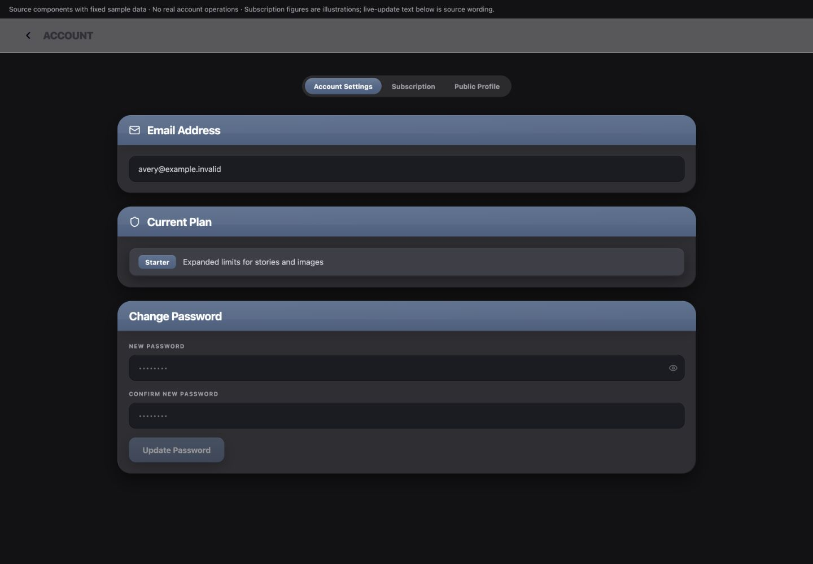
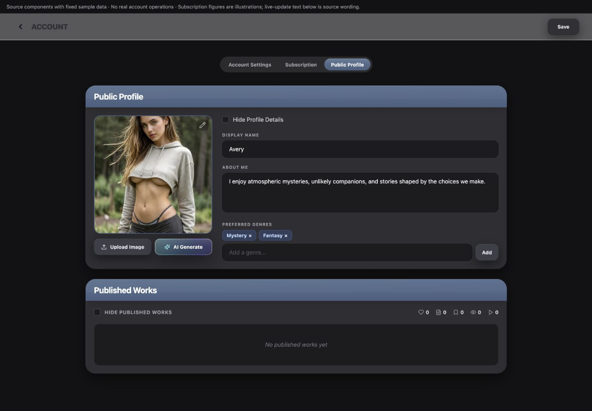
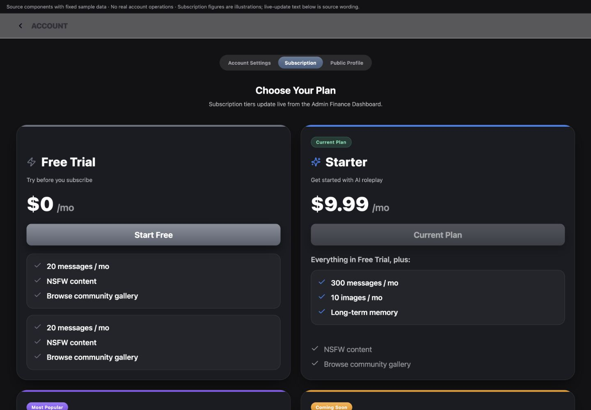
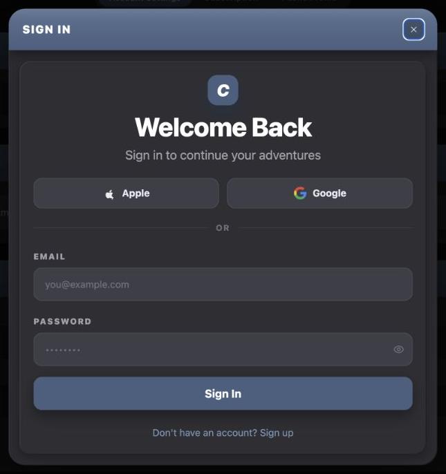
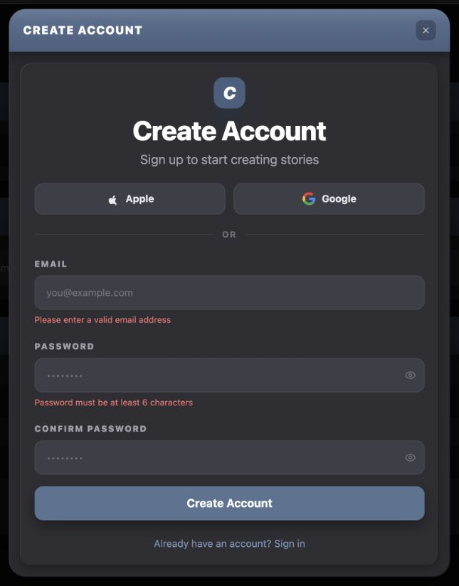
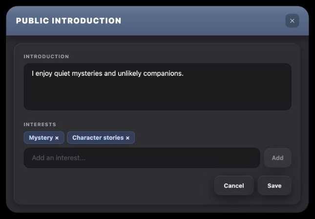
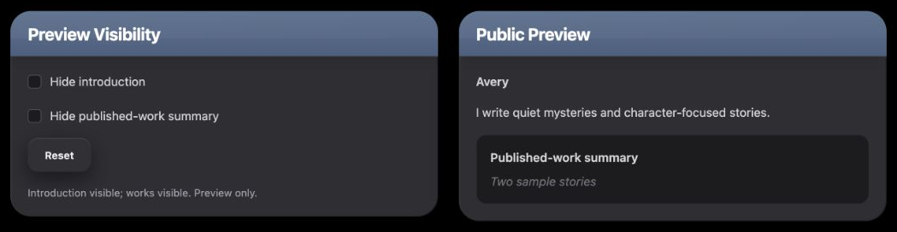

# Account & Access UI Reference

A practical menu of patterns for designing new UI that belongs in Chronicle's account settings, editable profile and access forms.

## Overview

### Designing with Account & Access's UI Language

Account combines slate-headed form sections, an editable public profile and accent-colored plan cards. Authentication is a separate, larger form surface. Their shared graphite palette does not make their fields, buttons or information hierarchy interchangeable.

#### Start with the User's Intent

| If the request is… | Start with… | Then combine… |
| --- | --- | --- |
| “Let me update an account value.” | Account section shell/header/body | Its recessed fields, slate 44px submit and explicit status message. |
| “Let me describe myself publicly.” | Public Profile's form family | Profile fields, independent privacy checkboxes, removable interest chips and the shared Save action. |
| “Let me change a profile image.” | Public Profile's square image treatment | Imported AvatarActionButtons and the separate reposition interaction. |
| “Compare available levels.” | Subscription's accent-card family | Current/unavailable badges, emphasized new features and quieter inherited items. |
| “Let me sign in or create an account.” | Existing AuthModal composition | Its 48px elevated fields, provider choices, mode-specific validation and busy behavior. |
| “Keep a public introduction draft in a separate editor.” | Auth's modal enclosure plus Profile's recessed fields/chips | A working copy and explicit Save/Cancel, without importing authentication behavior. |
| “Show me what two independent privacy choices do.” | Profile section/checkbox family | A local preview and immediate changes with Reset. |

#### Compose a New Design

Choose the interaction first, then select its complete surface and control family. Account's form panels use a 20px mixed-case title, while authentication uses a 16px uppercase header and a larger interior welcome heading. Profile fields have different fill, padding and focus edges from both password settings and authentication. A new account editor should not acquire a subscription-card accent simply because both appear under Account.

The account page owns three pills and a shared Back/Account header. Public Profile registers its Save callback with that header; it does not render an additional Save beneath every field. The visitor-facing Creator Profile page is a different region. This reference covers the owner's editor and access forms.

#### What Stays Consistent, and What Can Change

| Decision | Carry forward | Adapt to the concept |
| --- | --- | --- |
| Account/Profile sections | Graphite 24px shell, slate header, diagonal sheen and attached lower body. | Section count, width and field grouping. |
| Fields | The selected family's fill, edge, focus, label and text rules. | Field meaning, length limits and multiline height according to requirements. |
| Actions | Shared neutral Save, local gray Add, slate password/auth submit, imported layered AI image action. | Label, callback and appropriate pending/error behavior. |
| Subscription | Distinct 26px card, accent hierarchy and current/unavailable treatment. | Content and grid count; example prices and accents are data, not global theme tokens. |
| Profile layout | From medium, preserve the source avatar/form split with a shrinking form column. | New widgets can use their own responsive arrangement without changing that source page constraint. |
| State | Separate draft fields, independently persisted media changes, immediate previews and access submissions. | New transaction boundaries when explicitly chosen and implemented. |

#### Using This Reference as a Coding Agent

Identify the requested behavior, borrow the complete named recipes, and adapt only the layout or state responsibilities the new task requires. Shared components supply their declared styling and mechanics; local class variables are not exported components. Essential construction is described here so implementing a new field or modal does not require reconstructing unrelated account logic.

Source specimens use fixed local profile/config data and isolated service boundaries. They do not access a real account, authenticate, change a password, upload an avatar, save a public profile or purchase a plan. New compositions use local state. Source styling, specimen observations and proposed behavior remain distinct.

#### Account in Context

<figure class="source-preview"><div class="capture-background"></div><figcaption>Account Settings presentation with synthetic data. The email is a styled static value, not a disabled editable field.</figcaption></figure>

Index supplies a scrolling `#121214` canvas, 16px outer padding → 24px at small → 40px at large. Account Settings and Public Profile max at 1024px with 24px section gaps. Subscription maxes at 1480px. AppShellTopBar supplies Back/Account, plus the ordinary Save/Saving command only for the profile editor.

<p class="source-line">Source: <code>src/pages/Index.tsx</code> · lines 1237–1289 and 1424; <code>src/components/app-shell/AppShellTopBar.tsx</code> · account branches; <code>src/components/account/AccountSettingsTab.tsx</code>; <code>src/components/account/PublicProfileTab.tsx</code>; <code>src/components/account/SubscriptionTab.tsx</code>; <code>src/App.tsx</code> · auth and creator routes.</p>

## Color Palette

### Color Palette

| Visible role | Exact treatment | When it applies |
| --- | --- | --- |
| Account canvas / pill rail | `#121214` / `#2b2b2e`. | Account page framing. |
| Section shell / attached body | `#2a2a2f` / `#2e2e33`. | Account and Profile sections. |
| Slate header | Vertical `#5a7292` → `#4a5f7f`. | Section headings; Auth uses its own sheen/shadow variant. |
| Account field | `#1b1c21`, black/45 edge, zinc-500 placeholder. | Password settings and static email frame. |
| Profile field | `#1c1c1f`, black/35 edge, zinc-600 placeholder. | Profile text/genres and the new introduction example. |
| Auth field / social action | `#3c3e47`, white/10 edge. | Elevated access controls. |
| Auth submit | `#4a5f7f` → `#5a7292` hover. | Solid slate access action. |
| Profile Add | `#3c3e47` → `#44464f`, `#eaedf1` text. | Local list addition. |
| Shared neutral Save/Reset | `#303035` → `#343439`, `#eaedf1`. | Imported ChronicleSurfaceButton family. |
| Checked privacy control | Blue-500 fill, `#60a5fa` edge, white check. | Profile's caller-styled Checkbox. |
| Interest chip | Blue-500/20 fill, blue-400/25 edge, blue-200 text. | Profile's removable genre family. |
| Status | Emerald-500/15 + /30 border + emerald-300; rose equivalents for failure. | Password form status boxes. |
| Access error | Red-400 text. | Auth's field/form messages, with no invented alert box. |
| Pricing card | `#1b1c22`/95, white/10 edge, configured accent. | Subscription comparison, not ordinary account panels. |
| Unavailable pricing action | Glossy `#62656f` at .62 opacity. | Current/Coming Soon; no blanket 50% rule. |

Labels in Account/Profile use zinc-400; ordinary field content is white and static/supporting values zinc-300. Auth labels/helpers use `#a1a1aa`, field placeholders zinc-500, and its mode-switch action is `#7a92b5` → `#9bb5da`. These are component-specific values, not aliases for a universal muted token.

<p class="source-line">Source: <code>src/components/account/AccountSettingsTab.tsx</code> · local class variables and status; <code>src/components/account/PublicProfileTab.tsx</code> · panel/field/checkbox/chip classes; <code>src/components/account/SubscriptionTab.tsx</code>; <code>src/components/auth/AuthModal.tsx</code>; <code>src/components/chronicle/chronicle-dark-ui.ts</code>.</p>

## Typography & Spacing

### Typography & Spacing

| Role | Existing construction |
| --- | --- |
| Account section title | 20px bold white, `-.015em` tracking; 20px horizontal / 12px vertical header padding. |
| Section body / separation | 20px body padding; 24px between sections. |
| Account field label | 10px bold zinc-400, uppercase/widest, 8px bottom margin. |
| Profile field label | Same 10px family, 6px label/field gap. |
| Account input | 14px text, 16px horizontal / 12px vertical padding. |
| Profile input / textarea | 14px text, 16px horizontal / 10px vertical padding; About Me fixed 96px, no resize. |
| Profile split | 24px gap; single column below medium, 288px avatar + minmax(0,1fr) form from medium. |
| Genre chip | 12px bold, 10px horizontal / 4px vertical padding; 4px internal gap, 6px between chips. |
| Auth outer title | 16px black weight, uppercase `.08em`; 20px horizontal / 16px vertical header padding. |
| Auth interior hierarchy | 38px extra-bold/leading-none `-.02em` heading; 18px helper after 8px; 44px monogram above. |
| Auth labels / fields | 12px heavy uppercase `.12em`; 6px separation; 48px-high, 14px fields. |
| Subscription title / price | 30px extra-bold tier name, 48px black-weight price; 24px `/mo`. |
| Subscription feature / card | 16px → 18px at medium; 24px body padding/gaps; 16px inset feature boxes. |

Field height, avatar ratio, pricing columns and dialog maximum widths describe their source compositions. They are not universal values for every new account component. Keep the chosen family’s visual proportions while fitting the requested content.

<p class="source-line">Source: <code>src/components/account/AccountSettingsTab.tsx</code>; <code>src/components/account/PublicProfileTab.tsx</code> · lines 431–619; <code>src/components/account/SubscriptionTab.tsx</code> · lines 77–247; <code>src/components/auth/AuthModal.tsx</code> · lines 123–311.</p>

## Buttons & Menus

### Buttons & Menus

<section class="manual-entry">

#### Save, Submit, Add and Image Actions

<section class="reuse-recipe">

##### Use in a New Design

**Ordinary Save:** Import ChronicleSurfaceButton for the 40px/12px-radius neutral family: `#303035` → `#343439`, `#eaedf1`, 12px bold text, pressed scale .95, teal/40 focus ring, disabled 50% opacity/no pointers and three-part action shadow. Add horizontal padding at the call site. Public Profile's shared header uses 24px; the new examples use 20px in their action rows. The header calls the currently registered profile save and disables while it reports Saving. This is not the slate Update Password variant.

**Password submit:** Its complete local treatment is:

```tsx
className="inline-flex h-11 items-center justify-center rounded-xl border-t border-white/20 bg-gradient-to-b from-[#5a7292] to-[#4a5f7f] px-6 text-sm font-bold leading-none text-white shadow-[0_8px_24px_rgba(0,0,0,0.45)] transition-all hover:brightness-105 active:brightness-95 active:scale-[0.99] disabled:opacity-50 disabled:pointer-events-none focus-visible:outline-none focus-visible:ring-2 focus-visible:ring-blue-500/45"
```

It disables for a blank new password or a pending update, with Updating text while pending. It does not disable merely because the confirmation differs; that error appears after submit. Password fields remain editable during that source request.

**Profile Add:** Local native button, 40px high, 12px radius, border 0, 16px horizontal padding, `#3c3e47` → `#44464f`, 12px bold `#eaedf1`/leading-none. Shadow: `0 8px 24px rgba(0,0,0,.45), inset 0 1px 0 rgba(255,255,255,.09), inset 0 -1px 0 rgba(0,0,0,.20)`. Source Add has no explicit focus or disabled treatment and silently ignores blank/exact duplicate entries. The teaching editor adds teal focus and disabled/50% opacity for those unavailable additions.

**Avatar actions:** Import AvatarActionButtons for the complete gray Upload Image and layered teal/violet AI Generate pair. Both are 40px high and 12px radius; Upload uses 12px bold text, 14px icon, the ordinary three-part shadow and teal focus. Generate uses the existing iridescent edge, 2px mask, gradient/sheens, 12px bold text, stronger shadow and violet-400/45 focus. Do not flatten it into one gradient class. The pair stacks below small and becomes horizontal afterward. Upload opens a centered 192px shared menu; the component owns its image-picker-open state, while callers own upload/generation operations and busy flags. Public Profile never updates its outer isGeneratingAvatar flag in this source, so do not promise that button's pending label is exercised there.

**Meaning:** Removal from an interest list is the chip's small × action, blue-100 → red-300. It is not account deletion. A new destructive account operation needs its own confirmed scope; no such feature is represented by these specimens.

</section>
<p class="source-line">Source: <code>src/components/chronicle/ChronicleDarkUi.tsx</code>; <code>src/components/chronicle/chronicle-dark-ui.ts</code>; <code>src/components/app-shell/AppShellTopBar.tsx</code> · profile Save; <code>src/components/account/AccountSettingsTab.tsx</code> · lines 153–158; <code>src/components/account/PublicProfileTab.tsx</code> · genres and AvatarActionButtons caller; <code>src/components/chronicle/AvatarActionButtons.tsx</code>.</p>
</section>

<section class="manual-entry">

#### Account Choices and Access Commands

<section class="reuse-recipe">

##### Use in a New Design

**Account pills:** Index owns the full-radius `#2b2b2e` rail with matching edge, 4px padding, 2px gaps and 32px bottom separation. Each button has 16px horizontal / 6px vertical padding, 12px bold nowrap text, full rounding and top border. Selected: vertical slate gradient `#5a7292` → `#4a5f7f`, white/20 top edge, white text, small shadow and an absolute white/7-to-transparent sheen. Inactive: transparent edge, `#a1a1aa` → `#e4e4e7` hover. Current source is native buttons without tab/selected semantics or a dedicated overflow wrapper; new exclusive selections need explicit semantics and keyboard/focus treatment.

**Access commands:** Social choices are equal-width, 44px-high `#3c3e47` → `#44464f` buttons with white/10 border, 12px radius, 8px icon gap, 20px marks and 14px bold `#eaedf1`. Submit is full-width, 48px high, solid `#4a5f7f` → `#5a7292`, 12px radius, 16px bold white and `0 8px 20px rgba(0,0,0,.35)` shadow. Pending disables fields/social/submit and halves button opacity, replacing submit text with Loading. These source commands have no explicit focus-ring classes. The text mode switch uses the local blue values in Color Palette and 14px text; it changes the same modal's mode.

**Image reposition menu:** When an avatar exists and repositioning is inactive, the Pencil trigger is visible without hover. It has 6px padding, 8px radius, black/30 → black/50 fill, white/70 → white text and 16px glyph, located 8px from top/right at z30. Shared DropdownMenuContent supplies portal, offset, keyboard/dismissal and its 14px-radius gray shell/13px rows; this caller aligns end. Source trigger is unnamed. Reposition's small Done is a different overlay action: 6px radius, black/55 → black/70, white/20 edge, 8px horizontal / 4px vertical padding and 9px bold white. A new use should name its icon trigger rather than inheriting that omission.

</section>
<p class="source-line">Source: <code>src/pages/Index.tsx</code> · account pills; <code>src/components/auth/AuthModal.tsx</code> · social/submit/mode commands; <code>src/components/account/PublicProfileTab.tsx</code> · lines 497–530; <code>src/components/ui/dropdown-menu.tsx</code>.</p>
</section>

## Fields & Controls

### Fields & Controls

<section class="manual-entry">

#### Three Related Field Families

<section class="reuse-recipe">

##### Use in a New Design

These are local native-field styles; the enclosing account components do not export reusable field primitives. Copy the complete applicable appearance or make a narrowly scoped local component. A shared generic Input would not automatically provide these exact values.

```tsx
const accountField = 'w-full bg-[#1b1c21] border border-black/45 rounded-xl px-4 py-3 text-white text-sm placeholder:text-zinc-500 focus:outline-none focus:ring-2 focus:ring-blue-500/20 focus:border-blue-500/80 shadow-[inset_0_1px_0_rgba(255,255,255,0.04)]';
const profileField = 'bg-[#1c1c1f] border border-black/35 rounded-xl px-4 py-2.5 text-white text-sm placeholder:text-zinc-600 focus:outline-none focus:ring-2 focus:ring-blue-500/20 focus:border-blue-500';
const accessField = 'w-full h-12 px-4 bg-[#3c3e47] border border-white/[0.10] rounded-xl text-white placeholder:text-zinc-500 focus:outline-none focus:ring-2 focus:ring-[#4a5f7f] focus:border-transparent text-sm';
```

**Account:** A 10px bold zinc-400 uppercase/widest label sits 8px above the field. Static email is a div with the same recess and padding, zinc-300 text and no focus/placeholder behavior. New password reserves 40px right padding for a 16px Eye at right 12px, vertically centered, zinc-500 → zinc-300. Its source eye has no explicit accessible name; Auth's eyes do. Account's status is a 12px-radius box with 12px horizontal / 8px vertical padding, 14px semibold text, emerald or rose fill/edge/text from Color Palette. Source validates at least six characters and matching confirmation on submit; these describe existing behavior, not requirements for every new field. Success clears both values; pending changes the submit. The source status div has no live-region semantics.

**Profile:** Caller adds full width or flex-1/min-w-0. Labels use the same 10px family but 6px separation. Display Name caps at 30 characters; About Me caps at 500 and adds `resize-none h-24`. These are actual content limits, not a general size rule. Genre entry has no source maxLength and submits its add operation on Enter. Copying a field's appearance does not imply copying its character limit.

**Auth:** Labels are 12px black weight `#a1a1aa`, uppercase `.12em`, with 6px spacing; form groups are 16px apart. Password fields reserve 44px right padding and have named 16px eyes at right 12px. Form uses noValidate and validates email/password on submit, with an additional confirmation match in sign-up mode. Field errors are 12px red-400; form errors are 14px red-400 centered. Errors do not change the source field border. Enter requests submit except during composition. Pending disables native fields but adds no explicit field-opacity class; password visibility, close and mode controls remain active.

**Ownership and accessibility:** Values, validation, pending state and success/error handling belong to the caller. Most Account/Profile/Auth visible text labels lack htmlFor/id associations, and error text lacks aria-invalid/error associations. New fields should use associated labels, meaningful names and relevant error/status semantics, while retaining the selected appearance. An image or empty styled field is not evidence that saving or authentication works.

</section>
<p class="source-line">Source: <code>src/components/account/AccountSettingsTab.tsx</code> · lines 21–58 and 111–159; <code>src/components/account/PublicProfileTab.tsx</code> · lines 438–440 and 557–619; <code>src/components/auth/AuthModal.tsx</code> · validation and fields.</p>
</section>

<section class="manual-entry">

#### Independent Privacy Choices and Removable Interests

<figure class="source-preview"><div class="capture-background"></div><figcaption>The owner's editor stores visibility preferences; its checkboxes do not hide the editor's own fields or work list.</figcaption></figure>

<section class="reuse-recipe">

##### Use in a New Design

**Checkbox:** Import Checkbox, then apply the profile caller's override:

```tsx
<Checkbox checked={checked} onCheckedChange={value => setChecked(value === true)}
  className="h-4 w-4 rounded-[4px] border border-white/25 bg-[#1c1c1f] text-white data-[state=checked]:border-[#60a5fa] data-[state=checked]:bg-[#3b82f6] data-[state=checked]:text-white" />
```

The shared primitive supplies checked semantics, a 16px check, no-shrink geometry, keyboard interaction, a 2px theme-ring focus outline with 2px background offset, and disabled forbidden-cursor/50% opacity. Caller overrides fill/edge/radius as above, leaving focus inherited. Wrap it in a meaningful label with 10px control/text gap, as the source does. Profile Details text is 14px zinc-300; Works privacy uses 12px bold zinc-400 uppercase/wider. These are independent booleans, not a segmented single choice. A new local preview may update immediately; existing profile checkboxes only update the draft saved by the header.

**Interests:** Copy the genre-chip family: 8px corners, blue-400/25 border, blue-500/20 fill, blue-200 12px bold text, 10px horizontal / 4px vertical padding, 4px internal gap. Chips wrap with 6px gaps. Source × uses blue-100 → red-300 and is not individually named; the new editor supplies names. The local add routine trims input, rejects blank and exact case-sensitive duplicates, adds one entry and clears input. Removal updates only that array. New examples also allow long chips to wrap and explicitly disable unavailable Add.

**Save boundary:** Text, genres and privacy flags are included in Public Profile's registered header Save. Uploading an avatar and completing reposition persist separately. Do not present a whole-profile Cancel operation as reversible unless those independent media writes have been redesigned deliberately. Source Save failures log to console and have no visible confirmation/error panel; new persisted tasks need their own feedback.

</section>
<p class="source-line">Source: <code>src/components/ui/checkbox.tsx</code>; <code>src/components/account/PublicProfileTab.tsx</code> · handleSave, handleRepositionToggle, uploadAvatarFromUrl, addGenre, privacy/chip markup; <code>src/index.css</code> · inherited theme ring/background tokens; <code>docs/ui-guide/examples/account-access-compositions.tsx</code>.</p>
</section>

## Panels & Layout

### Panels & Layout

<section class="manual-entry">

#### Attached Account Sections and Editable Profile Media

<section class="reuse-recipe">

##### Use in a New Design

**Complete section layers:** AccountSettingsTab and PublicProfileTab hold these classes locally. Importing a generic Card does not supply them.

```tsx
const shell = 'w-full bg-[#2a2a2f] rounded-[24px] overflow-hidden shadow-[0_12px_32px_-2px_rgba(0,0,0,0.50),inset_1px_1px_0_rgba(255,255,255,0.09),inset_-1px_-1px_0_rgba(0,0,0,0.35)]';
const header = 'relative overflow-hidden bg-gradient-to-b from-[#5a7292] to-[#4a5f7f] border-t border-white/20 px-5 py-3 flex items-center shadow-lg';
const body = 'p-5 bg-[#2e2e33] rounded-b-[24px] shadow-[inset_1px_1px_0_rgba(255,255,255,0.07),inset_-1px_-1px_0_rgba(0,0,0,0.30),0_4px_12px_rgba(0,0,0,0.25)]';
```

Add an absolute diagonal `bg-gradient-to-tr from-white/10 to-transparent opacity-40` header sheen at 60% height, with relative z1 title/content. Title is 20px bold white with `-.015em` tracking. Account headers with icons use 20px icons and 12px gaps. The body attaches directly beneath the header and rounds only the lower 24px corners; it is not a separately floating 16px tray. The Current Plan summary adds a 12px elevated `#3c3e47` row, black/30 edge, 16px horizontal / 12px vertical padding, 12px gaps and shadow `0 8px 24px rgba(0,0,0,.35), inset 0 1px 0 rgba(255,255,255,.08), inset 0 -1px 0 rgba(0,0,0,.20)`. Its small slate badge uses 8px radius, top white/20 edge, 12px/4px padding and 12px bold white.

**Profile media:** The current form is one column below medium; from medium use `grid-cols-[288px_minmax(0,1fr)]`, 24px gap and min-w-0 in the form. Keep the source constraint that the form shrinks before stacking at medium widths. Avatar max width 288px, square aspect, 16px corners/shadow-lg. Image uses cover and stored object position with a 2px `#4a5f7f` edge. Missing image uses diagonal zinc-800 → zinc-900, a dashed 2px slate edge and 30px bold zinc-500 initials. Reposition declares a 4px blue-500 ring and move cursor with overflow hidden/touchAction none. Pointer/touch handling, image state and saved position belong to the caller, not the image frame.

**Published works:** Keep the same attached section family. Its local summary row wraps with 24px horizontal / 8px vertical gaps; icon/count group uses 16px gaps, 14px icons, 12px text, zinc-400 icons and bold zinc-300 counts. Empty works is a recessed `#1c1c1f` area with 12px radius, white/8 edge, 40px vertical padding and centered 14px italic zinc-500 text. Populated works imports GalleryScenarioCard and ScenarioDetailModal; their Community Gallery family remains applicable. The owner supplies a 2 / small:3 / large:4-column grid with 16px gaps and its callbacks. This reference does not redefine those cards.

**Loading and limitations:** Profile's loading state is centered text in a 256px-high area, `rgba(248,250,252,.3)`. A null user leaves that initial loading state unchanged; no explicit loading-error recovery panel is represented. Visibility checkboxes do not hide this editing interface. The source image operation and header Save are different persistence paths.

</section>
<p class="source-line">Source: <code>src/components/account/AccountSettingsTab.tsx</code> · local classes and Current Plan; <code>src/components/account/PublicProfileTab.tsx</code> · lines 424–714 and handlers; <code>src/components/chronicle/GalleryStoryCard.tsx</code>; <code>src/components/chronicle/StoryDetailModal.tsx</code>.</p>
</section>

<section class="manual-entry">

#### Subscription Comparison Cards

<figure class="source-preview"><div class="capture-background"></div><figcaption>Existing card presentation with fixed illustrative configuration. Prices, limits and accents here are not verified live commercial terms; buttons have no checkout handler in the current source.</figcaption></figure>

<section class="reuse-recipe">

##### Use in a New Design

**Construction:** Max 1480px centered region, centered 24px bold white heading with 14px `rgba(248,250,252,.7)` helper and 40px bottom separation. Grid is one column → two at large → four at 2xl, with 24px gaps. Card: relative flex column, overflow-hidden, 26px radius, white/10 border, `#1b1c22`/95 and `0 16px 38px -10px rgba(0,0,0,.6)` shadow. Add a 4px top strip in the configured accent and a 24px-padded flex body. This card deliberately differs from an account form shell.

**Hierarchy:** Reserve at least 28px for wrapping badges. Current Plan: full radius, emerald-500/35 edge, /20 fill, emerald-300 11px bold/wide text and 12px horizontal /4px vertical padding. Promotional badges use the same geometry/text size but white text over `linear-gradient(180deg, rgba(255,255,255,.20) 0%, rgba(255,255,255,.06) 42%, rgba(0,0,0,.16) 100%), <accent>`. Tier identity uses a 24px accent icon, 12px gap, 30px extra-bold white name; subtitle 14px white/65, price 48px heavy/leading-none white, `/mo`24px semibold white/55.

**Action:** Full width, 12px radius, white/20 top edge, 16px horizontal /12px vertical padding, 20px bold white, shadow `0 10px 26px rgba(0,0,0,.42)`, hover brightness 105%, active 95%. Available uses the promotional gloss above its accent. Current/Coming Soon uses `linear-gradient(180deg, rgba(255,255,255,.08) 0%, rgba(255,255,255,.02) 42%, rgba(0,0,0,.18) 100%), #62656f`, .62 opacity and forbidden cursor. No explicit focus ring is supplied. The native disabled value identifies current/Coming Soon. Even enabled-looking source actions have no onClick: this is presentation, not a purchase or upgrade flow.

**Features:** New-feature inset is white/4 with white/10 edge, 16px radius/padding, 20px accent checks and 12px icon gap. Text 16px →18px at medium, semibold white/snug. Inherited features use white/55 and normal weight with 8px row gaps, pushed toward the bottom; the “Everything in…” sentence is 18px semibold white/75. The first tier currently receives both the general new-feature box and its special first-tier box, so some details repeat. This source quirk is not a rule for new comparison components.

**Ownership/adaptation:** Data/config owns prices, accents, badge text and availability. The source starts with defaults while loading and shows a 12px white/45 loading sentence below the cards. Examples cannot establish live pricing or checkout. New comparisons can choose different card counts/content while retaining the chosen accent hierarchy; ordinary settings should retain their own neutral/slate family.

</section>
<p class="source-line">Source: <code>src/components/account/SubscriptionTab.tsx</code> · lines 35–258; <code>src/services/subscription-tier-config.ts</code> · configuration interface/defaults/loader.</p>
</section>

<section class="manual-entry">

#### Authentication's Separate Form Surface

<figure class="source-preview"><div class="capture-background"></div><figcaption>Actual access-form presentation behind local authentication boundaries. No real identity provider or account request is performed.</figcaption></figure>

<figure class="source-preview"><div class="capture-background"></div><figcaption>Source validation presentation. Mode switching changes this same dialog; it is not a second modal family.</figcaption></figure>

<section class="reuse-recipe">

##### Use in a New Design

**Container:** DialogContentBare supplies portal, black/80 backdrop, centered positioning, 200ms animations and modal focus/dismissal mechanics. It does not supply a styled shell or default close. Auth caller sets `w-[min(95vw,620px)] max-w-none`, then adds a 24px-radius `#2a2a2f` overflow-hidden shell with `0 20px 50px rgba(0,0,0,.55), inset 1px 1px 0 rgba(255,255,255,.09), inset -1px -1px 0 rgba(0,0,0,.35)` shadow. Source has no maximum-height scrolling treatment. At a 390×700px local viewport, the 799px sign-up/error dialog extended roughly49px beyond the top and bottom, clipping its header and lower controls. New content that can exceed its viewport must provide a height cap and scrolling rather than inheriting that limitation.

**Header/tray:** Vertical slate header, `0 6px 16px rgba(0,0,0,.35)` shadow and white/7 vertical sheen sized to the upper 30%, no-repeat. Header has 20px horizontal/16px vertical padding, 10px content gap, 16px uppercase black-weight title `.08em`; custom named X is 28px square, 8px radius, black/25 →black/40 and 14px white/70 glyph. An outer 16px body contains a 16px-radius `#2e2e33` tray with 20px padding and the full inset-tray shadow shown for attached section bodies. This tray is inset all round, unlike the attached Account/Profile body.

**Identity/content:** Centered 44px monogram, 14px radius, slate `#4a5f7f`, 24px black-weight italic C, shadow `0 12px 24px rgba(37,53,76,.5)`; it is a brand mark, not a copy control. Interior 38px heading and 18px helper precede providers and fields. Provider/“or” groups use 20px bottom spacing; divider lines white/8, 12px gap, separator 12px bold uppercase `.12em` `#71717a`. A new profile editor can reuse the enclosure without copying a sign-in welcome/brand block that has no role in its task.

**State/caller:** AuthModal receives open/onClose and uses auth providers internally. Sign-up adds confirmation and mode-specific title/action. Manual dismissal clears fields/errors and returns to sign-in; success calls parent close directly. Close/mode/visibility remain active while submit is loading. Source does not provide a password-recovery screen or success-confirmation panel. Its hidden semantic DialogTitle names the modal; a hidden description exists, but aria-describedby is explicitly unset on the content. New dialogs should supply meaningful associated title/description and names rather than importing that omission.

**Adapt:** Shell width, body arrangement and text depend on the new task. Preserve the selected layer family and its control differences. A separate editor must implement its own working copy and discard behavior; it must not call authentication handlers merely because it borrows this shell.

</section>
<p class="source-line">Source: <code>src/components/auth/AuthModal.tsx</code>; <code>src/components/ui/dialog.tsx</code>; <code>src/pages/Index.tsx</code> · AuthModal mount.</p>
</section>

## Composition Examples

### Composition Examples

These proposed examples combine the account/access patterns into new tasks with explicit local behavior. They are not current profile features or real account mutations.

<section class="manual-entry">

#### New Public Introduction Editor

**Requested behavior:** “Let me edit a short public introduction and a list of interests in a separate editor. Save keeps changes and Cancel discards them.”

<figure class="source-preview"><div class="capture-background"><picture><source media="(max-width:600px)" srcset="../../src/assets/ui-guide/account-access/new-intro-narrow.png"></picture></div><figcaption>New composition with a local working copy. Its shell is inherited from access forms; its contents and Save behavior come from the editing task.</figcaption></figure>

| Requirement | Inherited pattern | Deliberate adaptation |
| --- | --- | --- |
| Separate editor | Auth's bare-dialog shell, slate header and inset tray. | Named title/description, viewport margin/height cap, no sign-in identity block. |
| Short introduction | Profile's complete recessed field and 10px label. | Associated textarea, fixed 96px height and illustrative 500-character limit. |
| Maintain interests | Profile's genre entry/Add/chips. | Named remove actions, wrapping long text and disabled unavailable Add. |
| Keep or discard | Shared neutral Save command. | Saved values plus draft; dismissal rolls back only this local editor. |

<section class="reuse-recipe">

##### Use in a New Design

**Construction:** Use Dialog/Trigger/BareContent with the full Auth shell/header/tray recipe, a visible semantic 16px uppercase DialogTitle and hidden associated description. Set `w-[calc(100vw-32px)] max-w-[620px] max-h-[calc(100vh-32px)] overflow-y-auto` so this new editor fits with 16px margins. Named X uses the source 28px treatment plus the shared teal/40 focus ring. Omit authentication's brand/welcome/provider content because this is an editor.

Import the Profile field appearance from the complete fragment in Fields & Controls, adding `w-full h-24 resize-none` to the textarea. Use associated 10px bold zinc-400 uppercase/widest labels with 6px spacing. The interest input is min-w-0/flex-1 beside the 40px gray Add. Chips retain the exact Profile fill/border/type/radius and get named × buttons, break-words text and no-shrink remove icons. Native Add/remove/X receive `focus-visible:outline-none focus-visible:ring-2 focus-visible:ring-[hsl(var(--accent-teal))]/40`; unavailable Add uses disabled/no-pointers/50% opacity. Import ChronicleSurfaceButton for Save/Cancel, with 20px side padding in a wrapping end-aligned 8px-gap row.

**State:** Opening copies the saved introduction/interests into a draft and clears the pending interest input. Add trims and rejects blank/exact duplicates; Enter adds rather than saving the whole editor. Removing a chip changes only the draft. Save stores that draft locally and closes. Cancel/X/Escape/outside close leave saved values unchanged; reopening restores them. Blank introduction is allowed. The 500-character limit is the example's chosen reuse of Profile's About Me limit, not a new global rule. No profile/media service runs.

**Local check:** Enter and Add created chips, exact duplicates disabled Add, Save retained the introduction and chips on reopening, and edited text/removal followed by Cancel restored both. Escape returned focus to the trigger. Desktop and390px views were inspected; the narrow shell was358px wide without horizontal overflow.

**Keep and adapt:** Carry the enclosure, field/chip/action styling and explicit transaction. Width, labels, limits and arrangement can change with the new requirement. The existing profile page has independent media writes; this example intentionally does not include image changes in its discard promise.

```tsx
<ProfileIntroExample />
```

</section>
<p class="source-line">Source: <code>docs/ui-guide/examples/account-access-compositions.tsx</code> · ProfileIntroExample; inherited owners <code>src/components/auth/AuthModal.tsx</code>, <code>src/components/account/PublicProfileTab.tsx</code>, <code>src/components/chronicle/ChronicleDarkUi.tsx</code> and <code>src/components/ui/dialog.tsx</code>.</p>
</section>

<section class="manual-entry">

#### New Immediate Privacy Preview

**Requested behavior:** “Let me preview independently hiding my introduction and published-work summary, apply visibility changes immediately, and reset both while the preview stays visible.”

<figure class="source-preview"><div class="capture-background"><picture><source media="(max-width:600px)" srcset="../../src/assets/ui-guide/account-access/new-privacy-narrow.png"></picture></div><figcaption>New inline preview. Current profile settings do not hide their own editor; this composition explicitly adds an immediate illustration.</figcaption></figure>

| Requirement | Inherited pattern | Deliberate adaptation |
| --- | --- | --- |
| Keep preview visible | Two attached Account/Profile sections. | One named inline widget with separate controls and illustration. |
| Two independent choices | Imported Checkbox with Profile's caller styling. | Wrapped descriptive labels; checked means hide the corresponding preview part. |
| Apply immediately / reset | Local controlled booleans; shared ordinary action family. | Reset makes both parts visible; there is no Save, Cancel or modal. |

<section class="reuse-recipe">

##### Use in a New Design

**Construction:** Use the complete 24px shell/slate header/attached 20px body classes from Panels & Layout. Both titles keep 20px bold white `-.015em`, diagonal sheen at 60% height and source shadows. The sample widget is max 1024px with 24px gaps, one column below large and two afterward; this is a chosen widget arrangement, not a change to the source avatar/form split. Wrap each imported, profile-styled Checkbox in a descriptive label, 10px gap and 14px zinc-300 text. Inherited checkbox focus/disabled behavior remains intact.

The preview body uses 14px zinc-300 text. Its works summary borrows the empty-work recess: `#1c1c1f`, white/8 edge and 12px radius, with 16px padding chosen for this compact summary. Its supporting sentence is 14px italic zinc-500. Reset imports ChronicleSurfaceButton with 20px side padding. A 12px zinc-400 status states which sections are visible.

**State:** Both hide values start false, so both preview portions are visible. Each checkbox independently updates its corresponding portion; Reset sets both false without closing the preview. No draft, submission, public-profile write or persistence is implied. Source privacy controls instead prepare values for header Save, so actual immediate persistence would be an additional caller decision.

**Local check:** Each named checkbox affected only its corresponding preview. Keyboard Space worked, and Reset restored both. Checked fill/edge resolved to rgb(59,130,246)/rgb(96,165,250); keyboard focus retained the shared2px white offset and2px dark theme ring. At390px the widget stacked without horizontal overflow.

**Keep and adapt:** Preserve panel layers, checkbox variant, type, ordinary action and recess. Choose preview content, width and column arrangement to fit the actual concept. An independent boolean should not be replaced with a mutually exclusive pill selection.

```tsx
<PrivacyPreviewExample />
```

</section>
<p class="source-line">Source: <code>docs/ui-guide/examples/account-access-compositions.tsx</code> · PrivacyPreviewExample; inherited owners <code>src/components/account/PublicProfileTab.tsx</code>, <code>src/components/ui/checkbox.tsx</code>, <code>src/components/chronicle/ChronicleDarkUi.tsx</code> and <code>src/components/account/AccountSettingsTab.tsx</code>.</p>

<details class="implementation"><summary>Supporting source</summary>

```tsx
const [hideIntro, setHideIntro] = useState(false);
const [hideWorks, setHideWorks] = useState(false);
// Each checkbox affects only its preview portion. Reset sets both false; no service callback.
```

</details>
</section>
