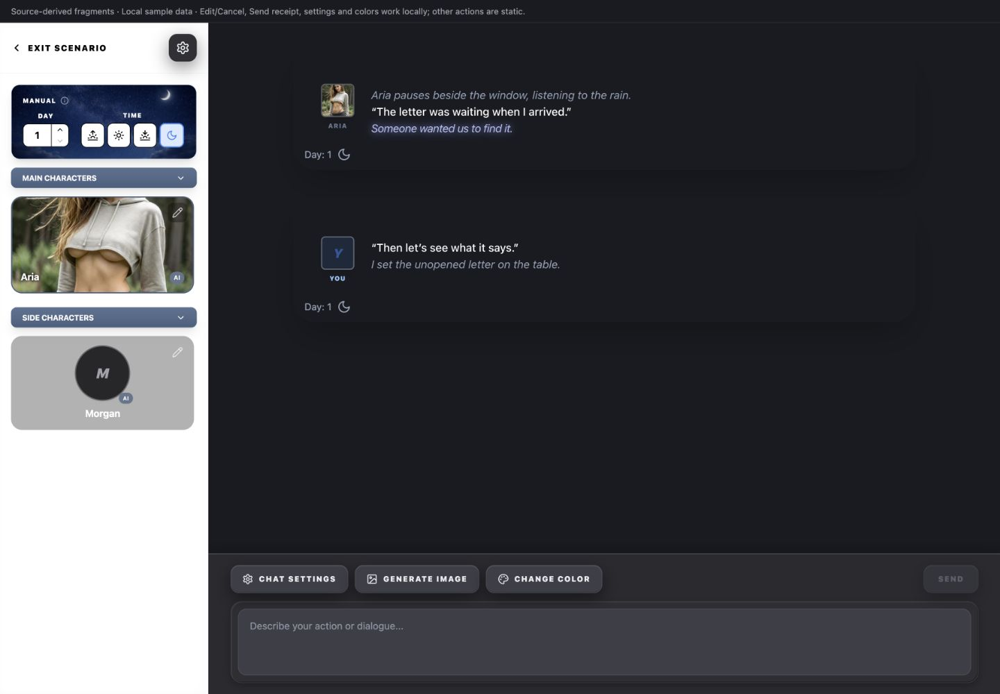
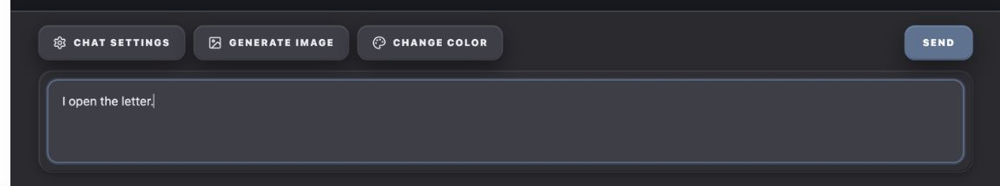
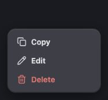
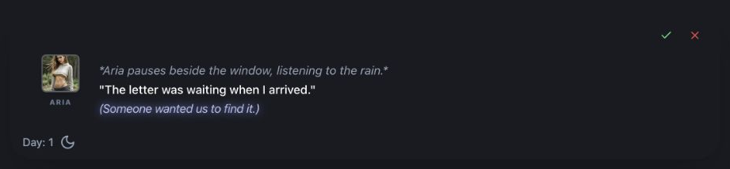
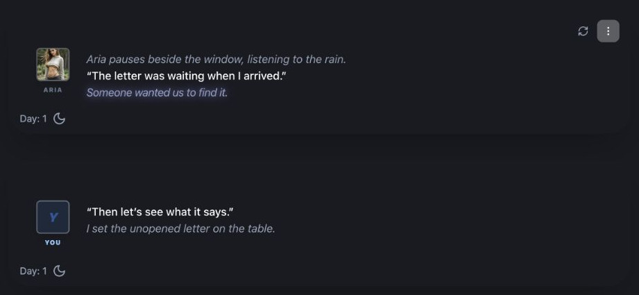
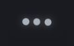
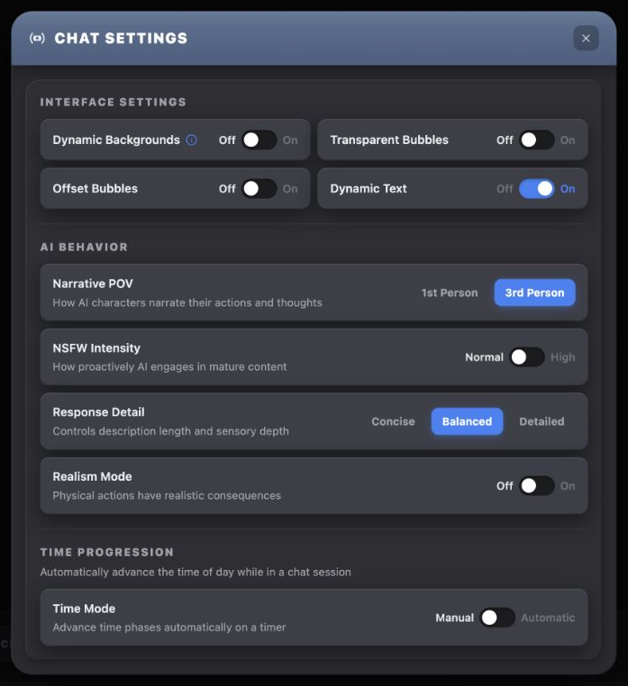
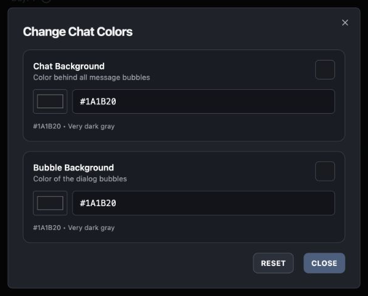
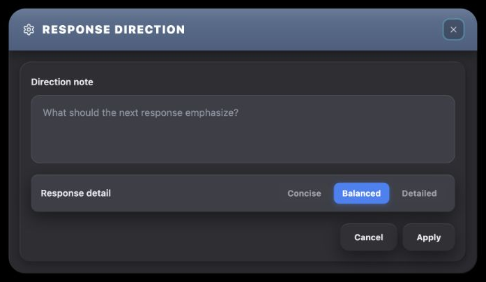
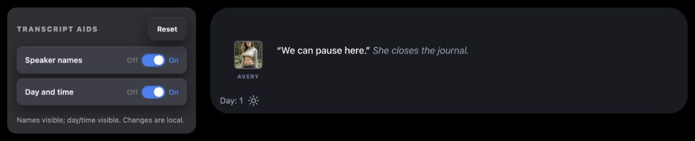

# Active Roleplay UI Reference

A practical menu of patterns for designing new UI that belongs in Chronicle's active conversation workspace.

## Overview

### Designing with Active Roleplay's UI Language

Active Roleplay combines a fixed character sidebar with a scrolling transcript and docked composer. Its message bubbles, speaker wrapping, quiet quick actions and settings surfaces form a distinct page language. It is not another poster-card library or Story Builder form.

#### Start with the User's Intent

| If the request is… | Start with… | Then combine… |
| --- | --- | --- |
| “Add information to the conversation.” | Shared transcript and message-bubble construction | Float-based speaker identity, formatted text and quiet message actions. |
| “Let me revise a spoken response.” | In-place formatted editor | Every visible speaker segment, explicit Save/Cancel and a caller-owned draft. |
| “Add a command near the prompt.” | Existing gray quick-action family | Named icon/label, appropriate disabled/pending state and caller-owned operation. |
| “Let me send a player turn.” | Slate Send variant | Composer field, availability guard and streaming state. |
| “Let me set several behavior choices.” | Chat Settings shell/tray/rows | Independent labeled toggles or exclusive blue choices, according to meaning. |
| “Let me adjust a small color preference.” | Compact Change Chat Colors family | Native color/hex controls, immediate updates and Reset/Close. |
| “Let me keep a staged response note.” | Settings surface plus composer-field appearance | Associated note label, working values, explicit Apply/Cancel. |
| “Let me show or hide transcript details immediately.” | Compact inline settings tray | Independent switches and a live message preview, with Reset. |

#### Compose a New Design

Choose whether the request belongs inside a message, in the docked composer, alongside the transcript or in a separate task. Keep the selected family's surface, type, controls and states together. The same page contains large message bubbles, smaller settings rows and a separate compact color editor; making them all one generic dark card loses useful distinctions.

The actual sidebar is a fixed 300px split pane. Current source explicitly preserves a horizontal layout: the transcript shrinks first. Do not stack this sidebar above the transcript when adding a feature. Internal form rows, a new widget's controls or a teaching example may wrap to fit without changing that application-level arrangement.

#### What Stays Consistent, and What Can Change

| Decision | Carry forward | Adapt to the concept |
| --- | --- | --- |
| Workspace | Fixed sidebar, separately scrolling transcript and docked composer; scene image belongs behind transcript only. | Content within each region, subject to the fixed split-pane constraint. |
| Message construction | 32px bubble, float-based speaker identity, speech/action/thought distinctions and space for actions/day-time. | Message width, amount of content and documented centered/offset mode. |
| Commands | Gray quick actions, distinct slate Send, quiet message commands and explicit destructive red. | Label, icon and callback; an AI operation does not automatically become a gradient button. |
| Settings layers | Graphite 24px shell, slate title, inset 16px tray, elevated 10px rows. | Width, row arrangement and staged versus immediate state when explicitly specified. |
| Compact color family | Blue-gray shell/edge, inset subpanels, native controls and small local actions. | Number of related preferences; it is not the default appearance for every settings task. |
| Ownership | Shared display primitives and tokens supply their named portions. | Data, working copies, validation, persistence and asynchronous feedback belong to the caller. |

#### Using This Reference as a Coding Agent

Identify the interaction, borrow complete construction fragments, then adapt the arrangement within the stated boundaries. Source labels identify the current owners; essential instructions stay in ordinary text. Existing behavior, source limitations and proposed teaching compositions are distinguished throughout.

The specimens reproduce selected ChatInterfaceTab markup with local data and import the real presentation components. They do not mount the full runtime, load a user's conversation, invoke AI, save preferences, upload media or establish remote failure recovery. New examples use local state. A source declaration and a rendered observation are separate evidence.

#### Active Conversation in Context

<figure class="source-preview"><div class="capture-background"></div><figcaption>Selected source markup with local data and imported display components. This is a styling specimen, not a running conversation.</figcaption></figure>

ChatInterfaceTab owns the split layout and most local compositions. AppShellTopBar is hidden for this region; Exit Scenario and the scenario-settings cog live in the sidebar. Index supplies story/conversation/model data and update/navigation callbacks. Main character tiles and generated side-character cards are different shapes; neither should be replaced with a generic avatar list.

<p class="source-line">Source: <code>src/components/chronicle/ChatInterfaceTab.tsx</code> · lines 7339–7614 and 8002–8067; <code>src/features/chat-runtime/avatar-position.ts</code> · CHAT_SIDEBAR_WIDTH; <code>src/components/app-shell/AppShellTopBar.tsx</code> · chat_interface branch; <code>src/pages/Index.tsx</code> · lines 1164–1226.</p>

## Color Palette

### Color Palette

| Visible role | Applicable treatment | Owner |
| --- | --- | --- |
| Canvas / ordinary bubble | Configurable color, each defaulting to `#1a1b20`; inline canvas color wins over the conditional bg-slate-900 class. | ChatInterfaceTab |
| Transparent bubble | Black/50 instead of the custom bubble fill. | ChatInterfaceTab |
| Scene overlay | Black/20 above the optional cover image; transcript area only. | ChatInterfaceTab |
| Composer / settings shell | `#2a2a2f`. | ChatInterfaceTab |
| Composer / settings tray | `#2e2e33`. | ChatInterfaceTab |
| Quick action / settings row / composer field | `#3c3e47`, with control-specific edges and shadows. | Local markup / shared constants / ChatSpellcheckTextarea |
| Quick-action hover | `#44464f`; ordinary sidebar cog instead uses `#303035` → `#343439`. | ChatInterfaceTab |
| Enabled Send | `#5a7292` fill, `#5f7ca7` edge, white text; hover `#6884ab`. | ChatInterfaceTab |
| Disabled Send | `#3c3e47`, white/10 edge, `#8f95a3`, 50% opacity. | ChatInterfaceTab |
| Selected setting | Blue `#3b82f6` / white, blue shadow; inactive `#3f3f46` / `#a1a1aa`. | Chat Settings choice buttons |
| Speech / action / thought | White medium; slate-400 italic; indigo-200/90 italic with glow. | FormattedMessage |
| Speaker name | User blue-300; AI slate-500. | ChatInterfaceTab |
| Compact color editor | Shell `#1f222b`, edge `#3a4152`, subpanel `#191c24`, hex-input `#12141b`. | Change Chat Colors markup |
| Quiet destructive / edit commands | Menu Delete red-400; inline Cancel red-500 → red-400; inline Save green-400 → green-300. | ChatInterfaceTab |

Generate Image uses the same gray quick-action family as Chat Settings and Change Color. It does not inherit Story Builder's gradient AI button. Send's slate fill means a ready player turn; blue setting choices mean selected preference values. These meanings should remain distinct.

Ghost-white is the shared root token `210 33% 98% / .30`, not opaque white. The source uses it for avatar/divider edges and quiet hover fills. Shared dialog/menu/tooltip primitives also retain theme tokens where their caller does not override them; follow the named component's actual variant.

<p class="source-line">Source: <code>src/components/chronicle/ChatInterfaceTab.tsx</code> · defaults, message actions, composer and settings; <code>src/components/chronicle/chronicle-dark-ui.ts</code>; <code>src/features/chat-runtime/message-formatting.tsx</code>; <code>src/components/chronicle/ChatSpellcheckTextarea.tsx</code>; <code>src/index.css</code> · ghost-white and theme tokens.</p>

## Typography & Spacing

### Typography & Spacing

| Role | Existing rule |
| --- | --- |
| Transcript | 24px horizontal / 32px vertical padding; horizontal grows to 56px at medium and 80px at large; 40px between message wrappers. |
| Message wrapper | Centered max 896px; offset mode max 768px, assistant left and player right. |
| Bubble | 32px corners, 32px horizontal, 56px top / 48px bottom padding, 16px internal gap. |
| Speaker column | Float left, 64px width, 16px right / 8px bottom margin; 6px between avatar and name. |
| Avatar / name | 48px square, 6px corners, 2px ghost-white border; name 9px black weight, uppercase/widest, centered/truncated. |
| New speaker segment | 10px top margin and padding with a ghost-white divider; clear the float after each segment. |
| Read-only message | Size/line-height inherit from its parent. FormattedMessage supplies token treatment, not a fixed font size. |
| Inline editor | 15px, relaxed leading, minimum 24px height, 6px corners, -4px horizontal margin / 4px padding. |
| Day/time | Bottom 12px / left 16px; 14px slate-400, 8px gap; 20px time icon. |
| Quick actions | 11px black weight, uppercase, `.12em` tracking; 40px height, 16px side padding and 8px icon/text gap. |
| Composer text | 14px/24px, 16px horizontal / 12px vertical inset. |
| Settings title | 16px black weight, uppercase, `.08em` tracking; 20px horizontal / 16px vertical header inset. |
| Settings group / row | Group 12px black weight `#a1a1aa`, uppercase `.12em`; row 13px semibold `#eaedf1`, helper 12px `#a1a1aa` after 2px. |
| Setting choices | 12px bold; 12px horizontal / 6px vertical inset and 6px gaps. |

Float-based speaker wrapping is important: text can continue underneath the avatar once it is tall enough. A permanent two-column grid would change this behavior. Long-message editing must preserve every speaker segment, its avatar and formatting rather than collapsing into one plain field.

<p class="source-line">Source: <code>src/components/chronicle/chronicle-dark-ui.ts</code> · transcript/message/speaker/day-time constants; <code>src/components/chronicle/ChatInterfaceTab.tsx</code> · lines 7848–7890, 8002–8067 and settings rows; <code>src/features/chat-runtime/message-formatting.tsx</code> · InlineFormattedMessageEditor.</p>

## Buttons & Menus

### Buttons & Menus

<section class="manual-entry">

#### Composer Quick Actions and Send

<figure class="source-preview"><div class="capture-background"></div><figcaption>Existing action families with local callbacks. No scene generation or message submission reaches a service.</figcaption></figure>

<section class="reuse-recipe">

##### Use in a New Design

**Quick actions:** Import CHRONICLE_CHAT_QUICK_ACTION_CLASS from chronicle-dark-ui. It supplies 40px height, 12px radius, 16px horizontal padding, 8px content gap, white/10 border, `#3c3e47` → `#44464f`, 11px heavy uppercase `.12em` text and `#eaedf1`. Shadow: `0 8px 24px rgba(0,0,0,.45), inset 0 1px 0 rgba(255,255,255,.09), inset 0 -1px 0 rgba(0,0,0,.20)`. Pressed scale .95; disabled no-pointer/50% opacity. The caller supplies the 16px icon, label, disabled value and callback. This constant has no explicit focus-visible treatment; new uses should add one, such as the existing sidebar cog's 2px accent-teal/40 ring.

**Send:** Its complete enabled family is the common geometry below plus the enabled class fragment. The disabled branch changes fill, border, text and shadow, not only opacity.

```tsx
const geometry = 'inline-flex h-10 w-full items-center justify-center gap-2 rounded-xl border px-5 text-[11px] font-black uppercase tracking-[0.12em] transition-colors active:scale-95 disabled:pointer-events-none sm:ml-auto sm:w-auto';
const ready = 'border-[#5f7ca7] bg-[#5a7292] text-white shadow-[0_10px_28px_rgba(0,0,0,0.42),inset_0_1px_0_rgba(255,255,255,0.16),inset_0_-1px_0_rgba(0,0,0,0.26)] hover:bg-[#6884ab]';
const unavailable = 'border-white/[0.10] bg-[#3c3e47] text-[#8f95a3] opacity-50 shadow-[0_8px_24px_rgba(0,0,0,0.45),inset_0_1px_0_rgba(255,255,255,0.09),inset_0_-1px_0_rgba(0,0,0,0.20)]';
```

**State and caller:** Send disables for a blank trimmed prompt, streaming or unavailable canonical chat state; streaming displays `...`. Generate Image disables during generation or when the conversation has no messages, changing to a Loader2 and “Generating...”. These callbacks do different work even though the quick actions share styling. The text field itself has no disabled prop; its submit handler must guard availability. Do not infer remote success or error recovery from a local disabled/button-label specimen.

</section>
<p class="source-line">Source: <code>src/components/chronicle/chronicle-dark-ui.ts</code> · CHRONICLE_CHAT_QUICK_ACTION_CLASS; <code>src/components/chronicle/ChatInterfaceTab.tsx</code> · lines 7379–7394 and 8005–8053.</p>
</section>

<section class="manual-entry">

#### Message Actions and Shared Menus

<figure class="source-preview"><div class="capture-background"></div><figcaption>The message menu is a command surface. A spelling-suggestion overlay and a settings form have different construction.</figcaption></figure>

<section class="reuse-recipe">

##### Use in a New Design

**Construction:** The strip is absolute top/right 16px, 4px gaps, normally opacity 0 → 1 on group hover; editing keeps it visible. Ordinary icon buttons have 8px padding/radius, 16px icon, slate-400 → white text and ghost-white hover fill. Continue and Regenerate add disabled 30% opacity. Inline Save uses green-400 → green-300; Cancel uses red-500 → red-400. Source hover reveal has no focus-within counterpart; new commands need keyboard/focus and touch access.

The shared DropdownMenuContent supplies a portal, 4px offset, 14px radius, black/20 edge, `#3c3e47`, 6px padding and the three-part ordinary action shadow. Rows use 9px radius, 10px horizontal / 8px vertical padding, 13px semibold `#eaedf1`; focus white/8 fill and white text, disabled 40% opacity/no pointers. This caller sets align=end and width 160px. Delete overrides normal and focused text to red-400. Icons are 16px with 8px after them. Import the primitives to retain keyboard navigation, dismissal and focus return.

**Meaning and ownership:** Continue belongs to the last non-notice message, Regenerate to eligible assistant messages, and More to messages generally. Copy/Edit/Delete callbacks are local owners in ChatInterfaceTab. Message deletion dispatches directly; the character-deletion confirmation is a different path. The named source UI is not evidence of clipboard, deletion, generation or saved editing success.

**Adapt:** Keep action meaning, subdued placement and complete menu styling. Width and available commands can change. Do not treat a three-dot menu as a form container or reproduce invisible-on-focus actions in a new design.

</section>
<p class="source-line">Source: <code>src/components/chronicle/ChatInterfaceTab.tsx</code> · lines 7656–7753; <code>src/components/ui/dropdown-menu.tsx</code>.</p>
</section>

## Fields & Controls

### Fields & Controls

<section class="manual-entry">

#### Composer Field and In-Place Message Editing

<figure class="source-preview"><div class="capture-background"></div><figcaption>Imported InlineFormattedMessageEditor in a source-derived bubble. Editing remains part of the message layout.</figcaption></figure>

<section class="reuse-recipe">

##### Use in a New Design

**Composer:** ChatSpellcheckTextarea supplies its own appearance and resizing; its caller supplies only the surrounding tray and controlled props. The tray is `#2e2e33`, 16px radius, white/8 border, 10px padding and the exact inset-tray shadow from Panels & Layout. The field is elevated `#3c3e47`, 12px radius, white/10 edge, 16px horizontal / 12px vertical inset, 14px/24px `#eaedf1` text and `#8f95a3` placeholder. Focus sets edge `#6e89ad` plus a 2px `#4a5f7f`/60 ring; native outline is removed. Its elevated appearance comes from its lighter fill and edge, not a separate idle shadow. It starts at three rows and grows to scrollHeight with no explicit maximum.

```tsx
<ChatSpellcheckTextarea value={input} onChange={setInput}
  placeholder="Describe your action or dialogue..."
  onSubmit={sendIfAvailable} allowlistEntries={characterNames} />
```

Enter submits if onSubmit exists; Shift+Enter inserts a newline. The component's className applies to its outer wrapper, not to the textarea. It exposes no disabled, id or aria-label prop. New integrations must arrange a usable accessible label and enforce availability in the submit handler, rather than assuming arbitrary native attributes are forwarded.

Its dictionary-based spelling overlay uses red `#ef4444` wavy underlines, positioned over transparent duplicate text. Suggestions are a local `#22242b` surface: minimum 180px width, 12px radius, white/10 border, 6px padding, shadow `0 14px 40px rgba(0,0,0,.48), inset 0 1px 0 rgba(255,255,255,.06)`. Rows have 8px radius, 12px horizontal / 8px vertical inset, 14px light text and white/8 hover. Escape, outside pointer and value changes close it. This is not a shared semantic menu and is inside an overflow-hidden overlay; do not promise unclipped placement or a complete keyboard-menu interaction. Dictionary failure removes spelling decoration, not the field.

**In-place edit:** Import InlineFormattedMessageEditor. It supplies a contentEditable, named multiline textbox, 15px relaxed text, minimum 24px height, 6px radius and small ±4px horizontal inset/margin. It preserves formatted tokens and reports text changes; it has spellcheck but no explicit focus ring. Caller owns all speaker segments, their draft and Save/Cancel. Keep avatars and wrapping visible while editing. Source Save rejects empty reconstructed content silently; there is no error banner or disabled Save for that condition.

**Adapt:** A new short-note field can borrow the composer's complete visible classes in an associated native textarea if its behavior differs. The Response Direction example explicitly does this: fixed three-row editable area, ordinary multiline Enter, no spelling overlay and no AI submit operation. Appearance inheritance does not imply importing every composer behavior.

</section>
<p class="source-line">Source: <code>src/components/chronicle/ChatSpellcheckTextarea.tsx</code>; <code>src/features/chat-runtime/message-formatting.tsx</code> · InlineFormattedMessageEditor; <code>src/components/chronicle/ChatInterfaceTab.tsx</code> · lines 6028–6064 and 7869–7885; <code>docs/ui-guide/examples/active-roleplay-compositions.tsx</code> · note field.</p>
</section>

<section class="manual-entry">

#### Independent Toggles and Exclusive Choices

<section class="reuse-recipe">

##### Use in a New Design

**LabeledToggle:** Import the component for the complete switch. It is a native button with role=switch and aria-checked; a 40×22px full-radius track contains a 16px white/shadowed thumb at top 3px, moving from x3px to x21px. Off is `#1c1c1f` with inset `0 1px 3px` black/40; On is blue-500 with black/30 inset. Off/On labels are 12px semibold with 6px gaps; inactive zinc-500, active Off zinc-200, active On blue-500. labelTone=dark changes active Off to zinc-900 and active On to `#4a5f7f`. Disabled or locked makes the whole control 70% opaque with forbidden cursor; locked uses a zinc-500 track and 12px Lock. Caller supplies checked/change, label text and optional disabled/locked state.

The component does not spread arbitrary naming props and has no explicit focus classes by default. Current settings captions are separate spans, not associated labels. A new use needs meaningful naming and focus; the Transcript Aids example wraps each switch in its descriptive label and adds the established teal/40 focus ring through className.

**Exclusive choices:** Chat Settings' options use `px-3 py-1.5 text-[12px] font-bold rounded-lg transition-colors border-none`, 6px group gaps. Selected: `bg-[#3b82f6] text-white shadow-[0_2px_8px_rgba(59,130,246,0.35)]`; unselected: `bg-[#3f3f46] text-[#a1a1aa]`. Source buttons lack radio/pressed semantics, explicit focus and a special hover rule. The new draft example adds a named group, exclusive aria-pressed state and teal focus while retaining those colors and geometry.

**Conditional select:** Automatic time progression reveals a native interval select: recessed `#1c1c1f`, black/35 border, 8px radius, 12px bold white, 12px horizontal / 6px vertical inset, outline-none and blue-500 focus edge. This is a choice of one value, not an independent toggle. Its current caller has no associated control label.

**State ownership:** Current Chat Settings updates preferences immediately through the parent callback; there is no Apply/Cancel transaction. New staged tasks need their own working copy, as Response Direction does. Do not copy immediate preference callbacks into a draft editor and call its closing action Cancel.

</section>
<p class="source-line">Source: <code>src/components/ui/labeled-toggle.tsx</code>; <code>src/components/chronicle/ChatInterfaceTab.tsx</code> · lines 7290–7311 and 8245–8433; <code>docs/ui-guide/examples/active-roleplay-compositions.tsx</code>.</p>
</section>

## Panels & Layout

### Panels & Layout

<section class="manual-entry">

#### Transcript, Speaker Bubbles and Waiting State

<figure class="source-preview"><div class="capture-background"></div><figcaption>Shared bubble/speaker classes and actual text formatting with local content. Text can flow beneath the floated speaker identity.</figcaption></figure>

<figure class="source-preview"><div class="capture-background"></div><figcaption>Actual TypingIndicatorBubble in a controlled waiting state; no generation request is active.</figcaption></figure>

<section class="reuse-recipe">

##### Use in a New Design

**Construction:** Import CHRONICLE_CHAT_TRANSCRIPT_CLASS, CHRONICLE_CHAT_CENTERED_MESSAGE_CLASS, CHRONICLE_CHAT_MESSAGE_BUBBLE_CLASS, CHRONICLE_CHAT_SPEAKER_COLUMN_CLASS, CHRONICLE_CHAT_SPEAKER_AVATAR_CLASS, CHRONICLE_CHAT_SPEAKER_NAME_CLASS and CHRONICLE_CHAT_DAY_TIME_CLASS. They provide the geometry under Typography & Spacing, including `shadow-2xl` on the bubble and `shadow-lg` on the avatar. Caller supplies background color/transparency, speaker image/fallback, name tone, action-strip placement and metadata. Keep the float and clear-both relationship.

FormattedMessage parses speech/action/thought tokens. Speech is white medium; action slate-400 italic; thought indigo-200/90 italic, tight tracking, 500ms entry and glow `0 0 8px rgba(129,140,248,.6), 0 0 16px rgba(129,140,248,.4), 0 0 24px rgba(129,140,248,.2)`. Plain user text is slate-300; AI uses plainTextMode=action. dynamicText=false simplifies styling while retaining action treatment for unmarked AI prose. Importing the component keeps these conditional rules together.

An image message uses a centered maximum 672px frame, natural-height image, 12px radius, large shadow and ghost-white border. Hover supplies a black/50 overlay with regenerate action; a bottom-left 12px-offset Scene badge uses black/60, 8px corners, 8px horizontal / 4px vertical padding and 10px bold uppercase light text. Its hover-only actions need better focus/touch access in a new composition.

**Waiting/empty:** TypingIndicatorBubble supplies a named polite live status, a centered/offset wrapper, 300ms entry, 16px-radius compact bubble with 20px horizontal / 16px vertical inset and three 10px slate-300/80 glowing dots 6px apart. Dots bounce with 140ms stagger. Caller supplies color/transparency and offset mode. Once streaming content exists, source renders the ordinary speaker/bubble family instead.

The empty transcript centers an 80px circular sparkle with ghost-white fill/edge, 40px glyph, small shadow, 24px gap to a 14px heavy uppercase `.2em` slate-300 title and 12px italic slate-500 guidance after 8px. Preparing data is only a centered 14px slate-400 “Preparing your story...” on zinc-800, despite a source comment calling it a skeleton. Neither is a generic failed-request presentation.

**Adapt:** Bubble width, content length and centered/offset option can follow the task. Preserve room for the absolute action strip and bottom day/time, speaker flow and the caller's background choice. These display examples do not establish message persistence, generation or interruption behavior.

</section>
<p class="source-line">Source: <code>src/components/chronicle/chronicle-dark-ui.ts</code>; <code>src/features/chat-runtime/message-formatting.tsx</code>; <code>src/components/chronicle/chat/TypingIndicatorBubble.tsx</code>; <code>src/components/chronicle/ChatInterfaceTab.tsx</code> · lines 7327–7335, 7615–7622 and 7644–8000.</p>
</section>

<section class="manual-entry">

#### Sidebar Media and the Docked Composer

<section class="reuse-recipe">

##### Use in a New Design

**Sidebar:** Keep width/min-width/max-width 300px, full height, no shrink, flex column and hidden outer overflow. Add the slate-200 right edge and `inset -4px 0 12px rgba(0,0,0,.02)` shadow. Its base is white, or white/90 with backdrop blur when backgrounds apply; an optional cover image sits behind relative z10 content. Header has 16px inset and slate-100 bottom edge. Exit is 12px black-weight uppercase/widest, a 16px chevron and 8px gap; light backgrounds use black → blue-500 on hover, while dark backgrounds use white → blue-300. The cog uses the ordinary 40px gray shared family and a 20px Settings icon. Main/Side section strips are 8px-radius vertical `#5a7292` → `#4a5f7f` gradients with white/20 top edge, shadow-lg, 16px horizontal / 6px vertical inset, 11px bold uppercase white with tight tracking and a 14px rotating chevron; actual click targets are headings without keyboard-button semantics.

**Main tile:** 140px collapsed height, 16px radius, 2px `#4a5f7f` edge, black base, cover image with stored object position. Expansion shows natural image aspect. Bottom content has 12px inset; name 14px bold/tight white, truncated with dark drop shadow, controller badge blue User or slate AI. The top-right named menu stays visible above the image-expansion target. Updating adds blue ring/vignette/glowing text; repositioning is a separate pointer-capture state. Geometry is page-specific, not a universal character-card shape.

**Side-character card:** Import SideCharacterCard for its distinct translucent body, centered 80px round avatar, 14px name and small controller badge. isDarkBg chooses its local fill/text variant, and isUpdating controls the vignette/status. Caller owns character data and edit/delete handlers. The optional menu appears only when an edit handler exists; its trigger lacks an explicit name in current source. Importing this component does not make it a rectangular main tile.

**Composer:** Keep it outside the transcript background and scroll area. Shell is relative z20, `#2a2a2f`, `--ui-border` top edge, 20px horizontal → 32px at medium, 16px top/bottom and upward shadow `0 -6px 16px rgba(0,0,0,.24)`. Inner content maxes at 1280px with 12px vertical spacing; quick actions wrap with 10px gaps. The field tray uses the full shadow `inset 1px 1px 0 rgba(255,255,255,.07), inset -1px -1px 0 rgba(0,0,0,.30), 0 4px 12px rgba(0,0,0,.25)`. Correct min-height-zero/flex height chains keep the transcript scrollable as other regions grow.

**Adapt:** Add content within these areas without moving the fixed sidebar above chat. Sidebar Theme and Character Edit are separate imported destinations; this representative reference does not claim every domain editor is covered. The mounted MemoriesModal alone does not prove an available opener in the inspected interface.

</section>
<p class="source-line">Source: <code>src/components/chronicle/ChatInterfaceTab.tsx</code> · main tile 7152–7283, sidebar 7344–7598, composer 8002–8067 and modal callers; <code>src/components/chronicle/SideCharacterCard.tsx</code>; <code>src/features/chat-runtime/avatar-position.ts</code>.</p>
</section>

<section class="manual-entry">

#### Substantial Chat Settings and Compact Color Editor

<figure class="source-preview"><div class="capture-background"></div><figcaption>Representative existing settings markup and real control primitives. Preferences in this specimen are local.</figcaption></figure>

<figure class="source-preview"><div class="capture-background"></div><figcaption>The compact color editor intentionally uses a different shell, edge, field and footer family.</figcaption></figure>

| Layer | Chat Settings | Change Chat Colors |
| --- | --- | --- |
| Shared primitive | DialogContentBare supplies portal/backdrop/position/animation, not a styled shell or default X. | DialogContent supplies the styled/default wrapper and X. |
| Shell | Max 672px, 24px radius, `#2a2a2f`, strong shadow `0 20px 50px rgba(0,0,0,.55), inset 1px 1px 0 rgba(255,255,255,.09), inset -1px -1px 0 rgba(0,0,0,.35)`. | Max 576px, `#1f222b`, `#3a4152` border, zinc-100 text. Shared defaults include 24px padding, 16px gaps, large shadow and 8px corners at small. |
| Header | Vertical `#5a7292` → `#4a5f7f`, shadow `0 6px 16px rgba(0,0,0,.35)`; vertical white/7 sheen sized to the top 30%, no repeat. 18px icon, 10px gap, 20px horizontal / 16px vertical inset, 16px uppercase heavy title. | Shared DialogHeader/Title; 20px bold/tight title, centered below small and left-aligned afterward. |
| Close | Custom 28px square, 8px radius, black/25 → black/40, 14px white/70 X. | Default shared top-right X plus the local footer Close action. |
| Body | 16px padding; 16px-radius `#2e2e33` tray, 16px inset/gaps, full tray shadow, max70vh and vertical scroll. | `#191c24` subpanels, `#3a4152` edge, 12px radius, 16px padding and 12px internal spacing. |
| Rows | Elevated `#3c3e47`, 10px corners, 14px horizontal / 12px vertical padding, three-part action shadow. Interface choices use fixed two columns; others full-width rows. | 14px semibold white label, 12px zinc-400 helper; 32px color swatch, white/20 edge and 6px corners. |
| Controls | Switches, blue exclusive choices and conditional recessed select specified in Fields & Controls. | Native color input 56×40px, white/20 border, 4px radius/padding. Hex input 40px high, 6px radius, white/20 border, `#12141b`, 12px horizontal inset, 14px uppercase monospace white. |
| Footer | No Apply/Cancel footer: source changes apply through the parent callback immediately. | Local Reset/Close: 8px radius, 12px horizontal / 8px vertical inset, 12px bold uppercase/wide white. Reset white/20 edge, `#2a2f3b` → `#343b49`; Close slate edge/fill `#4a5f7f` → `#5a7093`. Shared footer stacks below small and uses an end-aligned row at small. |

<section class="reuse-recipe">

##### Use in a New Design

**Construction and caller:** Bare content is not visually complete by itself: add every settings shell/header/tray/row layer. Ordinary content brings defaults which caller classes only partly replace; retain or explicitly override the default X, corners, padding and footer behavior. Both shared Dialog primitives supply modal mechanics, but source Chat Settings uses a plain title span and unnamed X rather than a semantic DialogTitle/named close. New examples add those accessible names without changing its visual family.

**State:** Chat Settings controls call the parent immediately; Close does not roll them back. In the compact color editor, valid hex applies immediately, invalid text reverts on blur and Reset restores both defaults to `#1a1b20`. The native color input has a name, but its adjacent text input has only a placeholder; source has no explicit invalid-error or focus classes on those hex fields. At a 390px local viewport, the source settings grid overflowed its own 326px width (353px content), with clipped switches; choice rows compressed. The source conversation itself retained its 300px sidebar and left roughly 90px for chat, making that narrow composition unusable. These are observed source constraints, not responsive approval or instructions to repeat clipped controls in a new widget. New task layouts should wrap while keeping the global sidebar constraint.

**Adapt:** Width, group count and columns are choices for the task, not universal modal rules. The Response Direction example uses this substantial family for staged choices; Transcript Aids uses only its inline tray/row/control portion. The compact color shell is appropriate when deliberately choosing that different family.

</section>
<p class="source-line">Source: <code>src/components/chronicle/ChatInterfaceTab.tsx</code> · lines 8070–8160 and 8220–8496; <code>src/components/ui/dialog.tsx</code>; <code>src/components/ui/labeled-toggle.tsx</code>.</p>
</section>

## Composition Examples

### Composition Examples

These new teaching examples combine the selected page patterns with explicit local behavior. Neither is an active conversation feature or a promise of persistence.

<section class="manual-entry">

#### New Response Direction Editor

**Requested behavior:** “Let me write a short direction note and choose concise, balanced or detailed response style in a separate editor. Apply keeps my draft and Cancel discards it.”

<figure class="source-preview"><div class="capture-background"><picture><source media="(max-width:600px)" srcset="../../src/assets/ui-guide/active-roleplay/new-direction-narrow.png"></picture></div><figcaption>New composition: immediate settings patterns are given an explicit working-copy transaction.</figcaption></figure>

| Requirement | Inherited pattern | Deliberate adaptation |
| --- | --- | --- |
| Separate task | Chat Settings' 24px graphite shell, slate title and 16px tray. | Semantic title/description, named X and viewport margin/height cap with scrolling. |
| Short note | Complete composer field appearance. | Associated native three-row textarea; multiline Enter, no spelling overlay or AI submission. |
| One response-detail choice | Selected blue / unselected zinc 8px buttons. | Named group, exclusive pressed state, explicit teal focus and wrapping. |
| Apply or discard | Ordinary shared neutral commands. | Saved local value plus working draft; all dismissals discard uncommitted edits. |

<section class="reuse-recipe">

##### Use in a New Design

**Construction:** Use Dialog root/trigger/BareContent, semantic DialogTitle/Description and the full substantial settings styling. Add `w-[calc(100vw-32px)] max-w-2xl max-h-[calc(100vh-32px)] overflow-y-auto` to its shell. The title retains 16px heavy uppercase `.08em`, with a named 28px X. Use associated 13px semibold `#eaedf1` note label and this complete native field appearance:

```tsx
className="block w-full resize-none rounded-xl border border-white/[0.10] bg-[#3c3e47] px-4 py-3 text-sm leading-6 text-[#eaedf1] placeholder:text-[#8f95a3] outline-none transition-all focus:border-[#6e89ad] focus:ring-2 focus:ring-[#4a5f7f]/60"
```

The field's three-row height and native scrolling are explicit adaptations. Its caller owns the value. The response-detail row keeps the existing 10px elevated frame, while its choices wrap and expose aria-pressed. Add `focus-visible:outline-none focus-visible:ring-2 focus-visible:ring-[hsl(var(--accent-teal))]/40` to native choices/X; import ChronicleSurfaceButton for the complete neutral 40px/12px-radius action family, using 20px horizontal padding in this footer.

**State:** Opening copies saved note/detail into a draft. Apply stores the draft locally and closes; Cancel/X/Escape/outside dismissal leave the saved values unchanged. The default is balanced and a blank note is allowed, so no invented required-field error appears. Shared dialog mechanics supply focus containment/dismissal/trigger return; an actual implementation must provide persistence and relevant pending/error handling.

**Local check:** Apply retained the entered note and exclusive choice on reopening. Editing both then Cancel restored the applied values. Escape closed and returned focus to the trigger. The 390px viewport produced a 358px-wide, 24px-radius shell with wrapping choices and no horizontal overflow. No persistent setting was changed.

**Keep and adapt:** Keep the selected shell, field, choice and action rules. Width, row arrangement, preview content and labels can change. Current Chat Settings applies immediately, so its callbacks must not be reused unchanged for this staged task.

```tsx
<ResponseDirectionExample />
```

</section>
<p class="source-line">Source: <code>docs/ui-guide/examples/active-roleplay-compositions.tsx</code> · ResponseDirectionExample; inherited owners <code>src/components/chronicle/ChatInterfaceTab.tsx</code> · settings rows/header, <code>src/components/chronicle/ChatSpellcheckTextarea.tsx</code> · field appearance, <code>src/components/chronicle/ChronicleDarkUi.tsx</code> and <code>src/components/ui/dialog.tsx</code>.</p>
</section>

<section class="manual-entry">

#### New Immediate Transcript Aids

**Requested behavior:** “Keep speaker names and day/time independently switchable beside a message preview. Show each change immediately and let me reset both without leaving the preview.”

<figure class="source-preview"><div class="capture-background"><picture><source media="(max-width:600px)" srcset="../../src/assets/ui-guide/active-roleplay/new-aids-narrow.png"></picture></div><figcaption>New inline composition. These local visibility choices are teaching additions, not current saved preferences.</figcaption></figure>

| Requirement | Inherited pattern | Deliberate adaptation |
| --- | --- | --- |
| Keep a preview visible | Shared message bubble, floated speaker identity and formatted text. | Standalone preview beside this widget; it does not change the actual app's fixed sidebar. |
| Two independent choices | Settings tray, elevated rows and actual LabeledToggle. | Each descriptive label wraps its switch; added teal focus, wrapping rows and local state. |
| Immediate changes and reset | Current settings' immediate interaction model; ordinary neutral button. | Only the example's speaker-name/day-time visibility changes, with a local status. |

<section class="reuse-recipe">

##### Use in a New Design

**Construction:** Use a named inline section, the full 16px tray and 10px row recipes, actual LabeledToggle controls and a ChronicleSurfaceButton Reset. Its group heading uses the source settings' 12px uppercase `#a1a1aa` `.12em` treatment. A label wrapper supplies each switch's descriptive name because LabeledToggle does not forward arbitrary naming props. Its className adds the established teal focus ring.

The preview imports the actual bubble, speaker and day-time constants and FormattedMessage. Its avatar remains visible when the name hides; day/time controls only the bottom metadata. The sample grid has a 320px controls column beside the preview at large and stacks this widget's internal contents below large. This is not authorization to stack the application's fixed character sidebar.

**State:** Both options start on. Each changes independently and immediately; Reset sets both on without closing anything. There is no draft, modal, Save or Cancel. Selection state uses each switch's actual aria-checked and visible Off/On treatment. The caller supplies avatarUrl; the component owns only local example values. A real preference store remains an implementation responsibility.

**Local check:** The switches exposed the names Speaker names and Day and time. Clicking the first hid only its label; keyboard Space on the second hid only metadata, and Reset restored both. The 390px viewport stacked this widget without horizontal overflow.

**Keep and adapt:** Retain fills, shadows, radii, type, switch semantics and speaker wrapping. Preview width and placement can change within the receiving app region. Do not invent different toggle or message shapes for this new concept.

```tsx
<TranscriptAidsExample avatarUrl={avatarUrl} />
```

</section>
<p class="source-line">Source: <code>docs/ui-guide/examples/active-roleplay-compositions.tsx</code> · TranscriptAidsExample; inherited owners <code>src/components/chronicle/chronicle-dark-ui.ts</code>, <code>src/features/chat-runtime/message-formatting.tsx</code>, <code>src/components/ui/labeled-toggle.tsx</code> and <code>src/components/chronicle/ChronicleDarkUi.tsx</code>.</p>

<details class="implementation"><summary>Supporting source</summary>

```tsx
const [names, setNames] = useState(true);
const [timestamps, setTimestamps] = useState(true);
// Each switch updates only its own value. Reset restores both; there is no persistence callback.
```

</details>
</section>
