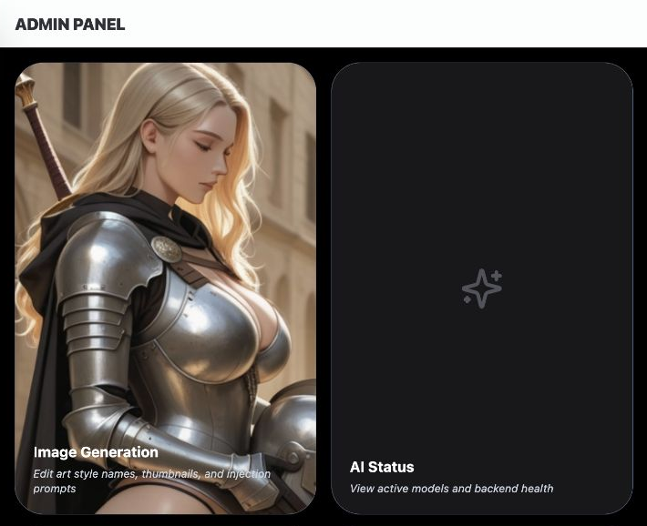
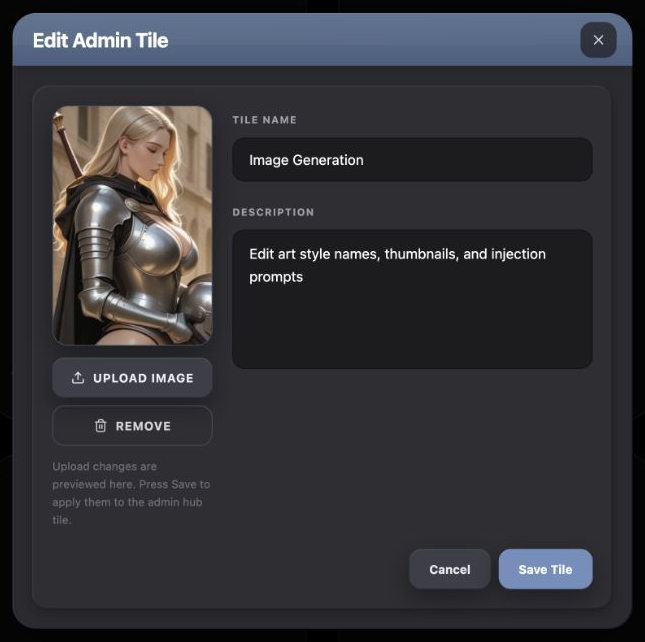
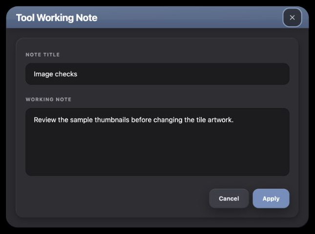
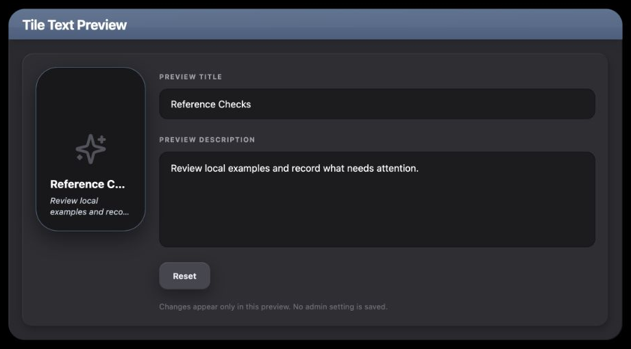

# Admin Panel UI Reference

A practical menu of patterns for designing new UI that belongs in Chronicle's admin launcher and tile editor.

## Overview

### Designing with the Admin Panel's UI Language

Admin is a black workspace of poster-shaped tool launchers beneath the shared Chronicle header. Its metadata editor uses a substantial graphite shell, slate title band and inset tray. These surfaces belong to the same application but have different actions: bright white/blue buttons expose a tile's Edit/Open functions; the editor uses neutral Cancel, slate Save and an outlined removal action.

#### Start with the User's Intent

| If the request is… | Start with… | Then combine… |
| --- | --- | --- |
| “Add another admin tool entry.” | Existing launcher tile and registry identity | Thumbnail/fallback, title/description and distinct Edit/Open handlers. |
| “Let an operator edit a short record without leaving.” | Tile editor's shell/header/tray inside DialogContentBare | Named recessed input/textarea, Cancel/Apply and draft state. |
| “Edit artwork for an entry.” | Tile editor's image preview and Upload/Remove controls | Explicit upload versus metadata-save ownership and visible failure feedback. |
| “Adjust text while a preview remains visible.” | Editor's field/tray family beside launcher text styling | Immediate local preview and neutral Reset. |
| “Add an embedded tool's page action.” | Actual AppShellTopBar and ChronicleSurfaceButton | Caller-owned callback, availability and pending state. |
| “Design inside an existing admin tool.” | That tool's own body owner | AdminPage chooses the destination; it does not impose one universal tool-body layout. |

#### Compose a New Design

Use the launcher when choosing destinations, a layered form when editing several values, and a small existing control group when only one local action is needed. Do not add a modal merely to reproduce its slate header. A modal's mechanics and its styling are separate: DialogContentBare supplies the former; the caller supplies the entire visible shell.

The hub's 2:3 ratio, grid columns and the editor's 620px cap/160px preview are existing arrangements, not universal dimensions. A new note can omit imagery. A live preview can remain inline. Both still inherit the relevant colors, edge treatments, control typography and states.

#### What Stays Consistent, and What Can Change

| Decision | Carry forward | Adapt to the concept |
| --- | --- | --- |
| Launcher | Black canvas, 32px poster corners, slate edge, low shadow, bottom text and meaning-specific actions. | Image, title, ratio and grid dimensions for a new context. |
| Layered editor | 24px shell, slate header, 16px inset tray, recessed fields. | Modal versus inline placement, width and columns. |
| Buttons | Use the complete chosen family; hub Open, modal Save and shared header actions are different variants. | Labels, callbacks and arrangement. |
| State | Explicit draft, pending, error and dismissal behavior. | Which values belong to the new local task. |
| Tool identity | Stable registry ID and explicit destination handling. | Display metadata; a renamed tile does not create a new tool. |

#### Using This Reference as a Coding Agent

Select the interaction and its local owner before assembling the surface. Reuse a shared primitive when it supplies the requested behavior; otherwise copy the short complete styling fragment and provide the missing semantics. A tile's Sparkles fallback is not an AI button. An enabled-looking control is not proof of persistence. Source labels below identify the construction owners; the examples label their new layout and local state.

The hub image is captured from the current local application. The editor and teaching specimens retain their source imports, fixed metadata and isolated local callbacks. Those specimens do not change real admin settings, storage objects, provider configuration or repository documents.

#### Admin Hub in Context

<figure class="source-preview"><div class="capture-background"></div><figcaption>Current Admin launcher after App Dashboard removal. This cropped view shows two representative tiles and the shared header; the source registry determines the full set of tools.</figcaption></figure>

The hub lives in Index's admin workspace. AdminPage itself has no header: AppShellTopBar supplies the Admin Panel title and adds Back when an embedded tool is selected. The header uses rgba(248,250,252,.3), a slate-200 lower border, small shadow, 16px horizontal padding becoming 32px at large width, 12px vertical padding and wrapping action rows. Its title is 18px black-weight uppercase/tight in `--ui-surface-2`; Back has 8px padding, full rounding, slate-100 hover and a 20px chevron. Separate routed tools own their own page shell and authorization wrapper. Every page-level Back control returns to the main Admin tile view.

<p class="source-line">Source: <code>src/pages/Admin.tsx</code>; <code>src/pages/Index.tsx</code> · admin composition; <code>src/components/app-shell/AppShellTopBar.tsx</code> · BackButton, SectionTitle and admin branches; <code>src/components/app-shell/AppShellHeader.tsx</code>; <code>src/App.tsx</code> · standalone tool routes.</p>

## Color Palette

### Color Palette

| Role | Exact appearance | Use |
| --- | --- | --- |
| Hub canvas / no-image tile | Black / zinc-900. | Destination browser. Frame base beneath imagery is slate-200. |
| Tile edge / fallback glyph | `#4a5f7f` / zinc-600. | 1px frame edge; 48px Sparkles. |
| Tile title / description | White / slate-300. | Primary title and italic summary. |
| Hover overlay | Black/30. | Reveals Edit/Open; there is no permanent text gradient. |
| Tile Edit | White → slate-100, `--ui-surface-2` text. | Metadata editor. |
| Tile Open | Blue-500 → blue-600, white text. | Destination action. |
| Editor shell / tray | `#2a2a2f` / `#2e2e33`. | Separate outer and inset layers. |
| Editor header | `#5a7292` → `#4a5f7f`, top to bottom. | Slate title band with white/20 top edge. |
| Fields / labels / placeholders | `#1c1c1f` / zinc-400 / zinc-600. | Recessed input body; values white. |
| Field border / focus | Black/35 → blue-500; 2px blue-500/20 ring. | Native input/textarea focus. |
| Editor neutral | `#3c3e47` → `#44464f`, `#eaedf1` text. | Upload and Cancel. |
| Editor Save | `#6f8fbd` → `#7c9ccb`, white text. | Committing a draft. |
| Remove / error | Remove zinc-300; hover rose-100 with rose-500/10 fill/rose-400/60 border. Error rose-100 on rose-500/10 with rose-500/30 edge. | Removal meaning and request feedback. |
| Shared header action | `#303035` → `#343439`, `#eaedf1` text. | ChronicleSurfaceButton; do not substitute modal button fill. |

`CHRONICLE_DARK` describes shared families, not overrides for every component. This editor's outer shadow starts at 20px/50px/black55 rather than the shared shell's 12px/32px/black50. Its neutral button outer shadow uses black35 rather than shared header buttons' black45. The exact local values below take precedence when reproducing this editor.

<p class="source-line">Source: <code>src/pages/Admin.tsx</code> · tile JSX; <code>src/components/admin/AdminToolEditModal.tsx</code>; <code>src/components/chronicle/chronicle-dark-ui.ts</code>; <code>src/index.css</code>.</p>

## Typography & Spacing

### Typography & Spacing

| Role | Existing rule |
| --- | --- |
| Hub | Full available width/height, vertical scroll; 16px padding/gaps, both become 40px padding/32px gaps at large width. |
| Grid | 1 column; small 2, large 3, extra-large 4, 2xl 5. Standard configured Tailwind breakpoints apply. |
| Tile | 2:3 frame, 32px radius, bottom text inset 20px. |
| Title / summary | 16px bold/truncate; 12px italic/two-line clamp, 4px top margin. Knowledge Base title alone uses 14px bold/tight wrapping. |
| Tile actions | 16px horizontal/8px vertical padding, 12px radius, 12px bold uppercase/wider; 12px group gap. |
| Editor | Width min(94vw,620px); 24px shell corners. Header 20px horizontal/12px vertical padding. |
| Editor title | DialogTitle overridden to 20px bold, tracking -.015em, white; inherited leading-none. |
| Body / tray | Each has 16px padding becoming 20px at small; tray 16px corners. |
| Preview / form | Single column below small; small adds 160px preview + flexible form; 20px gap. |
| Field groups | 16px between groups, 8px label/field spacing. Labels 10px bold uppercase/widest. |
| Input / textarea | 44px input; textarea rows=5/min128px, 14px text with relaxed leading, no user resizing. Both 12px corners/16px horizontal inset; textarea 12px vertical inset. |
| Footer | 20px top margin, 8px gaps, column-reverse below small, row/end-aligned from small. Native div, so no extra shared DialogFooter spacing. |
| Helpers / errors | 11px zinc-500 relaxed helper; 14px error in 16px horizontal/12px vertical inset with 12px corners. |

<p class="source-line">Source: <code>src/pages/Admin.tsx</code>; <code>src/components/admin/AdminToolEditModal.tsx</code>; <code>src/components/ui/dialog.tsx</code>; <code>tailwind.config.ts</code>.</p>

## Buttons & Menus

### Buttons & Menus

<section class="manual-entry">

#### Launcher, Editor and Shared Header Actions

<section class="reuse-recipe">

##### Use in a New Design

**Launcher actions:** Native Edit/Open buttons, each `px-4 py-2 font-bold text-xs uppercase tracking-wider rounded-xl shadow-xl transition-colors`. Edit adds `bg-white text-[hsl(var(--ui-surface-2))] hover:bg-slate-100`; Open adds `bg-blue-500 text-white hover:bg-blue-600`. Both stop propagation before their distinct callbacks. The outer tile is a clickable div, not a keyboard-activatable button. Its action overlay remains opacity-zero until hover, with no focus-within reveal. New launchers need deliberate keyboard/touch access rather than inheriting that limitation as a requirement.

**Editor Cancel:** This complete native fragment supplies the 40px neutral control:

```tsx
className="inline-flex h-10 items-center justify-center rounded-xl border-0 bg-[#3c3e47] px-5 text-xs font-bold leading-none text-[#eaedf1] shadow-[0_8px_24px_rgba(0,0,0,0.35),inset_0_1px_0_rgba(255,255,255,0.09),inset_0_-1px_0_rgba(0,0,0,0.20)] transition-colors hover:bg-[#44464f] disabled:cursor-not-allowed disabled:opacity-60"
```

Save uses the same geometry, `bg-[#6f8fbd] hover:bg-[#7c9ccb] text-white`, and changes only the positive inset highlight to white/12. Upload uses the neutral family with px-4, uppercase/wider text, a 14px Upload icon and 8px icon margin; it does not specify the footer's leading-none. Remove uses 40px height, px-4, 12px radius, 12px bold uppercase/wider zinc-300 text, transparent fill, 1px `#4a4d58` edge, 14px Trash2/8px margin, and the rose hover colors in the palette. It has no dedicated shadow.

**Pending/dismissal:** Upload/Remove/Cancel/Save disable while uploading or saving, with 60% opacity and not-allowed cursor. Upload and Save change labels to Uploading…/Saving…. Inputs remain editable, and the close icon, Escape and outside dismissal are not blocked by that pending flag. The source form should not be described as completely locked. Its native footer/Upload/Remove buttons have no explicit focus ring override; new examples add the editor close button's `focus-visible:outline-none focus-visible:ring-2 focus-visible:ring-[#9bb5d8]/70`.

**Close:** 36px square, 12px radius, right16/top50% with translateY(-50%), 16px X, `#1c1c1f`/70 fill→solid, zinc-300→white, inset top white/8 shadow, color transition and the blue-gray focus rule above. It is named Close edit tile modal.

**Shared header actions:** Import ChronicleSurfaceButton for tool-level actions such as R&D’s Save and Add New Mock-up. It supplies 40px height/12px corners, `#303035`→`#343439`, 12px bold/leading-none, `#eaedf1`, black45 outer shadow with white9/black20 insets, active95% scale, teal2px/40 focus and disabled pointer-events-none/50% opacity. Caller adds horizontal padding, icon/accessible name, callback and disabled condition. These are ordinary actions; Sparkles imagery elsewhere does not confer AI styling or behavior.

</section>
<p class="source-line">Source: <code>src/pages/Admin.tsx</code> · overlay actions; <code>src/components/admin/AdminToolEditModal.tsx</code> · form buttons; <code>src/components/chronicle/ChronicleDarkUi.tsx</code>; <code>src/components/chronicle/chronicle-dark-ui.ts</code>; <code>src/components/app-shell/AppShellTopBar.tsx</code> · admin actions.</p>
</section>

## Fields & Controls

### Fields & Controls

<section class="manual-entry">

#### Recessed Metadata Fields and Feedback

<figure class="source-preview"><div class="capture-background"></div><figcaption>Actual AdminToolEditModal with local sample metadata. Uploads and saves are isolated at fixture boundaries.</figcaption></figure>

<section class="reuse-recipe">

##### Use in a New Design

These are native input/textarea elements; there is no shared field wrapper or auto-resize behavior. Labels are associated through htmlFor/id and use `text-[10px] font-bold uppercase tracking-widest text-zinc-400`. Keep the complete base appearance:

```tsx
const field = "w-full rounded-xl border border-black/35 bg-[#1c1c1f] px-4 text-sm text-white placeholder:text-zinc-600 focus:border-blue-500 focus:outline-none focus:ring-2 focus:ring-blue-500/20";
// Input adds h-11. Textarea adds min-h-[128px] resize-none py-3 leading-relaxed, rows={5}.
```

The caller supplies value/onChange, labels and draft state. No idle inset shadow is present on these fields. Title is trimmed on Save and falls back to the previous title when empty; description is trimmed and may be blank. There is no required-field red border, aria-invalid or client-side empty-title error in the source. Do not invent a validation state for those cases.

**Request errors:** A failed upload/save produces a visible `rounded-xl border border-rose-500/30 bg-rose-500/10 px-4 py-3 text-sm text-rose-100` message in the form column. It does not mark an individual field and has no alert/live role. A new asynchronous task should name/announce its own feedback where needed. Source clears the error on opening, starting upload and starting Save.

**Draft and upload ownership:** Opening repopulates the draft from the selected ToolMeta. Save awaits onSave, then closes on success; rejection retains the draft and message. Cancel discards unsaved metadata. Upload writes an image to storage before metadata Save and sets the returned URL in the draft; Cancel does not undo that storage upload. Remove only clears the draft URL and does not delete the stored object. The fixture exercises no real upload or setting change.

**Preview controls:** The image frame is 2:3 with 16px corners, 1px `#4a5f7f`/80 edge, `#1c1c1f` base and `0 10px 28px rgba(0,0,0,.35)` shadow. Image covers. Empty state centers a 32px Upload icon and 12px bold uppercase/widest No Image in zinc-500, with 8px gap/16px horizontal inset. Buttons stack 8px apart, preview/group blocks 12px apart; helper text is 11px relaxed zinc-500. These dimensions belong to this editor's artwork task, not every new modal.

</section>
<p class="source-line">Source: <code>src/components/admin/AdminToolEditModal.tsx</code> · draft/upload/save handlers and rendered fields; <code>src/pages/Admin.tsx</code> · handleSaveTool.</p>
</section>

## Panels & Layout

### Panels & Layout

<section class="manual-entry">

#### Tool Posters and Destination Ownership

<section class="reuse-recipe">

##### Use in a New Design

The hub canvas is `w-full h-full p-4 lg:p-10 flex flex-col overflow-y-auto bg-black`; its grid is `grid grid-cols-1 sm:grid-cols-2 lg:grid-cols-3 xl:grid-cols-4 2xl:grid-cols-5 gap-4 lg:gap-8`. Each outer div supplies group/relative/cursor-pointer and the destination click; the inner frame owns the actual hover transform:

```tsx
className="aspect-[2/3] w-full overflow-hidden rounded-[2rem] bg-slate-200 shadow-[0_12px_32px_-2px_rgba(0,0,0,0.50)] transition-all duration-300 group-hover:-translate-y-3 group-hover:shadow-2xl border border-[#4a5f7f] relative"
```

Image covers without an image-zoom class. No-image fallback is full-size zinc-900 with centered 48px zinc-600 Sparkles. Bottom text block is absolute inset-x0/bottom0/p20; title/summary use Typography's exact rules. Unlike story posters, this tile adds neither a permanent black overlay nor a bottom text gradient. Its hover action layer is full-inset flex-center, 12px gap, black/30, opacity0→100 on group hover and transition-all. Frame lift is 12px and hover shadow is shadow-2xl.

Editing metadata changes the visible title, summary and thumbnail; it does not change the tool ID or create functionality. AdminPage dispatches some IDs through onSetActiveTool and others through navigate. Lazy embedded tools use a blank h-full/w-full Suspense fallback, not a skeleton or an error panel. Their internal forms, tables and document layouts are owned by those tools and cannot be inferred from the poster.

</section>
<p class="source-line">Source: <code>src/pages/Admin.tsx</code> · DEFAULT_TOOLS, handleOpenTool, embedded-tool branches and tile JSX.</p>
</section>

<section class="manual-entry">

#### Layered Editor Shell

<section class="reuse-recipe">

##### Use in a New Design

**Shared mechanics:** Dialog + DialogContentBare supplies portal, black/80 overlay, centered positioning,200ms animation and Radix focus/dismissal mechanics. Bare means no visible panel, default X, padding, radius or maximum width. The source caller adds `w-[min(94vw,620px)] max-w-none border-0 bg-transparent p-0 shadow-none`, then these separate layers:

```tsx
const shell = "overflow-hidden rounded-[24px] bg-[#2a2a2f] shadow-[0_20px_50px_rgba(0,0,0,0.55),inset_1px_1px_0_rgba(255,255,255,0.09),inset_-1px_-1px_0_rgba(0,0,0,0.35)]";
const header = "relative overflow-hidden border-t border-white/20 bg-gradient-to-b from-[#5a7292] to-[#4a5f7f] px-5 py-3 shadow-lg";
const tray = "rounded-2xl bg-[#2e2e33] p-4 shadow-[inset_1px_1px_0_rgba(255,255,255,0.07),inset_-1px_-1px_0_rgba(0,0,0,0.30),0_4px_12px_rgba(0,0,0,0.25)] sm:p-5";
```

Header sheen is an absolute inset0/z0 pointer-transparent diagonal white/10→transparent overlay, opacity40%, height60%. Title sits relative/z1 with 48px right clearance for Close. A hidden DialogDescription explains the editor. The body adds p16/small:p20 around the tray. Inside is a20px-gap grid that gains 160px/flexible columns at small. Footer belongs inside that tray and uses Typography's local flex spacing.

The existing source modal has no maximum-height/scroll constraint. In the 390×700px visual check, its stacked image/form/error content reached about1198px and clipped at the top and bottom. New layouts may cap height/scroll their own contents, omit the portrait or choose another column width; they must not claim that the old form already provides that behavior. For a compact action, use the required control/surface rather than adding all these layers without a content need.

</section>
<p class="source-line">Source: <code>src/components/admin/AdminToolEditModal.tsx</code>; <code>src/components/ui/dialog.tsx</code> · DialogContentBare and Overlay.</p>
</section>

## Composition Examples

### Composition Examples

These local examples combine Admin's existing styling for new tasks. They are reference source only; the admin registry does not mount them and they save no real data.

<section class="manual-entry">

#### New Tool Working Note

**Requested behavior:** “Keep a short working note for this admin tool in a separate editor. Let me change its title and text; Apply keeps changes and Cancel discards them.”

<figure class="source-preview"><div class="capture-background"><picture><source media="(max-width:600px)" srcset="../../src/assets/ui-guide/admin-panel/new-note-narrow.png"></picture></div><figcaption>New local draft composition. It omits the image column and preserves the editor's inherited layers.</figcaption></figure>

| Requirement | Inherited pattern | Deliberate adaptation |
| --- | --- | --- |
| Separate editor | DialogContentBare mechanics + complete editor shell/header/tray. | Named title/description, note content and shared header-style trigger. |
| Title and multiline text | Existing named native fields and blue focus. | Unique IDs, note labels, no artwork column. |
| Apply / Cancel | Editor Save / neutral Cancel appearance and footer. | Saved local state versus reopened draft; no request. |
| Fit a smaller screen | Same radius, inset and hierarchy. | max-height calc(100vh - 32px) with scrolling on this new modal only. |

<section class="reuse-recipe">

##### Use in a New Design

Use the complete Panels shell and Fields fragments; supply DialogTitle/Description and the named 36px close control. This example keeps the620px/94vw width but adds its own height cap/overflow-y-auto. The trigger imports ChronicleSurfaceButton with20px horizontal padding. Title is20px/leading-none/bold/white with the same tracking and sheen. Body/tray and field/footer spacing match the source, with the image column removed.

Opening copies saved values into the draft. Apply trims them, keeps the previous title if blank, stores locally and closes. Cancel, Close, Escape and outside dismissal leave saved values unchanged; reopening resets the draft. The visible14px zinc-400 status below the trigger reports the saved local note. No asynchronous validation or disabled pending state is implied. Apply/Cancel add the source Close control's2px blue-gray/70 focus fragment; field focus remains blue as documented.

Keep the layers, control variants, labels and draft semantics. Field count, content, width and image omission are task choices. The note is not persisted across reloads.

```tsx
<OperatorNoteExample />
```

</section>
<p class="source-line">Source: <code>docs/ui-guide/examples/admin-panel-compositions.tsx</code> · OperatorNoteExample; inherited owners <code>src/components/admin/AdminToolEditModal.tsx</code>, <code>src/components/ui/dialog.tsx</code> and <code>src/components/chronicle/ChronicleDarkUi.tsx</code>.</p>
</section>

<section class="manual-entry">

#### New Immediate Tile Text Preview

**Requested behavior:** “Beside an admin tile preview, let me adjust its title and description, see the changes immediately, and reset both without leaving the preview.”

<figure class="source-preview"><div class="capture-background"><picture><source media="(max-width:600px)" srcset="../../src/assets/ui-guide/admin-panel/new-preview-narrow.png"></picture></div><figcaption>New inline composition with immediate local state. The sample poster is a preview, not a tool launcher.</figcaption></figure>

| Requirement | Inherited pattern | Deliberate adaptation |
| --- | --- | --- |
| Preview stays visible | Editor shell/header/tray and artwork/form arrangement. | Inline named section, no dialog or backdrop. |
| Match launcher text |32px poster frame, Sparkles fallback, exact bottom title/summary typography. |160px-wide static preview with no destination or hover action layer. |
| Immediate changes | Named recessed input/textarea. | Local value updates both fields and poster; empty title displays Untitled. |
| Reset | Neutral editor action + explicit blue-gray focus. | Restores both initial strings immediately. |

<section class="reuse-recipe">

##### Use in a New Design

Reuse the exact shell/header/tray constants, with a max896px width/mx-auto chosen for this example. Use a semantic h2 with the editor title's20px bold/leading-none/-.015em/white styling. The source 20px grid gap and small:160px/flexible columns place the preview beside its fields; below small it stacks. The preview stays160px wide and keeps the launcher's2:3 frame,32px radius,1px slate edge and black50 shadow. It omits group hover, cursor-pointer, Edit/Open and any destination callback because it is display-only.

Title and description update local state immediately. Poster text deliberately inherits truncation/two-line clamp so the operator sees those limits. Reset restores both initial values. The11px zinc-500 relaxed helper states that no admin setting is saved. Fields retain the full source appearance and naming; Reset uses neutral footer styling plus the source Close focus fragment. There is no Apply/Cancel draft boundary in this immediate example.

The form's values, inline width and preview size are adaptable. The visible styling and meaning of actions remain inherited. This is neither an admin settings write nor proof of live tile metadata retrieval.

```tsx
<DisplayPreviewExample />
```

</section>
<p class="source-line">Source: <code>docs/ui-guide/examples/admin-panel-compositions.tsx</code> · DisplayPreviewExample; inherited owners <code>src/pages/Admin.tsx</code> and <code>src/components/admin/AdminToolEditModal.tsx</code>.</p>

<details class="implementation"><summary>Supporting source</summary>

```tsx
const [value, setValue] = useState(initial);
// Both native fields and the static poster read value.
// Reset restores initial; no storage, destination or settings callback exists.
```

</details>
</section>
