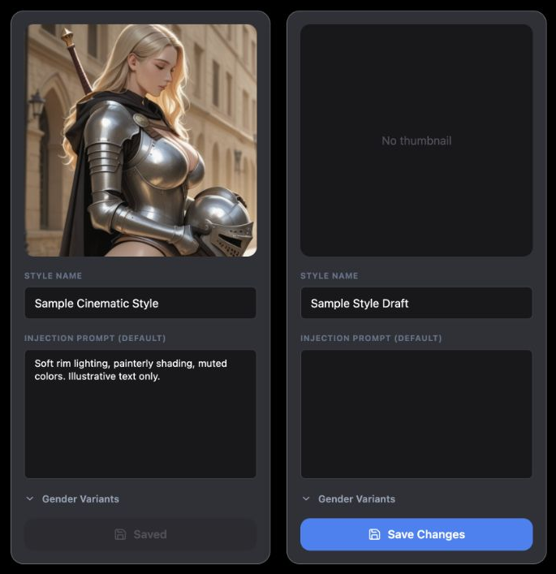
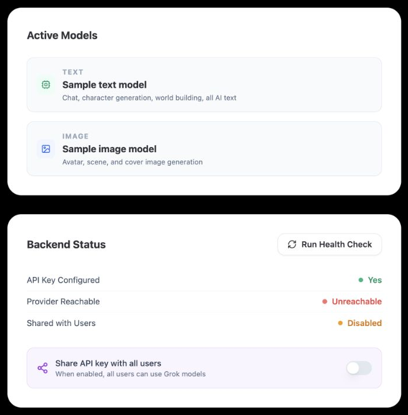
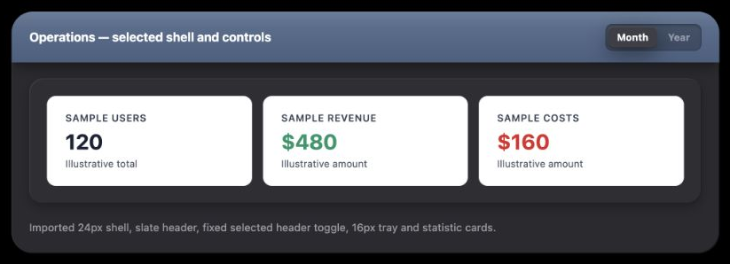
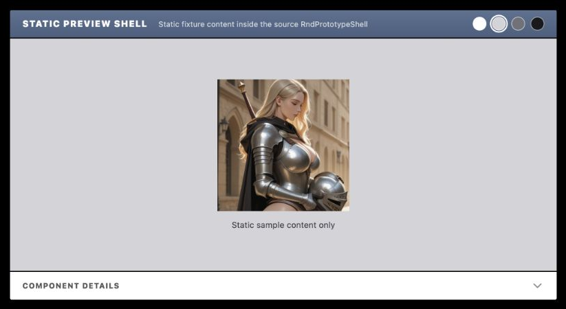

# Admin Workspaces UI Reference

A practical menu of patterns for designing new configuration, status, operations and prototype UI inside Chronicle's administrator workspaces.

## Overview

### Designing with Admin Workspaces' UI Language

Admin's launcher opens several independently styled tools. Asset configuration uses narrow graphite editing cards; AI Status uses white status panels; Finance and Quality Hub use layered dark operations panels; R&D places protected previews in a white notebook. Select the family that matches the new task before choosing its layout.

#### Start with the User's Intent

| If the request is… | Start with… | Then combine… |
| --- | --- | --- |
| “Edit several named assets and their text.” | ImageGenerationTool's card, thumbnail and recessed fields. | Local dirty/saving actions and an optional collapsible subsection. |
| “Show whether a system is ready.” | ModelSettingsTab's light card and labeled status rows. | A small secondary refresh action; a Switch only for a real binary setting. |
| “Summarize activity and records.” | Finance ShellCard/SlateHeader/Tray. | Compact selected controls; Quality Hub recessed blocks or Roadmap record rows when appropriate. |
| “Explain a preview beside editable notes.” | R&D's white notebook and RndPrototypeShell. | Background swatches, protected preview and collapsible source details. |

#### Compose a New Design

Preserve the selected family's palette, layers, edge treatment, typography and interaction states. Adapt the number of columns, width, content length and placement to the brief. A 320px asset card, 230px Finance sidebar or 340px preview minimum is an existing arrangement, not a required dimension for every new admin feature.

AdminPage chooses an embedded tool or a separate route; it supplies no universal tool-body shell. AppShellTopBar owns the shared Back/title and registered tool actions. Refer to the Admin Panel entry for that header and launcher/editor. This entry supplies representative body patterns rather than an inventory of every registered tool.

#### Using This Reference as a Coding Agent

Import a visual primitive when it provides the needed presentation and semantics. Otherwise use a short styling fragment with the new task's accessible names, selected state and callbacks. Similar colors do not prove a shared component: Finance exports reusable shells, while Quality Hub and Roadmap own local variants. Blue Save, status badges and background swatches are ordinary controls; they are not AI-generation actions.

The figures are static source-based styling illustrations. The final two compositions are teaching proposals, not implemented features or evidence of live admin operations. Source notes describe inspected styling and declared states; they do not claim browser-computed focus, narrow-screen behavior or service success.

<p class="source-line">Source: <code>src/pages/Admin.tsx</code> · lines 166–251; <code>src/pages/Index.tsx</code> · admin composition; <code>src/components/app-shell/AppShellTopBar.tsx</code> · lines 415–427 and 550–611.</p>

## Color Palette

### Color Palette

| Family / role | Exact appearance | Use |
| --- | --- | --- |
| Asset workbench | Black canvas; card <code>hsl(var(--ui-surface-2))</code> = <code>hsl(228 7% 20%)</code>; ghost-white edge. | Graphite editor cards on a scrolling workbench. Ghost-white is <code>hsl(210 33% 98% / .30)</code>, not opaque white. |
| Asset field / label | Zinc-900 fill, zinc-700 edge, white value, slate-500 label. | Native primitive fields with local colors. Save uses blue-500; clean state zinc-800/zinc-500. |
| Light status | White card, slate-200 border; slate-50 inset row; slate-600 labels. | Light information panels. Titles use UI-surface-2; help uses slate-500. |
| Status meaning | Emerald-500 dot/emerald-600 value; red-400 dot/red-500 value; amber-500 warning dot/amber-600 value. | Ready, error and warning. Checking uses amber-400 dot and amber-600 value. Text carries meaning alongside color. |
| Shared dark layers | Background <code>#0d0e12</code>; sidebar <code>#1b1b20</code>; shell <code>#2a2a2f</code>; tray <code>#2e2e33</code>; recessed <code>#1c1c1f</code>. | Finance's D palette maps these roles to CHRONICLE_DARK. |
| Dark type / controls | Text <code>#e4e1e8</code>, muted <code>#a1a1aa</code>, dim <code>#525260</code>; elevated <code>#3c3e47</code>; control text <code>#eaedf1</code>. | Separate body, help and raised-action levels. |
| Slate band | <code>#5a7292</code> → <code>#4a5f7f</code>, top to bottom; white text, white/20 top edge. | Finance headers, Quality Hub section bands and R&D preview headings have their own geometry around this common accent. |
| Finance selection | Blue <code>#3b82f6</code> on <code>rgba(59,130,246,.12)</code>. | Active sidebar item. Header/content toggle selection instead uses the elevated dark fill and a button shadow. |
| Roadmap variant | Shell <code>#2a2a2f</code>, edge <code>#454752</code>; priority accents <code>#c49aed</code>, <code>#ed7777</code>, <code>#e9bd67</code>. | Flat record sections with a colored left edge, not a slate-headed Finance card. |
| Notebook | White paper, zinc-900 body, black title; sidebar <code>#2a2a2f</code>, raised control <code>#3c3e47</code>. | R&D's editorial surface. Preview backgrounds are white, <code>#d4d4d8</code>, <code>#71717a</code> and <code>#1a1a1e</code>. |

Carry the complete dark shadow stack when using those layers:

```css
/* CHRONICLE_DARK: shell, tray, then raised button. */
box-shadow: 0 12px 32px -2px rgba(0,0,0,.50), inset 1px 1px 0 rgba(255,255,255,.09), inset -1px -1px 0 rgba(0,0,0,.35);
box-shadow: inset 1px 1px 0 rgba(255,255,255,.07), inset -1px -1px 0 rgba(0,0,0,.30), 0 4px 12px rgba(0,0,0,.25);
box-shadow: 0 8px 24px rgba(0,0,0,.45), inset 0 1px 0 rgba(255,255,255,.09), inset 0 -1px 0 rgba(0,0,0,.20);
```

These are three separate declarations for three different layers. Local exceptions below take precedence. Token-based Input/Switch colors depend on the enclosing theme; a dark-looking card alone does not set the global <code>.dark</code> theme.

<p class="source-line">Source: <code>src/components/chronicle/chronicle-dark-ui.ts</code> · lines 6–31; <code>src/index.css</code> · lines 10–96; <code>src/components/admin/finance/shared/finance-shared.tsx</code> · lines 20–98; <code>src/components/admin/ImageGenerationTool.tsx</code> · lines 124–252; <code>src/components/chronicle/ModelSettingsTab.tsx</code> · lines 20–40 and 80–160; <code>src/pages/admin/roadmap.css</code> · lines 1–24; <code>src/components/admin/research-development/RndPrototypeShell.tsx</code> · lines 14–23.</p>

## Typography & Spacing

### Typography & Spacing

| Pattern | Existing rhythm and geometry |
| --- | --- |
| Asset card | 320px nonshrinking width, 16px radius; cards 20px apart inside 24px workbench padding. Thumbnail square/12px radius; content 16px padding and gaps. Labels 10px bold uppercase/wider with 6px lower margin. |
| Light status | Centered maximum 672px column, 32px section gaps; Card caller adds 32px padding. Section title 30px black-weight/tight; card title 18px bold with 24px lower margin. Status label/value 14px, value semibold. |
| Finance shell | Outer radius 24px; tray radius 16px. SlateHeader inset 13px vertical/20px horizontal, title 14px bold/-.015em. Tray has no default padding; caller chooses it. |
| Finance workspace | Fixed 230px sidebar, main 30px vertical/34px horizontal padding. Page heading 19px bold/-.015em; subtitle 12px. Header bottom margin 24px, internal gap 16px. No responsive stacking is declared by these shell owners. |
| Compact operations controls | Toggle tray radius 8px, 3px padding/2px gaps; selected button radius 6px. Header toggle 11px bold/4×10px inset; content toggle 12px bold/5×12px inset. |
| Notebook | White page inset 24×32px, small 40px horizontal, large 56×48px. Title 30px bold/-.025em; metadata 14px; purpose/body 16px with 32px line height. Major content blocks 32px apart. |
| Protected preview | 4px frame radius, 2px black edge; heading 13px black-weight uppercase/.08em, detail subtitle 11px. Header/details-trigger inset 10px vertical/18px horizontal. Canvas minimum 340px high, 20px padding becoming 32px at small. |

Keep type and spacing relationships when changing dimensions. A new compact operations summary may omit the sidebar; a new asset editor may wrap its cards instead of copying the source's horizontal strip. Those are explicit new layout decisions, not existing responsive behavior.

<p class="source-line">Source: <code>src/components/admin/ImageGenerationTool.tsx</code> · lines 124–252; <code>src/components/chronicle/UI.tsx</code> · lines 10–57 and 140–145; <code>src/components/admin/finance/FinanceDashboardTool.tsx</code> · lines 150–165; <code>src/components/admin/finance/shared/FinanceHeader.tsx</code> · lines 17–30; <code>src/components/admin/finance/shared/FinanceSidebar.tsx</code> · lines 9–45; <code>src/components/admin/research-development/ResearchDevelopmentTool.tsx</code> · lines 669–825; <code>src/components/admin/research-development/RndPrototypeShell.tsx</code> · lines 98–181.</p>

## Buttons & Menus

### Buttons & Menus

<section class="manual-entry">

#### Asset Save and Light Status Actions

<section class="reuse-recipe">

##### Use in a New Design

**Asset Save:** Native full-width button, 10px vertical padding, 12px radius, 14px semibold text, centered flex/8px gap, 16px icon, transition-all. Dirty adds blue-500/white with hover brightness 125% and active brightness 150%. Clean adds zinc-800/zinc-500 and not-allowed cursor. Disabled adds pointer-events-none/50% opacity. Labels distinguish Saved, Save Changes and Saving…. The source supplies no dedicated focus rule; a new native action should add an explicit focus treatment, such as Roadmap's 2px <code>#9bb5d8</code> outline with 3px offset.

**Thumbnail actions:** Upload and Remove are 16px icons in 10px padding/12px-radius buttons. Upload uses ghost-white, Remove red-500/30; both use the same brightness interactions. The black/50 overlay reveals on parent hover. Source gives title attributes but no focus-within reveal or upload-pending appearance. New keyboard/touch layouts must make the actions discoverable instead of treating hover-only visibility as a requirement.

**Light status action:** Import the existing secondary Button, rather than using dark surface-button colors:

```tsx
import { Button } from '@/components/chronicle/UI';

<Button variant="secondary" disabled={checking} onClick={refresh}>
  {checking ? 'Checking…' : 'Refresh status'}
</Button>
```

Caller supplies the named action and state. Button contributes 12px radius, 16×8px inset, 14px semibold text, 1px slate-200 border, white fill, UI-surface-2 text, shadow-sm, ghost-white hover, active 95% scale and 200ms transition. Disabled gives 50% opacity/pointer-events-none. It has no explicit focus override. ModelSettingsTab adds a 16px RefreshCw with 8px right margin and spins it while checking.

</section>
<p class="source-line">Source: <code>src/components/admin/ImageGenerationTool.tsx</code> · lines 148–165 and 239–252; <code>src/components/chronicle/ModelSettingsTab.tsx</code> · lines 119–125; <code>src/components/chronicle/UI.tsx</code> · lines 10–35; <code>src/pages/admin/roadmap.css</code> · line 56.</p>
</section>

<section class="manual-entry">

#### Operations Selection and Notebook Navigation

<section class="reuse-recipe">

##### Use in a New Design

Finance's <code>HdrToggle</code> and <code>DarkToggle</code> receive <code>options</code> of <code>{v,l}</code>, <code>value</code> and <code>onChange</code>. Header tray is black/25 with inset 0 1px 3px black/40; content tray is <code>#1c1c1f</code> with black/35 border/inset 0 1px 3px black/50. Both use 8px rounding/3px padding/2px gaps. Buttons have no border, 6px rounding, pointer cursor and .12s transition. Selected is <code>#3c3e47</code> with the shared button shadow; unselected transparent/no shadow. Header text is white versus white/45; content text <code>#e4e1e8</code> versus <code>#a1a1aa</code>. Use Typography's corresponding insets and sizes.

These helpers style selection but do not declare <code>aria-pressed</code>, a disabled prop or focus appearance. For a new semantic exclusive-choice control, compose native buttons with the same full styles, add pressed state and a named group, and add the Roadmap outline rule above. That is a new accessibility adaptation. Avoid applying only a ring utility over an inline boxShadow: a normal inline shadow can replace Tailwind's ring shadow; use an outline or explicitly compose both shadows.

Finance sidebar selection is a different family: full-width left-aligned buttons, 9×14px inset, 8px radius, 11px bold uppercase/.07em, 2px lower margin and .15s transition. Selected uses blue on blue/12 with an inset 1px white/9 highlight; unselected is transparent/muted. No hover, focus or disabled style is specified there.

R&D navigation already provides an explicit state contract: 40px full-width buttons, 12px corners, 12px horizontal inset, 8px gaps, elevated fill/control text and shared button shadow; 12px bold truncated label. Selected changes the transparent border to <code>#7891b3</code> and sets <code>aria-current="page"</code>. Hover brightness 110%, 2px teal/40 focus ring and disabled not-allowed/50% opacity remain part of that recipe. Tool-level actions continue to use ChronicleSurfaceButton from the Admin Panel reference.

</section>
<p class="source-line">Source: <code>src/components/admin/finance/shared/finance-shared.tsx</code> · lines 326–358; <code>src/components/admin/finance/shared/FinanceSidebar.tsx</code> · lines 28–55; <code>src/components/admin/research-development/ResearchDevelopmentTool.tsx</code> · lines 700–717; <code>src/components/chronicle/chronicle-dark-ui.ts</code> · lines 22–31; <code>src/pages/admin/roadmap.css</code> · line 56.</p>
</section>

## Fields & Controls

### Fields & Controls

<section class="manual-entry">

#### Asset Fields and Optional Detail

<figure class="source-preview"><div class="capture-background"></div><figcaption>Asset configuration family: preserve the card and field treatment; choose the content and width for the new task.</figcaption></figure>

<section class="reuse-recipe">

##### Use in a New Design

Import Input/Textarea from <code>components/ui</code>. Their shared base gives full width, 6px corners, 1px border, 12×8px inset, token placeholder color, ring-offset-background, focus-visible outline-none/2px ring-ring/2px offset, and disabled not-allowed/50% opacity. Input is 40px high; Textarea has minimum 80px. Local asset styling overrides fill, edge, value size and textarea height:

```tsx
import { Input } from '@/components/ui/input';
import { Textarea } from '@/components/ui/textarea';

<Input id="asset-name" className="bg-zinc-900 border-zinc-700 text-white text-sm" />
<Textarea id="asset-note" className="bg-zinc-900 border-zinc-700 text-white text-xs min-h-[160px] resize-none" />
```

Supply value/change/disabled props and labels for the new fields. Label appearance is <code>text-[10px] font-bold uppercase tracking-wider text-slate-500 mb-1.5 block</code>; associate it using htmlFor/id, which the source asset labels do not currently provide. Optional detail textareas use minimum 100px and the same colors/type. The optional subsection uses Radix Collapsible with a full-width 12px semibold slate-400→white trigger, 8px icon gap, and content 12px below/12px between groups. Its chevron has a declared open-state rotation on the SVG; rendered state propagation has not been verified here.

For these primitives, default root tokens are background white, ring <code>hsl(222.2 84% 4.9%)</code>, muted placeholder <code>hsl(215.4 16.3% 46.9%)</code>. Under <code>.dark</code>, background becomes <code>hsl(222.2 84% 4.9%)</code>, ring <code>hsl(212.7 26.8% 83.9%)</code>, placeholder <code>hsl(215 20.2% 65.1%)</code>. Preserve the enclosing theme when reusing the primitive, or explicitly choose a new focus/offset color for a new surface.

</section>
<p class="source-line">Source: <code>src/components/admin/ImageGenerationTool.tsx</code> · lines 170–237; <code>src/components/ui/input.tsx</code> · lines 5–17; <code>src/components/ui/textarea.tsx</code> · lines 7–17; <code>src/components/ui/collapsible.tsx</code>; <code>src/index.css</code> · lines 10–96.</p>
</section>

<section class="manual-entry">

#### Light Status Rows and Binary Controls

<figure class="source-preview"><div class="capture-background"></div><figcaption>Light status family: readable state text and restrained colored indicators inside white panels.</figcaption></figure>

<section class="reuse-recipe">

##### Use in a New Design

Import Card from <code>src/components/chronicle/UI.tsx</code>: it supplies rounded-3xl/24px corners, a 1px slate-200 border, white fill, p-4/16px padding and shadow-sm. ModelSettingsTab adds p-8/32px padding for these status panels. Inside, use rows of <code>flex items-center justify-between py-2</code> separated by <code>divide-y divide-slate-100</code>. Labels are 14px slate-600; right-hand state uses flex/8px gap, an 8px circular dot and 14px semibold value. Use the palette's exact ready/error/warning colors; warning pulses and checking bounces. Empty or unavailable information should receive readable state text, not an invented successful status.

An inset information row uses 16px padding, 12px corners, slate-50 and slate-200 border; the icon tile has 8px padding/8px corners and a pale accent fill. A settings strip is separately purple-50/purple-200, 16px padding/12px radius, 24px top margin, 20px purple-600 icon, 14px slate-700 medium label and 12px slate-500 helper.

Import <code>Switch</code> from <code>components/ui/switch</code> for a real binary choice and provide a label through id/htmlFor or aria-label. It supplies 44×24px track, full rounding, transparent 2px border, checked bg-primary/unchecked bg-input, color transition, 2px ring-ring focus/2px background-colored offset and disabled not-allowed/50% opacity. Its 20px round background-colored thumb has shadow-lg and moves 20px when checked. Default primary/input are <code>hsl(222.2 47.4% 11.2%)</code>/<code>hsl(214.3 31.8% 91.4%)</code>; <code>.dark</code> changes them to <code>hsl(210 40% 98%)</code>/<code>hsl(217.2 32.6% 17.5%)</code>. ModelSettingsTab does not locally override this primitive.

Keep status display and settings distinct. The source disables its Switch while updating or unavailable; its presence means this page is not entirely read-only despite its introductory comment. This reference concerns the visible control family, not any live setting change.

</section>
<p class="source-line">Source: <code>src/components/chronicle/ModelSettingsTab.tsx</code> · lines 20–40 and 87–160; <code>src/components/chronicle/UI.tsx</code> · line 57; <code>src/components/ui/switch.tsx</code> · lines 6–24; <code>src/index.css</code> · lines 10–96.</p>
</section>

<section class="manual-entry">

#### Notebook Writing

<section class="reuse-recipe">

##### Use in a New Design

R&D writing looks like a document, not a recessed form. Title is a transparent, unpadded, borderless 30px bold input with -.025em tracking, black text, zinc-500 placeholder and minimum 220px width. Purpose is transparent/unpadded/borderless, 16px/32px-leading zinc-900, minimum 32px high, no resize, preserved whitespace/wrapped words, zinc-500 medium placeholder, and an 8px gap after its 14px bold label. The source auto-resizes it; the class alone does not. Both source fields suppress the focus outline/ring. A new editing concept can add an intentional outline on focus while preserving the paper appearance at rest. Notebook failures use 14px rose-600 text with role=alert; repository feedback has its own rose-700 medium variant.

</section>
<p class="source-line">Source: <code>src/components/admin/research-development/ResearchDevelopmentTool.tsx</code> · lines 764–823.</p>
</section>

## Panels & Layout

### Panels & Layout

<section class="manual-entry">

#### Dark Operations Shell and Record Variants

<figure class="source-preview"><div class="capture-background"></div><figcaption>Operations source fragments: the dark shell/header/tray family is shown alongside the imported Stat component in its light default variant.</figcaption></figure>

<section class="reuse-recipe">

##### Use in a New Design

Finance exports these presentational owners; content and padding remain caller choices:

```tsx
import { ShellCard, SlateHeader, Tray } from '@/components/admin/finance/shared/finance-shared';

<ShellCard>
  <SlateHeader title="Activity summary" />
  <div style={{ padding: 20 }}>
    <Tray style={{ padding: 16 }}>{summary}</Tray>
  </div>
</ShellCard>
```

ShellCard supplies flex-column, 24px corners, clipped overflow, shell fill and the complete shared shell shadow. Tray supplies 16px corners, tray fill and tray shadow. SlateHeader supplies the gradient, white/20 top edge, <code>0 10px 15px -3px rgba(0,0,0,.30), 0 4px 6px -4px rgba(0,0,0,.30)</code> shadow, 13×20px padding, relative/hidden layout and a pointer-transparent white/7→transparent highlight fading by 30%. Its title is 14px bold/white/-.015em and its optional right slot stays relative above the sheen. The snippet's 20px body/16px tray padding is a new caller choice.

**Imported light Stat variant:** Finance's <code>Stat</code> is separate from its dark shell primitives. Default fill is white with a 1px <code>#e8ecf2</code> border, 10px corners, 16px vertical/20px horizontal padding, flex:1 and minimum 130px width. Label is 11px/600, uppercase/.04em, <code>#374151</code> with 6px lower margin; value is 24px/700, line-height 1, <code>#1a2133</code>; optional helper is 11px <code>#4b5563</code> with 5px top margin. Caller may supply <code>soft</code> for fill and <code>color</code> for value. This passive card has no hover, selected, focus or disabled control state. The illustration intentionally shows this imported light default, not a dark Stat override.

**Quality Hub variant:** Local outer/header constants follow the same palette but are not imports of Finance. Its inner tray is 16px-radius, 16px-padded with <code>inset 1px 1px 0 rgba(255,255,255,.05), inset -1px -1px 0 rgba(0,0,0,.45)</code>. Recessed blocks use <code>#1c1c1f</code>, 16px corners, a white/5 edge and <code>inset 0 3px 10px rgba(0,0,0,.6), inset 0 1px 0 rgba(255,255,255,.05)</code>. Compact strips retain that fill/edge and white/5 top highlight, with 12px corners and <code>inset 0 2px 8px rgba(0,0,0,.6), inset 0 1px 0 rgba(255,255,255,.05)</code>. Local fields use these complete source declarations:

```tsx
const inputClass = "w-full rounded-lg border-none border-t border-[rgba(0,0,0,0.35)] bg-[#1c1c1f] px-3 py-2 text-sm text-white placeholder:text-[#52525b] outline-none focus:shadow-[0_0_0_2px_rgba(59,130,246,0.25)]";
const selectClass = "w-full rounded-lg border-none border-t border-[rgba(0,0,0,0.35)] bg-[#1c1c1f] px-2 py-2 text-sm text-white outline-none focus:shadow-[0_0_0_2px_rgba(59,130,246,0.25)]";
```

These specify 8px corners, 14px text, 8px vertical inset and 12px input/8px select horizontal inset. Input placeholder is <code>#52525b</code>; focus replaces the shadow with a 2px blue/25 outline-like shadow. The source declares both border-none and border-t; this is source CSS, not a computed claim of a visible top edge. Supply labels, values and any new disabled state separately.

**Roadmap record variant:** A section has 16px corners, <code>#2a2a2f</code> fill, <code>#454752</code> border and 5px priority-colored left edge, without the shared shell shadow. Header uses 20×24px inset, white/7 divider, 22px/750 title and 14px helper. Record rows have 20px vertical spacing, fine dividers, 17px bold titles and 15px/1.7-leading descriptions. Actions are 34px squares/9px corners, elevated fill/control text, white10% border and elevatedHover fill. Its fields use 10px corners, 11×13px inset, 15px text, recessed fill/white10% edge; textareas resize vertically/minimum 150px. New record interfaces can reuse this flatter list hierarchy without adding a Finance header.

Finance's sidebar remains 230px and its summary header does not wrap; new small layouts may stack/omit those parts. The current dark-page set covers all Finance pages except Styling Rules; the older “overview + sidebar only” comment is not the current rule. Its displayed Net Income value is labeled placeholder, so an illustration does not establish live figures. Roadmap declares a 600px breakpoint that wraps headings and stacks editor options.

</section>
<p class="source-line">Source: <code>src/components/admin/finance/shared/finance-shared.tsx</code> · lines 77–98, 240–247 and 308–358; <code>src/components/admin/finance/FinanceDashboardTool.tsx</code> · lines 59 and 150–165; <code>src/components/admin/finance/shared/FinanceHeader.tsx</code> · lines 17–70; <code>src/pages/style-guide/ui-audit.tsx</code> · lines 88–98; <code>src/pages/admin/roadmap.css</code> · lines 1–65.</p>
</section>

<section class="manual-entry">

#### White Notebook and Protected Preview

<figure class="source-preview"><div class="capture-background"></div><figcaption>RndPrototypeShell only: framed preview, background controls and source details. The surrounding notebook writing surface is not shown.</figcaption></figure>

<section class="reuse-recipe">

##### Use in a New Design

ResearchDevelopmentTool is a min-height 0/full-height flex column, changing to a row at large width. The charcoal sidebar is full-width/maximum 52vh below large; desktop width is clamp(250px, 28vw, 300px), full height. The white main area has its own vertical scroll and responsive paper insets. Keep the content flexible rather than shrinking the type to preserve desktop columns.

RndPrototypeShell receives <code>mockup</code>, optional <code>definition</code>/<code>section</code>, <code>isEditingDisabled</code> and <code>onBackgroundChange</code>. It owns the preview frame and selects an imported Preview component; it does not own the notebook's surrounding editor. The frame is full-width/overflow-hidden, white, 4px radius and 2px black border. Header wraps its title/source line and swatches, using the slate gradient, 2px black bottom border and 10×18px inset. Canvas is centered flex/overflow-auto/minimum 340px with 20px padding becoming 32px; a new task can choose another minimum or alignment explicitly.

Background buttons are 20px circles with white/70 border, hover scale 110%, named pressed state, title and disabled not-allowed/50% opacity. Selected and focus use 2px white rings with 1px slate-colored offset. These have no conflicting inline boxShadow. The white Component Details button is full-width, 11px extrabold uppercase/.08em with <code>#555</code> text; white fill becomes <code>#f9f9f9</code> on hover. It has 10×18px inset and a 2px inset slate focus ring. Its 20px <code>#888</code> chevron rotates from local expanded state with 200ms transition.

Details are white with a fine gray top edge, 20px vertical/18px horizontal padding becoming 22px horizontally at small. Metadata grids progress from one to two to four columns; labels 10px black-weight uppercase/widest zinc-500, values 11px monospace or 12px semibold. The local preview error boundary renders a maximum 512px rose-500/10 alert with rose-400/30 edge, 16px corners, 20×16px inset and 14px rose-100 text. Missing Preview leaves the canvas empty; missing details has a muted sentence. These are local display outcomes, not proof of prototype functionality.

</section>
<p class="source-line">Source: <code>src/components/admin/research-development/ResearchDevelopmentTool.tsx</code> · lines 669–728 and 762–823; <code>src/components/admin/research-development/RndPrototypeShell.tsx</code> · lines 35–55 and 70–235.</p>
</section>

## Composition Examples

### Composition Examples

These are static teaching proposals for new UI. They explain requirement-to-pattern choices; there is no new application component, persistence behavior or tested workflow attached to them.

<section class="manual-entry">

#### New Daily Operations Summary

**Requested behavior:** “Give me a compact daily summary with a period choice, labeled readiness indicators and a short list of items needing attention.”

| Requirement | Inherited styling | Free layout choice |
| --- | --- | --- |
| Clear summary hierarchy | Finance ShellCard, SlateHeader and Tray with their complete shadows/type. | One inline section, no Finance sidebar or unrelated financial metrics. |
| Period choice | DarkToggle's tray/button colors, spacing and selected shadow. | Three named pressed buttons; add Roadmap's outline focus and explicit disabled state when appropriate. |
| Readiness indicators | ModelSettingsTab's dot-plus-readable-value relationship. | Use dark-family text inside this dark composition; retain semantic indicator colors rather than importing a white card around each row. |
| Attention list | Roadmap's flat divided records and restrained priority edge. | A short list beneath summary values; wrap action labels and stack on narrow widths. |

<section class="reuse-recipe">

##### Use in a New Design

Start with the Operations shell fragment, choose 20px outer-body/16px tray inset, and put the period control beneath the header if it cannot fit alongside the title. A two-column summary can become one column without changing shell radii, title size or control size. Use a normal heading element for the new section and descriptive labels for every value. If changing period will load data, design its actual pending/error states when that behavior is implemented; the static proposal makes no success claim.

The new layout borrows the status row's readable relationship, not its slate text on a dark background. Primary values use <code>#e4e1e8</code>, labels <code>#a1a1aa</code>. An attention action can use ChronicleSurfaceButton rather than inventing a new blue gradient. The title, period options, record count, wrapping and data ownership are decisions for the brief; layered surfaces and complete control states remain inherited.

</section>
<p class="source-line">Inherited sources: <code>src/components/admin/finance/shared/finance-shared.tsx</code> · ShellCard, Tray, SlateHeader and DarkToggle; <code>src/components/chronicle/ModelSettingsTab.tsx</code> · StatusRow; <code>src/pages/admin/roadmap.css</code> · records and focus; <code>src/components/chronicle/ChronicleDarkUi.tsx</code> · ChronicleSurfaceButton. This composition is a proposal only.</p>
</section>

<section class="manual-entry">

#### New Notebook Reference Annotation

**Requested behavior:** “Keep a reference preview visible while I write an explanation and inspect its source details.”

| Requirement | Inherited styling | Free layout choice |
| --- | --- | --- |
| Preview stays recognizable | RndPrototypeShell's black frame, slate header and background swatches. | A reference image or static local preview instead of an interactive prototype. |
| Explanation reads like a document | Notebook's white paper, 30px title, 14px label and 16px/32px-leading writing. | One annotation field with an accessible label; add a visible focus outline while editing. |
| Optional source details | Existing white collapsible-details treatment and monospace metadata. | A concise citation and caption, without a full editor toolbar or line-number gutter. |
| Fit different screens | Existing paper inset rhythm and wrapping header. | Two columns only when useful space exists; otherwise preview above explanation with 32px separation. |

<section class="reuse-recipe">

##### Use in a New Design

Use the Notebook panel and writing recipes as separate parts. The preview can be display-only while background swatches change only its surrounding canvas. Put the explanation on white paper; avoid placing a recessed graphite textarea inside it merely because other admin forms use one. A newly editable field needs an explicit value/change contract, label and focus indication; a display-only annotation should be ordinary text instead.

Choose whether editing is immediate or draft-based before adding actions. If the future feature has Apply/Cancel, use the Admin Panel editor's established action meanings and explain their scope; this proposal does not invent a save operation. Preview minimum height, image fit, column ratio and source fields can change. The black preview edge, slate heading, white details surface and notebook type hierarchy are the parts that make the new composition belong here.

</section>
<p class="source-line">Inherited sources: <code>src/components/admin/research-development/RndPrototypeShell.tsx</code> · preview frame, swatches and details; <code>src/components/admin/research-development/ResearchDevelopmentTool.tsx</code> · paper layout and writing fields; <code>src/pages/admin/roadmap.css</code> · outline focus adaptation. This composition is a proposal only.</p>
</section>
