# Character Builder UI Reference

A practical menu of patterns for designing new UI that belongs in Chronicle's character editor.

## Overview

### Designing with Character Builder's UI Language

Use this reference to compose new character-authoring interfaces from established surfaces, fields, actions and states. Character Builder shares Chronicle's graphite, slate and recessed-field language with Story Builder, but has its own trait navigation, fixed and editable label/value rows, and compact identity choices. Carry those differences into a new design rather than copying the Story Builder arrangement unchanged.

This is a representative design vocabulary. It does not enumerate every profile category or require a new feature to resemble an entire existing page.

#### Start with the User's Intent

| If the request is… | Start with… | Then combine… |
| --- | --- | --- |
| “Give this character another kind of detail.” | Authoring section shell | Fixed label/value rows for established fields, editable rows for user-defined entries, and an Add action. |
| “Let me write a few notes separately.” | Editor dialog | Slate title, inset tray, named recessed fields and ordinary Apply/Cancel actions. |
| “Show where this profile is incomplete.” | Trait navigation and progress | Caller-supplied field counts, selected section and a completion ring. |
| “Let me choose one mode.” | Segmented choice | One selected value and the blue selected treatment. |
| “Let me independently enable several things.” | Checkbox | Separate checked values and associated labels; a segmented control would imply the wrong relationship. |
| “Add or remove named habits, facts or preferences.” | Editable label/value rows | Collection state, Add action, local remove controls and an empty state. |
| “Choose which kind of content to create.” | Chooser dialog | Descriptive option tiles; selecting an option completes the choice. |
| “Show commands beside the avatar.” | Command menu | Media/source actions or a quiet image-overlay trigger. |
| “Show a few settings while the editor stays visible.” | Compact anchored surface | Dark menu surface styling with the controls appropriate to the settings. |

#### Compose a New Design

1. **Choose the interaction.** Inline authoring belongs in a section; a separate editing task can use a dialog; immediate settings can use a compact anchored surface.
2. **Assign each layer a job.** A shell names a subject, a slate strip identifies it, a tray groups work, recessed fields hold values and elevated surfaces carry actions.
3. **Choose controls by meaning.** Distinguish an unchangeable field label from a disabled value, independent choices from exclusive modes, and completion from validation.
4. **Adapt the arrangement.** Choose width, columns, row proportions and image ratio for the content. Keep the source pattern's colors, radius, shadow and type relationships.
5. **Finish the relevant states.** Include selection, focus, disabled/busy, empty, collapsed and invalid states when the operation needs them. Give new controls names and keyboard access.

#### What Stays Consistent, and What Can Change

| Decision | Carry forward | Adapt to the concept |
| --- | --- | --- |
| Surface hierarchy | Graphite shell, slate title, inset tray, recessed field and elevated action; match each with its shadow. | Use only the layers the task needs. A compact settings popover does not need a full title strip and tray. |
| Shape | 24px major shell, 16px tray/media, 12px ordinary action or choice tray, 8px field, 14px menu and 9px menu row. | Width, height, number of columns and image ratio. |
| Color meaning | Slate structure, blue selection/add/progress, teal–violet AI, red removal or explicitly derived validation. | Labels and content. Do not assign a new accent merely because the feature is new. |
| Character-specific rows | Recessed compact labels alongside editable descriptions; a fixed label and editable label are distinct patterns. | A narrow arrangement stacks; choose a different proportion when longer labels require it. |
| Typography | Inherit the application font; compact heavy identifiers, readable 14px field text and stronger section titles. | Text length, wrapping and appropriate heading scale for a compact surface. |
| State ownership | Shared components supply only their documented treatment and behavior. | The feature supplies values, handlers, validation, working copies and persistence. |

#### Using This Reference as a Coding Agent

Resolve the interaction first, then combine its container and control recipes. Use the exact local variant when it differs from a shared token. Construction instructions and short fragments remain in the ordinary text; supporting source is evidence, not a requirement to reverse engineer unrelated character, media or AI logic.

**Existing specimens** use product components with local sample data. **Derived examples** demonstrate proposed combinations and explicitly supplied accessibility or state handling. Neither demonstrates remote saving, image upload or AI execution. The Mannerisms and Voice Notes examples are reference-only source in `docs/ui-guide/examples/character-builder-compositions.tsx`.

Inspect named owners when their interfaces or styling change. An intentionally flexible layout is not missing styling guidance. A missing source-owned treatment should be stated precisely instead of filled with an arbitrary new color, shape or shadow.

#### Character Builder in Context

Character Builder edits one selected profile. Character Library owns its browsing grid and reusable profiles; Story Builder opens this editor for a story-owned cast member. Both use the editor below, while the surrounding header identifies the ownership context. The library's portrait-card grid is a different state, not the editor's page layout.

<figure class="source-preview"><div class="capture-background"><picture><source media="(max-width:600px)" srcset="../../src/assets/ui-guide/character-builder/overview-narrow.png">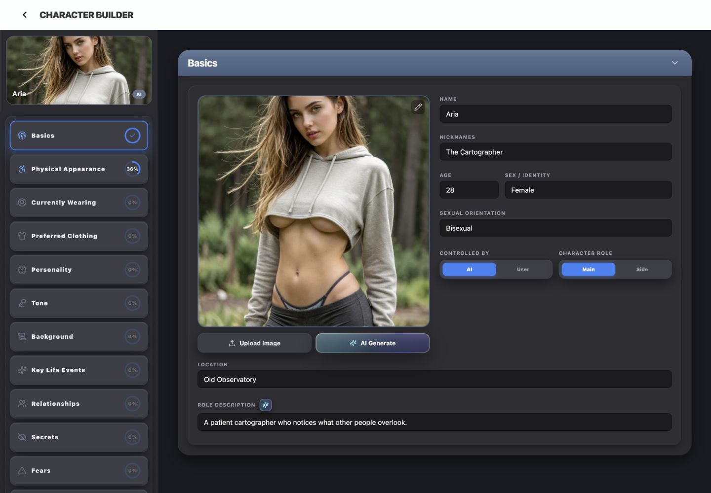</picture></div><figcaption>Character Builder's selected-profile editor with production page and header components and local sample data.</figcaption></figure>

<p class="source-line">Source: <code>src/features/character-builder/CharacterBuilderScreen.tsx</code> · selected editor lines 883–1008; library grid branch lines 790–880. Header context: <code>src/components/app-shell/AppShellTopBar.tsx</code> · lines 357–378 and 647–683.</p>

#### Check the New Composition

Compare the result with the closest specimen at the same effective width. Check the surface layers, radii, shadow strength, label/body/title scale, control height and gaps. Inspect narrow width, long labels, keyboard focus and the relevant changed states. Correct the result before treating visual review as the user's responsibility.

## Color Palette

### Color Palette

The shared dark tokens describe reusable surfaces. The selected Character Builder editor applies its own canvas color and several explicit local variants. A matching token is useful; a different token must not silently replace the value owned by the component.

| Role | Current value | Where it applies |
| --- | --- | --- |
| Editor canvas | `#1a1b20` | Selected-profile scroll area. `CHRONICLE_DARK.background` is `#0d0e12` and does not replace this local canvas. |
| Major shell/sidebar | `#2a2a2f` | Authoring sections and trait sidebar. |
| Inner tray | `#2e2e33` | Grouped fields and navigation tray. |
| Elevated control | `#3c3e47` | Add actions, media upload, segmented tray and trait navigation. |
| Ordinary action | `#303035`; hover/pressed `#343439` | Shared neutral SurfaceButton, including Save and Cancel. |
| Media action hover/pressed | `#44464f` | Avatar Upload Image, not the ordinary button's hover. |
| Recessed field | `#1c1c1f` | Editable values and the fixed label block; border black/35. |
| Slate title | `#5a7292 → #4a5f7f` | Main authoring headers. |
| Value text | White | Standard editable descriptions. |
| Control text | `#eaedf1` | Ordinary actions and trait navigation labels. |
| Muted text | `zinc-400` / `#a1a1aa` | Labels and collapsed body copy. |
| Placeholder | `zinc-600` / `#52525b` | Standard recessed fields. Shared `CHRONICLE_DARK.dim` is `#525260`; it is not this placeholder. |
| Selection, Add, progress | `blue-500` / `#3b82f6` | Selected modes, Add labels and completion ring. |
| Navigation icon emphasis | `#60a5fa` | Active/nonempty trait icons; idle is `#6b7280`. |
| Local removal | `red-500`, hover `red-400` | ExtraRow remove control; Personality uses its explicitly quieter variant. |
| AI | Teal–violet layers over `#2B2D33` | Enhancement and generation, with complete layered styles. |

<p class="source-line">Source: <code>src/components/chronicle/chronicle-dark-ui.ts</code> · lines 6–31; <code>src/features/character-builder/CharacterBuilderScreen.tsx</code> · lines 889–1005, 1167–1220; <code>src/features/character-builder/sidebar/TraitNavButton.tsx</code> · lines 33–70; <code>src/features/character-builder/rows/ExtraRow.tsx</code> · lines 28–75.</p>

#### Surface Shadows

Import these complete values from `CHRONICLE_DARK`; using only the fill removes the depth relationship.

| Surface | Exact shadow |
| --- | --- |
| Shell | `0 12px 32px -2px rgba(0,0,0,0.50), inset 1px 1px 0 rgba(255,255,255,0.09), inset -1px -1px 0 rgba(0,0,0,0.35)` |
| Tray | `inset 1px 1px 0 rgba(255,255,255,0.07), inset -1px -1px 0 rgba(0,0,0,0.30), 0 4px 12px rgba(0,0,0,0.25)` |
| Button | `0 8px 24px rgba(0,0,0,0.45), inset 0 1px 0 rgba(255,255,255,0.09), inset 0 -1px 0 rgba(0,0,0,0.20)` |

<p class="source-line">Source: <code>src/components/chronicle/chronicle-dark-ui.ts</code> · lines 22–27. The sidebar uses the same shell edges with a <code>.55</code> outer-shadow opacity; the standard section uses <code>.50</code> (<code>src/features/character-builder/CharacterBuilderScreen.tsx</code> · lines 892 and 993).</p>

#### Specific Variants

| Variant | Meaning and boundary |
| --- | --- |
| Standard built-in header | HardcodedSection uses the slate gradient and a white/7% sheen over the top portion. |
| Personality header | Same slate gradient with a white/15% sheen. This is an existing local variation, not a new header standard. |
| Custom section | Solid `#4a5f7f` header, white/10% shell border and outer shell shadow without the standard inset edges. Reuse when extending that custom-content surface; use the standard section family for a new ordinary authoring subject. |
| Personality flexibility summary | Rigid is red, Normal blue and Flexible emerald. These describe that domain scale; red there does not mean an invalid field. |

<p class="source-line">Source: <code>src/features/character-builder/sections/HardcodedSection.tsx</code> · lines 19–34; <code>src/components/chronicle/PersonalitySection.tsx</code> · lines 27–30 and 261–273; <code>src/features/character-builder/CharacterBuilderScreen.tsx</code> · lines 1616–1648.</p>

## Typography & Spacing

### Typography & Spacing

Inherit Chronicle's application font. Character Builder creates hierarchy through size, weight, case and spacing. It does not need a separate display typeface for a new profile category.

| Text role | Current treatment | Source |
| --- | --- | --- |
| Shared page title | 18px, black weight, uppercase, tracking-tight; `hsl(var(--ui-surface-2))` | `AppShellTopBar.tsx:167–171` |
| Authoring section title | 20px, bold, white, `-.015em` tracking | `HardcodedSection.tsx:25` |
| Trait navigation label | 12px, black weight, `.08em` tracking, tight line height, `#eaedf1` | `TraitNavButton.tsx:70` |
| Basics label | 10px, bold, uppercase, tracking-widest, zinc-400 | `CharacterBuilderScreen.tsx:1167–1190` |
| Fixed or editable row label | 12px, bold, uppercase, tracking-widest, zinc-400 | `HardcodedRow.tsx:25`, `ExtraRow.tsx:28` |
| Field value | 14px, white | `HardcodedRow.tsx:65` |
| Ordinary action | 12px, bold, leading-none, `#eaedf1` | `chronicle-dark-ui.ts:30–31` |
| Exclusive mode | 10px, black weight | `CharacterBuilderScreen.tsx:1194–1217` |
| Collapsed summary | 10px bold uppercase zinc-500 label; 14px zinc-400 body | `CharacterBuilderScreen.tsx:673–679` |
| Empty content | 14px zinc-500 italic | `PersonalitySection.tsx:159` |

<p class="source-line">Source owners: <code>src/components/app-shell/AppShellTopBar.tsx</code>; <code>src/features/character-builder/sections/HardcodedSection.tsx</code>; <code>src/features/character-builder/sidebar/TraitNavButton.tsx</code>; <code>src/features/character-builder/CharacterBuilderScreen.tsx</code>; <code>src/features/character-builder/rows/HardcodedRow.tsx</code>; <code>src/features/character-builder/rows/ExtraRow.tsx</code>; <code>src/components/chronicle/chronicle-dark-ui.ts</code>; <code>src/components/chronicle/PersonalitySection.tsx</code>.</p>

#### Spacing and Responsive Arrangement

| Relationship | Current rule | Adaptation |
| --- | --- | --- |
| Major section | 20px header horizontal inset, 12px vertical; body inset 20px; tray inset 20px with 24px bottom | Keep the layer relationships; choose content width independently. |
| Field row | 8px between row parts; 6px between label and optional AI icon | Stack below `md`; ordinary fixed/editable label cluster is 40% at `md`. |
| Basics label | 4px before its field | Keep related text close; longer labels can wrap. |
| Section children | 16px spacing in HardcodedSection | Personality also has 12px row spacing and 20px/24px group spacing. Follow the chosen owner. |
| Choice tray | 6px padding, 8px inner radius within 12px outer radius | Equal-width modes for short labels; content-fit is an existing Personality variant. |
| Trait navigation | 10px outer padding, 10px tray padding, 8px button spacing | The 320px desktop sidebar is an existing composition, not a mandatory width for every new panel. |
| Media/identity arrangement | One column until `xl`, then two with 20px gap | The square avatar and side-by-side identity fields belong to Basics. |

<p class="source-line">Source: <code>src/features/character-builder/sections/HardcodedSection.tsx</code> · lines 20–35; <code>src/features/character-builder/rows/HardcodedRow.tsx</code> · lines 23–67; <code>src/features/character-builder/CharacterBuilderScreen.tsx</code> · lines 117–126, 931–937, 1007–1008 and 1167–1194; <code>src/components/chronicle/PersonalitySection.tsx</code> · lines 140–145, 277–280 and 324.</p>

#### Focus, Names and Unavailable States

New compositions must retain usable control semantics alongside styling. These are explicit construction responsibilities, not claims that all existing specimens already implement them.

| Case | Construction rule |
| --- | --- |
| Shared component supplies focus/disabled | Preserve it. Ordinary actions use the teal ring; media AI uses violet; recessed text uses blue border and blue/20 ring. |
| Local control has no visible focus treatment | For a new control, add `focus-visible:outline-none focus-visible:ring-2 focus-visible:ring-blue-300`, as in the derived examples. Do not remove it to match an incomplete specimen. |
| New disabled local control | Supply native `disabled`, an appropriate accessible explanation when needed and `disabled:opacity-50 disabled:cursor-not-allowed`. This is a derived fallback; disabling is not achieved by opacity alone. |
| Auto-resizing wrapper | Character Builder's AutoResizeTextareaField does not forward input IDs, disabled or ARIA props. Use a named native field with the same visual classes when those props are needed, as the examples do. |
| Required-field validation | HardcodedRow/ExtraRow supply no validation style. A new required field must add an associated message and `aria-invalid`; use a red-500 border/message as an explicit derived error variant, preserving the field geometry. Replace the normal focus colors with `border-red-500 focus:border-red-500 focus:ring-red-500/20`; associate the message with `aria-describedby`. Do not mark an optional blank field invalid. |
| Keyboard ordering | Existing row enhancement/removal controls use `tabIndex={-1}`. New actions must be keyboard reachable. TabFieldNavigator also intercepts Tab between text fields; it is not a styling requirement for a new mixed-control form. |

<p class="source-line">Source: <code>src/features/character-builder/rows/AutoResizeTextareaField.tsx</code> · lines 4–36; <code>src/features/character-builder/rows/HardcodedRow.tsx</code> · lines 30–37; <code>src/features/character-builder/rows/ExtraRow.tsx</code> · lines 32–39 and 69–75; <code>src/components/chronicle/TabFieldNavigator.tsx</code> · lines 11–30; derived focus/naming: <code>docs/ui-guide/examples/character-builder-compositions.tsx</code>.</p>

## Buttons & Menus

### Buttons & Menus

Match the action's meaning to its visual family. An ordinary save, an Add action, an AI operation and a local removal are distinct. Blue does not simply mean “primary button.”

<section class="manual-entry">

#### Ordinary Actions and Add Actions

Save, Cancel and the library destination action use the ordinary shared surface button. Adding a row uses the elevated surface with blue text.

| Specification | Ordinary action | Add row or trait |
| --- | --- | --- |
| Geometry | 40px height, 12px radius | 40px height, 12px radius, full width in existing rows |
| Fill | `#303035` | `#3c3e47` |
| Text | 12px/bold/`#eaedf1` | 12px/bold/blue-500 |
| Hover/pressed | `#343439`; pressed scale 95% | Hover blue-300 and brightness 110% |
| Shadow | `CHRONICLE_DARK.buttonShadow` | Same shared shadow |
| Focus/disabled | Teal/40% ring; disabled 50% and pointer suppression | Existing local Add lacks explicit focus/disabled; add the derived new-control treatments when needed |

<section class="reuse-recipe">

##### Use in a New Design

**Construction:** Import ChronicleSurfaceButton for ordinary actions. It forwards native button props and supplies the fill, height, radius, shadow and states. The caller adds label, padding, icon, callbacks and operation state; it defaults to `type="button"`. Explicitly use `type="submit"` for form submission.

```tsx
<ChronicleSurfaceButton className="px-4" onClick={onCancel}>Cancel</ChronicleSurfaceButton>
<ChronicleSurfaceButton className="px-4" type="submit" disabled={isSaving}>
  {isSaving ? 'Saving...' : 'Apply'}
</ChronicleSurfaceButton>
```

For an Add action, preserve this complete local class and its shadow. Add the derived focus/disabled fallback if the new operation needs it.

```tsx
className="w-full h-10 text-xs font-bold text-blue-500 hover:text-blue-300 bg-[#3c3e47] rounded-xl shadow-[0_8px_24px_rgba(0,0,0,0.45),inset_0_1px_0_rgba(255,255,255,0.09),inset_0_-1px_0_rgba(0,0,0,0.20)] hover:brightness-110 transition-all flex items-center justify-center gap-1"
```

**Keep and adapt:** Keep the action family, geometry and states. Adapt width, label and icon. A new ordinary Apply or Reset action uses the neutral family. The current header's Save versus Update Character labels describe distinct destinations, not styling differences.

<p class="source-line">Source: <code>src/components/chronicle/ChronicleDarkUi.tsx</code> · lines 6–17; <code>src/components/chronicle/chronicle-dark-ui.ts</code> · lines 30–31; <code>src/components/chronicle/PersonalitySection.tsx</code> · lines 162–168; actual header uses <code>src/components/app-shell/AppShellTopBar.tsx</code> · lines 647–683.</p>

</section>

<details class="implementation"><summary>Implementation Details</summary>

```tsx
<SurfaceButton onClick={characterEditor.onCancel} className="px-6 gap-2">
  Cancel
</SurfaceButton>
```

</details>

</section>

<section class="manual-entry">

#### Avatar Source and AI Actions

<figure class="source-preview"><div class="capture-background">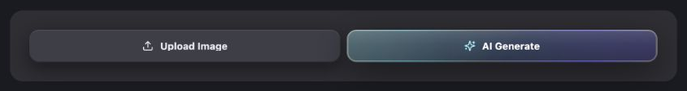</div><figcaption>Production AvatarActionButtons showing the neutral upload and layered AI generation action family with local state props.</figcaption></figure>

| Part | Current rule |
| --- | --- |
| Arrangement | Full-width actions, stacked below `sm`, side-by-side at `sm`; 8px gap |
| Upload | 40px height, 12px radius, 16px horizontal inset, 14px icon and 8px gap; `#3c3e47`, hover/pressed `#44464f`, shared button shadow |
| Upload text/focus | 12px bold `#eaedf1`; teal/40% focus ring; “Uploading...” while uploading |
| AI Generate | 40px/12px, layered teal–violet border and interior, bloom and sheen; `0 12px 40px rgba(0,0,0,.45)` shadow; hover brightness 125% |
| AI focus/busy | Violet-400/45 focus ring; “Generating...” while generating |
| Disabled | Both use 50% opacity; Upload disabled by `disabled || isUploading`; Generate also disabled by `isGenerating` |

<section class="reuse-recipe">

##### Use in a New Design

**Construction:** Import AvatarActionButtons when both actions have this avatar/source contract. The component supplies the full appearance, Upload menu and picker-open state. The caller supplies the upload, selected-image and generate callbacks and operation flags.

```tsx
<AvatarActionButtons
  onUploadFromDevice={onUploadFromDevice}
  onSelectFromLibrary={onSelectFromLibrary}
  onGenerateClick={onGenerateClick}
  disabled={disabled}
  isUploading={isUploading}
  isGenerating={isGenerating}
/>
```

**Keep and adapt:** Preserve the complete layered AI treatment, including focus and disabled state. This component targets avatar imagery; its library picker uses the character-avatar destination. For a different media operation, borrow the visual treatment with the correct operation owner instead of inheriting that destination accidentally. A local AI sparkle beside a field is a separate compact variant documented with the trait rows.

<p class="source-line">Source: <code>src/components/chronicle/AvatarActionButtons.tsx</code> · props lines 11–18; ordinary action lines 30–51; AI layers lines 75–178; picker lines 181–188.</p>

</section>

<details class="implementation"><summary>Implementation Details</summary>

```tsx
const isDisabled = disabled || isUploading;
```

The complete AI layers are supplied by the imported component. Its decorative spans are hidden from assistive technology; operation state remains caller-owned.

</details>

</section>

<section class="manual-entry">

#### Command Menu

<figure class="source-preview"><div class="capture-background">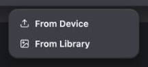</div><figcaption>Production avatar upload menu with From Device and From Library commands.</figcaption></figure>

| Part | Current rule |
| --- | --- |
| Menu surface | `#3c3e47`, 14px radius, black/20 border, 6px padding and shared button shadow |
| Placement | Primitive portal; default side offset 4px; avatar Upload uses centered 192px-wide menu |
| Row | 9px radius, 10px horizontal/8px vertical inset, 13px semibold `#eaedf1` |
| Focus | White/8% row fill, white text |
| Disabled | 40% opacity and pointer suppression |

<section class="reuse-recipe">

##### Use in a New Design

**Construction:** Use DropdownMenu, DropdownMenuTrigger with `asChild`, DropdownMenuContent and DropdownMenuItem from `src/components/ui/dropdown-menu.tsx`. The primitive supplies the menu interaction, portal and row treatment. The caller supplies commands, names, width and disabled state. A menu command runs an action; it is not a form awaiting Apply.

```tsx
<DropdownMenu>
  <DropdownMenuTrigger asChild>
    <ChronicleSurfaceButton className="px-4">Options</ChronicleSurfaceButton>
  </DropdownMenuTrigger>
  <DropdownMenuContent align="end">
    <DropdownMenuItem onSelect={onReset}>Reset choices</DropdownMenuItem>
  </DropdownMenuContent>
</DropdownMenu>
```

**Keep and adapt:** Keep menu surface, row geometry and focused/disabled treatment. Choose width for the labels; 192px is the avatar menu's choice. For a few immediate controls rather than commands, use the compact anchored-surface recipe in Panels & Layout.

<p class="source-line">Source: <code>src/components/ui/dropdown-menu.tsx</code> · lines 55–88; avatar caller <code>src/components/chronicle/AvatarActionButtons.tsx</code> · lines 53–71.</p>

</section>

<details class="implementation"><summary>Implementation Details</summary>

```tsx
<DropdownMenuContent align="center" className="w-48">
```

</details>

</section>

## Fields & Controls

### Fields & Controls

Character Builder uses the same recessed value treatment in several arrangements. Basics places small labels above fields. Trait rows place a larger fixed or editable label beside a description. Choose the arrangement from the information relationship and retain the complete field styling.

<section class="manual-entry">

#### Recessed Text and Basics Labels

<figure class="source-preview"><div class="capture-background"><picture><source media="(max-width:600px)" srcset="../../src/assets/ui-guide/character-builder/basics-narrow.png">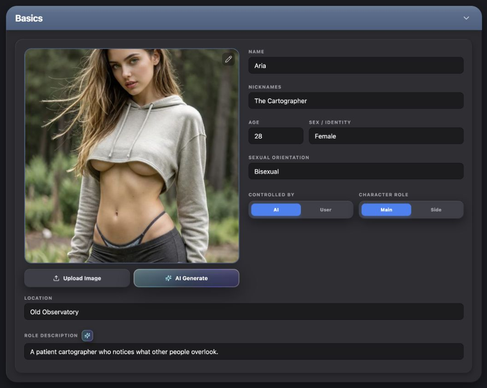</picture></div><figcaption>Production Basics section with avatar, identity fields and exclusive control and role choices. The narrow specimen isolates the upper Basics layout; further fields continue in its scroll area.</figcaption></figure>

| Specification | Current rule |
| --- | --- |
| Label above field | 10px bold uppercase zinc-400, tracking-widest, 4px bottom gap |
| Value field | `#1c1c1f`, black/35 border, 8px radius; 12px horizontal/8px vertical inset; 14px white text |
| Placeholder |zinc-600 |
| Focus |Blue-500 border plus 2px blue-500/20 ring; outline removed |
| Growing content |AutoResizeTextareaField resets height then grows to `scrollHeight`; default 1 row; wraps words and preserves line breaks |

The adjacent avatar is authored media with its own frame states. Preserve those states when borrowing the Basics media treatment:

| Avatar state | Current treatment |
| --- | --- |
| Populated |Square, full width, 16px radius and `shadow-lg`; 2px `#4a5f7f` border; clipped `object-cover` image with caller-owned object position |
| Empty |Zinc-800 → zinc-900 diagonal gradient, 2px dashed slate border, 16px radius; 40px zinc-500 avatar icon and 10px black-weight uppercase placeholder |
| Generating |Image 50% opacity; black 30% overlay with 2px backdrop blur and 40px white spinner |
| Repositioning | 4px blue-500 ring, move cursor, clipped image and touch action disabled; local Done control exits this state |
| Image commands |Top-right 16px Pencil in 6px-inset/8px-radius button; black 30% → black 50% hover fill and white 70% → white text; hidden while repositioning |

The square ratio suits an avatar; it is not a rule for every image. CharacterBuilderScreen owns these frame states and handlers; AvatarActionButtons owns the source actions below the frame. New image controls need descriptive alternative text, a named menu trigger and keyboard access, which this existing avatar markup does not fully supply.

<p class="source-line">Source: <code>src/features/character-builder/CharacterBuilderScreen.tsx</code> · lines 1011–1087.</p>

<section class="reuse-recipe">

##### Use in a New Design

**Construction:** AutoResizeTextareaField supplies growth and width, not the appearance. Pass this full class for the normal field:

```tsx
className="w-full min-w-0 px-3 py-2 text-sm bg-[#1c1c1f] border border-black/35 text-white placeholder:text-zinc-600 rounded-lg focus:outline-none focus:ring-2 focus:ring-blue-500/20 focus:border-blue-500"
```

The wrapper accepts `value`, `onChange(value)`, `placeholder`, `className` and `rows`. It remeasures on value changes, not on a width-only resize; test wrapping when its container changes width. It does not forward `id`, disabled or ARIA props. For a named native field with those capabilities, use the same class and an associated label:

```tsx
<label htmlFor="delivery-note" className="text-[10px] font-bold text-zinc-400 uppercase tracking-widest mb-1 block">Delivery note</label>
<textarea id="delivery-note" value={note} onChange={e => setNote(e.target.value)} rows={4} className={fieldClass} />
```

Here `fieldClass` is the full class above; a native textarea requires its own chosen resize/growth behavior. The derived examples use `resize-y` and a declared initial row count rather than claiming to be the auto-growing wrapper.

**Keep and adapt:** Keep fill, border, focus, radius, text and padding. Choose single-line input or multiline textarea for the value; choose row count for the content. Add validation only when the feature requires it, following the explicit derived rule in Typography & Spacing.

<p class="source-line">Source: <code>src/features/character-builder/rows/AutoResizeTextareaField.tsx</code> · lines 4–36; Basics labels/fields <code>src/features/character-builder/CharacterBuilderScreen.tsx</code> · lines 1167–1187.</p>

</section>

<details class="implementation"><summary>Implementation Details</summary>

```tsx
React.useEffect(() => {
  if (!ref.current) return;
  ref.current.style.height = 'auto';
  ref.current.style.height = `${ref.current.scrollHeight}px`;
}, [value]);
```

</details>

</section>

<section class="manual-entry">

#### Fixed Label and Editable Description

<figure class="source-preview"><div class="capture-background">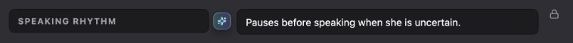</div><figcaption>Production HardcodedRow showing a fixed recessed label, optional compact AI action, editable description and lock marker.</figcaption></figure>

| Part | Current rule |
| --- | --- |
| Arrangement |Stacked below `md`; label cluster 40% at `md`, description grows, trailing lock slot 28px; 8px gaps |
| Fixed label |Recessed fill and black/35 border; 8px radius, 12px ×8px inset; 12px bold uppercase zinc-400, tracking-widest; wraps long words |
| Description |Full standard recessed text treatment |
| Lock | 14px zinc-400; indicates the fixed field definition, not a disabled editable value |
| Optional AI action | 8px outer radius, 6px inset, 13px cyan-200 sparkle; iridescent edge and 1.5px-inset teal–violet interior over `#2B2D33`; `0 4px 12px rgba(0,0,0,.40)` shadow |
| AI states |Hover brightness 125%; enhancing disables and uses pulse/wait cursor |

<section class="reuse-recipe">

##### Use in a New Design

**Construction:** HardcodedRow supplies this entire row. The caller provides label, value, value handler, optional placeholder, and optional enhancement callback/state.

```tsx
<HardcodedRow label="Usual gesture" value={gesture} onChange={setGesture} placeholder="Describe the recurring gesture" />
```

**Keep and adapt:** Use a fixed label when the field's meaning belongs to the feature. Reuse its 40%/remaining layout where appropriate, but stack or adjust proportions for the actual width. A new named native label/value row can reproduce the treatment while supplying associations the existing wrapper lacks. The Mannerisms example demonstrates that deliberate construction.

**Existing limitation:** HardcodedRow's label is a styled div, and its wrapper cannot accept an input ID. Its enhancement button is excluded from sequential Tab navigation. These are source limitations, not styling requirements; new compositions must give fields names and actions keyboard access.

<p class="source-line">Source: <code>src/features/character-builder/rows/HardcodedRow.tsx</code> · lines 6–13, 23–69.</p>

</section>

<details class="implementation"><summary>Implementation Details</summary>

```tsx
<div className="flex-1 px-3 py-2 text-xs font-bold bg-[#1c1c1f] border border-black/35 text-zinc-400 rounded-lg uppercase tracking-widest min-w-0 break-words">
  {label}
</div>
```

</details>

</section>

<section class="manual-entry">

#### Editable Label and Description Rows

<figure class="source-preview"><div class="capture-background">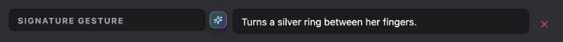</div><figcaption>Production ExtraRow with editable label and description, compact AI action and local remove control.</figcaption></figure>

<figure class="source-preview"><div class="capture-background">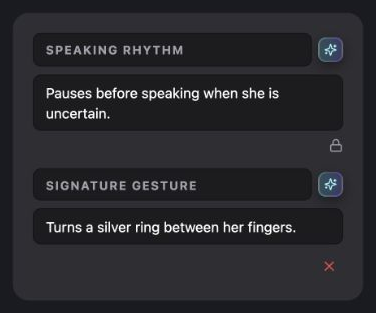</div><figcaption>Character Builder fixed and editable field rows stacked at a narrow width.</figcaption></figure>

The row is a named item in a collection. Both label and description can change; local removal deletes that row rather than the character.

| Part | Current rule |
| --- | --- |
| Label |Same recessed 12px bold uppercase zinc-400 treatment as the fixed label, now with placeholder and blue focus state |
| Description | 14px white recessed field |
| Layout |Stacked below `md`; label cluster 40%, value grows; 8px gap |
| Remove | 16px X, 6px inset, 6px radius; red-500, hover red-400 and red-900/30 fill; aligns at row end |
| Add |Full-width elevated 40px action with blue text and shared button shadow |
| Empty collection |The containing section supplies a short 14px zinc-500 italic message and a way to add an item |

<section class="reuse-recipe">

##### Use in a New Design

**Construction:** ExtraRow supplies both fields, optional compact enhancement, local remove appearance and responsive arrangement. The caller supplies the item and update/remove handlers. Collection identity and state remain outside the row.

```tsx
<ExtraRow extra={row} onUpdate={patch => updateRow(row.id, patch)} onDelete={() => removeRow(row.id)} />
```

**Keep and adapt:** Keep the editable label visibly distinct from the description and preserve the recessed family. Use the compact red remove action for removing one working entry. A consequential saved-record deletion needs confirmation appropriate to its real consequence; this local X is not a universal delete pattern.

**Existing limitation:** The row's text wrappers lack forwarded naming/disabled props, and enhancement/remove controls use `tabIndex={-1}`. The native fields and named keyboard-reachable removal in the derived Mannerisms example show how to preserve this appearance in a new accessible composition.

<p class="source-line">Source: <code>src/features/character-builder/rows/ExtraRow.tsx</code> · lines 7–12 and 22–75; Add pattern <code>src/components/chronicle/PersonalitySection.tsx</code> · lines 159–168.</p>

</section>

<details class="implementation"><summary>Implementation Details</summary>

```tsx
<AutoResizeTextareaField
  value={extra.label}
  onChange={(value) => onUpdate({ label: value })}
  placeholder="LABEL"
  className="flex-1 px-3 py-2 text-xs font-bold bg-[#1c1c1f] border border-black/35 text-zinc-400 uppercase tracking-widest placeholder:text-zinc-600 rounded-lg focus:outline-none focus:ring-2 focus:ring-blue-500/20 focus:border-blue-500 min-w-0"
/>
```

</details>

</section>

<section class="manual-entry">

#### Exclusive Choices and Independent Toggles

Controlled By and Character Role are separate exclusive choices in Basics. Standard/Split in Personality is a related compact mode choice. Checklist values in Character Goals are independent toggles.

| Part | Current rule |
| --- | --- |
| Segmented tray |`#3c3e47`, 12px radius, 6px padding and shared button shadow |
| Segment | 8px radius, 6px vertical inset, 10px black-weight text; equal width in Basics |
| Selected |Blue-500 fill, white text, `0 2px 8px rgba(59,130,246,.35)` shadow |
| Unselected |`#3f3f46` fill, `#a1a1aa` text, hover zinc-300 |
| Personality mode variant |Tray fits content; each segment has 14px horizontal inset |
| Checkbox |Shared 16px square with 4px radius; Character Goals adds zinc-600 border and blue-500 checked fill/border |
| Checkbox states |Primitive supplies checked indicator, keyboard focus and 50% disabled with not-allowed cursor; completed goal text uses line-through/zinc-500 |

<section class="reuse-recipe">

##### Use in a New Design

**Construction:** For an exclusive choice, carry the tray and both segment states together. The caller supplies one value and associated label/choice semantics; do not rely on color as the only indication. This short derived native-button arrangement adds `aria-pressed` and the explicit focus fallback to the existing appearance:

```tsx
<div role="group" aria-label="Delivery" className="flex p-1.5 bg-[#3c3e47] rounded-xl" style={{ boxShadow: CHRONICLE_DARK.buttonShadow }}>
  {options.map(option => <button key={option.value} type="button" aria-pressed={value === option.value} onClick={() => setValue(option.value)} className={`flex-1 py-1.5 text-[10px] font-black rounded-lg transition-all focus-visible:outline-none focus-visible:ring-2 focus-visible:ring-blue-300 ${value === option.value ? 'bg-[#3b82f6] text-white shadow-[0_2px_8px_rgba(59,130,246,0.35)]' : 'bg-[#3f3f46] text-[#a1a1aa] hover:text-zinc-300'}`}>{option.label}</button>)}
</div>
```

For independent values, import Checkbox from `src/components/ui/checkbox.tsx` and supply its Character Goals override:

```tsx
<label className="flex items-center gap-3 text-sm text-zinc-200">
  <Checkbox checked={enabled} onCheckedChange={checked => setEnabled(checked === true)} className="border-zinc-600 data-[state=checked]:bg-blue-500 data-[state=checked]:border-blue-500" />
  Show progress
</label>
```

**Keep and adapt:** Preserve selected/unselected contrast, control shape and appropriate focus. Adapt labels and group width. Native select is another compact exclusive-choice pattern: Personality uses recessed fill, black/35 border, 8px radius, 8px inset, 10px bold uppercase zinc-300 and blue/20 focus ring. Its Rigid/Normal/Flexible values are domain content, not default options for a new feature.

<p class="source-line">Source: <code>src/features/character-builder/CharacterBuilderScreen.tsx</code> · lines 1188–1220; <code>src/components/chronicle/PersonalitySection.tsx</code> · lines 108–115 and 280–319; <code>src/components/chronicle/CharacterGoalsSection.tsx</code> · lines 297–310; <code>src/components/ui/checkbox.tsx</code> · lines 7–22.</p>

</section>

<details class="implementation"><summary>Implementation Details</summary>

```tsx
className="border-zinc-600 data-[state=checked]:bg-blue-500 data-[state=checked]:border-blue-500"
```

</details>

</section>

## Panels & Layout

### Panels & Layout

Use a substantial shell for one authoring subject or separate editing task. Use a compact surface for a few commands or immediate settings. The trait sidebar and the editor's independent scroll region are a page arrangement; their presence is not required around every new component.

<section class="manual-entry">

#### Authoring Section Shell

<figure class="source-preview"><div class="capture-background">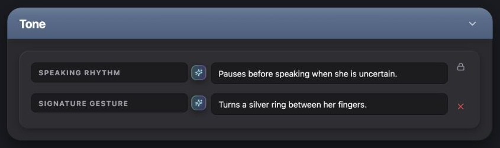</div><figcaption>Production HardcodedSection with its slate header, outer graphite shell and inset tray of representative character fields.</figcaption></figure>

| Layer | Complete applicable treatment |
| --- | --- |
| Shell |Full width, `#2a2a2f`, 24px radius, clipped overflow, `CHRONICLE_DARK.shellShadow` |
| Header |Relative slate gradient `#5a7292 → #4a5f7f`, white/20 top border, 20px horizontal/12px vertical inset, flex title/action with space between, `shadow-lg` |
| Sheen |Decorative white/7% top gradient fading through transparent, background size 100% ×60%, no repeat, pointer-events none |
| Title |White 20px bold, `-.015em`, above sheen |
| Collapse | 20px chevron, 4px button inset, 6px radius; white 70% → white, ghost-white hover |
| Body | 20px outer inset |
| Tray |`#2e2e33`, 16px radius, 20px inset/24px bottom, `CHRONICLE_DARK.trayShadow`; 16px spacing when expanded |

<section class="reuse-recipe">

##### Use in a New Design

**Construction:** HardcodedSection supplies these layers and switches between `children` and `collapsedContent`. It does not own the expanded value, data, row handlers or summary. Import it for the existing section contract:

```tsx
<HardcodedSection title="Mannerisms" isExpanded={expanded} onToggle={() => setExpanded(!expanded)} collapsedContent={<p className="text-sm text-zinc-400">{summary}</p>}>
  {fields}
</HardcodedSection>
```

For a new shell needing named/associated collapse controls, build the same layers with ChronicleDarkShell and the exact header/tray treatment above. ChronicleDarkShell supplies only the shell fill, 24px radius and shadow. The Mannerisms example does this; it does not modify HardcodedSection.

**Keep and adapt:** Preserve the matching fill/radius/shadow of each layer. Choose width, title, field groups and responsive rows from the content. Avoid adding another titled shell around every field group. The existing collapse control lacks a name and `aria-expanded`; new controls must add these plus the visible-focus fallback.

<p class="source-line">Source: <code>src/features/character-builder/sections/HardcodedSection.tsx</code> · lines 4–38; <code>src/components/chronicle/ChronicleDarkUi.tsx</code> · lines 21–38.</p>

</section>

<details class="implementation"><summary>Implementation Details</summary>

```tsx
<div className="p-5">
  <div className="p-5 pb-6 bg-[#2e2e33] rounded-2xl shadow-[inset_1px_1px_0_rgba(255,255,255,0.07),inset_-1px_-1px_0_rgba(0,0,0,0.30),0_4px_12px_rgba(0,0,0,0.25)]">
    {isExpanded ? <div className="space-y-4">{children}</div> : collapsedContent}
  </div>
</div>
```

</details>

</section>

<section class="manual-entry">

#### Collapsed Section and Readable Summary

<figure class="source-preview"><div class="capture-background">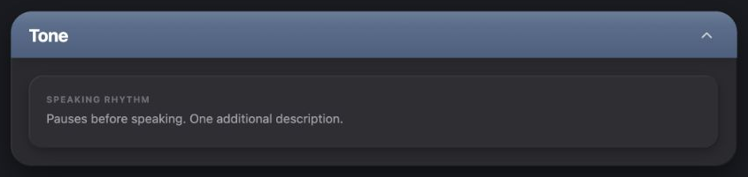</div><figcaption>Production authoring section in its collapsed summary state, retaining the shell, title and tray.</figcaption></figure>

Collapsing a section changes its contents to a readable summary. It does not remove the subject's shell or replace the tray with a new visual family.

| Part | Current rule |
| --- | --- |
| Summary label | 10px bold uppercase zinc-500, tracking-widest |
| Summary body | 14px zinc-400, 4px label/body gap |
| Empty | 14px zinc-500 italic message |
| State |Caller owns expanded state and meaningful summary; HardcodedSection selects the supplied content |

<section class="reuse-recipe">

##### Use in a New Design

**Construction:** Render relevant filled values as summary text and supply a concise empty message. Read-only content should look like readable copy; it is not a collection of disabled inputs. Do not infer that “collapsed” means data was saved.

**Keep and adapt:** Retain the shell, title and tray, then choose the amount of summary from the task. The new Mannerisms example summarizes the usual gesture and counts extra entries; that content is a teaching choice, not a universal summary format.

<p class="source-line">Source: <code>src/features/character-builder/CharacterBuilderScreen.tsx</code> · lines 673–679; <code>src/features/character-builder/sections/HardcodedSection.tsx</code> · lines 33–35; empty summary <code>src/components/chronicle/PersonalitySection.tsx</code> · lines 245–255.</p>

</section>

<details class="implementation"><summary>Implementation Details</summary>

```tsx
<div className="space-y-1">
  <span className="text-[10px] font-bold text-zinc-500 uppercase tracking-widest block">{label}</span>
  <p className="text-sm text-zinc-400">{value}</p>
</div>
```

</details>

</section>

<section class="manual-entry">

#### Trait Navigation and Completion

<figure class="source-preview"><div class="capture-background">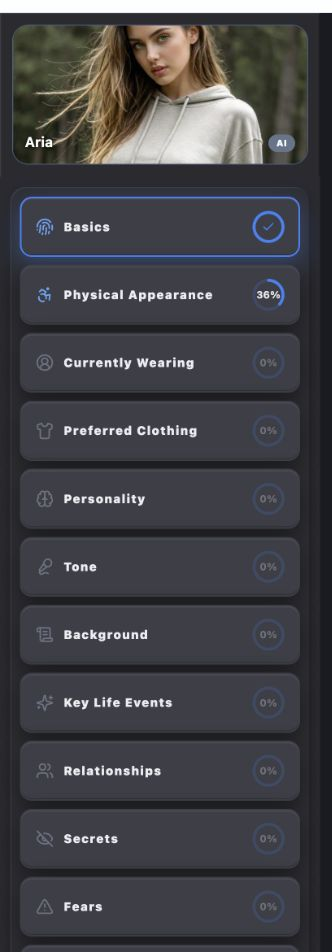</div><figcaption>Production Character Builder trait navigation beside the selected character profile.</figcaption></figure>

<figure class="source-preview"><div class="capture-background">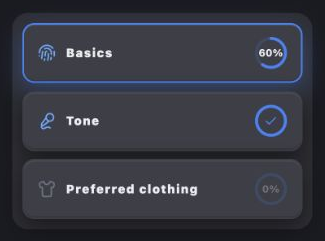</div><figcaption>Production TraitNavButton and TraitProgressRing showing empty, partial and completed states.</figcaption></figure>

| Part | Current rule |
| --- | --- |
| Page arrangement |Full-width sidebar above content below `lg`; 320px at `lg`; sidebar max 52vh below `lg`, full-height at `lg` |
| Sidebar surface |`#2a2a2f`, square outer corners; shell edges with `.55` outer-shadow opacity |
| Navigation tray | 10px outer plus 10px inner inset, 16px tray radius, `#2e2e33` and tray shadow; 8px button gap |
| Button |Full width,minimum 60px high, 14px horizontal inset, 12px radius, 2px transparent border, elevated fill and button shadow |
| Active |Blue-500 border; outer shadow `0 8px 24px rgba(59,130,246,.35)` plus standard button inset edges |
| Interaction | 150ms transition; hover brightness 112% and -1px y; pressed brightness 95%, y0 and scale 99% |
| Icon/label | 18px icon; 10px icon-label gap; 12px black-weight `.08em` label. Active or nonempty icon blue-400; idle gray |
| Ring | 32px, 3px stroke; blue/18% track and blue-500 progress; 10px bold percent or 14px completed check |

<section class="reuse-recipe">

##### Use in a New Design

**Construction:** TraitNavButton supplies the button, optional image treatment, icon styling and TraitProgressRing. The caller supplies `label`, `active`, `onClick`, an icon and `{total, completed, percent}`. It does not compute completion from arbitrary new fields.

```tsx
<TraitNavButton label="Mannerisms" icon={Sparkles} active={active} progress={progress} onClick={onSelect} />
```

For background images, the component uses the supplied position/scale and overlays black 38% when active or 52% otherwise. Do not add an image simply to match the photographed specimen; the no-image surface is a supported state.

**Keep and adapt:** Keep selection distinct from completion and retain the ring's track/fill relationship. Choose navigation width and names for the actual surface; this full sidebar is not required for an isolated dialog. A new navigation control must expose current selection semantically and add a visible-focus treatment where the existing local owner does not.

<p class="source-line">Source: <code>src/features/character-builder/CharacterBuilderScreen.tsx</code> · lines 889–953; <code>src/features/character-builder/sidebar/TraitNavButton.tsx</code> · lines 7–75; <code>src/features/character-builder/sidebar/TraitProgressRing.tsx</code> · lines 13–59.</p>

</section>

<details class="implementation"><summary>Implementation Details</summary>

```tsx
const hasMeaningfulProgress = progress.total > 0 && progress.percent > 0;
const isCompleted = progress.total > 0 && progress.completed >= progress.total;
const highlightIcon = active || hasMeaningfulProgress || isCompleted;
```

</details>

</section>

<section class="manual-entry">

#### Chooser Dialog

<figure class="source-preview"><div class="capture-background">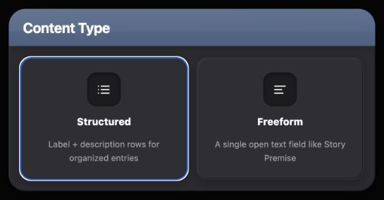</div><figcaption>Production CustomContentTypeModal and ChooserModal with Structured and Freeform choices.</figcaption></figure>

Use a chooser when the user selects a kind and that selection completes the interaction. Custom Content chooses Structured or Freeform; Enhancement Style uses the same shell for Precise or Detailed.

| Part | Current rule |
| --- | --- |
| Overlay/shell |DialogContentBare supplies black 80% backdrop and placement; ChooserModal adds graphite 24px shell and shell shadow |
| Header |Slate gradient, white 20% top border, 20px ×12px inset, 20px bold title and restrained sheen |
| Choice body | 16px inset, 12px gap; currently2 or3 fixed columns |
| Option |Tray fill/shadow, 16px radius, 2px transparent border, 20px vertical/16px horizontal inset; blue border hover for current content types |
| Icon bed | 48px square, 14px radius, recessed fill, black 35% top border and inset `0 2px 6px rgba(0,0,0,.40)` shadow |
| Text | 14px extra-bold white option title; 12px zinc-400 description with relaxed leading |
| Existing width | 520px maximum for2 columns or 680px for3;95vw cap |

<section class="reuse-recipe">

##### Use in a New Design

**Construction:** ChooserModal owns this full appearance and calls `onSelect` then `onClose`. Supply open state, title, choices with stable keys/icons/labels/descriptions, and callbacks. CustomContentTypeModal already supplies its specific two options.

```tsx
<CustomContentTypeModal open={open} onClose={() => setOpen(false)} onSelect={onSelectType} />
```

**Keep and adapt:** Preserve the dialog and tile families. Choose options and width for the task; the current maximums and fixed columns are not universal requirements. For a new implementation, provide an associated DialogTitle and explicit dismissal, and fit the choices at narrow widths. The current chooser has a plain h3 title and fixed columns; these are source limitations. A dialog with deferred Apply needs draft state and the editor-dialog construction below.

<p class="source-line">Source: <code>src/components/chronicle/CustomContentTypeModal.tsx</code> · lines 12–41; <code>src/components/chronicle/ChooserModal.tsx</code> · lines 47–85.</p>

</section>

<details class="implementation"><summary>Implementation Details</summary>

```tsx
onClick={() => {
  onSelect(opt.key);
  onClose();
}}
```

</details>

</section>

<section class="manual-entry">

#### Editor Dialog or Compact Anchored Surface

Separate editing and immediate settings have different surface needs. The Voice Notes example uses a substantial editor dialog. A few settings beside their trigger can use the shared popover primitive with dark menu styling.

| Interaction | Container and inherited styling | Caller responsibility |
| --- | --- | --- |
| Deferred editing with Apply/Cancel |Dialog → DialogContentBare; graphite 24px shell/shadow, slate title, 20px body inset and 16px-radius tray with tray shadow |Open state, associated title/description, named close, bounded scrolling, draft/committed values and dismissal behavior |
| Immediate compact settings |Popover → PopoverTrigger asChild → PopoverContent; `#3c3e47`, 14px radius, black 20% border, shared button shadow |Control values, accessible names, changed/reset handlers and a width that leaves context visible |
| Commands |DropdownMenu and its menu rows |Commands and disabled rules; no form layout or draft needed |

<section class="reuse-recipe">

##### Use in a New Design

**Construction:** DialogContentBare supplies the portal, backdrop, centering and underlying dialog focus/dismissal behavior. It does not supply the graphite shell, header or tray. Default DialogContent adds its own generic background, padding and close control; choose deliberately so those defaults do not introduce a different treatment.

For an editor, use the Authoring Section Shell layer specifications and the Voice Notes example's state contract. Bound the body scroll region and keep the title/close available. For immediate settings, import Popover, PopoverTrigger and PopoverContent from `src/components/ui/popover.tsx`, then override the generic visual defaults with this **derived dark-family treatment**:

```tsx
className="w-72 rounded-[14px] border border-black/20 bg-[#3c3e47] p-4 text-[#eaedf1]"
style={{ boxShadow: CHRONICLE_DARK.buttonShadow }}
```

Here 16px padding and 288px width are example layout choices. The 14px radius, fill, border and shadow come from the actual dropdown family. Choose width and padding for the controls and viewport. Preserve each child control's focus and selection treatment; do not add a slate title merely to make a small settings surface look like a section.

**Keep and adapt:** Keep the chosen surface family's styling. Choose dialog width, field order and arrangement from the task; use the supplied interaction semantics rather than importing unrelated profile-saving logic. A new confirmation for consequential deletion should state the real consequence and use the shared destructive confirmation family, not an unnamed local row X.

<p class="source-line">Source: <code>src/components/ui/dialog.tsx</code> · lines 15–72; <code>src/components/ui/popover.tsx</code> · lines 6–25; dark compact surface owner <code>src/components/ui/dropdown-menu.tsx</code> · lines 55–88; derived editor <code>docs/ui-guide/examples/character-builder-compositions.tsx</code> · VoiceNotesExample.</p>

</section>

<details class="implementation"><summary>Implementation Details</summary>

The compact form is a derived composition of the popover behavior and the dropdown surface; it is not a captured existing Character Builder feature.

</details>

</section>

## Composition Examples

### Composition Examples

These examples show how to combine the documented vocabulary for a new concept. The existing profile composition establishes the page context; the final two entries are proposed teaching compositions with local state. The examples' chosen widths, content, fields and arrangements are not additional Chronicle-wide rules.

<section class="manual-entry">

#### Existing Profile Editor Composition

The selected-profile editor combines a context header, trait navigation and an independently scrolling authoring area. Basics combines an avatar with identity fields and compact exclusive choices. Other traits use fixed or editable label/value rows inside the same authoring family.

| Requirement | Existing composition | What remains adaptable |
| --- | --- | --- |
| Identify where the character belongs |Shared header shows Character Library or Character Builder; actual action labels identify their destination |The new feature's title and actions must describe its real ownership |
| Move among profile subjects |Trait sidebar with selected state and completion ring |Number/names of subjects and whether the task needs a sidebar at all |
| Edit one subject |Graphite section → slate title → body inset → tray → field rows |Row count, label/value proportions and content grouping |
| Review without full inputs |Collapsed summary within the same shell/tray |Which meaningful values to summarize |

<section class="reuse-recipe">

##### Use in a New Design

**Construction:** CharacterBuilderScreen owns the page arrangement, selected section and its character-specific field bindings. Shared row/section components own the reusable presentation described above. AppShellTopBar owns the surrounding context header. New local components should borrow the appropriate pieces rather than mount another complete character editor.

**Keep and adapt:** Preserve the relationship between navigation, subject and values. The library grid's 2:3 portrait cards and the Basics square avatar are different content roles; neither sets a universal image ratio. The selected editor's `#1a1b20` canvas and independent scroll regions are the relevant page context.

<p class="source-line">Source: <code>src/features/character-builder/CharacterBuilderScreen.tsx</code> · lines 889–1008 and 1164–1224; <code>src/components/app-shell/AppShellTopBar.tsx</code> · lines 357–378 and 647–683.</p>

</section>

<details class="implementation"><summary>Implementation Details</summary>

```tsx
<TabFieldNavigator className="flex-1 min-h-0 min-w-0 overflow-y-auto scrollbar-thin bg-[#1a1b20]">
```

The existing TabFieldNavigator wrapper also changes keyboard navigation. Its presence here is page evidence, not an instruction to use it in a new mixed-control form.

</details>

</section>

<section class="manual-entry">

#### New Mannerisms Section

**Derived teaching example.** “Give this character a place for a usual gesture and additional named mannerisms, with a compact summary when collapsed.”

<figure class="source-preview"><div class="capture-background">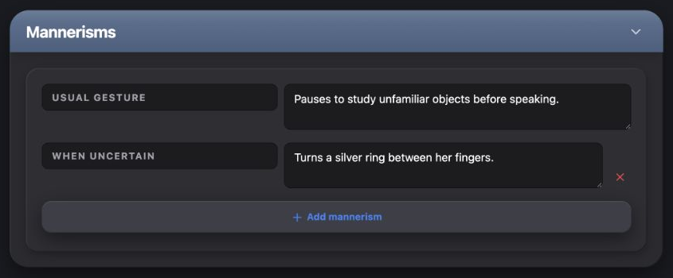</div><figcaption>Derived Mannerisms example combining the existing authoring shell and trait-row styling with named native fields and local add/remove state.</figcaption></figure>

| Requirement | Borrowed pattern and inherited styling | Chosen arrangement or behavior |
| --- | --- | --- |
| One named authoring subject |ChronicleDarkShell plus HardcodedSection's slate header, 20px body inset and 16px tray/shadow |Mannerisms title and content |
| A usual gesture with a stable meaning |Fixed recessed 12px uppercase label beside a 14px description |Native associated label and 2-row textarea; no decorative lock is required for this new concept |
| User-defined extra entries |Editable label/value appearance and compact red remove action |Native input and 2-row textarea; array held in local example state |
| Extend the collection | 40px elevated Add action, blue text and shared button shadow |“Add mannerism” adds an empty example row |
| Collapse and reopen |Existing title/chevron family |Named control with `aria-expanded`/`aria-controls`; summary of usual gesture plus entry count |
| Keyboard use |Blue field focus and derived blue-300 action focus |Fields and remove controls have accessible names and stay in tab order |

<section class="reuse-recipe">

##### Use in a New Design

**Construction:** The example borrows the visual layers of HardcodedSection and the fixed/editable trait rows, but uses native controls to supply names and associations the current row wrappers cannot forward. It uses ChronicleDarkShell and CHRONICLE_DARK shadows directly. This is a deliberate combination of existing styling with new control wiring, not a different visual design.

**Keep and adapt:** Keep shell/header/tray depth, row treatment, Add/remove meaning and visible focus. The field count, text, 40% label proportion and 2-row starting height fit this example; adapt them to the new concept. The manual textarea resize behavior is deliberate and differs from the production auto-growing wrapper.

**State and limits:** Values, expanded state and rows live only inside this reference example. Add/remove updates that local collection; collapse keeps the values and changes the summary. It neither modifies the Character schema nor saves to an account or story. A production implementation must connect its own working state and persistence boundary.

<p class="source-line">Source: <code>docs/ui-guide/examples/character-builder-compositions.tsx</code> · MannerismsExample. Styling owners: <code>src/features/character-builder/sections/HardcodedSection.tsx</code>, <code>src/features/character-builder/rows/HardcodedRow.tsx</code>, <code>src/features/character-builder/rows/ExtraRow.tsx</code> and <code>src/components/chronicle/chronicle-dark-ui.ts</code>.</p>

</section>

<details class="implementation"><summary>Implementation Details</summary>

```tsx
const [expanded, setExpanded] = useState(true);
const [habit, setHabit] = useState('Pauses to study unfamiliar objects before speaking.');
const [rows, setRows] = useState([{ id: 'one', label: 'When uncertain', value: 'Turns a silver ring between her fingers.' }]);
```

</details>

</section>

<section class="manual-entry">

#### New Voice Notes Dialog

**Derived teaching example.** “Let me edit a speaking note separately from the main page. Apply keeps it and Cancel discards the edit.”

<figure class="source-preview"><div class="capture-background">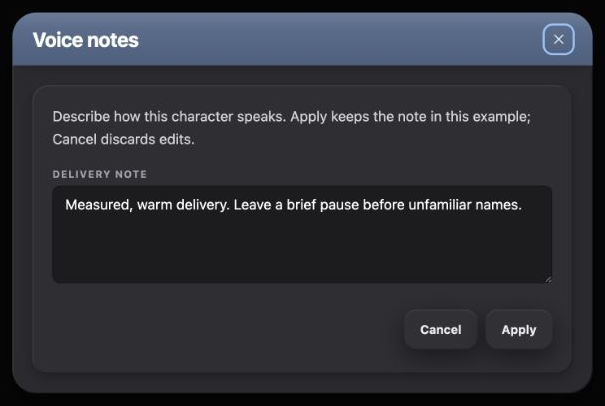</div><figcaption>Derived Voice Notes editor dialog with graphite shell, slate title, inset tray, named recessed field and ordinary Apply and Cancel actions.</figcaption></figure>

| Requirement | Borrowed pattern and inherited styling | Chosen arrangement or behavior |
| --- | --- | --- |
| Separate editing task |Dialog and DialogContentBare, black 80% overlay, graphite 24px shell/shadow | 580px desktop maximum, viewport minus 32px cap and 90dvh maximum height |
| Clearly named subject |HardcodedSection slate gradient/header spacing/title treatment |Associated DialogTitle and named close control |
| Focused note entry | 20px body inset, 16px tray/shadow, Basics label and recessed 14px field |One 4-row native textarea with associated label and manual vertical resize |
| Explain the operation | 14px zinc-300 relaxed copy |Associated DialogDescription and local-state wording |
| Keep or discard |Ordinary ChronicleSurfaceButton family |Right-aligned footer, 8px gap, 20px top separation; Cancel and Apply are neutral actions |
| Maintain accessibility |Primitive dialog behavior, named controls, standard field focus and derived close focus |Close, Cancel, Escape or outside dismissal discard the working edit; Apply commits it locally |

<section class="reuse-recipe">

##### Use in a New Design

**Construction:** Use the Editor Dialog recipe. The primitive supplies dialog behavior; the caller explicitly adds the graphite shell, slate title, tray and all form state. Keep a working value separate from the last applied value. On open or cancellation, initialize the working value from the applied value; on submission, update the applied value and close.

```tsx
const [saved, setSaved] = useState(initial);
const [draft, setDraft] = useState(initial);
function changeOpen(next: boolean) { setDraft(saved); setOpen(next); }
```

The example's form submission prevents native navigation, calls `setSaved(draft)` and closes. Cancel and the named close call `changeOpen(false)`; primitive dismissal uses the same open-change handler. This is the behavior required by a deferred edit, rather than a style trick applied to an immediate field.

**Keep and adapt:** Keep the complete authoring surface family and ordinary footer actions. The 580px width,4-row field and single-column arrangement serve this one note; choose dimensions and groups for the actual task. A small immediate option list can instead use the compact anchored surface and does not need this shell/header/tray composition.

**State and limits:** “Apply keeps” means retained in the mounted example's React state, available on reopening. The example does not save remotely or survive unmount/reload. Its styling is inherited; its fields, working-copy behavior and responsive bounds are proposed teaching choices. A product feature must connect its own save semantics and feedback.

<p class="source-line">Source: <code>docs/ui-guide/examples/character-builder-compositions.tsx</code> · VoiceNotesExample. Dialog behavior owner: <code>src/components/ui/dialog.tsx</code>; shell/actions: <code>src/components/chronicle/ChronicleDarkUi.tsx</code>; layer values: <code>src/components/chronicle/chronicle-dark-ui.ts</code>.</p>

</section>

<details class="implementation"><summary>Implementation Details</summary>

```tsx
<DialogTrigger asChild><ChronicleSurfaceButton className="px-4">Edit voice notes</ChronicleSurfaceButton></DialogTrigger>
```

</details>

</section>
