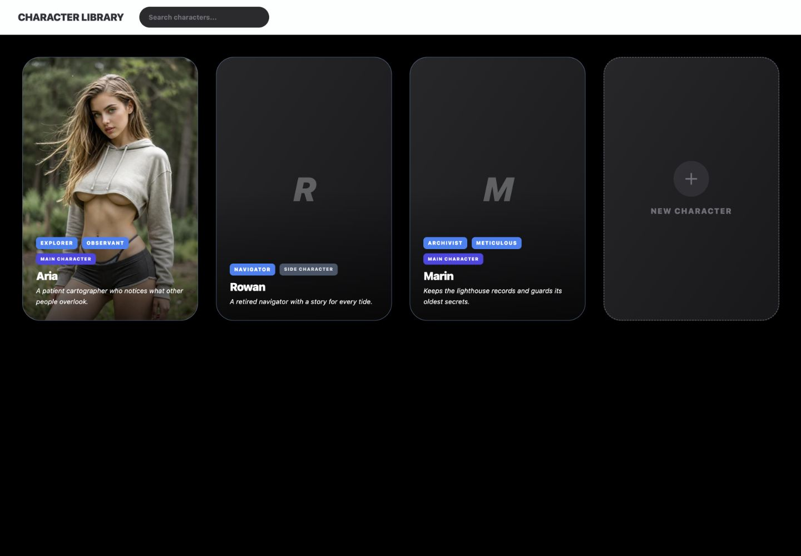
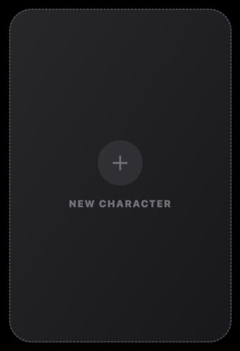
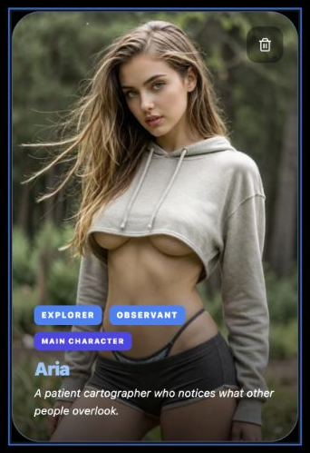
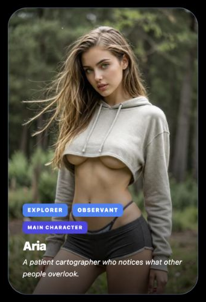
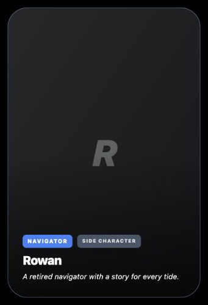
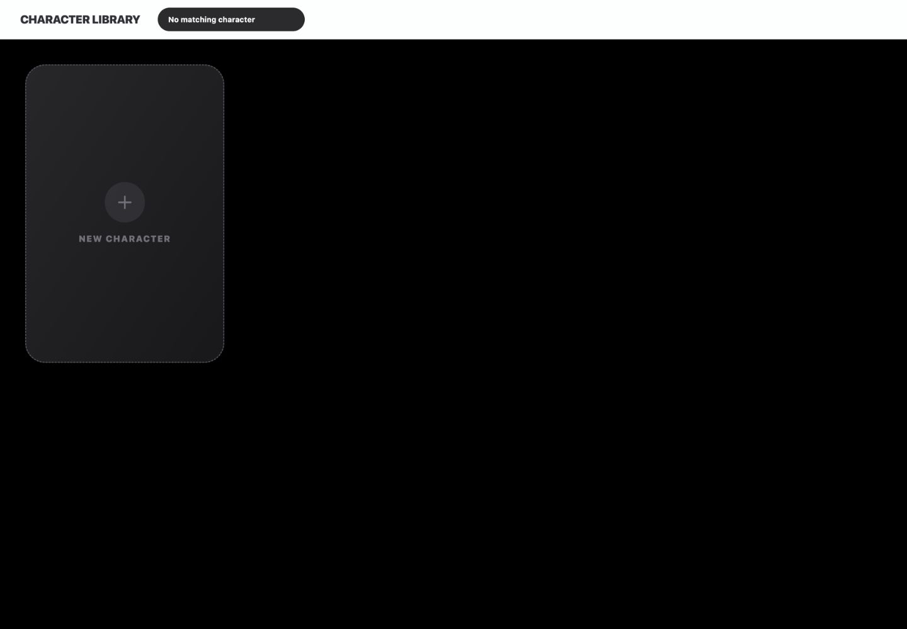
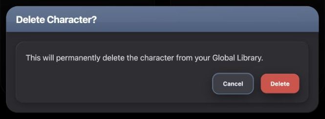
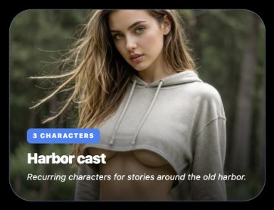
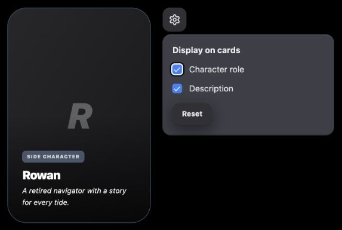

# Character Library UI Reference

A practical menu of patterns for designing new UI that belongs in Chronicle's reusable-character library.

## Overview

### Designing with Character Library's UI Language

Character Library's browsing view is an image-led collection on a black canvas. Portrait cards combine media, readable identity summaries, small metadata badges and a local delete action. A compact search pill narrows the collection, and a creation tile offers a new profile. Use those relationships when designing new browsing UI for this region.

The selected-profile editor is covered by Character Builder. Opening a library card switches into that editor; it does not add an inline selected state to the grid. The library's black canvas, portrait cards and compact header are different from the editor's trait sidebar and authoring sections.

This is a representative vocabulary for composing new designs. It does not enumerate every field of a character or require new concepts to use a complete existing page.

#### Start with the User's Intent

| If the request is… | Start with… | Then combine… |
| --- | --- | --- |
| “Show reusable items I can open.” | Media card and collection grid | Readable title/summary overlay, metadata and a named primary action. |
| “Make it easy to create another item.” | Creation tile | The neighboring cards' geometry, dashed boundary and blue Add emphasis. |
| “Let me find something in this collection.” | Header search pill | Caller-owned query and filtering; explain empty or failed results when the new flow needs them. |
| “Show a few details without opening the item.” | Metadata and summary overlay | Short badges, strong title and restrained descriptive copy. |
| “Let me remove this saved item.” | Card-local action and destructive confirmation | Separate action target, explicit consequence and safe Cancel path. |
| “Let me choose what appears on cards.” | Compact anchored settings surface | Independent checkboxes and ordinary Reset action; the display example is a proposed combination. |
| “Show a collection of characters as one item.” | Existing card's media/overlay/type family | Adapt the image ratio and metadata, as in the proposed Saved Collection example. |

#### Compose a New Design

1. **Choose the interaction.** Opening an item, adding one, changing display settings and deleting a saved record need different controls even when they share a palette.
2. **Identify the layers.** The black canvas supports the collection; each clipped media card owns an image or fallback; a permanent dark gradient supports the title and metadata; secondary actions sit separately above that content.
3. **Carry the full treatment.** Keep the appropriate radius, border, shadow, text hierarchy and states with each surface. A dark fill alone is not enough to reproduce this page.
4. **Adapt to the content.** Choose columns, width and image ratio for the new item. Preserve readable overlays and the distinction between primary and secondary actions.
5. **Complete the states.** Provide focus, accessible names and the relevant empty, busy, failure or disabled behavior. Source limitations below are not instructions to repeat them.

#### What Stays Consistent, and What Can Change

| Decision | Carry forward | Adapt to the concept |
| --- | --- | --- |
| Browsing surface | Black canvas and image-led collection; shared light application header | Grid column count, available width and collection density |
| Card construction | Clipped 32px corners, slate border, restrained card shadow, permanent bottom readability gradient | Image ratio, height and focal position for the subject |
| Metadata hierarchy | Small heavy badges, 20px strong title and 12px italic summary | Badge content, amount of summary and truncation appropriate to the new item |
| Action meaning | Blue creation emphasis, quiet card-local removal, explicit destructive confirmation | Labels, handler consequences and whether an action is needed |
| Compact settings | Existing dark elevated surface, shared controls and neutral Reset | Popup width, placement and controls; keep the relevant preview visible |
| State ownership | Components provide only documented appearance and behavior | The feature supplies query, data, working state, callbacks and persistence |

#### Using This Reference as a Coding Agent

Select patterns from the user's intended interaction, then combine their exact construction and state rules. Source labels and essential fragments remain in the ordinary text. Supporting source is evidence, not a requirement to reconstruct unrelated account or character logic.

**Existing specimens** use production components with local sample data. **Derived examples** demonstrate proposed combinations and state handling in `docs/ui-guide/examples/character-library-compositions.tsx`. They are not existing Character Library features and do not prove remote creation, retrieval or deletion.

Prefer the named local owner when it differs from a broad shared token. A new collection need not use the existing portrait ratio, but it should not acquire arbitrary colors or corners. Check source owners when their interfaces or styling have changed.

#### Character Library in Context

<figure class="source-preview"><div class="capture-background"><picture><source media="(max-width:600px)" srcset="../../src/assets/ui-guide/character-library/overview-narrow.png"></picture></div><figcaption>Production Character Library browsing header and unselected character grid with local sample profiles.</figcaption></figure>

Character Library holds reusable account-owned profiles. The actual browsing header has a title and search input. New Character is a tile in the grid. AI Fill, Cancel and library-update actions appear in the selected library editor, not as a browsing toolbar. The separate Save action belongs to the story-owned editor variant. The library grid is also distinct from Story Builder's separate import picker.

<p class="source-line">Source: <code>src/pages/Index.tsx</code> · lines 1037–1052; <code>src/features/character-builder/CharacterBuilderScreen.tsx</code> · lines 790–880; <code>src/components/app-shell/AppShellTopBar.tsx</code> · lines 357–369 and 647–683.</p>

#### Check the New Composition

Compare against the closest specimen at the same effective width. Inspect canvas, card edges, crop, gradient, title/metadata hierarchy and action placement. Then check long names, missing images, narrow width, keyboard focus and the changed state. A proposed layout may differ sensibly; inherited styling should remain identifiable.

## Color Palette

### Color Palette

The browsing view uses black and image-backed cards. Graphite shell/tray colors appear in the destructive confirmation; they are not a reason to surround the entire grid with an authoring panel.

| Role | Current value | Application |
| --- | --- | --- |
| Library canvas | `#000000` | Index's library wrapper. Neither shared `CHRONICLE_DARK.background` (`#0d0e12`) nor the selected editor's `#1a1b20` replaces it. |
| Card border | `#4a5f7f` | One-pixel slate edge around populated and fallback cards |
| Card base | `slate-200` | Behind media in the portrait shell; fallback gradient covers it when no image exists |
| Missing-image/create surface | `zinc-800 → zinc-900` | Diagonal dark gradient |
| Card readability overlay | Transparent → transparent → black/70 | Always present, not hover-only |
| Card text | White; hovered name blue-300 | Title and description over the gradient |
| Stored tag | Blue-500 / white | Existing profile metadata |
| Main role | Indigo-600 / white | Domain badge, not a selection color |
| Side role | Slate-600 / white 80% | Domain badge, not disabled styling |
| Creation emphasis | Zinc-500 → blue-500 | Plus, label and hovered dashed border |
| Search shell | `#2b2b2e` | Matching fill/border; transparent input with white text and zinc-500 placeholder |
| Card delete | Black 40% → black 60%; white → rose-400 | Local action hover |
| Confirmation shell/tray | `#2a2a2f` / `#2e2e33` | Separate consequential-deletion surface |
| Confirmation header | `#5a7292 → #4a5f7f` | Slate title family |
| Confirm Delete | `#d94b45` → `#e2554e`, white | Destructive action, distinct from card hover accent |
| Confirm Cancel | `#3c3e47` → `#44464f`; normal `#eaedf1`, inherited hover `hsl(var(--accent-foreground))` | Existing confirmation variant; hover text is dark `rgb(15,23,42)` under the root theme |
| Ordinary local action | `#303035` → `#343439`, `#eaedf1` | Shared ChronicleSurfaceButton used by the proposed display settings and Reset |

<p class="source-line">Source: <code>src/pages/Index.tsx</code> · line 1038; <code>src/features/character-builder/CharacterBuilderScreen.tsx</code> · lines 809–868; <code>src/components/app-shell/AppShellTopBar.tsx</code> · lines 185–191; <code>src/components/chronicle/DeleteConfirmDialog.tsx</code> · lines 30–56; <code>src/components/chronicle/chronicle-dark-ui.ts</code> · lines 6–31.</p>

#### Shadows Belong to Their Surfaces

| Surface | Exact treatment |
| --- | --- |
| Library card | `0 12px 24px -8px rgba(0,0,0,0.15)`; production card class marks this important |
| Confirmation shell | `0 20px 50px rgba(0,0,0,0.55), inset 1px 1px 0 rgba(255,255,255,0.09), inset -1px -1px 0 rgba(0,0,0,0.35)` |
| Confirmation tray | `CHRONICLE_DARK.trayShadow`: `inset 1px 1px 0 rgba(255,255,255,0.07), inset -1px -1px 0 rgba(0,0,0,0.30), 0 4px 12px rgba(0,0,0,0.25)` |
| Surface button / derived dark popover | `CHRONICLE_DARK.buttonShadow`: `0 8px 24px rgba(0,0,0,0.45), inset 0 1px 0 rgba(255,255,255,0.09), inset 0 -1px 0 rgba(0,0,0,0.20)` |

Do not substitute the authoring shell shadow for a library card. The production card also contains a nonimportant `group-hover:shadow-2xl` class, but its important base shadow takes precedence. The guide does not treat stronger hover shadow as an inherited card state.

<p class="source-line">Source: <code>src/features/character-builder/CharacterBuilderScreen.tsx</code> · line 809; <code>src/components/chronicle/DeleteConfirmDialog.tsx</code> · lines 31, 43, 51–56; <code>src/components/chronicle/chronicle-dark-ui.ts</code> · lines 24–27.</p>

## Typography & Spacing

### Typography & Spacing

Inherit the application font. The library's hierarchy comes from image-backed titles, much smaller metadata and a compact search input. A new collection item should preserve that relationship even when its content or image ratio changes.

| Text role | Current treatment | Source |
| --- | --- | --- |
| Shared page title |18px, black weight, uppercase, tracking-tight; `hsl(var(--ui-surface-2))` | `src/components/app-shell/AppShellTopBar.tsx:167–171` |
| Card title |20px, black weight, white, tight leading/tracking, truncated; hover blue-300 | `src/features/character-builder/CharacterBuilderScreen.tsx:840` |
| Description |12px white, italic, relaxed leading, three-line clamp | Same owner · lines 841–843 |
| Tag badge |9px black weight, uppercase, tracking-widest | Same owner · lines 831–834 |
| Role badge |8px black weight, uppercase, tracking-widest, no wrap | Same owner · lines 836–838 |
| Image fallback initial |60px, black weight, italic uppercase, tracking-tighter, ghost-white | Same owner · lines 821–822 |
| Creation label |14px black weight, uppercase, tracking-widest | Same owner · lines 866–868 |
| Search input |12px bold, white; zinc-500 placeholder | `src/components/app-shell/AppShellTopBar.tsx:191` |
| Confirmation title/body |20px bold white title with `-.015em`; 16px zinc-300 relaxed message | `src/components/chronicle/DeleteConfirmDialog.tsx:37–46` |

#### Spacing and Geometry

| Relationship | Existing rule | Adaptation boundary |
| --- | --- | --- |
| Library canvas inset |16px, 24px at `sm`, 40px at `lg` | Preserve usable outer space at the actual width |
| Grid |1/2/3/4/5 columns at base/`sm`/`lg`/`xl`/`2xl`; 16px gap, 32px at `lg` | Column count is a page arrangement, not a universal card requirement |
| Portrait shell |2:3 ratio, 32px radius, 1px slate border | Ratio and width may change with content; the Saved Collection example uses 4:3 |
| Bottom content |24px inset; badges 8px gap and 8px bottom separation; title 4px bottom gap | Preserve title/metadata relationships while accommodating longer content |
| Card delete |16px from top/right; 12px control inset; 16px icon; 12px radius | Keep a distinct secondary target that remains usable with keyboard and touch |
| Creation tile |64px circular icon bed; 32px Plus; 16px vertical gap | Match neighboring collection geometry, not unrelated authoring buttons |
| Search pill |4px shell padding; 28px input height; 224px input width; 12px horizontal input inset | Fixed width is a current source constraint; new layouts should bound it to available space |
| Confirmation |24px shell, 16px tray, 20px header horizontal/12px vertical inset; 16px body inset increasing to 20px at `sm` | Width must fit the message; current cap is `min(94vw,640px)` |

<p class="source-line">Source: <code>src/pages/Index.tsx</code> · line 1038; <code>src/features/character-builder/CharacterBuilderScreen.tsx</code> · lines 793, 809, 829–866; <code>src/components/app-shell/AppShellTopBar.tsx</code> · lines 185–191; <code>src/components/chronicle/DeleteConfirmDialog.tsx</code> · lines 30–56.</p>

#### States and New-Control Responsibilities

| Case | Guidance |
| --- | --- |
| Open-card focus |Existing wrapper has a 2px blue-500/80 ring with 2px offset in `#14151a`. Preserve visible focus; a new rounded native target should retain the 32px card shape. |
| Card hover |Image scales 110% over 700ms, title turns blue-300 and delete appears. The captured production hover has no wrapper transform and retains its base shadow; do not inherit an unsupported lift or stronger-shadow claim. |
| Search focus/name |Existing SearchChip removes outline and has only placeholder text. A new search input must have a name and visible focus; use a blue focus treatment as an explicitly derived addition. |
| Secondary action access |Existing delete is unnamed, `tabIndex=-1`, and hover-revealed. New secondary controls must be named, keyboard reachable and visible on focus as well as hover. |
| New disabled operation |Use native disabled semantics plus the selected family's disabled treatment. Shared neutral buttons already supply 50% opacity and pointer suppression. Local cards/creation tiles do not have a supplied disabled contract. |
| Failure or no results |Do not equate an empty visible grid with confirmed empty data. Existing library lacks distinct loading/error/no-match copy; new flows should explain the state their operation actually knows. |

<p class="source-line">Source: <code>src/features/character-builder/CharacterBuilderScreen.tsx</code> · lines 795–818 and 846–875; <code>src/components/app-shell/AppShellTopBar.tsx</code> · lines 185–191; <code>src/components/chronicle/chronicle-dark-ui.ts</code> · line 31. These new-control additions are explicit recommendations, not claims that the original specimens already provide them.</p>

## Buttons & Menus

### Buttons & Menus

Browsing actions live on or among the cards. New Character is a large creation tile, deletion is a card-local secondary action followed by confirmation, and the proposed display settings use a compact neutral action. The live browsing header has no separate sort/filter/action toolbar.

<section class="manual-entry">

#### New Character Tile

<figure class="source-preview"><div class="capture-background"></div><figcaption>Production New Character creation tile with portrait proportions, dashed edge and centered Add treatment.</figcaption></figure>

**Where used:** The unselected Character Library grid, including empty and no-match results.

| Specification | Current rule |
| --- | --- |
| Shell |Full width, 2:3 aspect, 32px radius, clipped overflow, 2px dashed zinc-600 border |
| Surface |Zinc-800 → zinc-900 diagonal gradient |
| Icon bed |64px circle, zinc-700/50, hover blue-900/30 |
| Icon/label |32px Plus and 14px black-weight uppercase label; zinc-500 → blue-500 on hover |
| Hover |Blue-500 border and corresponding icon/label emphasis; 300ms transition |
| Action |Calls supplied `onAddNew`; library creates a local working profile and opens its editor |

<section class="reuse-recipe">

##### Use in a New Design

**Construction:** The current creation tile is inline in CharacterBuilderScreen, conditionally rendered when the caller supplies `onAddNew`. Preserve its complete shell and centered action treatment rather than replacing it with a random colored panel.

```tsx
className="group aspect-[2/3] w-full overflow-hidden rounded-[2rem] border-2 border-dashed border-zinc-600 bg-gradient-to-br from-zinc-800 to-zinc-900 transition-all duration-300 hover:border-blue-500 flex flex-col items-center justify-center gap-4 cursor-pointer"
```

The child icon bed uses `w-16 h-16 rounded-full bg-zinc-700/50 flex items-center justify-center group-hover:bg-blue-900/30 transition-colors`; Plus uses `w-8 h-8 text-zinc-500 group-hover:text-blue-500`. The label uses `text-sm font-black text-zinc-500 group-hover:text-blue-500 uppercase tracking-widest`.

**Keep and adapt:** Keep the dashed boundary, Add emphasis and relationship to neighboring items. Match a different ratio when the new collection's cards use it. Supply a clear label and keyboard focus in a new implementation; the current tile has no explicit focus/disabled treatment. Creation is not proof that a new reusable record was saved.

</section>

<p class="source-line">Source: <code>src/features/character-builder/CharacterBuilderScreen.tsx</code> · lines 857–869; library callback <code>src/hooks/use-index-character-workspace.ts</code> · lines 226–275.</p>

<details class="implementation"><summary>Supporting source</summary>

```tsx
if (tab === "library") {
  setLibrary((previous) => [character, ...previous]);
  setSelectedCharacterId(character.id);
  setUnsavedNewCharacterIds((previous) => new Set(previous).add(character.id));
  return;
}
```

This local creation branch explains the click consequence. Full profile authoring and persistence belong to the editor's owners.

</details>

</section>

<section class="manual-entry">

#### Card-Local Delete and Open Action

<figure class="source-preview"><div class="capture-background"></div><figcaption>Production character card on hover, revealing its separate top-right delete control while keeping identity text visible.</figcaption></figure>

The card body opens the selected profile. The trash control requests a confirmation and stops its click from also opening the card.

| Part | Current rule |
| --- | --- |
| Main target |Wrapper with `role="button"`, `tabIndex=0`, accessible Open-character name; Enter/Space opens |
| Main focus |2px blue-500/80 ring, 2px offset in `#14151a` |
| Delete target |Top/right 16px, 12px inset, 12px radius, 16px icon, z20 |
| Delete colors |Black 40%/white; hover black 60%/rose-400 |
| Reveal |Opacity 0 →100% on card hover, 300ms transition |
| Consequence |`onDelete(id)` opens a separate confirmation; no inline selected-card mode is provided |

<section class="reuse-recipe">

##### Use in a New Design

**Construction:** Keep the primary card action distinct from secondary commands. The existing wrapper handles opening while its nested delete button stops click propagation:

```tsx
onClick={(e) => { e.stopPropagation(); onDelete(c.id); }}
```

Use this complete secondary-action appearance:

```tsx
className="absolute top-4 right-4 p-3 bg-black/40 text-white hover:text-rose-400 hover:bg-black/60 rounded-xl opacity-0 group-hover:opacity-100 transition-all duration-300 z-20"
```

**Keep and adapt:** Keep placement, target size and subdued overlay treatment. A new implementation should use separate named, keyboard-reachable primary and secondary controls, not nest one native button inside another. Add focus-visible reveal and focus treatment, and ensure touch users can discover the secondary action. These improve the new control's semantics without changing the card family.

**Existing limitation:** The current delete control has no accessible name and is excluded from tab order. The main card supports keyboard opening, but that does not make its secondary control keyboard accessible. Do not reproduce this limitation or claim it is a recommended interaction.

</section>

<p class="source-line">Source: <code>src/features/character-builder/CharacterBuilderScreen.tsx</code> · lines 795–807 and 846–852; icon size <code>src/constants.tsx</code> · lines 53–54; confirmation opener <code>src/hooks/use-index-character-workspace.ts</code> · lines 311–315.</p>

<details class="implementation"><summary>Supporting source</summary>

```tsx
const handleDeleteCharacterFromList = useCallback(
  (id: string) => {
    openDeleteConfirm(id, "character");
  },
  [openDeleteConfirm],
);
```

</details>

</section>

<section class="manual-entry">

#### Ordinary Local Actions

**Shared family used by the derived display example.** A small settings trigger and Reset action use ChronicleSurfaceButton. They are not existing browsing-toolbar controls.

| Specification | Shared rule |
| --- | --- |
| Geometry |40px height, 12px radius; caller chooses horizontal padding or 40px icon-only width |
| Surface/text |`#303035`, 12px bold leading-none `#eaedf1` |
| Shadow |`CHRONICLE_DARK.buttonShadow` |
| Hover/pressed |`#343439`; pressed scale 95% |
| Focus |2px accent-teal/40% ring |
| Disabled |50% opacity and pointer suppression; native disabled behavior |

<section class="reuse-recipe">

##### Use in a New Design

**Construction:** Import ChronicleSurfaceButton from `src/components/chronicle/ChronicleDarkUi.tsx`. It supplies the visual family and native button props, including a default `type="button"`. The caller supplies width/padding, icon or label, handler and busy/disabled state.

```tsx
<ChronicleSurfaceButton className="w-10 px-0" aria-label="Library display settings">
  <Settings size={20} />
</ChronicleSurfaceButton>
<ChronicleSurfaceButton className="px-4" onClick={onReset}>Reset</ChronicleSurfaceButton>
```

**Keep and adapt:** Use this subdued family for ordinary local operations. Do not give Reset an AI gradient or destructive red. The destructive confirmation uses a different elevated Cancel fill owned by that dialog; preserve that explicit variant when using the existing confirmation.

</section>

<p class="source-line">Source: <code>src/components/chronicle/ChronicleDarkUi.tsx</code> · lines 6–17; <code>src/components/chronicle/chronicle-dark-ui.ts</code> · lines 30–31; derived usage <code>docs/ui-guide/examples/character-library-compositions.tsx</code> · LibraryDisplayExample.</p>

<details class="implementation"><summary>Supporting source</summary>

```tsx
className={cn(CHRONICLE_SURFACE_BUTTON_CLASS, className)}
```

</details>

</section>

## Fields & Controls

### Fields & Controls

The browsing view's existing text field is a search pill. Profile editing fields belong to Character Builder. Independent checkboxes appear here only as a documented shared-control choice for the proposed display-settings composition.

<section class="manual-entry">

#### Header Search Pill

<figure class="source-preview"><div class="capture-background"></div><figcaption>Production Character Library header with its compact dark Search characters pill.</figcaption></figure>

| Part | Current rule |
| --- | --- |
| Shell |`#2b2b2e` fill and border, full radius, 4px padding, 16px left margin |
| Input |28px high, 224px wide, 12px horizontal/4px vertical inset; transparent fill, 12px bold white text |
| Placeholder |Zinc-500; “Search characters...” |
| Changed query |Caller updates query; loaded collection filtered locally, case-insensitively |
| Existing omissions |No explicit input name, visible focus ring, clear command, result count or no-match message |

<section class="reuse-recipe">

##### Use in a New Design

**Construction:** SearchChip is private to AppShellTopBar. Use the actual AppShellTopBar library configuration for the existing page. To compose a new search elsewhere, carry its shell/input appearance and add a native accessible name, responsive bounds and visible focus. This short **derived** fragment preserves the fill/type/shape while adding those responsibilities:

```tsx
<div className="max-w-full bg-[#2b2b2e] rounded-full p-1 border border-[#2b2b2e] focus-within:ring-2 focus-within:ring-blue-500/80">
  <input type="search" aria-label="Search reusable characters" value={query} onChange={event => setQuery(event.target.value)} placeholder="Search characters..." className="h-7 w-56 max-w-full px-3 py-1 text-xs font-bold rounded-full bg-transparent text-white placeholder:text-zinc-500 focus:outline-none" />
</div>
```

The current component uses `type="text"`; the explicit search type, name, focus and width constraint above are new-control choices. The caller owns filtering, query clearing and any result feedback. A search field does not supply those behaviors merely by matching this appearance.

**Keep and adapt:** Keep compact rounded geometry and the contrast of white query/zinc placeholder on the dark pill. Adapt width and placement for the available header space. Add filter or sort controls only when the requested feature requires them, using an appropriate documented control family; they are not part of the existing library header.

**Search scope:** The actual query matches names, nicknames, role descriptions, tags, listed appearance/outfit/clothing values and custom section titles/item labels/values. It does not search every possible profile field. Whitespace-only input returns the full loaded collection; nonblank input is lowercased without trimming.

</section>

<p class="source-line">Source: <code>src/components/app-shell/AppShellTopBar.tsx</code> · lines 175–193 and 357–367; caller <code>src/pages/Index.tsx</code> · lines 861–865; actual filter <code>src/hooks/use-index-character-workspace.ts</code> · lines 461–517.</p>

<details class="implementation"><summary>Supporting source</summary>

```tsx
if (!librarySearchQuery.trim()) return library;

const query = librarySearchQuery.toLowerCase();
```

The full filter's named fields are implementation evidence; the UI recipe does not need to recreate unrelated profile data bindings.

</details>

</section>

<section class="manual-entry">

#### Independent Display Choices

**Shared control used by the derived display example.** Independent checkboxes fit settings such as showing role and showing description. Selecting one must not deselect the other.

| Part | Applicable treatment |
| --- | --- |
| Checkbox primitive |16px square, 4px radius, checked indicator and native control semantics via the shared Radix wrapper |
| Character Goals override |Zinc-600 unselected border; blue-500 checked fill/border |
| Label/spacing in example |14px zinc-200 label; 12px checkbox-label gap and 12px row spacing |
| Focus |Primitive's 2px theme ring and 2px offset |
| Disabled |Not-allowed cursor and 50% opacity |

<section class="reuse-recipe">

##### Use in a New Design

**Construction:** Import Checkbox from `src/components/ui/checkbox.tsx` and preserve the documented checked override. Wrap it in a label or associate it with visible label text. The component owns the check indicator and interaction; the caller owns each checked value and changed handler.

```tsx
<label className="flex items-center gap-3 text-sm text-zinc-200">
  <Checkbox checked={showRole} onCheckedChange={value => setShowRole(value === true)} className="border-zinc-600 data-[state=checked]:bg-blue-500 data-[state=checked]:border-blue-500" />
  Character role
</label>
```

**Keep and adapt:** Preserve selection contrast, focus and label association. Give each independent choice separate state. The blue override is borrowed from Character Goals; the library display setting is a proposed teaching use, not an existing filter or role-selection feature. Optional/hidden content is not an invalid state and does not need validation-red styling.

</section>

<p class="source-line">Source: <code>src/components/ui/checkbox.tsx</code> · lines 7–22; source override <code>src/components/chronicle/CharacterGoalsSection.tsx</code> · lines 297–302; derived labels/state <code>docs/ui-guide/examples/character-library-compositions.tsx</code> · LibraryDisplayExample.</p>

<details class="implementation"><summary>Supporting source</summary>

```tsx
className="border-zinc-600 data-[state=checked]:bg-blue-500 data-[state=checked]:border-blue-500"
```

</details>

</section>

## Panels & Layout

### Panels & Layout

The library's ordinary item is a media card rather than a titled authoring shell. Its permanent readability overlay groups the information. Use the heavier graphite/slate/tray family when an operation actually needs a separate confirmation or editing surface.

<section class="manual-entry">

#### Portrait Card, Metadata and Fallback

<figure class="source-preview"><div class="capture-background"></div><figcaption>Production library portrait card with stored tags, role badge, name and description over its permanent dark gradient.</figcaption></figure>

<figure class="source-preview"><div class="capture-background"></div><figcaption>Production library card without an avatar, using a dark gradient and character initial behind the same metadata and summary treatment.</figcaption></figure>

| Layer | Current rule |
| --- | --- |
| Frame |2:3 ratio, 32px radius, 1px slate border, clipped overflow and restrained important card shadow |
| Image |Full frame, object-cover; stored percentage focal point, default 50%/50%; 700ms transition and hover scale 110% |
| Fallback |Zinc diagonal gradient, centered 60px heavy italic uppercase initial, ghost-white text, 40px inset |
| Readability |Permanent transparent-to-black 70% gradient over whole frame, z1, no pointer events |
| Bottom content |24px inset, z2; wrapping badges with 8px gap |
| Tag badge |Blue-500, white 9px black-weight uppercase; 8px ×4px inset, 6px radius, shadow-lg; 100px maximum and truncation |
| Role badge |8px black-weight uppercase; same inset/radius; Main indigo-600/white, Side slate-600/white 80%, no wrap |
| Title/summary |20px black-weight title and 12px italic description; 4px gap; title truncates, summary clamps to 3 lines |

<section class="reuse-recipe">

##### Use in a New Design

**Construction:** The inline library card owns this layered presentation. It is not an exported card primitive. A new media item can reuse the frame, image, overlay and content layers without inheriting character-specific fields or callbacks. Keep these complete frame and overlay fragments together:

```tsx
className="relative aspect-[2/3] w-full overflow-hidden rounded-[2rem] border border-[#4a5f7f] bg-slate-200 shadow-[0_12px_24px_-8px_rgba(0,0,0,0.15)]"
```

```tsx
<div aria-hidden className="absolute inset-0 bg-gradient-to-b from-transparent via-transparent to-black/70 pointer-events-none" />
<div className="absolute inset-x-0 bottom-0 p-6">
  <h3 className="text-xl font-black text-white leading-tight mb-1 tracking-tight group-hover:text-blue-300 transition-colors truncate">{title}</h3>
  <p className="text-xs text-white line-clamp-3 leading-relaxed italic">{description}</p>
</div>
```

The first fragment matches the derived example's ordinary shadow class; production adds `!` to enforce that same value. The actual stored-tag class is `bg-blue-500 text-[9px] font-black text-white px-2 py-1 rounded-md uppercase tracking-widest shadow-lg truncate max-w-[100px]`. Choose meaningful metadata for the new item instead of copying Main/Side role colors to unrelated states.

**Keep and adapt:** Keep card edges, overlay, depth and typography. Choose ratio, media focal point and summary amount for the subject. The new Saved Collection example uses 4:3 while preserving the visual family. Opening a card is a command to another view; if a new feature needs persistent selection or disabled state, supply and explain those new states rather than claiming the original card already has them.

**Existing fallbacks:** The card uses the first name character or `?` when no image exists. Its displayed name falls back to “Unnamed.” Description chooses roleDescription, then the first custom-section item's value, then “No description available.” Those are character-summary rules, not universal data assumptions for a new collection.

</section>

<p class="source-line">Source: <code>src/features/character-builder/CharacterBuilderScreen.tsx</code> · lines 809–843; derived fragment <code>docs/ui-guide/examples/character-library-compositions.tsx</code> · SavedCollectionExample.</p>

<details class="implementation"><summary>Supporting source</summary>

```tsx
{c.roleDescription || c.sections[0]?.items[0]?.value || "No description available."}
```

</details>

</section>

<section class="manual-entry">

#### Empty Collection and No Search Matches

<figure class="source-preview"><div class="capture-background"></div><figcaption>Current library empty state: the collection contains only the New Character creation tile.</figcaption></figure>

<figure class="source-preview"><div class="capture-background"></div><figcaption>Current library search with no matching profiles: the search remains visible and New Character remains available.</figcaption></figure>

| State | Actual rendering |
| --- | --- |
| Library has no displayed profiles |New Character tile remains because the library caller supplies `onAddNew` |
| Search has no matches |Same grid shape; no distinct no-results message or result count |
| Alternate component branch without creation callback |Full-grid centered placeholder with 80px vertical inset, 60px decorative star, 18px bold slate-500 heading and 14px slate-400 copy |
| Lazy module loading |Index uses an empty black `aria-hidden` fallback; this is not a data-loading/error indicator |

<section class="reuse-recipe">

##### Use in a New Design

**Construction:** The caller knows the data/query state and must decide what empty means. CharacterBuilderScreen receives only the displayed array and callbacks for this branch. Preserve the creation affordance when appropriate; do not treat the alternate no-creation placeholder as the existing library empty state.

**Keep and adapt:** Use the page's canvas, title/body hierarchy and ordinary actions for a new explanatory state. Explain “no matches” only when filtering completed; explain loading or failure when that is the known state. A message and reset/retry action are new state handling if added to this library flow, not existing behavior established by these captures.

</section>

<p class="source-line">Source: <code>src/features/character-builder/CharacterBuilderScreen.tsx</code> · lines 857–875; library always supplies creation at <code>src/pages/Index.tsx</code> · lines 1040–1047; lazy fallback lines 89–91 and 1039; search <code>src/hooks/use-index-character-workspace.ts</code> · lines 461–517.</p>

<details class="implementation"><summary>Supporting source</summary>

```tsx
{characters.length === 0 && !onAddNew && (
```

This guard explains why the component's generic text placeholder does not appear in the normal library branch. It is a condition excerpt, not a complete new empty-state component.

</details>

</section>

<section class="manual-entry">

#### Consequential Deletion Confirmation

<figure class="source-preview"><div class="capture-background"></div><figcaption>Production DeleteConfirmDialog with the actual library-deletion message, slate title, inset tray and Cancel/Delete actions.</figcaption></figure>

| Part | Current rule |
| --- | --- |
| Placement |Shared AlertDialog primitive; black 80% overlay; dialog width `min(94vw,640px)` |
| Shell |24px graphite shell with confirmation-specific shadow from Color Palette |
| Header |Slate gradient, white 20% top edge, 20px × 12px inset, restrained sheen; 20px bold white title, `-.015em` |
| Tray/body |Body 16px increasing to 20px at `sm`; tray 16px radius, 20px padding and shared tray shadow |
| Message |16px zinc-300, relaxed leading; actual library message explains permanent deletion from Global Library |
| Footer |20px top separation and 8px CSS gap; the primitive additionally retains 8px adjacent-child spacing at `sm`. It stacks in reversed order below `sm`, then uses an end-aligned row. |
| Actions |40px height, 12px radius, 20px horizontal inset, 12px bold and shared button shadow; elevated Cancel and red Delete |
| Focus |Both actions 2px `#6e89ad`/70% ring, no offset |

<section class="reuse-recipe">

##### Use in a New Design

**Construction:** Import DeleteConfirmDialog for an actual deletion with the same interaction contract. Its Cancel retains the shared outline button's hover foreground token; it does not keep the normal light text while hovered. It supplies the complete shell, title, message/tray, action appearance and alert-dialog behavior. The caller supplies open state, state change, consequence text and confirm handler.

```tsx
<DeleteConfirmDialog open={open} onOpenChange={setOpen} onConfirm={onConfirm} message="This will permanently delete the character from your Global Library." />
```

**Keep and adapt:** Keep the safe Cancel path, destructive color and associated title/message. Use accurate wording for the actual object and consequence. The action label is fixed “Delete”; for another consequential action, use the same alert-dialog construction with accurate action wording rather than mislabeling it.

**State and limits:** This component has no pending, error or disabled-action props. The current parent starts asynchronous deletion then clears confirmation; the hook removes the card after success and logs a failure. A new durable operation must provide its own needed progress/failure feedback and duplicate-action prevention; these captures do not establish that behavior. Do not present a closed confirmation as proof of deletion.

</section>

<p class="source-line">Source: <code>src/components/chronicle/DeleteConfirmDialog.tsx</code> · lines 13–65; primitive <code>src/components/ui/alert-dialog.tsx</code> · lines 13–43 and 51–88; outline hover <code>src/components/ui/button.tsx</code> and <code>src/index.css</code>; parent <code>src/pages/Index.tsx</code> · lines 1355–1376; deletion <code>src/hooks/use-index-character-workspace.ts</code> · lines 318–328.</p>

<details class="implementation"><summary>Supporting source</summary>

```tsx
className="inline-flex h-10 items-center justify-center rounded-xl border-0 bg-[#d94b45] px-5 text-xs font-bold leading-none text-white shadow-[0_8px_24px_rgba(0,0,0,0.45),inset_0_1px_0_rgba(255,255,255,0.09),inset_0_-1px_0_rgba(0,0,0,0.20)] transition-colors hover:bg-[#e2554e] focus-visible:outline-none focus-visible:ring-2 focus-visible:ring-[#6e89ad]/70 focus-visible:ring-offset-0"
```

</details>

</section>

## Composition Examples

### Composition Examples

The existing page establishes the relationship between header, search and cards. The two proposed examples show how new collection content and immediate settings can use that vocabulary without inventing a new theme. Their layouts and local interactions are teaching choices.

<section class="manual-entry">

#### Existing Browsing Composition

| Requirement | Existing composition | Caller-owned part |
| --- | --- | --- |
| Identify the region |Shared header and Character Library title |Application tab/context |
| Narrow profiles |Compact search pill |Stored query and filtering against the loaded library |
| Show meaningful items |Responsive black-canvas grid with media/metadata cards |Displayed character array and stable IDs |
| Open or create |Card primary action or creation tile |Editor selection and local new-profile state |
| Remove a reusable record |Card-local command followed by shared confirmation |Correct ID, consequence, mutation and feedback |

<section class="reuse-recipe">

##### Use in a New Design

**Construction:** Index supplies the library wrapper and passes the displayed array to CharacterBuilderScreen. AppShellTopBar supplies the title/search. The grid is the screen's unselected branch; there is no exported library-card component that silently supplies all of these relationships elsewhere.

```tsx
<CharactersTab
  appData={{ ...createDefaultScenarioData(), characters: filteredLibrary }}
  selectedId={selectedCharacterId}
  onSelect={setSelectedCharacterId}
  onUpdate={handleUpdateCharacter}
  onDelete={handleDeleteCharacterFromList}
  onAddNew={handleCreateCharacter}
/>
```

This reduced caller fragment shows the display/selection/action boundary; the actual caller also supplies section and navigation-image callbacks for the selected editor branch. A new card or compact collection should borrow its relevant visual parts rather than mount another complete profile editor.

**Keep and adapt:** Preserve visual hierarchy and action meaning. Choose a responsive layout for the new region's actual width. Do not import the separate story-character picker’s 140px expandable tiles and describe them as the library grid; that is another consumer with another interaction.

</section>

<p class="source-line">Source: <code>src/pages/Index.tsx</code> · lines 1037–1052; <code>src/features/character-builder/CharacterBuilderScreen.tsx</code> · lines 790–880; separate picker <code>src/components/chronicle/CharacterPicker.tsx</code> · lines 47–99.</p>

<details class="implementation"><summary>Supporting source</summary>

```tsx
if (!selectedId || !selected) {
```

This condition selects the browsing layout. Selecting a valid profile switches to the Character Builder editor.

</details>

</section>

<section class="manual-entry">

#### New Saved Collection Tile

**Derived teaching example.** “Show a reusable collection of characters as one image-backed item I can open.”

<figure class="source-preview"><div class="capture-background"></div><figcaption>Derived Harbor cast collection tile adapting the library card's border, corners, overlay and typography to a landscape image ratio.</figcaption></figure>

| Requirement | Borrowed pattern and inherited styling | Chosen arrangement or behavior |
| --- | --- | --- |
| One image-backed item |32px card corners, slate border, restrained shadow, object-cover media |4:3 landscape ratio and 50%/30% focal point |
| Identify the collection |Permanent bottom gradient, 24px content inset, 20px strong title and 12px italic summary |Harbor cast name and collection description |
| Show compact metadata |Blue 9px heavy uppercase badge with existing inset/radius/shadow |“3 characters” is sample collection metadata, not a computed count |
| Open the item |Existing visible card-focus ring and image/title hover treatment |Single native button calling supplied `onOpen` |

<section class="reuse-recipe">

##### Use in a New Design

**Construction:** SavedCollectionExample combines the existing library media-card treatment with a native primary button. It takes an image and optional `onOpen` callback; its demonstration text is local sample content. The image is decorative within the named button, while visible title and copy identify the action target.

```tsx
<SavedCollectionExample image={image} onOpen={onOpenCollection} />
```

**Keep and adapt:** Keep the inherited corner/border/shadow/overlay/type relationships. The ratio is freely chosen for a collection cover; this is why a new feature can look consistent without duplicating a portrait character card. No heavy slate header or authoring tray is necessary around the tile's short summary.

**State and limits:** The example's default `onOpen` is a no-op; a consumer must supply navigation or another real open action. The count and copy are sample values, and the example does not store collections or modify the character library. It demonstrates styling composition, not a completed collection feature.

</section>

<p class="source-line">Source: <code>docs/ui-guide/examples/character-library-compositions.tsx</code> · SavedCollectionExample. Styling owner: <code>src/features/character-builder/CharacterBuilderScreen.tsx</code> · lines 795–843.</p>

<details class="implementation"><summary>Supporting source</summary>

```tsx
export function SavedCollectionExample({ image, onOpen = () => {} }: { image: string; onOpen?: () => void }) {
```

</details>

</section>

<section class="manual-entry">

#### New Immediate Display Settings

**Derived teaching example.** “Let me independently show the role and description on cards, with immediate preview and Reset.”

<figure class="source-preview"><div class="capture-background"></div><figcaption>Derived display settings popover with independent role and description choices, neutral Reset action and a local card preview.</figcaption></figure>

| Requirement | Borrowed pattern and inherited styling | Chosen arrangement or behavior |
| --- | --- | --- |
| Keep context visible |Shared anchored Popover behavior |Preview first; trigger beside it at `sm` and below at narrow widths, with 20px layout gap |
| Compact settings surface |Dark dropdown family: `#3c3e47`, 14px radius, black 20% border, shared button shadow |16px inset, 288px width bounded to viewport minus 32px |
| Identify the operation |Ordinary 40px/12px neutral settings button with 20px icon |Trigger and popover both named “Library display settings” |
| Independent choices |Shared Checkbox with Character Goals zinc border/blue checked treatment |Two booleans for role and description, both initially true |
| Reset |Ordinary neutral ChronicleSurfaceButton |Restores both values immediately |
| Show the effect |Library fallback-card corners, border, gradient and title/metadata type |240px portrait preview of Rowan; role and description conditionally render |

<section class="reuse-recipe">

##### Use in a New Design

**Construction:** Use Popover, PopoverTrigger with `asChild`, and PopoverContent from `src/components/ui/popover.tsx`. The primitive supplies anchoring, portal and dismissal. Override its generic appearance with the exact dark-family treatment below; do not inherit its generic fill or smaller radius accidentally.

```tsx
<PopoverContent aria-label="Library display settings" align="start" className="w-72 max-w-[calc(100vw-32px)] rounded-[14px] border border-black/20 bg-[#3c3e47] p-4 text-[#eaedf1]" style={{ boxShadow: CHRONICLE_DARK.buttonShadow }}>
  {controls}
</PopoverContent>
```

The dark surface is borrowed from the shared dropdown family. The 16px form padding, 14px bold heading, 12px row spacing and width are chosen for these two settings. Combine the Checkbox and Ordinary Local Actions recipes; the popover does not supply their value state.

**Keep and adapt:** Preserve the surface's fill/border/radius/shadow and each control's selection/focus treatment. Choose placement and width so the preview remains useful. Immediate display settings need neither a full slate authoring header/tray nor a deferred Apply/Cancel footer.

**State and limits:** LibraryDisplayExample keeps `showRole` and `showDescription` as separate local booleans. Each changed value immediately updates its preview; Reset sets both true. Closing the popover does not roll changes back. The example does not persist a display preference, filter library records or change the real library cards. “Initially open” configures the sample's starting state, not a production default.

</section>

<p class="source-line">Source: <code>docs/ui-guide/examples/character-library-compositions.tsx</code> · LibraryDisplayExample; behavior <code>src/components/ui/popover.tsx</code> · lines 6–25; dark surface <code>src/components/ui/dropdown-menu.tsx</code> · lines 55–88; Checkbox <code>src/components/ui/checkbox.tsx</code> · lines 7–22; source checked override <code>src/components/chronicle/CharacterGoalsSection.tsx</code> · lines 297–302.</p>

<details class="implementation"><summary>Supporting source</summary>

```tsx
const [showRole, setShowRole] = useState(true);
const [showDescription, setShowDescription] = useState(true);
```

</details>

</section>
