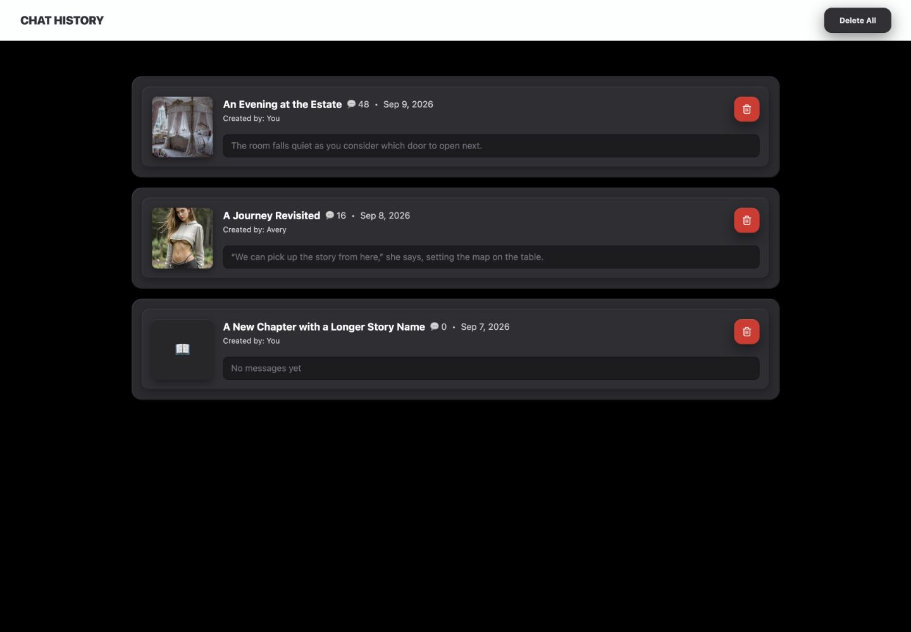
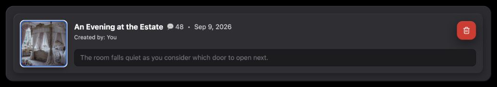
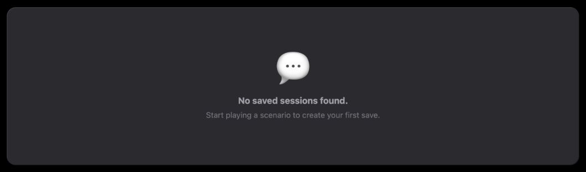
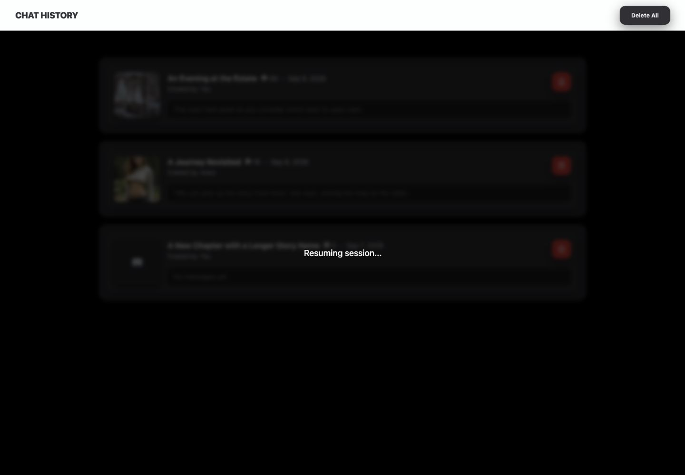
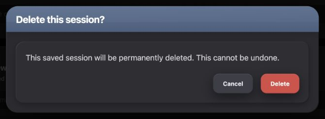
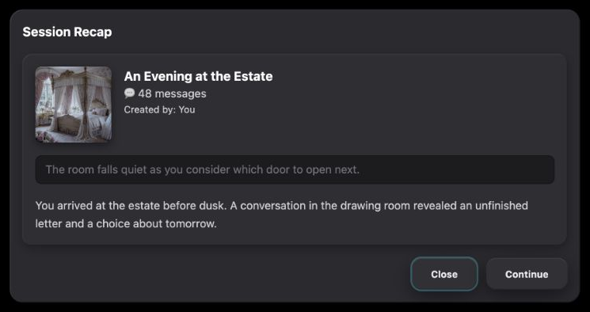
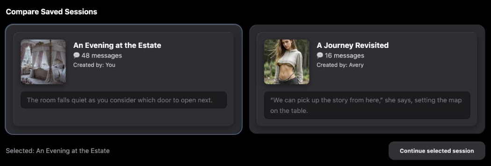

# Chat History UI Reference

A practical menu of patterns for designing new UI that belongs in Chronicle's saved-session workspace.

## Overview

### Designing with Chat History's UI Language

Chat History is a compact list of saved sessions. Its useful vocabulary is a layered horizontal row: graphite shell, inset tray, square story image, title and metadata, then a recessed message preview. It uses direct resume actions, a small destructive command and a shared confirmation. It does not need the inventory of controls found in a builder.

#### Start with the User's Intent

| If the request is… | Start with… | Then combine… |
| --- | --- | --- |
| “Let me return to a saved session.” | History row | Story image, title, message count, updated date, creator and last-message preview. |
| “Let me inspect a recap before continuing.” | Row's shell/tray/recess family | A semantic dialog, readable expanded content and ordinary neutral actions. |
| “Help me compare two possible continuations.” | Two layered session summaries | A clearly labeled exclusive choice and a separate Continue action. |
| “Reveal more saved sessions.” | Token-based Load More action | Caller-supplied registry and local 30-record reveal increments. |
| “Remove one or all saved sessions.” | Local red button or neutral Delete All | Shared destructive confirmation with the correct scope and consequence. |

#### Compose a New Design

First decide whether the task is browsing, inspecting, selecting or destroying. Carry the row's fill, shadow, radii, text hierarchy and inset preview together. A recap can expand the same family into a separate surface; comparison can arrange two rows side by side. Neither requires a new decorative slate header inside every card.

The substantial slate-header confirmation is a separate shared family. Its appearance does not turn the ordinary row's 16px shell and 12px tray into the confirmation's 24px shell and 16px tray. Reuse the family appropriate to the interaction, then adapt its arrangement.

#### What Stays Consistent, and What Can Change

| Decision | Carry forward | Adapt to the concept |
| --- | --- | --- |
| Session summary | Graphite shell, inset tray, square preview and quieter recessed last-message text. | Width, columns, image size and how much text is shown. |
| Information hierarchy | White bold story title; lighter metadata; subdued preview. | Add relevant recap content without promoting every line to a heading. |
| Commands | Ordinary shared neutral actions, local removal red, separate red final confirmation. | Labels and placement; expose meaningful busy/disabled states where needed. |
| Ownership | Registry and resume/delete handlers come from the parent; list sorting/reveal is local. | A new preview, working selection or persistence belongs to its caller. |
| Choice state | Source thumbnail supplies a slate ring color declaration. | The proposed comparison explicitly makes that ring visible and persistent for selection; the existing list has no selected state. |

#### Using This Reference as a Coding Agent

Identify the requested interaction and borrow a complete construction recipe. Use the source-specific variants below when shared tokens differ. Essential styling and ownership stay in ordinary text; source labels identify evidence without requiring navigation or reverse engineering session storage.

Existing captures import ConversationsTab, the shared header and confirmation with fixed local metadata. The resuming illustration reproduces Index's overlay markup around the imported list. The new examples use local intent receipts. These checks do not resume, delete or save real conversations, establish registry loading, or prove remote success/failure behavior.

#### Chat History in Context

<figure class="source-preview"><div class="capture-background"><picture><source media="(max-width:600px)" srcset="../../src/assets/ui-guide/chat-history/overview-narrow.png"></picture></div><figcaption>Existing source components with local sessions. At 390px the rows fit: titles truncate, metadata wraps and message previews clamp to two lines.</figcaption></figure>

Index supplies a black scrolling canvas with 16px padding, 24px at small and 40px at large. ConversationsTab centers its list at 1024px maximum with another 16px vertical inset. AppShellTopBar supplies “Chat History” and shows Delete All only when the registry contains entries.

The visible title is scenarioTitle, not conversationTitle. Rows sort by updatedAt descending. They show a localized updated date, messageCount, creatorName or “You,” and lastMessage or “No messages yet.” A missing image uses a book glyph. There is no current search, filter, rename or editable form in this region.

<p class="source-line">Source: <code>src/components/chronicle/ConversationsTab.tsx</code> · complete list composition; <code>src/components/app-shell/AppShellTopBar.tsx</code> · lines 382–384 and 522–527; <code>src/pages/Index.tsx</code> · lines 914–916 and 1119–1161; <code>src/types.ts</code> · ConversationMetadata.</p>

## Color Palette

### Color Palette

| Visible role | Applicable value | Owner |
| --- | --- | --- |
| Canvas | Black. | Index |
| Session shell | `#2a2a2f`. | ConversationsTab |
| Inset tray | `#2e2e33`. | ConversationsTab |
| Preview recess | `#1c1c1f`, black/35 edge. | ConversationsTab |
| Thumbnail fallback | Zinc-800 fill, zinc-500 book glyph. | ConversationsTab |
| Main title / metadata | White; `rgba(248,250,252,.8)` count/date/creator. | ConversationsTab |
| Preview / empty guidance | Zinc-500; empty-state main sentence zinc-400. | ConversationsTab |
| Ordinary header action | `#303035` → `#343439`, `#eaedf1` text. | ChronicleSurfaceButton |
| Load More | `hsl(var(--ui-surface-2))`, `hsl(var(--ui-text))`, slate `#4a5f7f` edge; ghost-white hover/pressed. Root tokens are `228 7% 20%`, `210 20% 93%`, and ghost-white `210 33% 98% / .30`. | ConversationsTab / index.css |
| Local Delete | `hsl(0,72%,51%)` → red-600, white icon. | ConversationsTab |
| Final Delete | `#d94b45` → `#e2554e`, white text. | DeleteConfirmDialog |
| Tooltip | Shared popover/background/foreground/border tokens. The captured root theme resolves to white background and dark `rgb(2,8,23)` text. | TooltipContent / index.css |

Local Delete and final confirmation deliberately use different reds. Delete All remains an ordinary neutral header command because it first opens a separate confirmation. There is no AI action or existing selection-color system in this list.

<p class="source-line">Source: <code>src/components/chronicle/ConversationsTab.tsx</code>; <code>src/components/chronicle/chronicle-dark-ui.ts</code>; <code>src/components/chronicle/DeleteConfirmDialog.tsx</code>; <code>src/components/ui/tooltip.tsx</code>; <code>src/index.css</code> · root and dark token declarations.</p>

## Typography & Spacing

### Typography & Spacing

Inherit the application font. This page is quieter than poster-card libraries: title, metadata and last-message preview form the hierarchy inside each row.

| Role | Existing treatment |
| --- | --- |
| App title | 18px black-weight uppercase, tight tracking, `--ui-surface-2` text. |
| List rhythm | 1024px maximum; 16px between rows; 16px shell padding and 16px tray padding. |
| Media/content relationship | 96px fixed square thumbnail, 16px gap; flexible content with min-width zero. |
| Story title | 16px/24px bold white, one-line truncation. |
| Count / updated date | 14px/20px light metadata; title/count/date row wraps with 8px gaps. |
| Creator | 12px/16px metadata, 2px top margin. |
| Title/action row | 8px gap; removal command does not shrink. |
| Last message | 14px/22.75px relaxed zinc-500 text, two-line clamp; 8px top margin before recess. |
| Recess padding | 12px horizontal / 6px vertical. |
| Load More | 14px bold, 24px horizontal / 8px vertical padding; about 38px total height including edge, not fixed 40px. |
| Empty state | 80px vertical padding; 60px chat glyph, 16px after it; 16px bold main sentence, 14px guidance after 4px. |

The actual 390px list retains the thumbnail and both nested insets, making the content column compact. Titles truncate and date/count wrap; the row grows vertically without horizontal overflow in the inspected fixture. New layouts may move the preview below the image or stack whole summaries to give text more room.

#### Naming and Focus

The existing thumbnail, title/metadata and message preview are separate native Resume buttons. The outer card is not clickable. The thumbnail has no accessible name beyond its empty image alt; the Delete button relies on its tooltip rather than an explicit name. The local buttons and Load More provide no explicit focus-visible rule or disabled state. Native keyboard activation alone does not supply a clear focus treatment.

The thumbnail declares `hover:ring-2 hover:ring-[#4a5f7f]`, but its inline boxShadow overrides Tailwind's ring composition: the inspected hovered thumbnail retains only its two-part shadow. The proposed comparison borrows the declared slate color while deliberately implementing a visible ring. Its new focus recipe is `focus-visible:outline-none focus-visible:ring-2 focus-visible:ring-[#4a5f7f] focus-visible:ring-offset-2 focus-visible:ring-offset-black`. Its shadow is expressed as a Tailwind utility so the ring remains part of the final box shadow. Shared ChronicleSurfaceButton keeps its own teal focus family.

<p class="source-line">Source: <code>src/components/chronicle/ConversationsTab.tsx</code> · lines 34–151; <code>src/components/chronicle/ChronicleDarkUi.tsx</code>; <code>src/components/chronicle/chronicle-dark-ui.ts</code>; <code>docs/ui-guide/examples/chat-history-compositions.tsx</code>. Thumbnail hover and narrow layout were inspected in the local source fixture.</p>

## Buttons & Menus

### Buttons & Menus

There is no current command menu in Chat History. Tooltip, resume target, progressive reveal and confirmation have different jobs.

<section class="manual-entry">

#### Resume and Ordinary Header Actions

<section class="reuse-recipe">

##### Use in a New Design

**Construction:** Import ChronicleSurfaceButton from ChronicleDarkUi for a new ordinary command. It supplies 40px height, 12px corners, no border, 12px bold `#eaedf1` text, `#303035` → `#343439`, pressed scale .95 and the hover fill while pressed. Its shadow is `0 8px 24px rgba(0,0,0,.45), inset 0 1px 0 rgba(255,255,255,.09), inset 0 -1px 0 rgba(0,0,0,.20)`. It has a 2px accent-teal/40 focus ring, disabled 50% opacity and no pointer events. Caller supplies label, callback and horizontal inset; Delete All uses 24px.

Existing row Resume targets are native buttons styled as the thumbnail, title block and recessed preview described in Panels & Layout. They have no filled action-button wrapper. Each passes the same scenarioId/conversationId pair to onResume. New targets need names and visible focus; do not nest a Delete button inside a larger Resume button.

```tsx
<ChronicleSurfaceButton className="px-6" onClick={continueSession} disabled={!selectedId}>
  Continue selected session
</ChronicleSurfaceButton>
```

**Ownership and adaptation:** The header's Delete All is hidden for an empty registry. ConversationsTab receives no busy prop; its Resume buttons are not disabled by the parent overlay. A new async action should supply its own pending/failed behavior. Keep action styling distinct from the row's read-only content and local destructive command.

</section>
<p class="source-line">Source: <code>src/components/chronicle/ConversationsTab.tsx</code> · three onResume targets; <code>src/components/app-shell/AppShellTopBar.tsx</code> · conversation branch; <code>src/components/chronicle/ChronicleDarkUi.tsx</code>; <code>src/components/chronicle/chronicle-dark-ui.ts</code> · CHRONICLE_SURFACE_BUTTON_CLASS.</p>
</section>

<section class="manual-entry">

#### Local Delete, Tooltip and Load More

<figure class="source-preview"><div class="capture-background"></div><figcaption>Existing progressive reveal. The local check changed the visible count from 30 to 31, then removed the button; no backend page was fetched.</figcaption></figure>

| Control | Complete applicable treatment |
| --- | --- |
| Local Delete | 40px square, 12px radius, 16px white Trash2; `hsl(0,72%,51%)` → red-600, color transition and the ordinary three-part action shadow. Always visible; click invokes onDelete after stopping propagation. |
| Delete tooltip | Import Tooltip/TooltipTrigger/TooltipContent. Content portals at z80, 4px offset/8px collision padding, 6px radius, token border/popover fill/text, 12px horizontal / 6px vertical padding, 14px text, medium shadow and fade/zoom/side entry. It is descriptive content, not a command menu. |
| Load More | `px-6 py-2 rounded-xl border border-[#4a5f7f] bg-[hsl(var(--ui-surface-2))] text-[hsl(var(--ui-text))] shadow-[0_10px_30px_rgba(0,0,0,0.35)] hover:bg-ghost-white active:bg-ghost-white transition-all active:scale-95 text-sm font-bold`. Centered with 24px vertical outer padding. |

<section class="reuse-recipe">

##### Use in a New Design

**Caller and state:** ConversationsTab owns visibleCount, initially 30. Clicking Load More adds 30 and the label shows the remaining count. This is already-loaded data, so there is no fetching spinner, request error or pending-disable state. Delete invokes a parent callback; it does not mount its own dialog. Give a new icon command an explicit accessible name in addition to its tooltip, and add the documented native focus recipe where needed.

**Keep and adapt:** Preserve the local red versus neutral/shared versus token-based variants. Label, placement and reveal batch size can change. If a new list actually fetches, its caller must provide pending/error behavior rather than treating this reveal button as a complete network-loading control.

</section>
<p class="source-line">Source: <code>src/components/chronicle/ConversationsTab.tsx</code> · lines 102–118 and 142–151; <code>src/components/ui/tooltip.tsx</code>.</p>
</section>

## Fields & Controls

### Fields & Controls

Chat History currently has no editable text fields, validation messages, filters or selected-session state. Its recessed message box is a display preview inside a Resume button. Adding an input recipe here would incorrectly imply a page-specific field family exists.

<section class="manual-entry">

#### Read-Only Preview and New Choice State

<section class="reuse-recipe">

##### Use in a New Design

**Read-only content:** The source shows a two-line last-message excerpt in `bg-[#1c1c1f] border border-black/35 rounded-lg px-3 py-1.5`; its text is `text-sm text-zinc-500 line-clamp-2 leading-relaxed`. It is neither disabled text nor an input with focus/validation states. The parent owns message content, thumbnail URL and metadata; the row supplies their layout and fallback strings.

**Derived choice:** The comparison example introduces a single working selection. Two named native buttons expose aria-pressed; choosing one clears the other's pressed state and updates a visible status. A persistent 2px `#4a5f7f` ring uses the thumbnail's declared slate color; hover shows the same ring on an unselected candidate, and keyboard focus adds the 2px black-offset recipe in Typography & Spacing. The shell/tray/recess fills remain unchanged. Continue stays disabled until there is a choice, using the actual shared button's disabled appearance.

**Ownership and adaptation:** Selection is a teaching-example addition, not a current list capability. The caller owns exclusivity and the selected ID. Neither selecting nor opening a recap mutates a saved session. New editing requirements need an explicitly selected form family from Chronicle's relevant authoring reference; the read-only recess alone is not a complete field specification.

</section>
<p class="source-line">Source: <code>src/components/chronicle/ConversationsTab.tsx</code> · thumbnail, metadata and preview; <code>docs/ui-guide/examples/chat-history-compositions.tsx</code> · SessionComparisonExample.</p>
</section>

## Panels & Layout

### Panels & Layout

<section class="manual-entry">

#### Layered Session Row

<figure class="source-preview"><div class="capture-background"></div><figcaption>Existing row. The thumbnail's declared hover ring is obscured by its inline shadow; the image and row do not become a selected card.</figcaption></figure>

| Layer | Complete applicable construction |
| --- | --- |
| Shell | `#2a2a2f`, 16px corners, clipped overflow; shadow `0 12px 32px -2px rgba(0,0,0,.50), inset 1px 1px 0 rgba(255,255,255,.09), inset -1px -1px 0 rgba(0,0,0,.35)`. 16px inner padding. |
| Tray | `#2e2e33`, 12px corners, 16px padding; shadow `inset 1px 1px 0 rgba(255,255,255,.07), inset -1px -1px 0 rgba(0,0,0,.30), 0 4px 12px rgba(0,0,0,.25)`. |
| Thumbnail | 96px square, nonshrinking, 8px corners, zinc-800, clipped cover crop; shadow `0 4px 12px rgba(0,0,0,.4), inset 0 1px 0 rgba(255,255,255,.07)`. Null image uses a centered 24px zinc-500 book glyph; broken URLs have no error fallback. |
| Content | 16px image/content gap; flexible min-width-zero column with space between top metadata/actions and bottom preview. Header/action gap 8px; type/wrapping under Typography & Spacing. |
| Message recess | `#1c1c1f`, black/35 1px edge, 8px corners, 12px horizontal / 6px vertical inset. No extra shadow. Full-width button sits 8px below the header; 14px relaxed zinc-500 preview clamps at two lines. |

<section class="reuse-recipe">

##### Use in a New Design

**Construction:** ConversationsTab writes these layers locally. Importing its component also imports its list behavior; when a new job needs different structure, carry the complete row family into that composition. Shared CHRONICLE_DARK constants contain matching fills and shadows, but a shared 24px shell wrapper would not preserve this row's 16px geometry without a deliberate override.

**States and caller:** Thumbnail, title block and preview each resume; the outer shell does not. This is not selectable, draggable or expandable markup. Caller supplies the data and callbacks; sorting and pagination are local. A new recap may show a full message instead of a two-line excerpt, while a comparison may put the preview below the top image/title area. Preserve layering, hierarchy and command meaning as those arrangements change.

</section>
<p class="source-line">Source: <code>src/components/chronicle/ConversationsTab.tsx</code> · lines 43–136; <code>src/components/chronicle/chronicle-dark-ui.ts</code> · matching dark tokens.</p>
</section>

<section class="manual-entry">

#### Empty, Resuming and Destructive Confirmation

<figure class="source-preview"><div class="capture-background"></div><figcaption>Existing empty registry state. Delete All is absent and there is no extra create-session button.</figcaption></figure>

<figure class="source-preview"><div class="capture-background"></div><figcaption>Index's overlay markup reproduced around the imported list. This is a controlled visual state, not a completed session load.</figcaption></figure>

<figure class="source-preview"><div class="capture-background"></div><figcaption>Existing DeleteConfirmDialog with History's caller text. Both single and all-session dialogs were opened and canceled locally; no deletion was performed.</figcaption></figure>

<section class="reuse-recipe">

##### Use in a New Design

**Empty:** Reuse the row's graphite fill, 16px radius and shell shadow, then 80px vertical padding and centered text. The 60px chat glyph has 16px after it; the main line is 16px bold zinc-400, guidance 14px zinc-500 after 4px. It explains empty history, not a failed request or no-search-results condition. ConversationsTab has no loading/error props; the module-loading fallback in Index is a blank black aria-hidden block.

**Resuming:** Index supplies an absolute inset-0 z50 black/70 overlay with backdrop-blur-sm (4px), a centered column and 18px medium white “Resuming session...” text. There is no spinner or Cancel. The lifecycle handler schedules it after 300ms and removes it in finally. It does not provide inert, disabled props or a focus trap to the covered list. Missing data and caught failure log to console rather than a visible retry state. A new asynchronous surface must define coherent pending/error/interaction handling; this overlay alone is not that complete contract.

**Confirmation:** Import DeleteConfirmDialog, with open/onOpenChange/onConfirm and caller-owned title/message. It supplies the semantic alert dialog, Cancel focus, Escape handling and complete visual family: black/80 backdrop; width `min(94vw,640px)`; 24px `#2a2a2f` shell and strong shadow `0 20px 50px rgba(0,0,0,.55), inset 1px 1px 0 rgba(255,255,255,.09), inset -1px -1px 0 rgba(0,0,0,.35)`. Its header has a vertical `#5a7292` → `#4a5f7f` gradient, white/20 top edge, 20px horizontal / 12px vertical padding, large shadow and a pointer-inert white/10 diagonal sheen at 40% opacity over its top 60%. Title is 20px bold white with `-.015em` tracking.

The body uses 16px padding → 20px at small; its 16px-corner `#2e2e33` tray has 20px padding and the row tray's exact shadow. Description is 16px relaxed zinc-300. Actions follow after 20px. Below small they stack in reverse order (Delete above Cancel) with an 8px gap; at small and above the end-aligned row combines an 8px gap with 8px sibling margin for 16px separation. Both use: 40px height, 12px radius, 20px horizontal inset, 12px bold type and the shared three-part action shadow. Cancel uses `#3c3e47` → `#44464f` with normal `#eaedf1` text, but its inherited outline-button hover foreground is `hsl(var(--accent-foreground))` (dark `rgb(15,23,42)` in the captured root theme). This inherited hover differs from the ordinary neutral button; importing the confirmation retains it. Delete uses `#d94b45` → `#e2554e` / white. Both have a 2px `#6e89ad`/70 focus ring and zero offset. The shared alert primitive handles dismissal and does not interpret outside clicking as confirmation.

History supplies “Delete this session?” and the permanent single-session consequence, or “Delete all N sessions?” and the all-session consequence. Index closes confirmation immediately. The lifecycle optimistically removes records and restores the registry on caught failure, without a history-specific error banner. The dialog supplies no pending/error props. Do not infer a completed deletion from its closing or from these local captures.

</section>
<p class="source-line">Source: <code>src/components/chronicle/ConversationsTab.tsx</code> · empty branch; <code>src/pages/Index.tsx</code> · LazyTabFallback and lines 1119–1161; <code>src/hooks/use-index-scenario-lifecycle.ts</code> · lines 479–541 and 594–645; <code>src/components/chronicle/DeleteConfirmDialog.tsx</code>; <code>src/components/ui/alert-dialog.tsx</code>; <code>src/components/ui/button.tsx</code> · inherited outline hover; <code>src/index.css</code> · accent-foreground token.</p>
</section>

## Composition Examples

### Composition Examples

These are new reference-only compositions. They use local metadata and intent receipts, borrowing the History row's language without creating active product features.

<section class="manual-entry">

#### New Session Recap

**Requested behavior:** “Let me inspect a saved session's recap and last message separately before continuing. Close should leave history unchanged.”

<figure class="source-preview"><div class="capture-background"></div><figcaption>New composition: existing row styling becomes a separate inspection task. There is no new slate banner inside the dialog.</figcaption></figure>

| Requirement | Inherited pattern | Deliberate adaptation |
| --- | --- | --- |
| Inspect separately | History's 16px graphite shell and 12px inset tray. | Shared semantic Dialog, 720px sample maximum, viewport margins/height cap and scrolling. |
| Recognize the session | 96px thumbnail, bold white title, lighter count/creator. | The title wraps and metadata is abbreviated for this recap. |
| Read last message and recap | Existing recessed preview and metadata type. | Full message rather than two-line clamp; 14px relaxed recap after 16px. |
| Continue or close | Ordinary ChronicleSurfaceButton family. | Continue records a local intent; Close/Escape/outside dismissal changes no session. |

<section class="reuse-recipe">

##### Use in a New Design

**Construction:** Use shared Dialog root/trigger/content/title/description for naming, focus containment, Escape/outside dismissal and trigger focus return. Caller overrides the primitive's default surface with the complete row shell shadow and the following geometry. Both base and small radius overrides are needed because DialogContent supplies sm:rounded-lg by default.

```tsx
className="w-[calc(100vw-32px)] max-w-[720px] max-h-[calc(100vh-32px)] overflow-y-auto rounded-2xl sm:rounded-2xl border-0 bg-[#2a2a2f] p-4 gap-4 text-white [&>button]:hidden"
```

Hide the default X and provide the visible Close command. DialogTitle is explicitly `text-base font-bold leading-6 tracking-normal`, preserving the row's 16px/24px type rather than inheriting the primitive's tracking/leading. A visually hidden DialogDescription explains the task. The tray, thumbnail and message use their full recipes above. The footer wraps, right-aligns and uses 12px gaps; ordinary actions use 24px horizontal padding.

**State and adaptation:** The caller supplies session metadata and recap; this component only owns open state and a local Continue receipt. Close, Escape and outside dismissal do not mutate history. Local checks covered Close, Continue, reopening and completed Escape/focus return. At 390px the 358px shell fits, title/message wrap and actions remain visible. Width, text length, preview size and placement can change; keep the surface/type/action family. An implemented Continue operation needs real pending/error ownership.

```tsx
<SessionRecapExample session={sessionSummary} />
```

</section>
<p class="source-line">Source: <code>docs/ui-guide/examples/chat-history-compositions.tsx</code> · SessionRecapExample and SessionContents; inherited owners <code>src/components/chronicle/ConversationsTab.tsx</code>, <code>src/components/ui/dialog.tsx</code>, <code>src/components/chronicle/ChronicleDarkUi.tsx</code>.</p>
</section>

<section class="manual-entry">

#### New Session Comparison

**Requested behavior:** “Let me compare two saved sessions side by side, choose which to continue, then continue only that selection.”

<figure class="source-preview"><div class="capture-background"></div><figcaption>New inline composition. Selected state belongs to this example; the existing History list resumes directly instead.</figcaption></figure>

| Requirement | Inherited pattern | Deliberate adaptation |
| --- | --- | --- |
| Compare summaries | Full row shell/tray/recess, square thumbnail and type hierarchy. | Two equal columns at medium; one column below medium. Full message previews sit below image/title. |
| Choose exactly one | Thumbnail's declared slate ring color. | Persistent visible ring plus named pressed buttons and explicit focus. No destructive action nested inside either target. |
| Continue only the choice | Ordinary shared header-action family. | Disabled until a choice exists; separate local intent receipt. |

<section class="reuse-recipe">

##### Use in a New Design

**Construction:** Use a named inline section, a labeled group and two full-width native buttons. Each gets the exact row shell/shadow, 16px padding, nested 12px tray/16px inset, and SessionContents. The sample keeps the 1024px maximum and 16px inter-card gap. Its title is 16px bold white, 16px above the grid. Below the grid, status and Continue wrap with 16px gaps. There is no backdrop, dialog or dismissal command.

**Selection styling:** Express the shell shadow as a Tailwind shadow utility, then add `ring-2 ring-[#4a5f7f]` to the chosen button. An unselected button has the same ring on hover; focused buttons receive the documented black-offset slate focus recipe. Keeping the shadow in the utility composition avoids the existing thumbnail's inline-shadow problem. The current example was inspected with both the 2px ring and the complete three-part shell shadow present.

**State:** The caller supplies exactly two nonempty session summaries. Selection starts empty; Continue is disabled with the shared opacity/no-pointer rule. Choosing one makes only it pressed and updates the status. Continue records the selected title locally. Local checks covered the disabled initial state, exclusive mouse/keyboard selection and Continue using the second selection. At 390px both cards stack and the body fits without horizontal overflow.

**Keep and adapt:** Preserve fills, radii, shadows, hierarchy and a visible, named choice distinct from a Resume command. Column count, width and recap amount may change. The source has no selected-card or comparison behavior; these explicit additions teach how to compose it consistently. Persistence and actual resume failure handling remain the implemented feature's responsibility.

```tsx
<SessionComparisonExample sessions={[firstSession, secondSession]} />
```

</section>
<p class="source-line">Source: <code>docs/ui-guide/examples/chat-history-compositions.tsx</code> · SessionComparisonExample, shellClass and focus; inherited owners <code>src/components/chronicle/ConversationsTab.tsx</code>, <code>src/components/chronicle/ChronicleDarkUi.tsx</code>, <code>src/components/chronicle/chronicle-dark-ui.ts</code>.</p>

<details class="implementation"><summary>Supporting source</summary>

```tsx
const [selected, setSelected] = useState<string | null>(null);
// Each candidate compares its ID to selected for aria-pressed and ring classes.
// Continue is disabled until selected is non-null; its callback records local intent only.
```

</details>
</section>
