# Community Gallery UI Reference

A practical menu of patterns for designing new UI that belongs in Chronicle's public story discovery workspace.

## Overview

### Designing with Community Gallery's UI Language

Community Gallery combines public story discovery, filtering, reactions and reviews. Its graphite canvas, recessed search, slate category controls and review forms extend the same Chronicle language used by Story Builder. Use this representative menu to choose and combine those treatments for new UI, rather than treating every category, rating or publication field as another component to catalog.

#### Start with the User's Intent

| If the request is… | Start with… | Then combine… |
| --- | --- | --- |
| “Let me find stories using words and tags.” | Recessed search pill | Clear action, removable filter chips and truthful result/loading/error states. |
| “Let me narrow several categories independently.” | Collapsible category groups | Muted slate selected rows, a selected count and Clear all. |
| “Let me choose a discovery feed.” | Shared slate header segments | Caller-owned sort/filter meaning. |
| “Let me react to or save a public item.” | Like/Save action pair | Rose or amber selected state, named controls and caller-owned pending behavior. |
| “Show the creator's work and community response.” | Public detail surface | Creator action, compact ratings/statistics and restrained review cards. |
| “Let me rate something and add a note.” | Review form shell | Recessed rating well, optional disclosure, textarea and persistent footer. |
| “Keep the results visible while I adjust a few choices.” | Anchored discovery popover | The category-row vocabulary with immediate independent state. |
| “Ask before revealing adult imagery.” | Existing visibility switch and confirmation | The documented mask and reveal flow, without inventing a new warning family. |

#### Compose a New Design

Choose the interaction first. A command menu executes a command; an anchored popover holds controls beside their subject; a dialog gives a separate task room for its fields and actions. Then choose the surface layers that task needs. Gallery's category sidebar uses an inset tray and elevated disclosure headers. Its review form uses a graphite shell, slate title, trays and recessed wells. A public review card uses a single bordered surface without that entire hierarchy.

Preserve the selected family's fill, edge, shadow, corner radius, type and state treatment together. Adapt width, columns, image ratio, text length and the number of controls to the request. A new idea does not require a new accent color or a fixed copy of the photographed layout.

#### What Stays Consistent, and What Can Change

| Decision | Carry forward | Adapt to the concept |
| --- | --- | --- |
| Layer hierarchy | Graphite shell, slate title, inset tray, recessed editable/control well. | Number of layers; compact controls need less structure than a substantial form. |
| Selection | Muted slate category rows; rose Like; amber Save; existing category-chip colors. | Choice labels and single/multiple selection behavior, which must follow the actual request. |
| Shape | 32px public media cards; 24px review shells; 16px trays; 12px review wells/rows; fully rounded search and compact slate commands. | Overall width, height, image ratio and column arrangement. |
| Typography | Heavy compact labels, readable 14px form copy, stronger prompts and restrained 13px public reviews. | Wording, wrapping and content density. |
| Feedback | Distinguish selected, focused, disabled, loading, empty and failed states. | Which states are required. Existing missing semantics are not instructions to reproduce them. |

#### Using This Reference as a Coding Agent

Resolve the requested interaction, select its container and combine only the supporting controls it needs. The main text and short construction fragments state what the component supplies, what its caller adds and which values are local variants. Supporting source provides evidence without requiring reconstruction of unrelated service logic.

Existing specimens import production components with local sample data and controlled reads. The two proposed examples use local state. Neither category establishes live publication, review submission, authentication, persistence or remote filtering. Named source limitations remain visible in the reference; freely chosen layout is not a missing styling rule.

#### Community Gallery in Context

<figure class="source-preview"><div class="capture-background"><picture><source media="(max-width:600px)" srcset="../../src/assets/ui-guide/community-gallery/overview-narrow.png">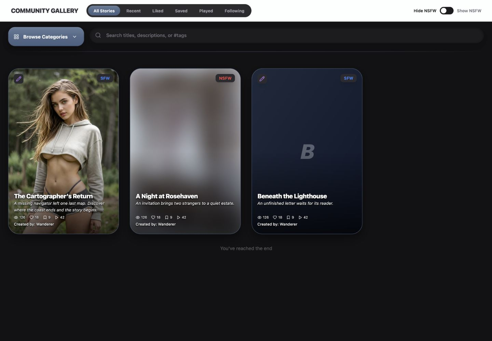</picture></div><figcaption>Production application header and GalleryHub with local stories and controlled reads. In the narrow capture, the shared header overflows, its title wraps and the visibility switch moves to another row; the search becomes cramped beside Browse Categories. These are existing source limitations.</figcaption></figure>

AppShellTopBar owns the application title, feed segments and visibility switch. GalleryHub owns the separate search/category toolbar, optional sidebar, result grid and feedback states. GalleryScenarioCard is exported from GalleryStoryCard.tsx. ScenarioDetailModal is exported from StoryDetailModal.tsx and gains its public controls from GalleryHub's props. ReviewModal owns the separate rating form.

The feed labels are All Stories, Recent, Liked, Saved, Played and Following. Liked/Saved/Played sort public results by their corresponding counts; they are not the viewer's private liked or saved collections. All and Following map to recent order, with Following also supplying creator IDs. Search text and category choices are separate state. Exact limits of these mappings appear with the controls below.

<p class="source-line">Source: <code>src/pages/Index.tsx</code> · lines 101–108 and 996–1008; <code>src/components/app-shell/AppShellTopBar.tsx</code> · lines 439–455; <code>src/components/chronicle/GalleryHub.tsx</code> · lines 440–765; <code>src/services/gallery-data.ts</code> · lines 403–423; source ordering <code>supabase/migrations/20260614071711_6c0e510c-bc5b-456a-8168-1687e24e3ed3.sql</code> · lines 290–295.</p>

## Color Palette

### Color Palette

Use the value that belongs to the chosen pattern. Shared dark tokens describe relationships, but Gallery has deliberate local fills and shadows. Preserve transparency and gradients instead of replacing them with opaque approximations.

| Visible role | Applicable value | Owner |
| --- | --- | --- |
| Gallery canvas | `#121214`; internal toolbar `rgba(18,18,20,.8)` with 12px backdrop blur. | GalleryHub |
| Major shell | `#2a2a2f`. | Sidebar outer shell, review/age dialogs and story detail |
| Inset tray | `#2e2e33`. | Category sidebar and review trays |
| Elevated disclosure/neutral command | `#3c3e47` → `#44464f`. | Category headers and review neutral actions |
| Recessed input/well | `#1c1c1f`. | Search and review fields |
| Public review card | `#1c1f26` with `#4a5f7f` border. | StoryDetailModal review list |
| Slate structural gradient | `linear-gradient(180deg, #5a7292, #4a5f7f)`. | Feed selection, Browse Categories, form title and slate commands |
| Selected category row | `rgba(74,95,127,.25)` fill, `rgba(110,137,173,.45)` edge, `#e7eef8` text and `#9fb5d4` icon. | GalleryCategorySidebar |
| Category-count strip | Transparent fill, `rgba(110,137,173,.3)` edge, zinc-300 text; Clear all `#dbe7f4` → white. | GalleryCategorySidebar; explicit transparent variant in proposed popover |
| Like / Save | Rose-500 / amber-500 selected action fills with white icons; bottom metadata uses rose-400 / amber-400. | GalleryScenarioCard and public detail |
| Play | Blue-500 (`#3b82f6`), card hover blue-600. | Public card/detail |
| Rating marks | Amber-400 filled stars; red-500 filled flames; ghost-white empty marks. | StarRating and SpiceRating |
| Filter chips | Search uses translucent ghost-white with white text; category chips use blue/purple/green/amber fills at 20% and corresponding text. | GalleryHub |
| Form text | White prompts, zinc-400 labels/helper copy, white/75 header helper; textarea white with zinc-600 placeholder. | ReviewModal |
| Public-review text | White name, white/30 time, white/70 comment. | StoryDetailModal |

The current class `bg-[#4a5f7f]/12` on the category-count strip computes to transparent in Chronicle's compiled CSS. The proposed example explicitly uses `bg-transparent` to preserve that observed treatment. The masked card's `bg-[#121214]/18` wash also computes transparent; the visible masking comes from image blur/scale, not a verified 18% dark wash. Do not teach these unsupported opacity classes as visible fills.

Rose Like and amber Save express public interactions; they are not destructive and warning states. Red flames and NSFW badges are domain meanings, not field errors. Purple genre chips and remix icons are not AI commands. This reference has no Gallery AI-action specimen.

The review form's slate Submit is a local primary-action variant. Its neutral action uses the elevated fill above, while ChronicleSurfaceButton's ordinary shared fill is `#303035` → `#343439`. Choose the complete family rather than averaging the values. Reuse shared constants only when they match the actual local shadow: public review cards have a border and no added shadow stack.

<p class="source-line">Source: <code>src/components/chronicle/GalleryHub.tsx</code> · lines 441–543 and 550–619; <code>src/components/chronicle/GalleryCategorySidebar.tsx</code> · lines 104–130 and 188–194; <code>src/components/chronicle/GalleryStoryCard.tsx</code> · lines 68–169; <code>src/components/chronicle/ReviewModal.tsx</code> · lines 139–278; <code>src/components/chronicle/StoryDetailModal.tsx</code> · lines 703–745; <code>src/components/chronicle/StarRating.tsx</code> · lines 8–10; <code>src/components/chronicle/SpiceRating.tsx</code> · lines 45–49; <code>src/components/chronicle/chronicle-dark-ui.ts</code> · line 31. The transparent-fill qualification is based on the source fixture's computed styles.</p>

## Typography & Spacing

### Typography & Spacing

Inherit the application font. Discovery controls use compact bold labels; review forms combine small identifiers with readable prompts and helpers; public review comments stay quieter than the story title. These hierarchies describe different jobs within one theme.

| Role | Current treatment |
| --- | --- |
| Application title | 18px black weight, uppercase, tight tracking, dark application ink. |
| Feed segment | 12px bold; 16px horizontal / 6px vertical inset; 2px gaps inside 4px tray padding. |
| Browse Categories | 14px bold, 16px icons, 12px gaps, 56px trigger height; expanded sidebar header 73px high. |
| Search | 14px medium white, 48px height, 48px left / 56px right inset; 18px search icon. |
| Category header/row | Header 14px bold with `-0.01em` tracking; row 14px regular, 16px icon, 8px gap. |
| Filter chip | 12px medium, 8px horizontal / 4px vertical inset, 12px X, 4px internal gap; 8px between chips. |
| Public card | 18px heavy white title; 12px italic synopsis with two-line clamp and 40px minimum height; 10px counts; 11px medium creator line. |
| Review-form title/helper | 20px bold with `-0.015em` tracking; helper 14px white/75 with 4px top gap. |
| Form well label | 12px black weight, uppercase, `0.12em` tracking, zinc-400. |
| Form prompt/helper | 16px bold white prompt after 8px; 14px relaxed zinc-400 helper after 4px. |
| Rating marks | Quick rating 24px with 6px gaps; optional category stars 20px with 4px gaps; public display 16px. |
| Comment field | 14px white, 16px horizontal / 12px vertical padding, 120px minimum height. |
| Form footer action | 44px height, 14px bold, 20px horizontal inset, 8px icon gap, 16px busy icon. |
| Public review | 13px medium name, 12px timestamp, 13px comment at 1.5 line-height; 28px avatar. |

The Gallery grid keeps 24px horizontal padding and 40px bottom padding; gaps are 16px and become 32px at large. Sidebar content has 12px padding and section gaps; rows have 6px vertical separation. Review bodies use 16px padding, increasing to 20px at small, with 20px between trays. A tray uses 16/20px padding around a 16px-padded recessed rating well. Keep those relationships while adapting columns and wrapping to actual width.

#### State and Naming Responsibilities

Shared Collapsible supplies disclosure semantics but no appearance. Shared Textarea forwards native props and supplies its base disabled/focus behavior, while ReviewModal supplies the full dark variant. StarRating and SpiceRating do not forward arbitrary naming props to their internal buttons. Gallery card roots, reaction icons and category rows also have missing keyboard or selection semantics described with their recipes.

The proposed examples add named controls, pressed selection and `focus-visible:outline-none focus-visible:ring-2 focus-visible:ring-[#6e89ad]/70`. This addition is explicit. Preserve an existing control's own documented focus treatment when importing it; do not claim the original specimens already provide the example's additions. Pending state and visible failures remain caller responsibilities where source controls do not supply them.

<p class="source-line">Source: <code>src/components/app-shell/AppShellTopBar.tsx</code> · lines 167–224; <code>src/components/chronicle/GalleryHub.tsx</code> · lines 453–543 and 628–680; <code>src/components/chronicle/GalleryCategorySidebar.tsx</code> · lines 104–135 and 201–202; <code>src/components/chronicle/GalleryStoryCard.tsx</code> · lines 118–178; <code>src/components/chronicle/ReviewModal.tsx</code> · lines 144–278; <code>src/components/chronicle/StoryDetailModal.tsx</code> · lines 703–745; <code>src/components/ui/textarea.tsx</code> · lines 5–17; <code>src/components/ui/collapsible.tsx</code> · lines 1–9; <code>docs/ui-guide/examples/community-gallery-compositions.tsx</code> · focus constant and both examples.</p>

## Buttons & Menus

### Buttons & Menus

Choose an action by its job. Browse Categories is a substantial disclosure, Like/Save are stateful public reactions, Play is progression, and review submission uses the slate form-action family. The inspected Gallery toolbar has no command dropdown; the proposed Discovery Focus surface is a popover containing controls.

<section class="manual-entry">

#### Structural and Form Actions

| Variant | Complete treatment |
| --- | --- |
| Browse Categories | 56px high, 20px corners, slate gradient, white/20 top edge and 7% white vertical sheen. 16px left / 20px right inset; 14px bold text, 16px icons, 12px gaps. Shadow `0 10px 24px rgba(0,0,0,.42), inset 0 1px 0 rgba(255,255,255,.12), inset 0 -1px 0 rgba(0,0,0,.22)`. Hover brightness 105%; active scale .99 / brightness 95%; 2px `#6e89ad`/60 focus ring. |
| Submit / Update Review | 44px high, 12px corners, 20px horizontal inset, 14px bold white text and 8px icon gap. Slate gradient and white/20 top edge; shadow `0 8px 24px rgba(0,0,0,.45), inset 0 1px 0 rgba(255,255,255,.14), inset 0 -1px 0 rgba(0,0,0,.22)`. Same brightness/press states; 2px `#6e89ad`/70 focus ring. Disabled: pointer-events none, opacity 40%; busy adds a spinning 16px Loader2. |
| Neutral form command | Same 44px height, 12px corners, 20px inset and 14px bold type. `#3c3e47`→`#44464f`, `#eaedf1` text, no border; shadow `0 8px 24px rgba(0,0,0,.45), inset 0 1px 0 rgba(255,255,255,.09), inset 0 -1px 0 rgba(0,0,0,.20)`. Same focus/disabled treatment as Submit. |
| Leave / Edit Review | Compact 36px slate pill, 16px horizontal inset and 12px bold white text; Submit shadow/top edge/press behavior, with a 2px `#5a7292`/60 focus ring. |

<section class="reuse-recipe">

##### Use in a New Design

**Construction:** These are caller-styled native buttons, not interchangeable variants of ChronicleSurfaceButton. Keep the entire fill/edge/shadow/type/state relationship. Layer the sheen behind the label with a pointer-inert absolute element and a positioned label above it. Browse Categories owns expanded-state ARIA in GalleryHub; its caller opens the sidebar. The expanded sidebar's closing header is a different, solid elevated treatment described under Panels & Layout.

ReviewModal supplies Submit/Update busy state and eligibility; it also styles Delete Review as a neutral command which opens DeleteConfirmDialog. The final destructive confirmation uses Chronicle's shared red action (`#d94b45`→`#e2554e`), not a rose Like action. DeleteConfirmDialog supplies its 24px graphite shell, slate title, inset tray, neutral Cancel and red Delete; the caller supplies title, consequence and confirmation callback. This shared confirmation has no pending/error props. The reference-only private-rating example borrows the neutral form command for Cancel; that label and working-copy behavior are proposed.

**Keep and adapt:** Preserve the selected action family and its explicit states. Choose label, width and placement for the task. Gallery has no AI command or dashed Add tile in this path; those meanings should use an appropriate established family when a new requirement needs them, not a recolored Like or Submit button. For asynchronous commands, supply visible failure feedback; the source review's service errors are console-only.

</section>

<p class="source-line">Source: <code>src/components/chronicle/GalleryHub.tsx</code> · lines 491–509; <code>src/components/chronicle/ReviewModal.tsx</code> · footer and DeleteConfirmDialog; <code>src/components/chronicle/StoryDetailModal.tsx</code> · lines 685–695; <code>src/components/chronicle/DeleteConfirmDialog.tsx</code> · lines 13–65.</p>

<details class="implementation"><summary>Supporting source</summary>

```tsx
disabled={!canSubmit || isSubmitting}
{isSubmitting && <Loader2 className="h-4 w-4 animate-spin" />}
{existingReview ? 'Update Review' : 'Submit Review'}
```

</details>
</section>

<section class="manual-entry">

#### Like, Save and Play

<figure class="source-preview"><div class="capture-background">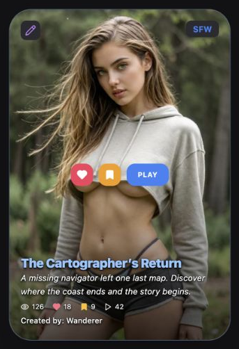</div><figcaption>Production GalleryScenarioCard with locally supplied selected states. These are public reactions and progression, not private collection filters.</figcaption></figure>

| Part | Current treatment |
| --- | --- |
| Hover tray | Absolute inset, centered, wrapping, 8px gaps and 16px horizontal padding; z-index 10. Opacity 0 and scale .9 become opacity 1 / scale 1 over 300ms. |
| Like / Save base | 32px square, 12px corners, 16px icons, `shadow-2xl`, transition-all. Idle white/90 with slate-700 icons. |
| Like | Idle hover rose-100 fill / rose-500 icon; selected rose-500 fill, white filled Heart. |
| Save | Idle hover amber-100 fill / amber-500 icon; selected amber-500 fill, white filled Bookmark. |
| Play | 32px high, 16px horizontal inset, 12px corners, blue-500 → blue-600, white 10px bold uppercase/wider text, `shadow-2xl`. |
| Public detail variant | Labeled 40px actions with 12px corners, 14px icons, 6px gaps and 12px bold uppercase/.05em tracking. Idle reactions use `#2f3137`/`#eaedf1` and the neutral detail shadow; selected rose/amber and blue Play use outer `0 8px 24px rgba(0,0,0,.45)` only. |

<section class="reuse-recipe">

##### Use in a New Design

**Construction:** GalleryScenarioCard receives `isLiked`, `isSaved` and callbacks. It owns temporary Like/Save busy flags and disables those buttons while awaiting their callbacks. The caller owns authentication, services, selected values, counts and failures. Existing icon buttons have no accessible names, pressed-state ARIA or explicit busy/focus styling. The card root is a click-only div without keyboard behavior. New controls need a named primary opening target, separate named reaction buttons, programmatic selection and visible focus. Expose secondary actions for keyboard/touch use instead of requiring hover.

**Keep and adapt:** Keep rose/amber reaction meanings distinct from blue progression. Do not transfer the card's white idle controls into a dark detail action row: that local variant has a different idle fill and shadow. The source stops click propagation on shortcuts; new keyboard handling must also avoid triggering the primary open action. The shared illustration does not prove remote reaction persistence.

</section>

<p class="source-line">Source: <code>src/components/chronicle/GalleryStoryCard.tsx</code> · lines 28–59 and 115–148; <code>src/components/chronicle/StoryDetailModal.tsx</code> · lines 357–415; <code>src/components/chronicle/GalleryHub.tsx</code> · handleLike, handleSave and handlePlay.</p>

<details class="implementation"><summary>Supporting source</summary>

```tsx
// A controlled input to the card; the owning feature supplies these values.
<GalleryScenarioCard published={published} isLiked={isLiked} isSaved={isSaved}
  onLike={onLike} onSave={onSave} onPlay={onPlay} onViewDetails={onViewDetails} />
```

</details>
</section>

## Fields & Controls

### Fields & Controls

Feed choice, multiple category choices, text search, a visibility switch and a rating scale have different behavior. Carry the appropriate selection and naming contract with their styling.

<section class="manual-entry">

#### Feed Selection and Visibility

<section class="reuse-recipe">

##### Use in a New Design

**Construction:** AppShellTopBar's private SegmentedControl renders the feed choices from caller-supplied options, active value and onChange. Tray: `flex items-center bg-[#2b2b2e] rounded-full p-1 gap-0.5 border border-[#2b2b2e]`. Buttons: `px-4 py-1.5 rounded-full text-xs font-bold transition-colors whitespace-nowrap border-t`. Selected adds `relative overflow-hidden bg-gradient-to-b from-[#5a7292] to-[#4a5f7f] border-white/20 text-white shadow-sm`, with pointer-inert 7% white vertical sheen behind a relative z-index 1 label. Inactive uses `border-transparent text-[#a1a1aa] hover:text-[#e4e4e7]`.

GalleryNsfwToggle wraps LabeledToggle with dark label tone and 10px gaps. LabeledToggle supplies native switch semantics and checked state: 40×22px track, 16px white shadowed thumb at top 3px moving from x 3px to x 21px. Checked track blue-500 with inset `0 1px 3px rgba(0,0,0,.3)`; unchecked `#1c1c1f` with .4 shadow. Labels are 12px semibold; inactive zinc-500, active off zinc-900 and active on `#4a5f7f`. Generic LabeledToggle can disable/lock with 70% opacity and a forbidden cursor; the Gallery wrapper does not expose those props or arbitrary ARIA forwarding. Neither adds an explicit focus class. A new wrapper should provide an appropriate visible focus treatment and name without assuming unknown props reach the internal control.

**State:** The caller owns feed meanings and visibility approval. Liked/Saved/Played are popularity orders; Following supplies creator IDs. The service omits an empty publisher-ID array, so this path does not establish a correctly restricted empty-following result. The Gallery retains masked NSFW cards while hiding the NSFW category choice; it requests approval before opening or playing a masked story. The age surface is shown under Panels & Layout.

**Keep and adapt:** Preserve slate exclusive selection and the switch's two-state treatment. Add selected semantics and focus when composing new feed controls; the current segments have no pressed/radio semantics. Constrain or wrap the parent at narrow widths instead of copying the captured overflowing header.

</section>

<p class="source-line">Source: <code>src/components/app-shell/AppShellTopBar.tsx</code> · SegmentedControl and gallery branches; <code>src/components/chronicle/GalleryNsfwToggle.tsx</code>; <code>src/components/ui/labeled-toggle.tsx</code>; <code>src/components/chronicle/GalleryHub.tsx</code> · lines 73–116 and 388–413; <code>src/services/gallery-data.ts</code> · lines 403–423.</p>
</section>

<section class="manual-entry">

#### Search and Removable Filters

<figure class="source-preview"><div class="capture-background">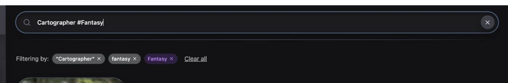</div><figcaption>Existing search and filter presentation. Query results in this fixture are controlled local data, not evidence of the remote search service.</figcaption></figure>

<section class="reuse-recipe">

##### Use in a New Design

**Construction:** The native input's caller supplies its appearance and query handlers. Use the complete recessed pill:

```tsx
className="h-12 w-full rounded-full border border-black/40 bg-[#1c1c1f] pl-12 pr-14 text-sm font-medium text-white placeholder:font-medium placeholder:text-zinc-500 shadow-[inset_0_2px_8px_rgba(0,0,0,0.45),0_10px_24px_rgba(0,0,0,0.18)] focus:outline-none focus:ring-2 focus:ring-[#4a5f7f] focus:border-transparent"
```

The 18px zinc-500 Search icon sits 16px from the left, vertically centered and pointer-inert. When nonempty, Clear search is a named 32px circular button at right 8px: elevated `#3c3e47`→`#44464f`, zinc-200→white, 16px X, shadow `0 8px 20px rgba(0,0,0,.35), inset 0 1px 0 rgba(255,255,255,.09), inset 0 -1px 0 rgba(0,0,0,.20)`. The input has an ID and placeholder but no associated label; supply a name for new input. Its native attributes can supply disabled state when needed; the source has no disabled search treatment.

Changes parse after 220ms; Enter parses immediately. Whitespace-separated #tags become lowercase tags and remaining words become search text. Active chips wrap with 8px gaps. Each uses `px-2 py-1 rounded-full text-xs font-medium flex items-center gap-1` and a 12px X. Search chips use ghost-white/white; story types blue-500/20 and blue-500; genres purple-500/20 and purple-400; origins green-500/20 and green-400; warnings amber-500/20 and amber-400. X hover is red-300. The main Clear all is 14px white/70→white with underline and 8px left margin.

**State and limits:** Main Clear all clears query and categories; sidebar Clear all clears categories only. Removing a search-tag chip does not remove it from the source query string, so a later query edit may parse it again. New removals should keep displayed input and active state coherent. Current chip X buttons are unnamed; provide per-chip names and visible focus. These category colors are local metadata variants, not instructions to assign arbitrary new hues to new filters.

</section>

<p class="source-line">Source: <code>src/components/chronicle/GalleryHub.tsx</code> · applySearchQuery, search effect, lines 513–622.</p>

<details class="implementation"><summary>Supporting source</summary>

```tsx
const timeoutId = window.setTimeout(() => applySearchQuery(searchQuery), 220);
return () => window.clearTimeout(timeoutId);
```

</details>
</section>

<section class="manual-entry">

#### Collapsible Category Choices

| Part | Applicable construction |
| --- | --- |
| Group header | 12px corners, black/30 border, `#3c3e47`→`#44464f`, 16px horizontal/12px vertical inset. Shadow `0 8px 20px rgba(0,0,0,.28), inset 0 1px 0 rgba(255,255,255,.07), inset 0 -1px 0 rgba(0,0,0,.18)`. 14px bold white/90 text with -.01em tracking; 16px zinc-400 chevron. |
| Choice container | 6px vertical row gaps; 4px horizontal/bottom padding and 12px above rows. |
| Count strip | 12px corners, `#6e89ad`/30 border, transparent fill, 12px horizontal/8px vertical inset; 12px zinc-300 text. Clear all bold `#dbe7f4`→white. |

<section class="reuse-recipe">

##### Use in a New Design

**Construction:** Collapsible supplies disclosure behavior; the private CategorySection supplies appearance and its open state. Each group toggles independent values through selectedItems and onToggle. Carry the full row variant:

```tsx
const rowBase = 'flex w-full items-center gap-2 rounded-xl border px-3 py-2.5 text-left text-sm transition-colors';
const selected = 'border-[#6e89ad]/45 bg-[#4a5f7f]/25 text-[#e7eef8] shadow-[inset_0_1px_0_rgba(255,255,255,0.06)]';
const idle = 'border-transparent text-zinc-300 hover:bg-white/[0.04] hover:text-white';
// Icon: h-4 w-4 flex-shrink-0; selected #9fb5d4, ordinary idle rgba(248,250,252,.3).
```

Story Type and Genre start expanded, Origin and Trigger Warnings collapsed. Unselected SFW/NSFW icons use green-400/orange-400, warning icons amber-400; selected icons use the same slate value regardless of category. New independent choices need named native buttons with `aria-pressed`, a named group and explicit focus; those semantics are added in DiscoveryFocusExample, not supplied by the original rows.

**Keep and adapt:** Preserve muted slate selection and the elevated-header/recessed-tray relationship. Group names, item count, icons and initial disclosure state can follow the concept. The source has customTags in its state/count but no custom-tag category section in this rendered sidebar; do not invent a fifth visible group. An anchored version can borrow this treatment without inheriting the full 280px sidebar.

</section>

<p class="source-line">Source: <code>src/components/chronicle/GalleryCategorySidebar.tsx</code> · CategorySection, toggleFilter, count strip and four rendered groups.</p>
</section>

<section class="manual-entry">

#### Ratings, Optional Feedback and Comment Entry

<figure class="source-preview"><div class="capture-background">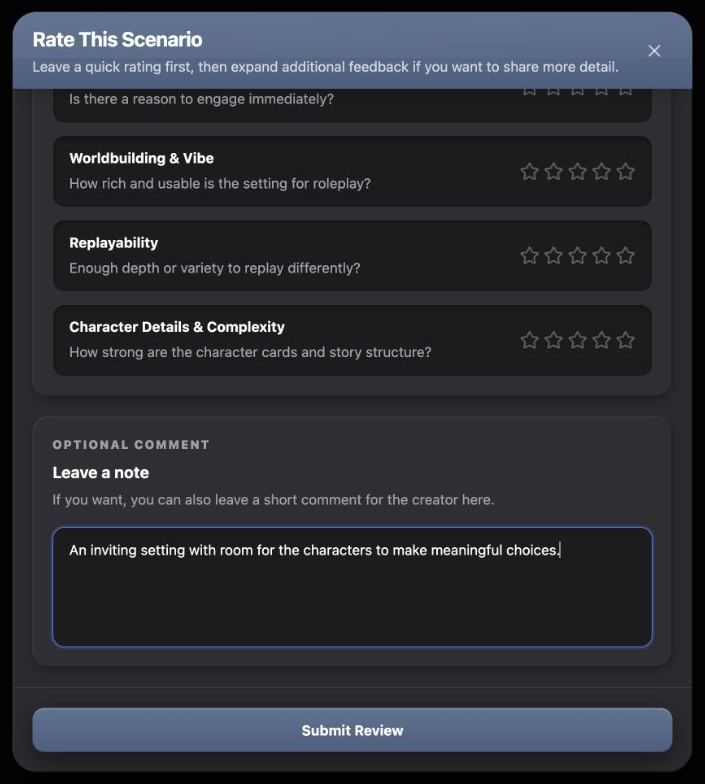</div><figcaption>Existing optional feedback rows and focused textarea after local selection and entry. No review was submitted.</figcaption></figure>

<section class="reuse-recipe">

##### Use in a New Design

**Construction:** StarRating owns amber-400 filled/ghost-white empty icons, half-star display, integer interactive selection and hover preview. SpiceRating uses red-500 filled flames and whole-icon display. Defaults are five 16px marks with 2px gaps; ReviewModal overrides quick marks to 24px / 6px gaps and category stars to 20px / 4px gaps. Noninteractive marks are disabled buttons with cursor-default; interactive buttons are transparent, zero padding/margin/border, with hover scale 1.1 and transition-transform. Neither component exposes names, pressed state or arbitrary attributes for its internal buttons.

For a new named integer score, carry the icon and button styling into native controls as the proposed example does:

```tsx
<div role="group" aria-label="Private story score" className="mt-4 flex items-center gap-1.5">
  <button type="button" aria-label={`Rate ${value} out of 5`}
    aria-pressed={score === value} onClick={() => setScore(value)}
    className="m-0 border-0 bg-transparent p-0 hover:scale-110 transition-transform focus-visible:outline-none focus-visible:ring-2 focus-visible:ring-[#6e89ad]/70">
    <Star className={`h-6 w-6 ${displayScore >= value ? 'text-amber-400 fill-amber-400' : 'text-ghost-white'}`} />
  </button>
</div>
```

Repeat the button for values 1–5. The caller owns score and optional hover preview (`displayScore = hoverScore ?? score`); clear hover on pointer leave. Names, pressed semantics and slate focus are explicit additions. Enlarging targets or choosing a different row arrangement is an adaptable interaction choice, not a reason to recolor the stars.

Shared Textarea forwards native attributes and supplies full width, spellcheck, base focus and disabled cursor/50%-opacity behavior. The caller supplies value/change, an associated label, optional length limit and this complete ReviewModal variant:

```tsx
className="mt-4 min-h-[120px] resize-none rounded-xl border border-black/35 bg-[#1c1c1f] px-4 py-3 text-sm text-white placeholder:text-zinc-600 focus-visible:ring-2 focus-visible:ring-blue-500/20 focus-visible:ring-offset-0 focus-visible:border-blue-500"
```

The source's visible Optional Comment prose is not an associated label; the proposed example explicitly uses label/htmlFor and textarea/id. ReviewModal caps comments at 1000 characters. It uses recessed 12px wells with white/8 border, 16px padding and inset `0 2px 6px rgba(0,0,0,.4)` shadow. The optional Collapsible trigger uses that family with 16px horizontal/12px vertical inset and hover `#202026`; its 20px chevron rotates 180 degrees. Expanded rows stack below small, align horizontally at small, and use 12px gaps with 12px between rows.

**State and limits:** Current review eligibility is a story score OR spice score of at least 1; spice is hidden only for SFW. A story score is not universally required by the existing implementation. Existing review data pre-fills state, while Additional Feedback starts collapsed. Source submission and deletion have busy controls but console-only failures. New concepts must define their own eligibility, working-copy/Cancel behavior and any asynchronous feedback. The private-rating example deliberately requires its sole score and saves only in local state.

</section>

<p class="source-line">Source: <code>src/components/chronicle/StarRating.tsx</code>; <code>src/components/chronicle/SpiceRating.tsx</code>; <code>src/components/ui/textarea.tsx</code>; <code>src/components/chronicle/ReviewModal.tsx</code> · state initialization, canSubmit, rating wells, additional-feedback rows and comment field; <code>docs/ui-guide/examples/community-gallery-compositions.tsx</code> · PrivateRatingExample.</p>
</section>

## Panels & Layout

### Panels & Layout

Choose the number of layers for the job. The discovery workspace needs a canvas, toolbar and optional sidebar. A substantial rating task uses a shell, title, trays and wells. A public review is a quiet bordered card. A few immediate choices can use an anchored tray without acquiring a full form header and footer.

<section class="manual-entry">

#### Discovery Canvas, Sidebar and Grid

<figure class="source-preview"><div class="capture-background">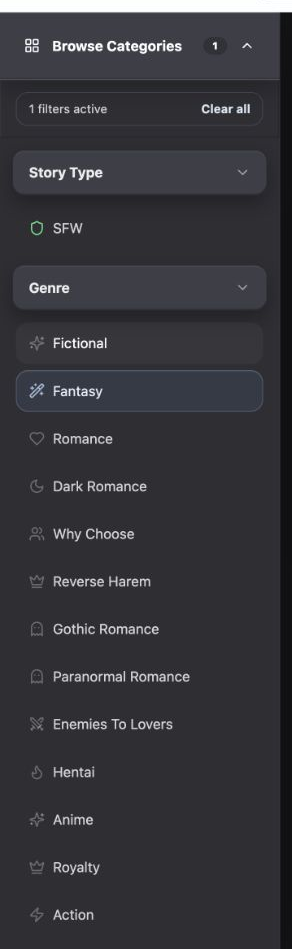</div><figcaption>Existing category sidebar, rendered with local selections. Its fixed width belongs to this workspace arrangement.</figcaption></figure>

| Layer | Applicable styling and ownership |
| --- | --- |
| Canvas / toolbar | GalleryHub supplies the `#121214` full-height flex canvas. Its separate sticky toolbar uses 24px horizontal / 16px vertical padding, `rgba(18,18,20,.8)` and 12px backdrop blur. |
| Toolbar divider | 1px high, 16px top gap, 60% opacity; `linear-gradient(90deg, transparent 0%, rgba(110,137,173,.55) 18%, rgba(110,137,173,.8) 50%, rgba(110,137,173,.55) 82%, transparent 100%)`. |
| Sidebar shell | 280px wide, nonshrinking, full height, `#2a2a2f`, right white/8 edge; shadow `0 18px 42px -24px rgba(0,0,0,.68), inset 1px 0 0 rgba(255,255,255,.04), inset -1px 0 0 rgba(0,0,0,.26)`. |
| Closing header | 73px high, full width, `#3c3e47` → `#44464f`, bottom white/8 border, 24px horizontal inset. White 14px bold text, 16px icons, 12px gaps. Shadow `0 10px 24px rgba(0,0,0,.22), inset 0 1px 0 rgba(255,255,255,.10), inset 0 -1px 0 rgba(0,0,0,.18)`; 2px slate `#6e89ad`/60 focus ring. |
| Sidebar content | `#2e2e33` tray, 12px padding and group gaps, independent vertical scrolling; category-row construction is under Fields & Controls. Active-count area uses 16px horizontal / 12px vertical padding and inset white/4 and black/18 corner highlights. |
| Results | Separately scrolling main area. Grid has 24px horizontal and 40px bottom padding; one column, then two at small, three at large, four at extra-large and five at 2xl. Gaps are 16px, then 32px at large. |

<section class="reuse-recipe">

##### Use in a New Design

**Construction:** GalleryHub owns the sidebar-open state and renders its outer shell/header; GalleryCategorySidebar supplies the inner tray, count and groups. AppShellTopBar is the application header above this composition, not the internal search toolbar. Keep `min-h-0` on flex scroll ancestors and `min-w-0` on the results column so the chosen scroll area can contract.

**Keep and adapt:** Preserve the canvas/toolbar/sidebar layer relationship and the category controls' complete states. Sidebar width, breakpoint behavior and grid column count are layout choices. In the 390px source fixture, the shared application header overflows to roughly 636px, the closed-sidebar search is only about 106px wide, and opening the 280px sidebar leaves a roughly 110px results column. These are source constraints to solve for a new layout, not desired reusable dimensions.

</section>

<p class="source-line">Source: <code>src/components/chronicle/GalleryHub.tsx</code> · lines 440–553 and 628–680; <code>src/components/chronicle/GalleryCategorySidebar.tsx</code> · outer content and count wrapper. Narrow measurements come from the production-component fixture at a 390px viewport.</p>
</section>

<section class="manual-entry">

#### Public Media Card and Image Mask

<figure class="source-preview"><div class="capture-background">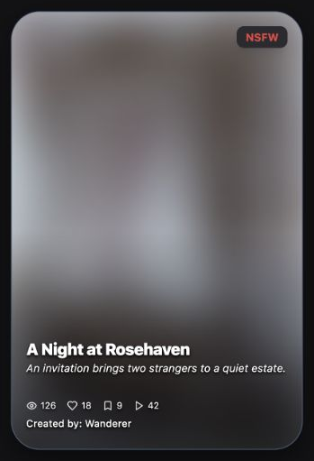</div><figcaption>The existing mask blurs the cover while leaving its badge, title and metadata readable. The unsupported opacity wash contributes no visible fill in the compiled source fixture.</figcaption></figure>

<section class="reuse-recipe">

##### Use in a New Design

**Construction:** GalleryScenarioCard supplies a 2:3 media surface, 32px corners, `#4a5f7f` border, slate-200 base and `0 12px 32px -2px rgba(0,0,0,.5)` shadow. Its hover shadow changes to `shadow-2xl` (`0 25px 50px -12px rgba(0,0,0,.25)`) over 300ms. The root's current `group-hover:-translate-y-3` does not move the standalone card in this fixture. Keep this distinction from other Chronicle card variants.

Cover imagery fills the card with object-cover and caller-supplied focal position. Normal image hover scales to 1.1 over 700ms. Masked imagery uses 24px blur, scale 1.06 at rest and 1.12 on hover. The `bg-[#121214]/18` overlay currently computes transparent. An absent image uses a diagonal slate-800 → slate-900 background and a 60px heavy italic uppercase initial in ghost-white.

The full-card gradient runs from transparent through transparent to black/70. Bottom content has 16px inset and 20px bottom padding: 18px heavy title, 12px italic two-line synopsis with 40px minimum height, 10px counts and an 11px creator line. The title becomes blue-300 on hover. Text shadow is `0 1px 2px rgba(0,0,0,.9), 0 2px 4px rgba(0,0,0,.7), 0 0 1px rgba(0,0,0,.9)`. A top-right badge uses 8px corners, 10px horizontal / 4px vertical padding, graphite fill, 12px bold red/blue text and a large shadow. The remix badge uses the same graphite/8px family with 6px padding and a 16px purple Pencil.

**Caller and states:** Supply the public story, image position, counts, selected reactions and opening/action handlers. Masking is a display input; GalleryHub owns permission and reveal decisions. The source card's click-only root and unnamed reaction controls need the keyboard/naming treatment described under Buttons & Menus when constructing new UI.

**Keep and adapt:** Carry the edge, radius, shadow, text gradient and metadata hierarchy together. Image ratio, card width, number of metadata items and text arrangement can change. A new card should not require hover to expose its only keyboard or touch actions.

</section>

<p class="source-line">Source: <code>src/components/chronicle/GalleryStoryCard.tsx</code> · lines 63–184; <code>src/components/chronicle/GalleryHub.tsx</code> · masked opening/play handlers. Hover and mask qualifications use computed production-fixture styles.</p>
</section>

<section class="manual-entry">

#### Loading, Empty and Failed Results

<figure class="source-preview"><div class="capture-background">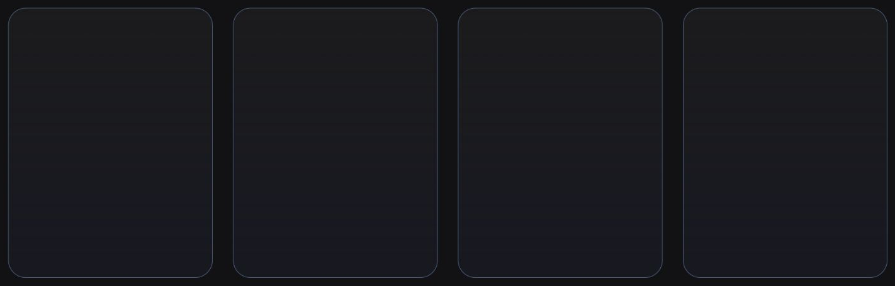</div><figcaption>Controlled initial loading state using the actual GalleryHub branch.</figcaption></figure>

<figure class="source-preview"><div class="capture-background">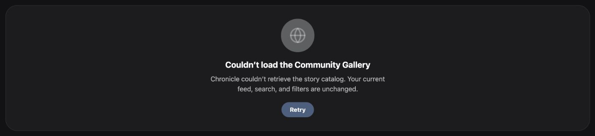</div><figcaption>Controlled failed read. The source retains the current feed, search and filters.</figcaption></figure>

<figure class="source-preview"><div class="capture-background">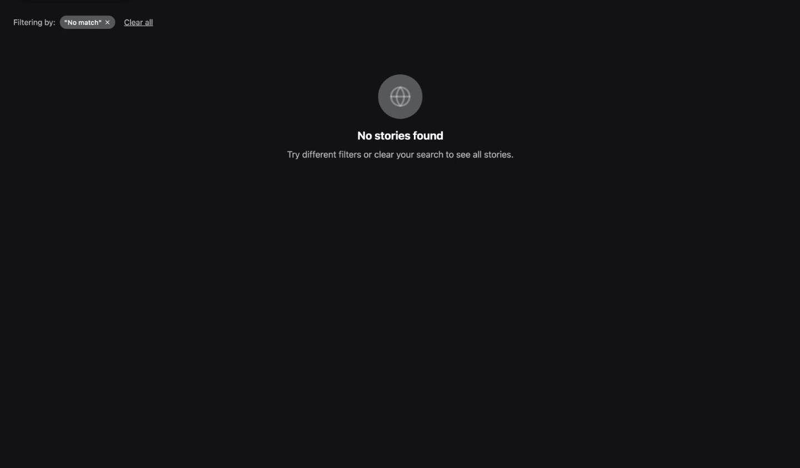</div><figcaption>Controlled empty result. This is separate from the bordered failure panel.</figcaption></figure>

<section class="reuse-recipe">

##### Use in a New Design

**Construction:** Initial loading uses four static 430px-high placeholders in the result grid. Each has 28px corners, `rgba(86,118,164,.85)` border and `linear-gradient(180deg, rgba(255,255,255,.04) 0%, rgba(24,25,33,.95) 100%)`. They are not animated skeletons.

Initial failure uses a 256px-minimum-height centered panel, 28px corners, white/10 edge, `#1c1c1f`, 24px horizontal / 32px vertical padding and `role="alert"`. An 80px ghost-white circle holds a 40px white/30 Globe. Title is 20px bold white with 8px below; body is white/70 with 448px maximum width. Retry has 20px top spacing, a full radius, `#4a5f7f` → `#5a7292`, 20px horizontal / 8px vertical padding, and 14px bold white text; fetching changes its label and adds wait cursor / 60% opacity.

Empty results reuse the centered icon/title/body hierarchy in a 256px-high area without the failure panel's fill, edge or Retry. Pagination failure retains existing cards and puts a 14px white/70 message with a smaller-inset Retry below them. Loading-more and disconnected copy use 14px white/50; end-of-results uses white/30. A polite live status also announces recovery/connection state.

**Caller and adaptable choices:** The query owner supplies truthful loading, error, pause, pagination and empty state. A different page can choose placeholder height and grid count to match its own content, while preserving these feedback distinctions. The captures establish rendered branches with controlled reads; they do not test the live network or retry recovery.

</section>

<p class="source-line">Source: <code>src/components/chronicle/GalleryHub.tsx</code> · live status and lines 628–723; <code>src/index.css</code> · ghost-white token.</p>
</section>

<section class="manual-entry">

#### Public Detail and Review Cards

<figure class="source-preview"><div class="capture-background">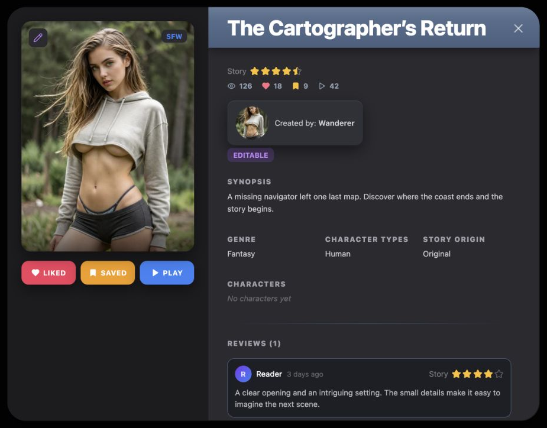</div><figcaption>Public variant of ScenarioDetailModal using local publication and review data. Its shared shell also appears in My Stories; Gallery supplies different props and actions.</figcaption></figure>

<figure class="source-preview"><div class="capture-background">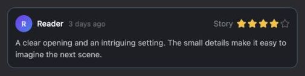</div><figcaption>A public review needs this single restrained layer, rather than the entire rating-form shell.</figcaption></figure>

<section class="reuse-recipe">

##### Use in a New Design

**Shared shell:** ScenarioDetailModal supplies black/90 backdrop with small blur, a 32px-corner `#2a2a2f` shell and shadow `0 20px 50px rgba(0,0,0,.5), inset 1px 1px 0 rgba(255,255,255,.09), inset -1px -1px 0 rgba(0,0,0,.35)`. This example caps width at 900px and height at `min(700px, calc(100vh - 2rem))`. The 340px recessed media column uses `#1c1c1f` and 24px padding. Its 3:4 image has 16px corners and `0 8px 24px rgba(0,0,0,.45)` shadow. The title banner uses `linear-gradient(180deg, #5a7292 0%, #4a5f7f 100%)`, 32px horizontal / 14px vertical padding, white 36px extra-bold title with `-.02em` tracking, a white/20 top edge and `0 10px 15px -3px rgba(0,0,0,.3), 0 4px 6px -4px rgba(0,0,0,.3)` shadow. Its pointer-inert sheen fades vertically from white/7 to transparent by 30%. These dimensions describe this composition, not every modal.

**Public additions:** Gallery omits `isOwned`, using ScenarioDetailModal's default `false`, even for a publisher viewing their own public item; unpublishing is a separate capability. Labeled reactions and Play use the detail action variant under Buttons & Menus. Statistics use 14px icons, 12px bold slate-400 counts and 16px gaps. A creator button uses `#2f3137`, 12px corners, 14px horizontal / 10px vertical padding, and shadow `0 8px 24px rgba(0,0,0,.45), inset 0 1px 0 rgba(255,255,255,.09), inset 0 -1px 0 rgba(0,0,0,.20)`. Its 56px avatar gets a 2px slate ring on hover; fallback uses a diagonal purple `#7c3aed` → blue `#3b82f6` gradient and an 18px initial. Creator copy is 13px, white/80, with semibold name. The caller supplies identity and the component opens the creator page.

**Review list:** A fading slate divider separates reviews after 32px. Cards are spaced 16px apart and use the complete small surface below—no added shadow:

```tsx
style={{ padding: '12px', borderRadius: '12px',
  background: '#1c1f26', border: '1px solid #4a5f7f' }}
```

The top row has 8px below it: 28px circular avatar, 13px medium white name, 12px white/30 time, and optional 16px rating marks. Comment is 13px white/70 at 1.5 line-height. Empty-review text is 13px white/40 italic. Load More uses 12px medium white/30 text, 16px horizontal / 8px vertical padding, no fill/edge and 50% disabled opacity; a 16px spinner replaces the label while pending.

**States and limits:** The caller supplies public counts and publication identity; the component fetches review pages. Its displayed spice average uses only the loaded reviews, and initial review loading/failure has no distinct visible state. This source composes DialogPortal/Overlay with plain divs rather than semantic Dialog content. The inspected public detail has no dialog role, and its fixed media geometry can constrain narrow layouts. New separate tasks need semantic content, a name, focus handling and viewport-aware scrolling, as the proposed private-rating example demonstrates. No remote review loading, opening a creator account, Play or unpublish action was exercised by these figures.

</section>

<p class="source-line">Source: <code>src/components/chronicle/StoryDetailModal.tsx</code> · lines 249–318, public actions, title banner, lines 475–553 and 676–776; <code>src/components/chronicle/GalleryHub.tsx</code> · ScenarioDetailModal props.</p>
</section>

<section class="manual-entry">

#### Rating Form and Confirmation Surface

<figure class="source-preview"><div class="capture-background">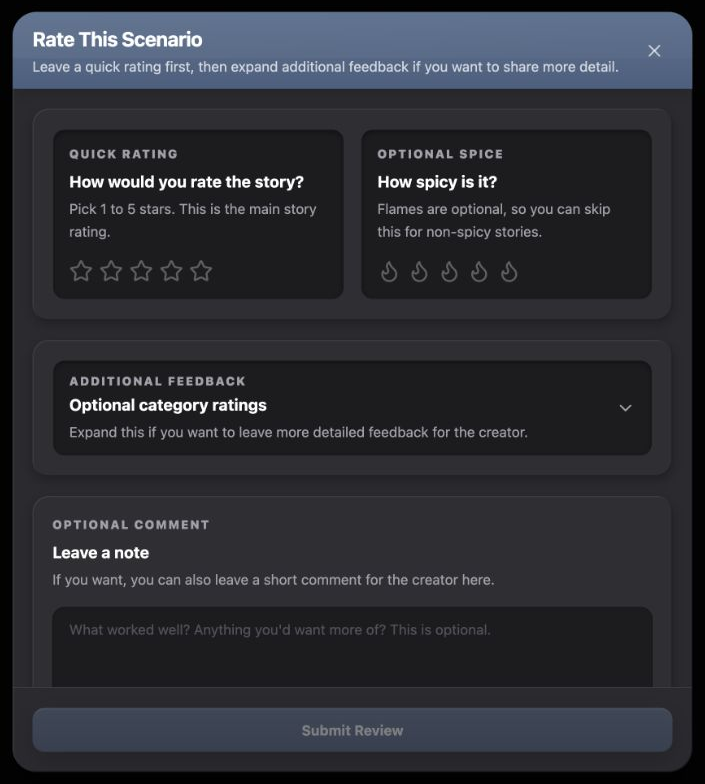</div><figcaption>Existing ReviewModal before selection. The footer stays outside the scrolling body. The local fixture supplies identity and data without submitting a review.</figcaption></figure>

<figure class="source-preview"><div class="capture-background">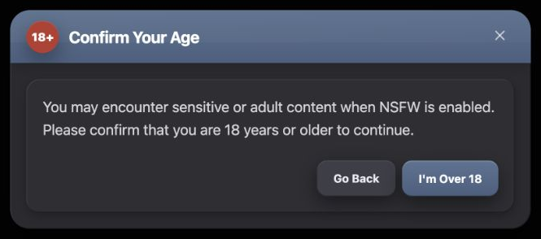</div><figcaption>Existing GalleryNsfwAgeModal. Its short confirmation borrows the same shell/header/tray family while using fewer layers.</figcaption></figure>

| Layer | Complete applicable styling |
| --- | --- |
| Rating shell | Black/90 blurred backdrop, 16px viewport inset. Graphite `#2a2a2f`, 24px corners, overflow hidden, shadow `0 20px 50px rgba(0,0,0,.55), inset 1px 1px 0 rgba(255,255,255,.09), inset -1px -1px 0 rgba(0,0,0,.35)`. Source width caps at 680px; height is `min(760px, calc(100vh - 2rem))`. |
| Form header | Slate `#5a7292` → `#4a5f7f` vertical gradient, white/20 top edge, 20px horizontal / 12px vertical inset, `shadow-lg`. Diagonal white/10 → transparent sheen at 40% opacity covers its top 60%. Title: 20px bold white, `-.015em` tracking; helper: 14px white/75 with 4px top gap. |
| Close | 20px X inside 8px padding / 8px corners; white/65 → white, hover black/10. Review's X is unnamed; age confirmation explicitly names its close control. |
| Scroll body | `flex-1 min-h-0 overflow-y-auto`; inner 16px padding becomes 20px at small, 20px gaps between trays. |
| Tray | 16px corners, `#2e2e33`, 16px padding becomes 20px at small; shadow `inset 1px 1px 0 rgba(255,255,255,.07), inset -1px -1px 0 rgba(0,0,0,.30), 0 4px 12px rgba(0,0,0,.25)`. |
| Rating well | 12px corners, white/8 border, `#1c1c1f`, 16px padding; inset `0 2px 6px rgba(0,0,0,.4)` shadow. |
| Footer | Outside scrolling body, white/8 top edge, 16px padding becomes 20px at small, 12px gap. The 44px actions grow equally; use the form variants under Buttons & Menus. |

<section class="reuse-recipe">

##### Use in a New Design

**Construction:** ReviewModal supplies the composed surfaces, rating fields, optional disclosure and submit/delete controls. The caller provides open/change, publication/user identity, existing review and completion callback. The source's two quick-rating wells become columns at small; SFW hides spice but the grid arrangement remains. Adapt columns to the requested fields rather than inheriting an empty column.

GalleryNsfwAgeModal uses the same 24px shell/header at 640px maximum width. Its 40px circular `#b9392f` badge has white 14px heavy “18+” text and shadow `0 10px 24px rgba(0,0,0,.35), inset 0 1px 0 rgba(255,255,255,.12)`. A 20px-padded tray holds 16px relaxed zinc-300 copy, growing to 18px at small. Actions sit 24px below with 8px gaps, stacked in reverse order before small and right-aligned in a row thereafter. Go Back uses the neutral form family. The slate confirm uses the Browse shadow, not Submit's slightly different stack. Its caller owns approval and visibility effects.

**Dismissal and adaptation:** Both existing sources use plain div content with explicit backdrop/X handlers; their Portal/Overlay alone does not supply dialog role, focus containment or Escape handling. Do not infer those semantics from the component name. The proposed private-rating example uses actual Dialog content and a named trigger to add them. Width, height, field count and one/two-column arrangement remain adaptable. Preserve the chosen shell/header/tray/field/action family and keep the required actions reachable when content grows.

</section>

<p class="source-line">Source: <code>src/components/chronicle/ReviewModal.tsx</code> · lines 122–295; <code>src/components/chronicle/GalleryNsfwAgeModal.tsx</code>; <code>src/components/ui/dialog.tsx</code>.</p>
</section>

## Composition Examples

### Composition Examples

The existing captures show Chronicle's production components with local data. The two new compositions below are teaching examples: they combine documented styling with a new requirement and local state. They are not implemented Gallery features.

<section class="manual-entry">

#### Existing Public Discovery Composition

| Requirement | Existing composition | Caller responsibility |
| --- | --- | --- |
| Find public stories | Application feed segments, recessed search, optional category sidebar and result grid. | Feed meaning, parsed query, category state and actual query service. |
| Inspect before playing | Public media card → ScenarioDetailModal. | Selected publication, permission/reveal flow, reaction state and navigation. |
| Read or contribute feedback | Restrained review cards → ReviewModal. | User/publication identity, storage service and appropriate failure feedback. |

The hierarchy is consistent even though its surfaces differ: discovery stays on the graphite canvas, a separate rating task receives a substantial shell, and public comments stay compact. The fixtures import these production owners with QueryClientProvider, router/tooltip context, sample identities and controlled service reads. Those dependencies support the illustrations; they are not instructions to copy unrelated domain logic into new UI.

<p class="source-line">Source: <code>src/components/chronicle/GalleryHub.tsx</code>; <code>src/components/chronicle/GalleryStoryCard.tsx</code>; <code>src/components/chronicle/StoryDetailModal.tsx</code>; <code>src/components/chronicle/ReviewModal.tsx</code>. Capture sources and controlled service boundaries are recorded in <code>docs/ui-guide/community-gallery.capture.json</code>.</p>
</section>

<section class="manual-entry">

#### New Private Story Rating

**Requested behavior:** “Let me keep a private one-to-five story score and optional note separately; Save keeps it, Cancel discards.”

<figure class="source-preview"><div class="capture-background">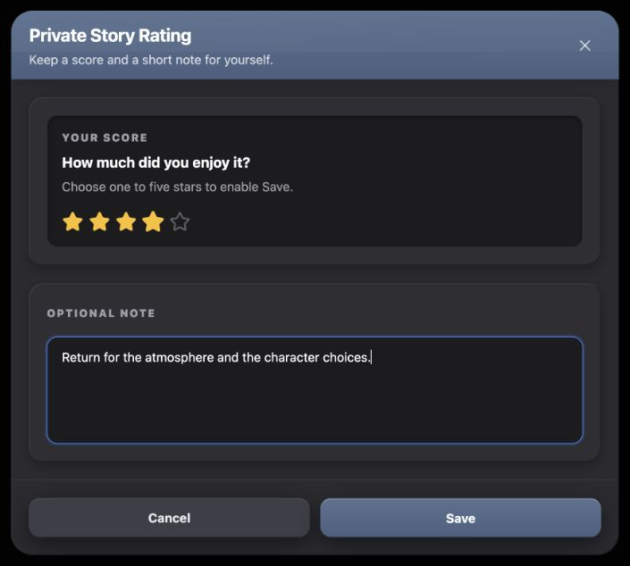</div><figcaption>New reference-only composition. Its styling comes from the existing rating form; private draft/save behavior is proposed and runs only in local state.</figcaption></figure>

| Requirement | Borrowed treatment | Deliberate choice for this example |
| --- | --- | --- |
| A separate focused task | ReviewModal's black/90 blurred backdrop, 24px graphite shell, slate header and persistent footer. | Actual semantic Dialog content with named title/description/trigger; 680px sample width constrained by viewport. |
| One score | Quick-rating recessed well, amber 24px stars with 6px gaps and the documented label/prompt/helper hierarchy. | Five named native buttons with pressed state and slate focus; sole score must be 1–5 before Save. |
| Optional note | Review tray and complete dark Textarea variant under Fields & Controls. | Associated label/id, 1000-character maximum, one column beneath the score. |
| Keep or discard changes | Slate Submit styling for Save; neutral form styling for Cancel. | Saved state and a separate working copy. Opening copies saved values and clears hover. |

<section class="reuse-recipe">

##### Use in a New Design

**Construction:** Dialog root, Portal, Overlay and the Radix content primitive provide the interaction structure. The primitive avoids the shared DialogContent wrapper's default appearance and default close button; the example applies the complete rating shell/header/body/tray/footer styles from Panels & Layout itself. Title and description are named shared primitives. The X gets its own accessible name and the added slate focus treatment. The body scrolls independently with `min-h-0`; outer maximum height is `calc(100vh - 32px)`. These are complete styling layers, not a bare generic dialog.

**State:** Hover previews a score without saving it. Save is disabled at zero with the documented 40% treatment; selecting a score enables it. Save commits the working copy to local state and closes. Cancel, X, Escape and outside dismissal close without committing; reopening restores the saved score/note. Closing returns focus to the trigger. Local checks exercised Save, edit/Cancel/reopen and Escape/focus return. The 390px composition fits within a 358px shell. No storage or remote error state is implied: an actual feature's caller must add persistence and visible failure feedback before claiming a durable save.

**Keep and adapt:** Inherit all chosen fills, corners, shadows, text levels and state styles. A different width, field order or number of columns is acceptable if the separate task and reachable footer remain. Requiring the sole private score is this example's rule; the existing public review accepts either a story or spice score.

```tsx
// Reference-only component; its implementation contains local state.
<PrivateRatingExample />
```

</section>

<p class="source-line">Source: <code>docs/ui-guide/examples/community-gallery-compositions.tsx</code> · PrivateRatingExample; inherited styling from <code>src/components/chronicle/ReviewModal.tsx</code>, <code>src/components/chronicle/StarRating.tsx</code> and <code>src/components/ui/textarea.tsx</code>; semantic primitives from <code>src/components/ui/dialog.tsx</code> and <code>@radix-ui/react-dialog</code>.</p>

<details class="implementation"><summary>Supporting source</summary>

```tsx
function changeOpen(value: boolean) {
  if (value) { setDraft(saved); setHover(null); }
  setOpen(value);
}
// Save: setSaved(draft); setOpen(false).
// All other dismissals: changeOpen(false).
```

</details>
</section>

<section class="manual-entry">

#### New Discovery Focus Popover

**Requested behavior:** “Let me choose Fantasy and/or Romance while results stay visible; changes appear immediately and Clear all resets.”

<figure class="source-preview"><div class="capture-background">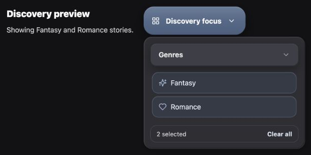</div><figcaption>New reference-only composition. Category styling is inherited; the anchored layout and immediate local preview behavior are proposed.</figcaption></figure>

| Requirement | Borrowed treatment | Deliberate choice for this example |
| --- | --- | --- |
| Keep discovery visible | Browse Categories trigger and compact inset tray vocabulary. | Nonmodal Popover beside a visible summary, with no backdrop or form footer. |
| Independent genre choices | Elevated category header, muted slate selected rows and 16px icons. | Named group, pressed native buttons, both choices allowed; Fantasy's illustrative icon is Sparkles. |
| Immediate changes | Existing filter state relationship and count-strip colors. | Update a local summary on every choice; show the count even at zero. |
| Clear without leaving | Compact bold Clear all treatment. | Reset both values immediately; closing or collapsing preserves current values while mounted. |

<section class="reuse-recipe">

##### Use in a New Design

**Construction:** Shared Popover supplies anchoring, outside/Escape dismissal and focus return. Its caller supplies the complete compact surface override rather than accepting the wrapper's default fill, radius and padding:

```tsx
<PopoverContent aria-label="Discovery focus" align="start"
  className="w-80 max-w-[calc(100vw-32px)] rounded-2xl border border-white/[0.08] bg-[#2e2e33] p-3 text-white"
  style={{ boxShadow: 'inset 1px 1px 0 rgba(255,255,255,0.07), inset -1px -1px 0 rgba(0,0,0,0.30), 0 4px 12px rgba(0,0,0,0.25)' }}>
  {/* Collapsible header, rows and count use the complete Fields & Controls recipes. */}
</PopoverContent>
```

This borrows the 16px review-tray radius/shadow, the sidebar's 12px content inset and its elevated category/header-row relationship. It intentionally omits the substantial shell/title/footer because two immediate choices need only an anchored tray. The trigger borrows the 56px Browse construction under Buttons & Menus, with the example's 70%-opacity slate focus ring. Header, rows and Clear all also receive the explicitly added focus treatment.

**State:** Fantasy and Romance toggle independently through an array; their pressed state, slate fill/edge/icon and the summary update together. Clear all resets the array. Collapsing the group hides its controls while preserving values; closing the popover also preserves values during the mounted example. There is no Apply/Cancel transaction. The count-strip fill is explicitly transparent to match the observed source, while its slate edge and typography remain. Local checks exercised both selections, collapse and Clear all; the 320px popover fits the 390px viewport with the preview still visible above it. This summary is not a live filtered query or persisted preference.

**Keep and adapt:** Preserve the compact surface, category states, focus and immediate feedback. Width, anchoring side, header wording, icon choice and summary placement can adapt to available space. The two rows are enough to teach multi-selection; adding a full category inventory would not clarify this composition.

```tsx
<DiscoveryFocusExample />
```

</section>

<p class="source-line">Source: <code>docs/ui-guide/examples/community-gallery-compositions.tsx</code> · DiscoveryFocusExample; inherited styling from <code>src/components/chronicle/GalleryHub.tsx</code>, <code>src/components/chronicle/GalleryCategorySidebar.tsx</code> and <code>src/components/chronicle/ReviewModal.tsx</code>; shared behavior from <code>src/components/ui/popover.tsx</code> and <code>src/components/ui/collapsible.tsx</code>.</p>
</section>
