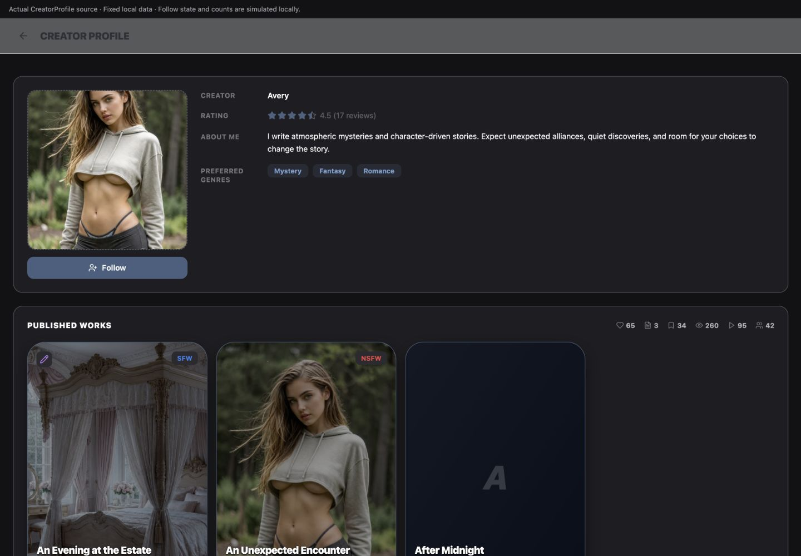
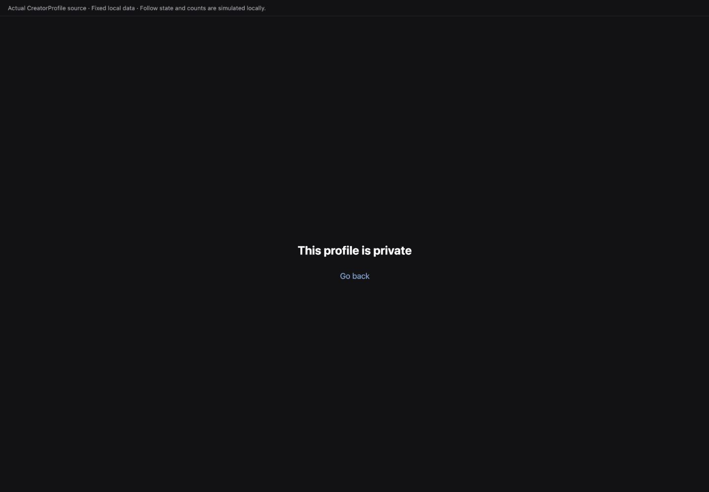
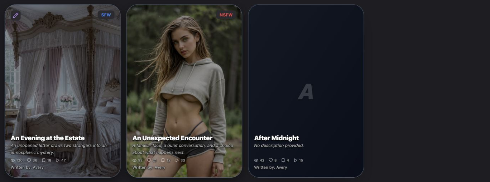
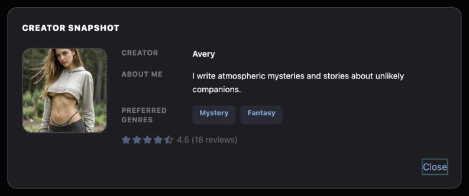
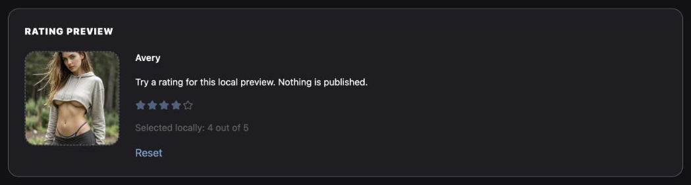

# Creator Profile UI Reference

A practical menu of patterns for designing new UI that belongs in Chronicle's public creator profile.

## Overview

### Designing with Creator Profile's UI Language

The public visitor page uses flat graphite panels, a fixed square portrait, side-by-side read-only labels and custom poster summaries. It differs from the slate-headed Account editor despite source comments describing them as matching. Follow is its main local relationship action; published-work posters currently have no opening or playback handler.

#### Start with the User's Intent

| If the request is… | Start with… | Then combine… |
| --- | --- | --- |
| “Show a creator's public background.” | Flat profile panel and read-only information rows | Square portrait, description, muted labels and slate genre tags. |
| “Show the creator's aggregate rating.” | Actual StarRating in slate, read-only mode | Numeric rating/review count, shown only when data exists. |
| “Let a signed-in visitor follow this creator.” | Existing Follow/Unfollow appearance | Relationship state, ownership guard and caller-managed request feedback. |
| “Show published-work summaries.” | This page's local poster composition | Cover/fallback, flat dark overlay, type/remix badges, title and small metrics. |
| “A profile cannot be displayed.” | Existing centered private/not-found state | A clear message and blue text Go back action. |
| “Let me inspect a creator without leaving.” | Flat profile panel inside shared bare-dialog mechanics | A compact portrait, information rows and Close. |
| “Let me try a one-to-five rating beside a preview.” | StarRating's existing slate/empty appearance and hover rule | Named local rating choices, visible selected value and Reset. |

#### Compose a New Design

Preserve this page's flat `#1e1e22`/16px panel family. It has neither the attached 24px Account body/header nor an inset form tray. Its genre tags are quiet slate labels without remove controls. Its posters are local read-only summaries, not imported Community Gallery cards with their interaction contract.

The existing portrait/info row never switches to a stacked layout: the portrait stays 288px wide and information labels stay 112px wide. At a 390px viewport, the rendered source had 629px document width and clipped its information to the right. That fixed-width source constraint is not a rule for every new widget. The two new examples explicitly adapt their own contents without changing this page.

#### What Stays Consistent, and What Can Change

| Decision | Carry forward | Adapt to the concept |
| --- | --- | --- |
| Public panels | Flat graphite, 16px corners, ghost-white edge and 24px inset. | Panel width, content and internal arrangement. |
| Identity | Square dashed-edge portrait, muted small labels and light read-only values. | Portrait size and row stacking in a new compact surface. |
| Ratings/tags | Slate rating stars and genre-tag family; informational tags have no chip-removal action. | Rating data, tag content and an explicitly new interactive task. |
| Posters | Local cover/overlay/badge/text/metrics composition. | Grid count, dimensions and content; functionality must be supplied deliberately. |
| Actions | Solid slate Follow, ghost-white Unfollow with red hover, blue text Back. | Different task labels and explicit focus/pending feedback. Red hover belongs to removal meaning. |
| State | Private/missing/hidden-works/owner/anonymous distinctions. | A new local preview's state; never infer public persistence from a specimen. |

#### Using This Reference as a Coding Agent

Choose the requested interaction, copy the relevant complete local construction or shared primitive, and then adapt the stated dimensions. Source labels identify the actual owners. No editor fields, purchase flow, editable rating, work-detail modal or playback action is implied merely by a familiar-looking control.

Source specimens import the actual CreatorProfile and StarRating with fixed public data, local relationship receipts and isolated service boundaries. They do not fetch a user's public profile, follow an account, publish a rating or start a story. New teaching examples use local state. Source comments, rendered observations and actual behavior are treated separately.

#### Public Profile in Context

<figure class="source-preview"><div class="capture-background"></div><figcaption>Imported visitor-page component with synthetic public data. These are the page's actual flat panels and custom poster markup.</figcaption></figure>

The `/creator/:userId` route renders this page directly. It owns a sticky 64px header with 24px horizontal padding, `rgba(248,250,252,.3)` fill, slate-200 lower edge and small shadow. The named Back button uses 8px padding, full rounding, slate-100 hover and a 20px ArrowLeft; the 18px heavy uppercase/tight title and arrow use `--ui-surface-2`. Content has 24px horizontal/40px vertical padding and 24px section spacing, with no centered maximum-width wrapper.

<p class="source-line">Source: <code>src/pages/CreatorProfile.tsx</code> · lines 47–202; <code>src/App.tsx</code> · creator route; <code>src/index.css</code> · ui-surface-2 and ghost-white.</p>

## Color Palette

### Color Palette

| Role | Exact appearance | Meaning |
| --- | --- | --- |
| Canvas / panel | `#121214` / `#1e1e22`. | Public page and flat information sections. |
| Panel edge / empty stars | Ghost-white: `210 33% 98% / .30`. | A translucent edge/glyph, not solid white. |
| Portrait base / edge | Zinc-800 / dashed zinc-600. | Applies even when the source image is present. |
| Labels / empty helpers | White/40 / white/30. | Read-only labels and empty genre/work context. |
| Value / description | White, including the `No bio yet` fallback; poster secondary `rgba(248, 250, 252,.7)`. | Information hierarchy. |
| Follow | `#4a5f7f` → `#5a6f8f`, white text. | Not following yet. |
| Unfollow | Ghost-white fill/white text → red-500/20 fill/red-500 text on hover. | Existing relationship's removal action. |
| Genre tag | `#4a5f7f`/20 fill, `#7ba3d4` text. | Non-editable public genre label. |
| Filled slate star | `hsl(215, 25%, 40%)`, both stroke/text and fill. | StarRating color=slate; distinct from the Follow hex fill. |
| Back / new text actions | `#7ba3d4`, underlined on hover. | Quiet navigation/dismissal/reset family. |
| Poster | Slate-200 base, `#4a5f7f` border and black/40 overlay. | Readability over a cover. |
| Poster badges | `#2a2a2f`; NSFW red-500, other story type blue-500, remix purple-400. | Content type/remix information. |

Do not import Account's bright blue privacy/chip appearance for these read-only genre labels. StarRating defaults to amber unless its caller passes color=slate; omitting that prop would change this page's rating appearance.

<p class="source-line">Source: <code>src/pages/CreatorProfile.tsx</code> · return markup; <code>src/components/chronicle/StarRating.tsx</code>; <code>src/index.css</code> · root tokens.</p>

## Typography & Spacing

### Typography & Spacing

| Role | Existing rule |
| --- | --- |
| Page | 24px horizontal /40px vertical content padding, 24px section gaps. |
| Flat panel | 16px corners, 24px padding, 1px ghost-white edge; no dedicated shadow or header/tray layer. |
| Profile row | Horizontal flex, 24px gap; 288px non-shrinking portrait column and min-w-0 flexible details. |
| Portrait | 288px square, 16px radius, 2px dashed zinc-600 border. |
| Information labels | 112px non-shrinking width, 12px bold white/40, uppercase/wider; 8px label/value gap. |
| Information values | 14px white; name semibold, bio relaxed leading. 16px between rows. |
| Genre tag | 12px bold, 12px horizontal/4px vertical padding, 8px radius/gaps. |
| Rating | 16px stars with 2px gaps; 14px ghost-white count, 6px group gap. |
| Works heading / totals | 14px black-weight white uppercase/wider; totals 12px with 14px icons and 16px between metrics. |
| Poster | 2:3 frame, 32px corners; title 18px black weight/tight, description 12px relaxed italic with two-line clamp and 40px minimum height. |
| Poster metrics / byline | 10px metrics with 12px icons; 11px medium byline, each after 4px. |

The source posters use a 2 / small: 3 / large: 4-column grid with 16px gaps. Those dimensions describe this page's examples. New widgets may use a smaller portrait or stack their read-only rows while retaining the flat layers and type hierarchy.

<p class="source-line">Source: <code>src/pages/CreatorProfile.tsx</code> · lines 196–391; <code>src/components/chronicle/StarRating.tsx</code>.</p>

## Buttons & Menus

### Buttons & Menus

<section class="manual-entry">

#### Relationship and Quiet Text Actions

<section class="reuse-recipe">

##### Use in a New Design

**Follow family:** Local native button, full width beneath portrait, flex center with 8px gap,16px horizontal/10px vertical padding,12px radius,14px semibold text and color transition. Follow uses `bg-[#4a5f7f] text-white hover:bg-[#5a6f8f]`; Unfollow uses `bg-ghost-white text-white hover:bg-red-500/20 hover:text-red-500`. Icons are 16px UserPlus/UserMinus. No border, special shadow, explicit focus or disabled-opacity treatment is supplied by the caller. Native disabled prevents activation while isToggling; its label does not change and no spinner appears.

**Ownership:** Only a signed-in visitor to someone else's profile sees this action. The owner and anonymous visitors do not see it. Source updates the local following state/count after awaiting its service call, and logs thrown exceptions; it does not display a request-error banner. It also does not inspect returned database error objects in these insert/delete paths. A new asynchronous relationship action needs explicit pending/failure handling, not a claim that local color change proves persistence.

**Text action:** Private/not-found Go back is a native text button using `text-[#7ba3d4] hover:underline mt-4`; font size inherits the page, normally 16px. The new examples use that blue/underline family for Close/Reset and add the existing shared teal focus treatment: `focus-visible:outline-none focus-visible:ring-2 focus-visible:ring-[hsl(var(--accent-teal))]/40`. Their task-specific margins are separate choices. The snapshot trigger borrows Follow's solid slate appearance, but its callback opens a local dialog and has no relationship meaning.

**Adapt:** Keep the selected action's complete appearance and semantics. Use removal's red hover only for removal. A view/close/reset task does not need an Unfollow-like danger hover. This page has no source command menu or poster action strip to copy.

</section>
<p class="source-line">Source: <code>src/pages/CreatorProfile.tsx</code> · lines 133–184 and225–238; <code>src/components/chronicle/chronicle-dark-ui.ts</code> · established teal focus treatment; <code>docs/ui-guide/examples/creator-profile-compositions.tsx</code>.</p>
</section>

## Fields & Controls

### Fields & Controls

<section class="manual-entry">

#### Read-Only Information, Tags and Rating

<section class="reuse-recipe">

##### Use in a New Design

**No editable form is present here.** The Creator, Rating, About Me and Preferred Genres rows are read-only content. Source labels are 12px bold white/40 uppercase/wider spans, width 112px/no-shrink, with 8px gap to 14px white values. Name is semibold; bio is relaxed with 4px label top inset. Missing name is Anonymous, bio is No bio yet, empty genres show 14px italic white/30 None set. Rows are 16px apart. A new semantic description list can retain that appearance and adapt its row arrangement; the snapshot does so.

**Genre tags:** `px-3 py-1 bg-[#4a5f7f]/20 text-[#7ba3d4] rounded-lg text-xs font-bold`, in a wrapping group with 8px gaps. No border, selected/disabled state, add/remove button or field is supplied. These are labels rather than interactive filters.

**Aggregate rating:** Import the real component and set its page-specific variant:

```tsx
<StarRating rating={rating} size={16} color="slate" />
```

It defaults to5 stars and noninteractive mode. Full stars use `text-[hsl(215,25%,40%)] fill-[hsl(215,25%,40%)]`; empty stars use ghost-white; half values overlay a filled StarHalf on the empty Star. The root has 2px gaps. Buttons have zero padding/margin/border, transparent background and are disabled in display mode without an opacity override. The caller displays a 14px ghost-white numeric value and review count 6px after the stars; missing rating data omits the entire row.

StarRating also has interactive/onChange props with whole-star click values and temporary hover preview/110% hover scale, but CreatorProfile does not enable them. Its internal buttons lack names, selected semantics and explicit focus rules, and className styles the outer wrapper only. A new interactive task should preserve the appearance and improve those controls, as the Rating Preview example's small native composition does. It is not evidence that this page lets visitors submit a rating.

</section>
<p class="source-line">Source: <code>src/pages/CreatorProfile.tsx</code> · lines 241–285; <code>src/components/chronicle/StarRating.tsx</code>; <code>docs/ui-guide/examples/creator-profile-compositions.tsx</code>.</p>
</section>

## Panels & Layout

### Panels & Layout

<section class="manual-entry">

#### Flat Public Identity and Restricted States

<figure class="source-preview"><div class="capture-background"></div><figcaption>Controlled privacy-state specimen. It shows the visitor-page branch, not a request failure or an editable-profile control.</figcaption></figure>

<section class="reuse-recipe">

##### Use in a New Design

**Panel:** `bg-[#1e1e22] rounded-2xl border border-ghost-white p-6`. There is no extra shell shadow, slate title band or recessed inner tray. Identity and Published Works each use this same flat panel. A new panel title can use Published Works'14px heavy white uppercase/wider treatment.

**Portrait/details:** The page's parent is `flex gap-6`, with a 288px/no-shrink portrait column. The image frame is `w-72 h-72 rounded-2xl overflow-hidden border-2 border-dashed border-zinc-600 bg-zinc-800`. Supplied images use cover and stored objectPosition; the dashed border remains. Empty image fills the frame with centered 48px black-weight white/40 initials. Details are flex-1/min-w-0 with the read-only row recipes above. Existing markup never stacks this row and has fixed 112px labels; new compact components must not claim source responsive behavior it does not have.

**Privacy/data states:** Before the public layout, loading fills a min-screen `#121214` canvas with a centered 32px spinning Loader2 in white/30; it has no named status in source. Missing profile and private profile use centered flex-column white content on the same canvas:24px bold message with 8px bottom margin, then blue Go back with 16px top margin. These branches do not show the ordinary header. Privacy restriction applies before the owner/nonowner relationship decision. hide_published_works removes the entire works panel and its metric row; empty visible works instead shows 14px italic white/30 centered text with 32px vertical padding. A failed/invalid load has no general retry UI in the inspected component.

**Adapt:** New surfaces can resize the portrait, stack labels, and choose width while retaining this flat family. The snapshot uses 144px portrait and responsive description rows inside its own modal. This changes only the example's layout, not the existing creator page or its privacy decisions.

</section>
<p class="source-line">Source: <code>src/pages/CreatorProfile.tsx</code> · loading/missing/private branches and lines 196–317; <code>src/index.css</code> · ghost-white.</p>
</section>

<section class="manual-entry">

#### Custom Published-Work Posters

<figure class="source-preview"><div class="capture-background"></div><figcaption>Local static poster markup, including a no-cover fallback. No story-opening or playback operation is wired to these tiles.</figcaption></figure>

<section class="reuse-recipe">

##### Use in a New Design

**Section:** Flat panel above. Its wrapping header row has 24px horizontal/8px vertical gaps and 20px bottom separation; the uppercase 14px heavy heading sits beside right-aligned metrics. Metrics group 16px gaps,14px icons,12px text, white/40 icons and bold `rgba(248,250,252,.7)` counts. Likes/published/saves/views/plays/followers are data labels here, not independently clickable actions.

**Poster layers:** Frame2:3,32px radius, overflow-hidden, slate-200 base,1px `#4a5f7f` border, `0 12px 32px -2px rgba(0,0,0,.50)` shadow,300ms shadow transition. Image covers with stored object position,700ms transform and source group-hover 110% scale. Without an image, use diagonal slate-800→slate-900,40px padding and a centered 60px black-weight ghost-white initial, uppercase/tighter/italic with word breaking and 16px inner padding. Add a full black/40 pointer-transparent overlay.

Content type badge sits 16px top/right, `#2a2a2f`, backdrop-blur-sm,8px radius,10px horizontal/4px vertical padding,12px bold and shadow-lg; NSFW red-500, other provided type blue-500. Remix is 16px top/left with the same fill/blur/radius/shadow,6px padding and 16px purple-400 Pencil. No badge is rendered when its source condition is absent.

**Text layer:** Absolute bottom/inset-x0,16px padding with 20px bottom padding, flex-column and pointer-events-none. Shadow is `0 1px 2px rgba(0,0,0,.9), 0 2px 4px rgba(0,0,0,.7), 0 0 1px rgba(0,0,0,.9)`. Title 18px heavy white/leading-tight/tracking-tight/truncate; description 12px `rgba(248,250,252,.7)` relaxed italic, two-line clamp/min 40px; metric row 10px same color,12px icons and 12px between metrics; byline 11px medium same color. Both metric row and byline have 4px top margin.

**State/ownership:** The local parent declares a group-hover upward translation, but it is itself the group and has no ancestor group in this page. The rendered check confirmed no lift, while its descendants receive 110% image zoom and shadow-2xl on hover. There is no button, anchor, keyboard selection, onClick, detail opener or playback handler on these posters. A new clickable poster must supply those deliberately and include focus/touch treatment, preserving the visual layers. Existing comments calling these identical to Account's Gallery cards do not establish that contract.

**Adapt:** Use this menu for image-forward public summaries, without copying all the story data logic. Ratio, grid count and arrangement are page examples; text hierarchy, overlay and applicable badge/action meaning are the inherited styling.

</section>
<p class="source-line">Source: <code>src/pages/CreatorProfile.tsx</code> · lines 289–393; no imported GalleryScenarioCard or StoryDetailModal in this owner.</p>
</section>

## Composition Examples

### Composition Examples

These teaching examples use the public page's flat styling for new interactions. They are local demonstrations, not current Creator Profile features.

<section class="manual-entry">

#### New Compact Creator Snapshot

**Requested behavior:** “Let me inspect this creator's introduction, genres and rating in a separate compact surface, then close it without leaving the current page.”

<figure class="source-preview"><div class="capture-background"><picture><source media="(max-width:600px)" srcset="../../src/assets/ui-guide/creator-profile/new-snapshot-narrow.png"></picture></div><figcaption>New composition: the flat profile panel becomes a modal through shared mechanics, with its own responsive arrangement.</figcaption></figure>

| Requirement | Inherited pattern | Deliberate adaptation |
| --- | --- | --- |
| Separate inspection | Public flat 16px panel plus DialogContentBare. | Modal title/description, width/height cap, Close and focus return. |
| Public identity | Dashed-edge square portrait, muted labels, white values and slate tags. | 144px portrait, semantic description list and responsive label/column arrangement. |
| Aggregate rating | Actual StarRating color=slate and numeric count. | Fixed illustrative aggregate; decorative stars hidden from accessibility in favor of the numeric text. |
| Close without navigation | Page's quiet blue text-action appearance. | Closes only this modal. Trigger borrows Follow's solid slate geometry, not its relationship callback. |

<section class="reuse-recipe">

##### Use in a New Design

**Construction:** Shared Dialog/Trigger/BareContent provides portal, black/80 backdrop, centered positioning,200ms animation, focus containment/dismissal/trigger return. Caller must add the complete flat panel:16px radius, ghost-white edge, `#1e1e22`,24px padding and no extra source-style shadow. Example width is `w-[calc(100vw-32px)] max-w-3xl max-h-[calc(100vh-32px)] overflow-y-auto`. Visible DialogTitle borrows the 14px heavy uppercase/wider white Works heading with 20px line-height; hidden DialogDescription names the inspection task.

Inside, use 24px gaps and vertical margins; the 144px portrait keeps the 16px corner/dashed 2px zinc-600/zinc-800 construction and cover image. It stacks above the info below medium in this new widget. The description list has 16px row gaps,8px column gap,112px labels from small upward and stacked labels below small. Labels use the exact 12px white/40 uppercase/wider treatment; name 14px semibold white, bio 14px relaxed white, and genre tags use the exact slate family. The aggregate uses actual 16px slate StarRating with its numeric 14px ghost-white text 6px away. A wrapper marks the decorative stars aria-hidden while the numeric text remains available.

**State:** Trigger opens; Close/Escape/outside dismissal returns to the same page. No edits, review submission or relationship change occurs. The sample profile/rating are fixed and avatarUrl is supplied by the caller. Close and trigger have the exact shared teal focus fragment described in Buttons & Menus.

**Keep and adapt:** Preserve the flat panel, portrait/tag/rating appearance and read-only semantics. Width, portrait size, row stacking and content are freely chosen for the new inspection task; they are not the current creator page's fixed 288px layout.

```tsx
<CreatorSnapshotExample avatarUrl={avatarUrl} />
```

</section>
<p class="source-line">Source: <code>docs/ui-guide/examples/creator-profile-compositions.tsx</code> · CreatorSnapshotExample; inherited owners <code>src/pages/CreatorProfile.tsx</code>, <code>src/components/chronicle/StarRating.tsx</code>, <code>src/components/ui/dialog.tsx</code> and <code>src/components/chronicle/chronicle-dark-ui.ts</code>.</p>
</section>

<section class="manual-entry">

#### New Local Rating Preview

**Requested behavior:** “Let me try a one-to-five rating beside a creator preview, see the selected value immediately, and reset it without leaving the preview.”

<figure class="source-preview"><div class="capture-background"><picture><source media="(max-width:600px)" srcset="../../src/assets/ui-guide/creator-profile/new-rating-narrow.png"></picture></div><figcaption>New interactive example using the existing star appearance. No public review is created.</figcaption></figure>

| Requirement | Inherited pattern | Deliberate adaptation |
| --- | --- | --- |
| Keep identity visible | Public flat panel, portrait and light text. | 144px portrait and responsive inline widget. |
| Choose 1–5 | StarRating's slate/ghost-white glyphs, 2px gaps and hover preview. | Named native buttons, exclusive aria-pressed values and explicit teal focus. |
| Immediate selected value | Page's 14px ghost-white rating text. | Local status message and 0/unselected initial value. |
| Reset without leaving | Quiet blue text-action family. | Clears local selection/hover only. |

<section class="reuse-recipe">

##### Use in a New Design

**Construction:** Use the complete flat 16px panel with 24px inset, max 1024px in this example. Title is 14px heavy uppercase/wider white; inner layout has 20px top margin,24px gap and stacks below small. Portrait uses the snapshot's 144px adaptation of the source frame. Name is 14px semibold white; explanatory content 14px relaxed white. Choices have 16px Star glyphs,2px group gaps, zero button padding/margin/border and transparent fill, exactly as StarRating. Each is named “Rate N out of5,” has aria-pressed for the committed choice, and gains the shared teal 2px/40 focus rule. Filled glyphs use the exact slate HSL fill/stroke; unfilled use ghost-white. Pointer hover temporarily previews the whole value and scales the hovered button to 110%, matching the shared component's interaction appearance.

The source StarRating's private internal buttons do not accept naming/selected props, so the new example reproduces this small choice loop rather than claiming the existing read-only caller is already accessible and editable. It uses the same Lucide Star source and color fragment. Display a 14px ghost-white status and blue/underline Reset. No unrelated input or new color family is needed.

**State:** Initial0 means no selection; each button stores its1–5 value, independent of temporary hover. Reset clears both selection and hover. The preview stays visible; nothing is saved or published. Keyboard native activation selects a star, but this is a named button group rather than a radio group with arrow-key behavior. Source CreatorProfile uses read-only StarRating and never calls this local example.

**Keep and adapt:** Keep exact star fill/size/gap/hover, panel and text/action family. Preview copy, overall width and portrait arrangement can change. An eventual real rating submission needs separate validation, account eligibility and request feedback; this local exercise does not assert them.

```tsx
<RatingPreviewExample avatarUrl={avatarUrl} />
```

</section>
<p class="source-line">Source: <code>docs/ui-guide/examples/creator-profile-compositions.tsx</code> · RatingPreviewExample; inherited owners <code>src/components/chronicle/StarRating.tsx</code>, <code>src/pages/CreatorProfile.tsx</code> and <code>src/components/chronicle/chronicle-dark-ui.ts</code>.</p>

<details class="implementation"><summary>Supporting source</summary>

```tsx
const [rating, setRating] = useState(0);
const [hover, setHover] = useState<number | null>(null);
const displayed = hover ?? rating;
// Click stores a value; hover is temporary. Reset clears both. No service callback.
```

</details>
</section>
