# Image Library UI Reference

A practical menu of patterns for designing new UI that belongs in Chronicle's image organization workspace.

## Overview

### Designing with Image Library's UI Language

Image Library organizes private images into folders. Its root uses large poster-like folder cards; opening a folder shows smaller square images with metadata footers. A compact zinc editor changes folder details, while a larger graphite editor gives an image room for preview, title and tags. These are useful contrasting patterns for new media workflows.

#### Start with the User's Intent

| If the request is… | Start with… | Then combine… |
| --- | --- | --- |
| “Show collections I can browse.” | Folder-card grid | Poster preview or fallback, compact count, title, description and separate commands. |
| “Let me organize individual images.” | Square image tiles | Metadata footer, measured aspect-ratio indicator and a distinct folder-cover marker. |
| “Let me find images within a collection.” | Header search pill | Caller-owned query matching titles, filenames and tags. |
| “Let me edit a short name and description.” | Compact folder-editor family | Zinc fields, associated labels and the token-based small uppercase actions. |
| “Let me inspect an image and revise its details.” | Image Details family | Slate title, inset tray, contained media, recessed inputs and tag pills. |
| “Keep alternatives nearby while I compare.” | Inline review composition | A large preview beside square alternatives; distinguish preview selection from the collection-cover choice. |
| “Remove a saved image.” | Local removal action and DeleteConfirmDialog | Clear consequence, safe Cancel and the established red confirmation. |

#### Compose a New Design

Choose the interaction and the appropriate scale of surface first. Browsing collections does not require form trays around every card. Two short fields can use the compact folder editor. A media-heavy editing task can use Image Details' shell, slate title, tray and recessed preview. An inline workspace can keep those layers while putting alternatives beside it instead of using a modal.

Carry the chosen family's fill, edge, radius, shadow, type and states together. A folder's 2:3 ratio, the square image grid, modal width and column count describe their existing jobs; the new concept may arrange its content differently. Preserve the distinction between a blue active choice, an amber folder-cover marker and a red destructive action.

#### What Stays Consistent, and What Can Change

| Decision | Carry forward | Adapt to the concept |
| --- | --- | --- |
| Browsing layers | Black or image-backed canvas; clipped media with readable caption or separate zinc footer. | Grid density, ratio, width and metadata amount. |
| Compact editing | Zinc-900 surface, slate edge, zinc-800 fields and small token-based commands. | Width and arrangement of a small form; add only the preview it needs. |
| Substantial editing | 24px graphite shell, slate header, 16px inset tray and recessed media/fields. | Inline versus modal placement, image height, fields and columns. |
| State meaning | Blue preview selection, amber collection cover, blue tag chips, red removal/error. | Which state the feature needs and what its callbacks do. |
| Ownership | Shared primitives supply their documented styling/semantics; local markup supplies other appearances. | Values, validation, working copies, storage and feedback belong to the feature. |

#### Using This Reference as a Coding Agent

Resolve the requested interaction, combine its construction recipes and use the exact local variant when it differs from a broad token. Essential fragments stay in the ordinary text. Supporting source explains evidence and ownership without requiring reconstruction of the storage/upload implementation.

Existing captures import production components with fixed local folders/images and controlled reads. The proposed collection and review compositions use local state. Neither proves private signed-media access, upload, deletion, durable metadata changes or remote account behavior. Existing source limitations are explicit; they are not instructions to repeat a defect.

#### Image Library in Context

<figure class="source-preview"><div class="capture-background"><picture><source media="(max-width:600px)" srcset="../../src/assets/ui-guide/image-library/overview-narrow.png">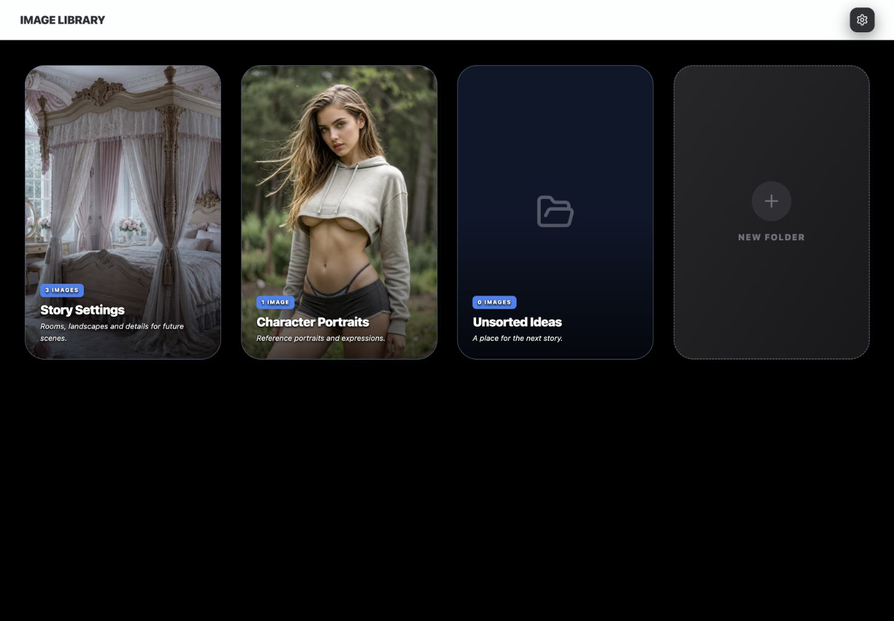</picture></div><figcaption>Production AppShellTopBar and ImageLibraryTab with local data. The root folder grid fits the 390px capture; the first card is hovered in that narrow view.</figcaption></figure>

Index supplies a black canvas, optionally a centered cover background image with a fixed black/10 overlay. AppShellTopBar supplies the title and Settings; entering a folder adds Back, search and Upload Images. ImageLibraryTab owns the folder/image browsing states and editing surfaces. Exiting a folder clears the parent search query.

Settings opens the existing BackgroundPickerModal with the title “Image Library Background,” the image-library selection and shared background handlers. Its library source indirectly opens ImageLibraryPickerModal. Those are shared background-selection surfaces already documented in My Stories; they are distinct from the image manager's ordinary browsing view. Importing the shared components retains their complete appearance. This reference concentrates on the manager's differing patterns.

<p class="source-line">Source: <code>src/pages/Index.tsx</code> · lines 884–890, 1010–1035 and 1330–1351; <code>src/components/app-shell/AppShellTopBar.tsx</code> · lines 399–412 and 614–636; <code>src/components/chronicle/ImageLibraryTab.tsx</code> · folder and image branches; <code>src/components/chronicle/BackgroundPickerModal.tsx</code> · library-source branch.</p>

## Color Palette

### Color Palette

Image Library includes intentional local variants. Use the values of the selected family rather than replacing every dark surface or action with one shared fill.

| Visible role | Applicable value | Owner |
| --- | --- | --- |
| Canvas | Black; optional cover image with black/10 overlay. | Index |
| Folder frame/fallback | Slate-200 base, slate-900 fallback, `#4a5f7f` border. | ImageLibraryTab |
| Creation tile | Diagonal zinc-800 → zinc-900, zinc-600 dashed edge. | ImageLibraryTab |
| Image-tile footer | Zinc-700; white title, zinc-400 ratio. | ImageLibraryTab |
| Compact editor | Zinc-900 shell, slate `#4a5f7f` border, zinc-800 fields with zinc-700 edge. | FolderEditModal |
| Compact footer tokens | `hsl(var(--ui-surface-2))`, `hsl(var(--ui-border))`, `hsl(var(--ui-text))`. Root values: `228 7% 20%`, `210 33% 98% / .30`, `210 20% 93%`. | FolderEditModal and index.css |
| Image Details shell/tray | `#2a2a2f` shell; `#2e2e33` tray. | ImageLibraryTab |
| Image Details field/media | `#1c1c1f`, black/35 edge. | ImageLibraryTab |
| Slate title | Vertical `#5a7292` → `#4a5f7f`; white/20 top edge. | Image Details and shared confirmation |
| Elevated detail action | `#3c3e47` → `#44464f`, `#eaedf1` text. | Image Details Save/Cancel |
| Ordinary header action | `#303035` → `#343439`, `#eaedf1` text. | ChronicleSurfaceButton |
| Tags | Blue-500/20 fill, blue-500/30 edge, blue-300 text. | Image Details |
| Folder-cover choice | Amber-500 with white filled Star. | ImageLibraryTab |
| Preview choice | Blue-500 edge and blue-500/30 ring. | ImageLibraryPickerModal; explicitly borrowed by the proposed review workspace |
| Error/removal | Error notice red-950/25 and red-400/40 edge; confirmation `#d94b45` → `#e2554e`. | ImageLibraryTab / DeleteConfirmDialog |

Blue count badges describe media collections; blue tags describe metadata. The amber Star means “this image is the folder cover,” not a favorite or generic multi-selection. Image Library has no AI command in this inspected manager path. Do not relabel these colors to invent an AI, warning or destructive treatment.

The compact fields retain shared Input/Textarea focus tokens. In the captured root theme, `--background` is white and `--ring` is `222.2 84% 4.9%`: the visible focus treatment includes a white 2px offset and dark 2px ring. Image Details instead explicitly supplies a blue border and blue/20 ring without that offset. These are different existing field families.

<p class="source-line">Source: <code>src/components/chronicle/ImageLibraryTab.tsx</code> · lines 483–615 and 665–914; <code>src/components/chronicle/FolderEditModal.tsx</code>; <code>src/components/chronicle/ImageLibraryPickerModal.tsx</code> · lines 313–348; <code>src/components/chronicle/chronicle-dark-ui.ts</code>; <code>src/index.css</code> · root tokens; <code>src/components/ui/input.tsx</code>; <code>src/components/ui/textarea.tsx</code>.</p>

## Typography & Spacing

### Typography & Spacing

Inherit the application font. Folder cards emphasize a collection name over an image; image tiles use quieter footer text; the two editor families intentionally use different label and action scales.

| Role | Existing treatment |
| --- | --- |
| Application title | 18px black weight, uppercase, tight tracking, dark UI surface token. |
| Folder name / description | 20px black weight, tight leading/tracking, one-line truncation; 12px white italic description, relaxed leading and two-line clamp. |
| Folder count | 9px black weight, uppercase/widest, 8px horizontal / 4px vertical padding. |
| Folder caption inset | 24px; 8px between count and name, 4px after name. |
| In-folder title / description | 24px black weight white; 14px white/70, 12px gap in a baseline-aligned row. |
| Image footer | 12px horizontal / 8px vertical inset; 12px medium white title; 10px zinc-400 ratio after 4px, with 6px icon gap. |
| Compact title | 18px bold white; shared DialogHeader centers below small and aligns left at small. |
| Compact label | 12px bold uppercase slate-500; 8px field gap and 16px between groups. |
| Compact input | 40px high, 12px horizontal / 8px vertical inset; 16px type before medium, 14px at medium. |
| Compact textarea | 14px, 80px minimum height, three rows in FolderEditModal, no resize. |
| Compact footer | 40px high, 10px bold uppercase/wider text, 24px horizontal inset, 12px between commands. |
| Image Details title | 20px bold white, `-.015em` tracking, 20px horizontal / 12px vertical header inset. |
| Image Details label/helper | 10px; label black weight, uppercase/widest, zinc-400; helper zinc-500. |
| Image Details field | 44px high, 14px text, 14px horizontal inset; 8px gap beneath label. |
| Image Details footer | 40px high, 12px bold text, 20px horizontal inset; 8px gaps and 12px top inset after divider. |

Folder browsing uses 16px outer padding, increasing to 40px at large. In-folder content is centered at 1152px maximum width with 24px section spacing. Image Details uses 16/20px body and tray padding with 16px between its internal groups. Adapt columns and wrapping while keeping each selected family's label/control/action relationship.

#### Naming, Focus and State Ownership

Folder cards have a named keyboard opening target and an explicit blue focus ring. Shared dialogs/menus supply their semantic interaction when their actual content primitives are mounted. The manually built Image Details overlay supplies neither dialog semantics nor focus return. New examples explicitly add associated labels, named selection controls and visible focus where source markup lacks them.

The added focus recipe is `focus-visible:outline-none focus-visible:ring-2 focus-visible:ring-blue-500/80 focus-visible:ring-offset-2 focus-visible:ring-offset-[#14151a]`, borrowed from the folder-card target. Keep Input/Textarea's own documented focus family when importing those components. Pending/error/validation behavior belongs to the caller unless an owner supplies it explicitly.

<p class="source-line">Source: <code>src/components/app-shell/AppShellTopBar.tsx</code> · helpers and image-library branches; <code>src/components/chronicle/ImageLibraryTab.tsx</code> · lines 518–589 and 686–914; <code>src/components/chronicle/FolderEditModal.tsx</code>; <code>src/components/ui/input.tsx</code>; <code>src/components/ui/textarea.tsx</code>; <code>docs/ui-guide/examples/image-library-compositions.tsx</code> · focus constant and examples.</p>

## Buttons & Menus

### Buttons & Menus

Folder browsing, media commands, form actions and destructive confirmation use distinct variants. A command menu executes an action; an inline comparison panel or popup with fields is a different interaction.

<section class="manual-entry">

#### Header Actions and Settings

<figure class="source-preview"><div class="capture-background">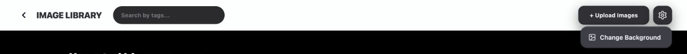</div><figcaption>Existing AppShellTopBar and shared dropdown. The background command is shown without opening or changing a persisted background.</figcaption></figure>

<section class="reuse-recipe">

##### Use in a New Design

**Construction:** Import ChronicleSurfaceButton for the ordinary header family: 40px height, 12px corners, `#303035` → `#343439`, 12px bold `#eaedf1` text, no border and shadow `0 8px 24px rgba(0,0,0,.45), inset 0 1px 0 rgba(255,255,255,.09), inset 0 -1px 0 rgba(0,0,0,.20)`. It supplies 95% pressed scale, the hover fill while pressed, a 2px accent-teal/40 focus ring and 50% opacity / no pointer events when disabled. The caller supplies label, handlers and width: Upload uses 24px horizontal inset; Settings is a 40px square with 20px icon.

The shared DropdownMenuContent supplies Portal placement, 4px anchor offset, 14px corners, black/20 border, `#3c3e47`, 6px padding and the same three-part shadow. Rows have 9px corners, 10px horizontal / 8px vertical padding, 13px semibold `#eaedf1` text; focus uses white/8 fill and white text, disabled rows use 40% opacity/no pointer events. This caller sets width to 192px and aligns end; its 16px Image icon has 8px after it. The menu primitives supply keyboard navigation, dismissal and focus return.

```tsx
<DropdownMenuContent align="end" className="w-48">
  <DropdownMenuItem onClick={onChangeBackground}>
    <ImageIcon className="mr-2 h-4 w-4" />Change Background
  </DropdownMenuItem>
</DropdownMenuContent>
```

**Caller and states:** The actual Upload action opens the manager's hidden multiple image file input through a ref. Internal `isUploading` is not exposed in the header config or consumed by rendered controls, so this source does not supply upload progress or disabling. Add the needed pending/failed treatment for a new asynchronous action. The current Settings icon is unnamed; give a new trigger an accessible name. Preserve the ordinary shared family rather than copying the image editor's different action fill.

</section>

<p class="source-line">Source: <code>src/components/app-shell/AppShellTopBar.tsx</code> · lines 614–636; <code>src/components/chronicle/ChronicleDarkUi.tsx</code> · ChronicleSurfaceButton; <code>src/components/chronicle/chronicle-dark-ui.ts</code> · CHRONICLE_SURFACE_BUTTON_CLASS; <code>src/components/ui/dropdown-menu.tsx</code> · Content and Item; <code>src/components/chronicle/ImageLibraryTab.tsx</code> · uploadRef and handleUploadImages.</p>
</section>

<section class="manual-entry">

#### Folder Commands and Creation Tile

<figure class="source-preview"><div class="capture-background">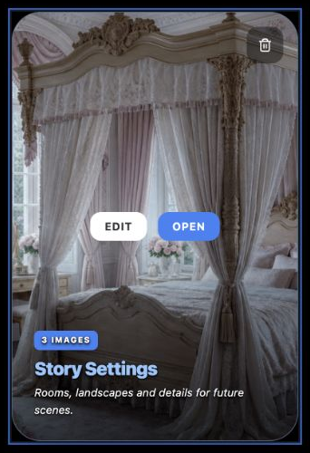</div><figcaption>Existing folder action variants. The wrapper stays in place while the image zooms and the shadow changes.</figcaption></figure>

| Action | Complete local treatment |
| --- | --- |
| Edit / Open | 16px horizontal / 8px vertical padding, 12px corners, 12px bold uppercase/wider type and `shadow-xl`. Edit is white → slate-100 with dark `--ui-surface-2` text; Open is blue-500 → blue-600 with white text. |
| Hover group | Centered over the image, 12px gap, opacity 0 / scale .9 → opacity 1 / scale 1 over 300ms; z-index 10. |
| Folder Delete | Top/right 16px; 12px padding and corners, 16px Trash icon. Black/40 → black/60, white → rose-400; opacity 0 → 1 on hover, 300ms transition, z-index 20. |
| New Folder | 2:3 silhouette and 32px corners; 2px dashed zinc-600 edge, diagonal zinc-800 → zinc-900 background. 64px zinc-700/50 circular well with 32px zinc-500 Plus; 16px gap to 14px heavy uppercase/widest label. Hover: blue-500 edge/icon/text and blue-900/30 well. |

<section class="reuse-recipe">

##### Use in a New Design

**Construction:** ImageLibraryTab owns this local markup. The named folder root has role=button, tabIndex=0, Enter/Space opening and the blue focus recipe under Typography & Spacing. Inner commands stop click propagation. For new nested actions, also isolate keyboard activation and reveal commands on focus/touch; the current hover group has no focus-within reveal and the root's key handler does not distinguish descendant targets.

**State:** New Folder creates its record before opening FolderEditModal; canceling the editor does not undo that creation. The folder-grid Delete action only sets a target: its early-return branch does not mount DeleteConfirmDialog, so the inspected click shows no confirmation. The valid image-deletion path is documented under Panels & Layout. These limitations describe current behavior, not a recommended new construction.

**Keep and adapt:** Retain the blue creation/progression meaning and quiet local removal. Card ratio, grid count and command placement can change; keep the secondary actions distinct from the primary opening target. Gallery/Story cards have related silhouettes, but Image Library's white Edit and blue Open pair is the local folder variant.

</section>

<p class="source-line">Source: <code>src/components/chronicle/ImageLibraryTab.tsx</code> · handleCreateFolder, handleDeleteFolder, lines 518–633 and 928–945. Hover transform and absent folder confirmation were inspected in the local production-component fixture.</p>
</section>

<section class="manual-entry">

#### Compact and Image-Detail Form Actions

| Family | Carry the complete variant |
| --- | --- |
| Compact Folder Save/Cancel | 40px height, 12px corners, 24px horizontal inset, 10px bold uppercase/wider type. Surface/border/text use the three `--ui-*` tokens in Color Palette; shadow `0 10px 30px rgba(0,0,0,.35)`; hover opacity 90%. |
| Image Details Save/Cancel | 40px height, 12px corners, 20px horizontal inset, 12px bold `#eaedf1`, no border. `#3c3e47` → `#44464f`, also `#44464f` while pressed. Shadow `0 8px 24px rgba(0,0,0,.45), inset 0 1px 0 rgba(255,255,255,.09), inset 0 -1px 0 rgba(0,0,0,.20)`. |
| Final Delete | Shared confirmation keeps the detail action geometry/shadow, with white text and `#d94b45` → `#e2554e`. It and Cancel explicitly use a 2px `#6e89ad`/70 focus ring with zero offset. |

<section class="reuse-recipe">

##### Use in a New Design

**Construction:** The first two families are caller-styled native buttons. Neither source supplies explicit focus classes, pending state or disabling on its Save/Cancel pair. The reference examples add the documented blue focus recipe, while retaining the separate compact versus detail typography and shadows. Shared DeleteConfirmDialog supplies the complete confirmation and its focus styling; its caller supplies the consequence and handler.

**Keep and adapt:** A Save label does not imply a blue or slate primary button here: both actual editor footers use matching neutral actions. Width, alignment, wrapping and labels can follow a new task. Supply pending/error/disabled treatment when a real operation needs it; do not describe the local examples' state changes as remote persistence.

</section>

<p class="source-line">Source: <code>src/components/chronicle/FolderEditModal.tsx</code> · footer; <code>src/components/chronicle/ImageLibraryTab.tsx</code> · lines 875–914; <code>src/components/chronicle/DeleteConfirmDialog.tsx</code> · actions; <code>docs/ui-guide/examples/image-library-compositions.tsx</code> · action constants.</p>
</section>

## Fields & Controls

### Fields & Controls

Use a query field, metadata input, tag list or cover choice according to meaning. They are not interchangeable selection controls.

<section class="manual-entry">

#### Search Within a Folder

<section class="reuse-recipe">

##### Use in a New Design

**Construction:** AppShellTopBar's private SearchChip supplies a `#2b2b2e` pill, matching border, 4px padding and 16px left margin. Its controlled native input is 28px high / 224px wide with 12px horizontal / 4px vertical padding, transparent fill, 12px bold white text and zinc-500 placeholder. It removes the focus outline without adding a ring. A new input needs an associated name and visible focus; the existing placeholder alone is not that complete treatment.

**State and caller:** Parent Index owns the query. ImageLibraryTab matches lowercased tags, title and filename, despite “Search by tags...” wording. Root folders are not filtered. Exiting a folder clears the query. Zero search matches currently yield a blank grid, because the empty-folder message checks the unfiltered collection. A new search should distinguish empty storage from no matches and show relevant loading/failure feedback.

**Adapt:** Constrain or wrap the parent/search width when space is limited. The actual 390px in-folder fixture has a wrapped header and approximately 394px body scroll width; the image grid itself fits.

</section>

<p class="source-line">Source: <code>src/components/app-shell/AppShellTopBar.tsx</code> · SearchChip and image-library header; <code>src/components/chronicle/ImageLibraryTab.tsx</code> · lines 655–663 and empty-image condition; <code>src/pages/Index.tsx</code> · onFolderChange.</p>
</section>

<section class="manual-entry">

#### Compact Fields and Recessed Metadata Fields

<section class="reuse-recipe">

##### Use in a New Design

**Compact family:** Shared Label, Input and Textarea provide native association/attributes and base styling. FolderEditModal adds its local zinc variant. Keep the essential class fragments together:

```tsx
<Label htmlFor="name" className="text-xs font-bold uppercase text-slate-500">Name</Label>
<Input id="name" value={name} onChange={onNameChange}
  className="h-10 bg-zinc-800 border-zinc-700 text-white placeholder:text-zinc-500" />
<Textarea id="description" value={description} onChange={onDescriptionChange} rows={3}
  className="resize-none bg-zinc-800 border-zinc-700 text-white placeholder:text-zinc-500" />
```

Supply an associated description label too. Both fields inherit 6px corners, full width, 12px horizontal / 8px vertical padding, spellcheck, 2px token focus ring with 2px background offset, and disabled forbidden cursor / 50% opacity. Input has 16px text before medium and 14px at medium; Textarea has 14px text and 80px minimum height. The local classes do not replace those focus/disabled rules. Under the captured root theme the offset is white and the ring dark; use the actual tokens rather than describing this as the blue Image Details focus.

**Image Details family:** Its caller uses native inputs and supplies all appearance. Labels are 10px black-weight uppercase/widest zinc-400 with 8px gap. Carry this complete field variant:

```tsx
className="w-full h-11 px-3.5 bg-[#1c1c1f] border border-black/35 rounded-xl text-white text-sm placeholder:text-zinc-600 focus:outline-none focus:ring-2 focus:ring-blue-500/20 focus:border-blue-500 transition-colors"
```

The source's visible Title and Tags labels lack association; the new review example supplies htmlFor/id. These native fields do not inherit shared Input's disabled appearance. Add it deliberately if the feature needs disabling, and distinguish read-only from disabled.

**Validation and ownership:** FolderEditModal copies values on opening; Save trims both and substitutes “Untitled Folder” for a blank name. It has no required-field error or disabled Save. Image Details permits a blank title and falls back to filename in the grid. New concepts must define validation only when needed; the proposed collection deliberately retains a named fallback instead of inventing an error state.

</section>

<p class="source-line">Source: <code>src/components/chronicle/FolderEditModal.tsx</code>; <code>src/components/ui/input.tsx</code>; <code>src/components/ui/textarea.tsx</code>; <code>src/components/ui/label.tsx</code>; <code>src/components/chronicle/ImageLibraryTab.tsx</code> · lines 829–903; <code>docs/ui-guide/examples/image-library-compositions.tsx</code>.</p>
</section>

<section class="manual-entry">

#### Tags, Preview Choice and Folder-Cover Marker

<figure class="source-preview"><div class="capture-background">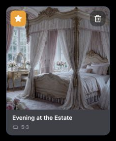</div><figcaption>The filled amber Star marks the folder's cover. The square thumbnail crop is independent of the measured ratio in its footer.</figcaption></figure>

<section class="reuse-recipe">

##### Use in a New Design

**Tags:** Wrap pills with 6px gaps. A pill uses `inline-flex items-center gap-1 px-2.5 py-1 rounded-full text-xs font-medium border border-blue-500/30 bg-blue-500/20 text-blue-300`. The named remove button adds a full radius, 2px padding, blue-500/30 hover fill and a 12px X. Its source has no explicit focus treatment; the new example adds the documented blue ring.

Source Enter trims/lowercases, accepts a nonempty unique tag while fewer than ten exist, then clears the input. The helper is 10px zinc-500 and displays count/10. Rejected duplicates/blank/overflow have no visible error. Existing tags mutate immediately; title waits for Save. Cancel is not a tag rollback, and title Save closes even after a caught service error. A new staged editor must own a working copy for both, as the proposed review workspace does.

**Folder cover:** The tile's named Star button sits 8px from top/left with 8px padding, 8px radius and a 16px icon. Current cover: amber-500, white, filled Star, always visible. Other images: white/80, slate-600, hidden until hover, then amber/white on hover. The caller owns which image is the cover. A new control should expose pressed state and focus, and make its action available without hover.

**Preview selection:** The nested ImageLibraryPickerModal uses `border-blue-500 ring-2 ring-blue-500/30` for its active image. The proposed review borrows that selection color/ring on the manager's 12px-radius image-tile frame while keeping the amber cover action separate. These are two independent meanings. The source picker uses 2px borders, 8px corners and a blue check badge; the new composition keeps its existing 1px manager frame and named pressed target instead of copying that entire picker geometry.

**Adapt:** Tag contents, maximum count, preview placement and choice persistence follow the concept. Preserve the documented fill/border/text/state meanings. The normal manager has no bulk-selection or drag-and-drop UI in this path.

</section>

<p class="source-line">Source: <code>src/components/chronicle/ImageLibraryTab.tsx</code> · handleUpdateImageTags, thumbnail action and lines 848–873; <code>src/components/chronicle/ImageLibraryPickerModal.tsx</code> · lines 313–348; <code>docs/ui-guide/examples/image-library-compositions.tsx</code> · ReferenceReviewExample.</p>
</section>

## Panels & Layout

### Panels & Layout

Use the simplest surface that supports the task. Poster cards, compact forms, square tiles and substantial media editors share Chronicle's language through deliberate local variants.

<section class="manual-entry">

#### Folder Cards and Image Grid

<figure class="source-preview"><div class="capture-background"><picture><source media="(max-width:600px)" srcset="../../src/assets/ui-guide/image-library/inside-folder-narrow.png">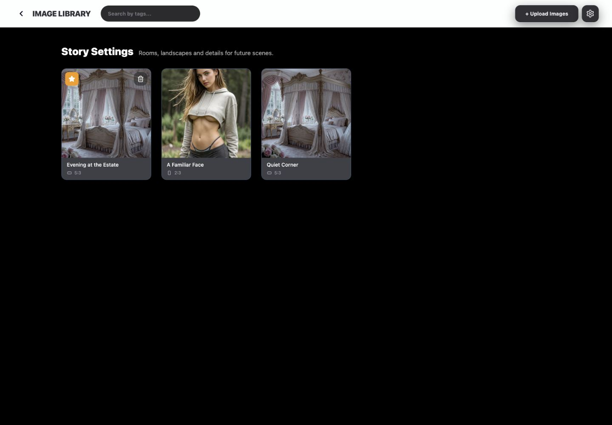</picture></div><figcaption>The existing folder detail uses a narrower centered content area and a denser image grid. Its narrow header wraps and slightly overflows; the two-column grid fits.</figcaption></figure>

| Part | Complete applicable construction |
| --- | --- |
| Root layout | 16px outer padding → 40px at large; unrestricted content width. Grid columns 1 / small:2 / large:3 / xl:4 / 2xl:5; 16px gaps → 32px at large. |
| Folder frame | 2:3, 32px corners, slate-200 base, `#4a5f7f` edge. Shadow `0 12px 32px -2px rgba(0,0,0,.5)` → `shadow-2xl` on hover over 300ms. |
| Folder media | Full cover crop, zoom 1.1 over 700ms; fallback slate-900 with a 64px ghost-white FolderOpen. Root's current group-hover translation does not lift the standalone card. |
| Folder caption | Full-card transparent → black/70 gradient, 24px bottom content inset. Text shadow `0 1px 2px rgba(0,0,0,.9), 0 2px 4px rgba(0,0,0,.7), 0 0 1px rgba(0,0,0,.9)`. Type and action recipes are above. |
| In-folder layout | Centered 1152px maximum, 24px section spacing; same outer 16/40px inset. Grid columns 2 / small:3 / large:4 / xl:5, always 24px gaps. |
| Image tile | 12px corners, `#4a5f7f` edge, `shadow-sm` → `shadow-lg`. Square slate-100 image area uses cover crop and 1.1 hover zoom over 700ms; zinc-700 footer sits below the image. |
| Ratio metadata | 10px zinc-400 text and 12px zinc-400 icon. AspectRatioUtils finds the closest standard ratio from measured dimensions; it does not change the square thumbnail crop. |

<section class="reuse-recipe">

##### Use in a New Design

**Construction and caller:** ImageLibraryTab owns both layouts, loaded folders/images, selected folder and cover marker. Shared AspectRatioIcon provides only the small orientation icon; the caller supplies measured dimensions and footer placement. Private media paths resolve through signed URLs; the captures use explicit local sample URLs, so they do not validate that access path.

**Keep and adapt:** Carry the complete frame/edge/shadow/caption or footer family, not only the image crop. Ratio, grid count, preview size and metadata arrangement may change. New image-opening targets need keyboard semantics and focus because the current clickable img does not provide them. If a measured image fails to load, the existing batched ratio calculation can leave ratio labels unavailable; don't treat every source tile as guaranteed to have metadata.

</section>

<p class="source-line">Source: <code>src/components/chronicle/ImageLibraryTab.tsx</code> · image-ratio effect and lines 483–615, 665–770; <code>src/components/chronicle/AspectRatioUtils.tsx</code>. Hover/width qualifications use the production-component fixture.</p>
</section>

<section class="manual-entry">

#### Compact Folder Editor

<figure class="source-preview"><div class="capture-background">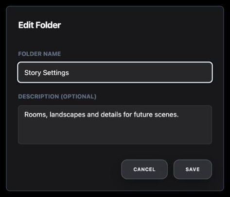</div><figcaption>Existing FolderEditModal. Its simple zinc surface, fields and small uppercase actions are a distinct local family.</figcaption></figure>

<section class="reuse-recipe">

##### Use in a New Design

**Construction:** FolderEditModal imports shared DialogContent and adds `sm:max-w-md bg-zinc-900 border-[#4a5f7f] text-white [&>button]:hidden`. The shared wrapper supplies black/80 backdrop, centered fixed grid, 24px padding, 16px gaps, border, `shadow-lg`, and 8px corners at small. At small the width caps at 448px; below small its default full width has no explicit viewport side margin or corner class. The source hides the wrapper's default X.

DialogHeader supplies centered text before small and left alignment afterward. The title is 18px bold white. The body has 16px vertical padding and 16px group spacing; field labels/controls use the complete compact recipe under Fields & Controls. The footer is a right-aligned row with 12px gaps and the compact token actions under Buttons & Menus.

**State and semantics:** Actual Radix content supplies the named dialog, focus containment, Escape/outside dismissal and closing callbacks. The component copies folder values when opened, trims/falls back on Save and calls onSave/onClose. The parent starts its async update and closes immediately; no busy/validation state is supplied. The source has no colocated DialogTrigger to establish a trigger-return target. New standalone uses should provide one, as the collection example does.

**Keep and adapt:** Preserve this zinc/field/token-action family for a compact editing job. It does not require a slate banner or a second tray. Width, columns and an optional media preview can change. The proposed collection adds a viewport cap, 16px side margins, scrolling and an 8px radius at all widths; these are explicit adaptations for its added content.

</section>

<p class="source-line">Source: <code>src/components/chronicle/FolderEditModal.tsx</code>; <code>src/components/ui/dialog.tsx</code>; <code>src/components/chronicle/ImageLibraryTab.tsx</code> · FolderEditModal callers.</p>
</section>

<section class="manual-entry">

#### Image Details Editor

<figure class="source-preview"><div class="capture-background">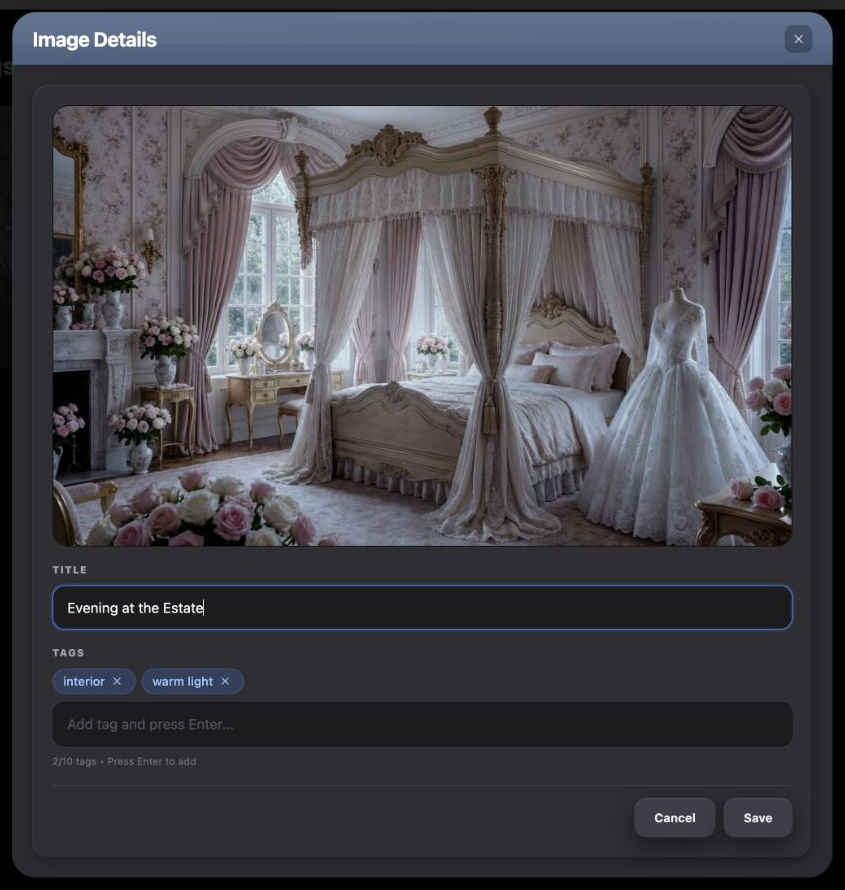</div><figcaption>Existing manually composed editor. Local title cancellation and Escape were checked; no title/tag save was sent to a service.</figcaption></figure>

| Layer | Applicable styling |
| --- | --- |
| Overlay / shell | Fixed black/85 overlay with 16px padding → 32px at small. Shell width `min(96vw,820px)`, 24px corners, `#2a2a2f`; shadow `0 20px 50px rgba(0,0,0,.55), inset 1px 1px 0 rgba(255,255,255,.09), inset -1px -1px 0 rgba(0,0,0,.35)`. 150ms fade/zoom entry. |
| Header | Vertical slate gradient, white/20 top edge, 20px horizontal / 12px vertical inset and `shadow-lg`. Pointer-inert diagonal white/10 → transparent sheen at 40% opacity covers its top 60%; title is 20px bold white with `-.015em` tracking. |
| Close | Named 28px square, 8px corners, black/25 → black/40, 14px white/70 X. |
| Body / tray | Body 16px padding → 20px at small. Tray uses `#2e2e33`, 16px corners, 16/20px padding, 16px group spacing and shadow `inset 1px 1px 0 rgba(255,255,255,.07), inset -1px -1px 0 rgba(0,0,0,.30), 0 4px 12px rgba(0,0,0,.25)`. |
| Media recess | 16px corners, black/35 border, `#1c1c1f`, clipped overflow and inset `0 2px 6px rgba(0,0,0,.4)` shadow. Full-width image uses object-contain, capped at 50vh. |
| Form / footer | Recessed input and blue-tag recipes under Fields & Controls. Footer has a white/10 top edge, 12px top padding and right-aligned 8px gaps; both 40px actions use the detail family. |

<section class="reuse-recipe">

##### Use in a New Design

**Construction and states:** This is local div markup, not shared DialogContent. Backdrop, X and Cancel close explicitly; an effect closes on Escape. It has no dialog role, focus trap or focus-return wiring. A new modal must add actual semantic dialog content and naming. An inline task can use the visual shell without modal behavior, as the review example does.

Title changes are staged until Save; tag mutations occur immediately. The current editor closes even after a caught title-save failure, and it has no submitting-disabled state. The local source check established title Cancel/reopen and Escape dismissal to body; it did not establish tag rollback or remote saving.

**Keep and adapt:** Preserve shell/header/tray/media/field depth and the exact neutral footer variant. Image ratio, content height, width and inline/modal arrangement can change. This source has no explicit height-limited scrolling container for short viewports; new media-heavy forms need reachable actions as their content grows. The proposed inline workspace uses ordinary page scrolling and puts alternatives above the editor on narrow screens.

</section>

<p class="source-line">Source: <code>src/components/chronicle/ImageLibraryTab.tsx</code> · Escape effect, tag update handler and lines 784–914.</p>
</section>

<section class="manual-entry">

#### Feedback and Image-Deletion Confirmation

<figure class="source-preview"><div class="capture-background"></div><figcaption>Controlled source loading branch: a spinner, rather than placeholder cards.</figcaption></figure>

<figure class="source-preview"><div class="capture-background">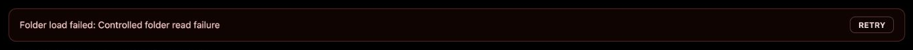</div><figcaption>Controlled failed folder read. The existing notice can coexist with the grid or empty state below it.</figcaption></figure>

<figure class="source-preview"><div class="capture-background">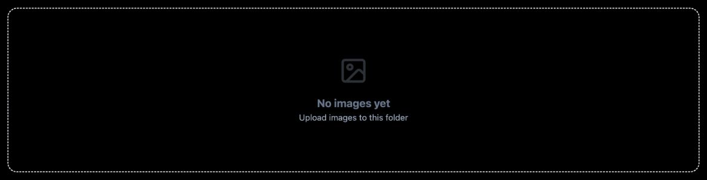</div><figcaption>An empty stored folder is different from the current blank search-result state.</figcaption></figure>

<figure class="source-preview"><div class="capture-background">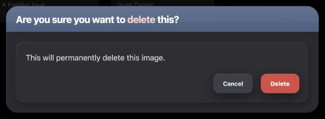</div><figcaption>Actual image-delete path, opened and canceled locally. No image was deleted.</figcaption></figure>

<section class="reuse-recipe">

##### Use in a New Design

**Loading/error:** A 32px spinning slate-400 Loader2 is centered with 80px vertical padding. Folder and image read errors use a 12px-radius notice, red-400/40 edge, red-950/25 fill, 16px horizontal / 12px vertical inset and 14px red-200 text. Retry has 8px corners, red-300/40 border, 12px horizontal / 4px vertical inset, 12px semibold uppercase/wide red-100 text and red-900/30 hover fill. These notices lack an alert/live role; new feedback should be named/announced appropriately. The caller owns retry and pending state.

**Empty:** Root still displays New Folder, then an unbordered centered message with 80px vertical padding, 64px/30%-opacity FolderOpen, 18px bold slate-500 title and 14px slate-400 guidance. Empty image folders use a 2px dashed slate-200 edge, 16px corners, the same padding/type relationship and a 48px/30%-opacity Image icon. There is no source no-search-matches panel. Choose the correct meaning before borrowing the appearance.

**Confirmation:** Import DeleteConfirmDialog to retain its complete semantic alert dialog and styling. It caps width at `min(94vw,640px)`, uses a 24px graphite/slate-title shell and the same strong shadow as Image Details. A 20px-padded, 16px-corner tray holds 16px relaxed zinc-300 consequence text and actions after 20px. Its neutral Cancel and red Delete variants are under Buttons & Menus. Confirmation Cancel additionally inherits the outline primitive's `hover:text-accent-foreground`: normal `#eaedf1` becomes dark `rgb(15,23,42)` on hover in the captured root theme, unlike the native Image Details Cancel. Its footer stacks Delete above Cancel with an 8px gap below small; at small and above, an 8px gap plus inherited 8px sibling margin produces 16px separation. The shared alert primitive focuses Cancel, handles Escape and does not treat an outside click as confirmation. Caller supplies open/change, message/title and onConfirm; there are no pending/error props. The source image path mounts it; the root folder path currently does not.

**Limits:** The fixtures establish these rendered branches with controlled reads. They do not prove successful retries, authentication, durable deletion or uploads. A real new asynchronous feature must keep pending/errors coherent with its actions.

</section>

<p class="source-line">Source: <code>src/components/chronicle/ImageLibraryTab.tsx</code> · lines 483–505, 609–615, 669–705, 775–780 and 928–945; <code>src/components/chronicle/DeleteConfirmDialog.tsx</code>; <code>src/components/ui/alert-dialog.tsx</code>; <code>src/components/ui/button.tsx</code> · outline hover; <code>src/index.css</code> · accent-foreground token.</p>
</section>

## Composition Examples

### Composition Examples

Existing figures show production components with local data. The two compositions below are new reference-only examples. They demonstrate new arrangements and explicitly chosen state behavior without adding product features.

<section class="manual-entry">

#### New Inspiration Collection

**Requested behavior:** “Let me name a new inspiration collection, write a short description, preview its poster-style cover and create it. Cancel should discard it.”

<figure class="source-preview"><div class="capture-background">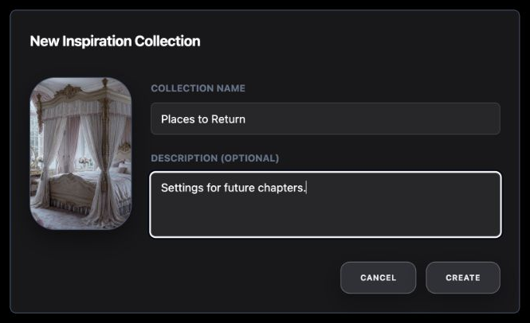</div><figcaption>New local-state composition. The small form family comes from FolderEditModal; the cover frame comes from folder cards.</figcaption></figure>

| Requirement | Inherited pattern | Deliberate adaptation |
| --- | --- | --- |
| Small separate creation task | Compact zinc dialog, slate edge, 18px title, shared Label/Input/Textarea and token footer. | Named trigger/description and a 640px sample width with viewport margin/height cap and scrolling. |
| Preview the cover | Folder frame: 2:3, 32px corners, slate edge, dark fallback and full cover crop. | 128px preview beside fields at small, centered above them below small; no hover commands on a read-only preview. |
| Create or discard | Compact neutral actions and field semantics. | Working values create a local receipt only on Create; Cancel/dismissal creates nothing. |

<section class="reuse-recipe">

##### Use in a New Design

**Construction:** Use shared Dialog root/trigger/content/header/title/description. Its content receives the compact styling from Panels & Layout plus `w-[calc(100vw-32px)] max-w-[640px] max-h-[calc(100vh-32px)] overflow-y-auto rounded-lg`. The default X is hidden as in FolderEditModal. A 24px-gap grid combines the folder frame and compact fields; the footer can wrap and uses 12px gaps. The caller supplies coverUrl, associated labels, values and handlers. The extra description is visually hidden but names the task for assistive technology.

**State:** Opening starts a fresh draft. Create trims values and uses “Untitled Collection” for a blank name, then writes a local status and closes. Cancel, Escape and outside dismissal close without creating; focus returns to the trigger. The example adds the blue focus recipe to native footer/trigger buttons; fields keep the compact token focus. Local checks covered Cancel, Create, reset on reopening and completed Escape/focus return. At 390px its 358px shell fits with fields below the preview. The actual New Folder source creates before editing; this proposed transaction intentionally changes that behavior.

**Keep and adapt:** Preserve compact surface/field/footer styling and the folder-frame relationship. Width, preview ratio, column proportions and labels can change. A real feature's caller must supply persistence and visible pending/failure behavior; the receipt is not a stored collection.

```tsx
<InspirationCollectionExample coverUrl={coverUrl} />
```

</section>

<p class="source-line">Source: <code>docs/ui-guide/examples/image-library-compositions.tsx</code> · InspirationCollectionExample; inherited owners <code>src/components/chronicle/FolderEditModal.tsx</code>, <code>src/components/chronicle/ImageLibraryTab.tsx</code> · folder frame, and the shared dialog/field primitives.</p>

<details class="implementation"><summary>Supporting source</summary>

```tsx
function changeOpen(value: boolean) {
  if (value) { setName(''); setDescription(''); }
  setOpen(value);
}
// Create commits the local receipt; other dismissals only close.
```

</details>
</section>

<section class="manual-entry">

#### New Reference Review Workspace

**Requested behavior:** “Let me review an image while nearby alternatives stay available. Stage title and tag edits until Apply, discard them with Cancel, and choose the collection cover immediately.”

<figure class="source-preview"><div class="capture-background">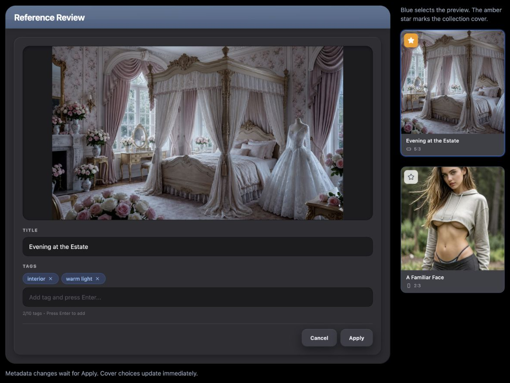</div><figcaption>New inline composition. Metadata and cover state are local; the preview and cover have separate visible selection meanings.</figcaption></figure>

| Requirement | Inherited pattern | Deliberate adaptation |
| --- | --- | --- |
| Useful image preview and metadata | Image Details' 24px graphite shell, slate header, inset tray, contained media, recessed fields and blue tags. | Inline named section without backdrop/X; preview capped at 40vh and normal page scrolling. |
| Nearby alternatives | Square manager tiles and zinc footers; ratio icon from AspectRatioUtils. | A 240px alternative column at large, two tiles above the editor below large; stationary previews for comparison. |
| Identify the current preview | Blue edge/ring from the shared image picker. | Named pressed target on the manager's 12px, 1px-border frame; no duplicate blue check badge. |
| Choose the cover independently | Amber/white Star from the current-thumbnail control. | Separate always-visible native button with pressed state and blue keyboard focus. |
| Apply or cancel metadata | Recessed inputs/tags and matching neutral Image Details actions. | Both title and tags use a working copy; cover updates immediately and independently. |

<section class="reuse-recipe">

##### Use in a New Design

**Construction:** Import ReferenceReviewExample with image IDs, URLs, titles, tags and dimensions. The component combines the full Image Details shell/header/tray/field/action styles and the square-tile footer recipe already stated here. It uses associated input labels, named preview/cover buttons and explicit blue focus for native actions. Selection carries both appearance and pressed state. Keep preview opening and cover choice as separate sibling buttons so their keyboard/click actions do not trigger each other.

```tsx
<ReferenceReviewExample initialImages={[
  { id: 'room', url: roomUrl, title: 'Evening Room', tags: ['interior'], width: 1600, height: 900 },
  { id: 'portrait', url: portraitUrl, title: 'Portrait', tags: ['portrait'], width: 1000, height: 1500 },
]} />
```

**State:** Selecting another preview copies its saved title/tags into the draft and discards uncommitted metadata from the previous image. Apply commits the working copy locally; Cancel restores that image's saved metadata. Tag entry trims/lowercases, rejects empty/duplicate additions and caps at ten as the source does, but mutations wait for Apply in this example. The amber cover choice updates immediately without changing which image is previewed. A status describes the local result. Local checks covered tag/title Cancel, Apply and switching back to the saved title, plus independent cover selection. At 390px the alternatives stack above the editor and the body fits without horizontal overflow.

**Keep and adapt:** Inherit fills, edges, radii, shadows, type levels and the distinct blue/amber states. Overall width, preview height and column arrangement are intentional layout choices. A larger collection can use a constrained scrolling alternative list. This example has no dialog to dismiss and no remote operation; an implemented feature's caller must define durable persistence and relevant pending/error feedback.

</section>

<p class="source-line">Source: <code>docs/ui-guide/examples/image-library-compositions.tsx</code> · ReferenceReviewExample; inherited owners <code>src/components/chronicle/ImageLibraryTab.tsx</code> · square tiles and Image Details, <code>src/components/chronicle/ImageLibraryPickerModal.tsx</code> · blue selection, and <code>src/components/chronicle/AspectRatioUtils.tsx</code>.</p>
</section>
