# My Stories UI Reference

A practical menu of patterns for designing new UI that belongs in Chronicle's private story workspace.

## Overview

### Designing with My Stories' UI Language

My Stories is the browsing workspace for owned stories, drafts, publications and saved stories. Its image-backed cards, collection filters and read-only details differ from Story Builder's authoring sections. Use this reference to compose new browsing, preview and appearance controls while preserving those differences. It is a representative vocabulary, not an inventory of every story field or gallery feature.

#### Start with the User's Intent

| If the request is… | Start with… | Then combine… |
| --- | --- | --- |
| “Show another collection of stories.” | Page grid and media card | Existing title/summary/status hierarchy and a meaningful primary open action. |
| “Let me choose which collection I see.” | Slate-selected header segments | Caller-owned collection state and filtering. |
| “Let me create another item.” | Dashed creation tile | The neighboring cards' proportions and a clear Add action. |
| “Let me inspect this before beginning.” | Substantial detail surface | Recessed cover, slate title banner, compact metadata and the appropriate progression action. |
| “Put a command beside the page title.” | Neutral settings button and command menu | The shared menu's complete surface, row and focus treatments. |
| “Let me choose a page background.” | Background chooser | Selected image tiles, upload source commands and optional overlay controls. |
| “Let me adjust the appearance while watching it.” | Compact anchored popover | Named color choices, a numeric slider and immediate preview updates. |
| “Let me remove this item.” | Local destructive command and confirmation | The correct consequence for an owned story or a saved reference. |

#### Compose a New Design

Choose the interaction before the geometry. A collection item opens a preview; a menu issues commands; a popover keeps a few controls near their subject; a substantial dialog gives a story enough room for a cover and readable information. Preserve the chosen family's fill, edge, shadow, type and action meaning together. Width, image ratio, column count and wording can follow the new content.

My Stories does not need authoring trays around every card. Its detail surface uses a recessed media column beside a graphite information column. The background chooser does use a shell, slate header and inset tray. The proposed compact appearance popup uses one elevated surface. These are deliberate levels of structure, not interchangeable backgrounds.

#### What Stays Consistent, and What Can Change

| Decision | Carry forward | Adapt to the concept |
| --- | --- | --- |
| Card treatment | 32px corners, slate edge, deep shadow, permanent lower gradient, compact white image-overlay text. | Ratio, displayed metadata and grid columns. |
| Structure | Graphite shells, slate titles, recessed media and complete shadow stacks. | A large preview needs more structure than a small anchored settings surface. |
| Local variants | 32px story-detail shell; 24px background-chooser shell; 14px compact dark menu/popover. | Overall width and height. These radii do not prescribe one universal modal size. |
| Color meaning | Slate collection selection, blue progression/Add/image selection, ordinary dark commands, red deletion and documented category exceptions. | New wording and interaction concepts; a new feature does not need a new accent. |
| State | Clear selected choices, named controls, visible keyboard focus and feedback attached to the relevant operation. | Required states and data behavior. Existing missing semantics are not instructions to reproduce them. |

#### Using This Reference as a Coding Agent

Use the decision table to choose a container and its controls, then carry the complete applicable construction rules. Read source ownership as an implementation boundary: some shared primitives supply behavior and styling, while page-local markup supplies the card, banner or custom control appearance. Essential instructions remain in the text and short fragments outside the supporting-source disclosures.

Existing specimens import production components with local sample data and controlled service reads. Derived examples are proposed combinations with local state. Neither establishes persisted creation, playback, deletion, upload or account behavior. The named current owners take precedence over broad descriptions of intended product behavior; identify a precise source gap instead of inventing a styling rule.

#### My Stories in Context

<figure class="source-preview"><div class="capture-background"><picture><source media="(max-width:600px)" srcset="../../src/assets/ui-guide/my-stories/overview-narrow.png">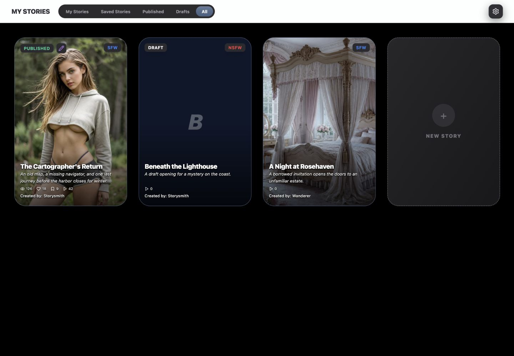</picture></div><figcaption>Production My Stories header and grid with local sample data. In the narrow capture, the grid fits but the unshrinking filter row makes the header overflow; the title wraps and settings move to another row. This is a documented source limitation.</figcaption></figure>

The shared application header identifies My Stories, presents its five collection choices and opens background settings. Index owns the black or image-backed canvas and passes the chosen collection into ScenarioHub. ScenarioHub arranges cards, the always-present New Story tile and optional loading-more feedback. Opening a card leads to ScenarioDetailModal, exported from StoryDetailModal.tsx.

There is no search field or sort control in this header/page branch. The five filters are My Stories, Saved Stories, Published, Drafts and All; their exact data meanings appear with the segmented control. Do not import Character Library's search pill or public-gallery review controls and describe them as existing My Stories behavior.

<p class="source-line">Source: <code>src/pages/Index.tsx</code> · lines 561–595 and 962–993; <code>src/components/app-shell/AppShellTopBar.tsx</code> · lines 386–397 and 530–547; <code>src/components/chronicle/StoryHub.tsx</code> · lines 173–323.</p>

## Color Palette

### Color Palette

The shared dark constants explain family relationships; the page and component values below resolve the actual local variants. Preserve alpha and gradients instead of flattening them into approximate colors.

| Visible role | Value and treatment | Current owner |
| --- | --- | --- |
| Browsing canvas | Black, optionally replaced by a cover-positioned background image with black/white overlay. | Index hub wrapper |
| Header title | `hsl(var(--ui-surface-2))`; root value `228 7% 20%`. | SectionTitle and index.css |
| Filter tray | `#2b2b2e`; selected slate gradient `#5a7292` → `#4a5f7f`, white/20 top border and 7% white sheen. | SegmentedControl |
| Story-card edge and base | `#4a5f7f` border; slate-200 base under the image; slate-900 fallback. | ScenarioCard |
| Major shell | `#2a2a2f`. | StoryDetailModal and BackgroundPickerModal |
| Recessed media/default tile | `#1c1c1f`. | Detail left column and background default tile |
| Inset chooser tray | `#2e2e33`. | BackgroundPickerModal |
| Elevated controls/menu | `#3c3e47`; documented hover `#44464f`. | Upload command, shared menu and overlay panel |
| Shared ordinary action | `#303035` → `#343439`; control text `#eaedf1`. | ChronicleSurfaceButton |
| Detail-local ordinary action | `#2f3137` with `#eaedf1`; no separate hover fill in its source. | Edit / Remove from Gallery |
| Progression | Blue-500 (`#3b82f6`); card Play hovers to blue-600. | Card and detail Play |
| Background selection | Blue-500 thumbnail edge; `#4f7fdc` selected swatch border and check badge. | BackgroundPickerModal |
| Status/category | Emerald-400 Published; purple-400 remix/Editable; red-500 NSFW; blue-500 SFW. | Card/detail badges |
| Card text | White, backed by lower black/70 gradient and text shadow. | ScenarioCard |
| Detail text | Body `rgba(248,250,252,0.8)`; labels `#a1a1aa`; empty character copy `rgba(248,250,252,0.3)`. | StoryDetailModal |

<p class="source-line">Source: <code>src/pages/Index.tsx</code> · lines 962–975; <code>src/components/app-shell/AppShellTopBar.tsx</code> · lines 167–170 and 207–224; <code>src/components/chronicle/StoryHub.tsx</code> · lines 37–149; <code>src/components/chronicle/StoryDetailModal.tsx</code> · lines 250–350 and 555–675; <code>src/components/chronicle/BackgroundPickerModal.tsx</code> · lines 76–225; <code>src/components/chronicle/chronicle-dark-ui.ts</code> · lines 6–31; <code>src/index.css</code> · lines 11–48.</p>

#### Resolve Apparent Conflicts

Slate-selected collection filters are an explicit My Stories variant; do not recolor them blue merely because image choices use blue. The background swatch's `#4f7fdc` is also a local value, not a replacement for every blue action.

The shared Slider uses `bg-secondary`, `bg-primary`, `border-primary`, `bg-background` and `ring-ring`. These resolve through the active application theme; the background picker supplies no blue override. Use the component's token-based treatment rather than assuming its range is the swatch color. Likewise, card Delete uses `hsl(var(--destructive))`, whereas the shared confirmation uses `#d94b45` → `#e2554e`.

Published, Editable and SFW/NSFW are domain statuses. Purple Editable is not an AI action, and red NSFW is not a validation error. This browsing region has no AI action specimen; an actual new AI command should use Chronicle's established AI family from the Story Builder reference rather than repurposing a status badge.

<p class="source-line">Source: <code>src/components/ui/slider.tsx</code> · lines 8–20; <code>src/index.css</code> · lines 31–48 and 79–96; <code>src/components/chronicle/StoryHub.tsx</code> · lines 53–105; <code>src/components/chronicle/DeleteConfirmDialog.tsx</code> · lines 50–58.</p>

## Typography & Spacing

### Typography & Spacing

Inherit the application font. Image-backed cards favor short, heavy text over a protected lower gradient; read-only detail content uses smaller, quieter body copy with strongly separated labels. These are two text hierarchies within the same visual language.

| Role | Existing treatment |
| --- | --- |
| Application region title | 18px, black weight, uppercase, tight tracking. |
| Collection filter | 12px bold, 16px horizontal / 6px vertical padding; 2px between segments inside a 4px-padded tray. |
| Card title | 18px black weight, white, tight line-height/tracking, single-line truncation; hover blue-300. |
| Card synopsis | 12px white italic, relaxed line-height, two-line clamp and 40px minimum height. |
| Card counts / author | Counts 10px, 12px icons, 4px icon gap, 12px between counts; author 11px medium. Both rows have 4px top margin. |
| Card shortcuts | 10px bold uppercase, wider tracking, 32px height, 12px horizontal inset, 12px corners. |
| Detail title | 36px with 40px line-height, weight 800, white, `-0.02em` tracking; banner inset 32px horizontal / 14px vertical. |
| Detail labels | 12px, weight 900, uppercase, `0.1em` tracking, muted zinc-400, 6px to value. |
| Detail prose | 13px, white at 80% with 1.6 line-height for synopsis; preserved line breaks. |
| Detail actions | 12px bold uppercase, `0.05em` tracking, 40px height, 14px icon, 6px icon gap. |
| Background title / toolbar label | Title 16px black weight, uppercase/widest; toolbar label 10px black weight, uppercase, `0.16em` tracking. |
| Background settings | 12px labels; 32px swatches; 12px between opacity label, slider and value. |

The grid has 16px insets and gaps below the large breakpoint, increasing to 40px insets and 32px gaps at large. Story-card bottom content uses 16px inset with 20px at the bottom. In the detail surface, synopsis begins after 24px, grouped metadata and characters after 32px, and metadata columns have 16px gaps. The chooser uses 20px shell/body/tray insets, then a smaller 16px settings-panel inset.

<p class="source-line">Source: <code>src/components/app-shell/AppShellTopBar.tsx</code> · lines 167–224; <code>src/components/chronicle/StoryHub.tsx</code> · lines 89–149 and 254–287; <code>src/components/chronicle/StoryDetailModal.tsx</code> · lines 323–350, 449–474 and 583–675; <code>src/components/chronicle/BackgroundPickerModal.tsx</code> · lines 79–170.</p>

#### Complete the States a New Interaction Needs

The current cards, filters and swatches do not provide a complete keyboard-focus/selection treatment. The proposed examples explicitly add `focus-visible:outline-none focus-visible:ring-2 focus-visible:ring-blue-300` to their new native controls while preserving their surfaces. This is a derived construction choice, not a claim about every source control. ChronicleSurfaceButton already supplies its own accent-teal/40 focus ring and 50%-opacity disabled state; shared menu rows use white/8 focused fill and 40%-opacity disabled state.

New controls need an accessible name and programmatic selection as well as color. Do not introduce invalid-field styling into read-only metadata or a bounded slider that has no invalid state. If a new asynchronous action is added, its caller must provide pending/error state and operation feedback; a screenshot of a button cannot establish that behavior.

<p class="source-line">Source: <code>docs/ui-guide/examples/my-stories-compositions.tsx</code> · focus constant and both examples; <code>src/components/chronicle/chronicle-dark-ui.ts</code> · line 31; <code>src/components/ui/dropdown-menu.tsx</code> · lines 73–88.</p>

## Buttons & Menus

### Buttons & Menus

Separate a page command, a local shortcut and a primary progression action. Their existing sizes and fills differ intentionally. Use a command menu for commands; the proposed appearance popover contains controls and therefore stays open while their values change.

<section class="manual-entry">

#### Page Settings and Upload Source Menus

<figure class="source-preview"><div class="capture-background">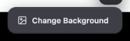</div><figcaption>Production settings menu opened from the My Stories header. It contains Change Background.</figcaption></figure>

| Specification | Current rule |
| --- | --- |
| Page trigger | ChronicleSurfaceButton, 40px square via `w-10 px-0`, 20px Settings icon; named “Story Hub settings”. |
| Ordinary button foundation | 40px high, 12px corners, `#303035` → `#343439`, 12px bold `#eaedf1`, no border, shared button shadow; active scale 0.95. |
| Menu shell | 14px corners, black/20 border, `#3c3e47`, 6px padding, `#eaedf1`, shared button shadow, 4px trigger offset. |
| Menu row | 9px corners, 10px horizontal / 8px vertical padding, 13px semibold, no extra line leading; focused white/8 fill with white text. |
| Menu disabled | Pointer suppression and 40% opacity. |
| Local widths | Page settings 192px; background upload menu 176px; both align to the trigger's end. |

<section class="reuse-recipe">

##### Use in a New Design

**Construction:** ChronicleSurfaceButton supplies the ordinary action appearance, ref and native props. The caller adds horizontal padding or a square width, its name/icon and callback. DropdownMenu supplies command behavior; DropdownMenuContent and Item already supply the complete dark menu treatment. The caller supplies rows, labels, icons and actions.

```tsx
<DropdownMenuContent align="end" className="w-48">
  <DropdownMenuItem onClick={hub.onOpenBackgroundModal} className="cursor-pointer">
    <ImageIcon className="w-4 h-4 mr-2" />
    Change Background
  </DropdownMenuItem>
</DropdownMenuContent>
```

The background chooser's Upload Background trigger is a deliberate elevated variant: `h-10 px-4 rounded-xl border-0 bg-[#3c3e47]`, hover/active `#44464f`, shared button shadow, 12px bold control text and 8px icon gap. It uses a 14px Upload icon and 12px chevron. `isUploading` disables at 50% opacity and changes the copy to “Uploading...”; the two commands are From Device and From Library. This trigger does not inherit the ordinary button's fill automatically.

**Keep and adapt:** Keep the chosen action family's height, corners, depth and focus treatment. Menu width can follow its labels. A setting with an adjustable value belongs in the compact control popover illustrated later, not a command row that closes after selection. Neither settings nor upload menus require another slate title strip.

</section>

<p class="source-line">Source: <code>src/components/app-shell/AppShellTopBar.tsx</code> · lines 530–547; <code>src/components/chronicle/ChronicleDarkUi.tsx</code> · lines 6–18; <code>src/components/chronicle/chronicle-dark-ui.ts</code> · lines 26–31; <code>src/components/ui/dropdown-menu.tsx</code> · lines 55–88; <code>src/components/chronicle/BackgroundPickerModal.tsx</code> · lines 101–123.</p>

<details class="implementation"><summary>Supporting source</summary>

```tsx
<DropdownMenuContent align="end" className="w-44">
  <DropdownMenuItem onClick={() => fileInputRef.current?.click()} className="cursor-pointer">
    <Upload className="w-4 h-4 mr-2" /> From Device
  </DropdownMenuItem>
  <DropdownMenuItem onClick={() => setIsPickerOpen(true)} className="cursor-pointer">
    <Image className="w-4 h-4 mr-2" /> From Library
  </DropdownMenuItem>
</DropdownMenuContent>
```

The file/library handlers explain the existing command boundary. The reference does not need upload services to demonstrate the menu styling.

</details>

</section>

<section class="manual-entry">

#### Card Shortcuts and Destructive Confirmation

<figure class="source-preview"><div class="capture-background">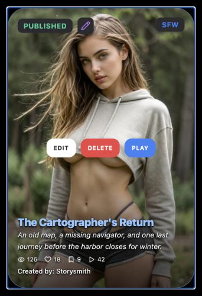</div><figcaption>Production hover: image scale increases to 1.1 and shortcuts appear. The wrapper stays in place and the important card shadow remains unchanged.</figcaption></figure>

| Action/state | Current treatment |
| --- | --- |
| Shortcut layer | Absolute full-card center, 8px gap and 16px horizontal inset, z-index 10; opacity 0 → 1 and scale 0.9 → 1 over 300ms. |
| Shared shortcut geometry | 32px high, 12px horizontal padding, 12px corners, 10px bold uppercase, wider tracking, `shadow-2xl`. |
| Edit | White fill, `hsl(var(--ui-surface-2))` text, ghost-white hover; always rendered. |
| Delete | `hsl(var(--destructive))` fill, white text, 110% hover brightness; always rendered. |
| Play | Blue-500 → blue-600, white text; absent for drafts. |
| Primary card action | Click, Enter or Space opens details; secondary clicks stop propagation. |

<section class="reuse-recipe">

##### Use in a New Design

**Construction:** ScenarioCard is private markup inside StoryHub.tsx. It receives separate open, edit, delete and play callbacks; those callbacks do not supply the styling. For a matching compact primary shortcut, the complete current class is:

```tsx
className="h-8 px-3 rounded-xl bg-blue-500 text-white hover:bg-blue-600 text-[10px] font-bold leading-none uppercase tracking-wider shadow-2xl transition-colors"
```

Use a named primary target and separate native secondary actions in a new composition. The existing outer `role="button"` contains nested buttons, only click propagation is stopped, and the hidden shortcut layer is revealed by hover rather than keyboard focus. It does not provide the complete interaction pattern for touch or keyboard. Preserve the visual roles while making secondary actions available on focus and at the intended input widths.

**Consequence:** Index distinguishes removing a saved reference from deleting an owned scenario. The owned-story confirmation title is “Delete Scenario?” and its message is “Delete this entire scenario? This cannot be undone.” A saved reference uses “Remove Bookmark?” and “Remove this story from your bookmarks?” The shared confirmation's action label remains Delete in both cases.

```tsx
<DeleteConfirmDialog
  open={open}
  onOpenChange={setOpen}
  onConfirm={confirmDeletion}
  title="Delete Scenario?"
  message="Delete this entire scenario? This cannot be undone."
/>
```

This reduced call supplies the actual scenario copy with caller-owned state and consequence. The imported component owns a 24px graphite shell, slate title strip, 16px inset tray and 40px actions. Cancel uses `#3c3e47` → `#44464f`; Delete uses `#d94b45` → `#e2554e`; both use 12px corners, 20px horizontal padding, 12px bold text, shared button shadow and a 2px `#6e89ad`/70 focus ring with no offset. Its width is `min(94vw,640px)`, an existing confirmation arrangement rather than a universal width. Cancel normally uses `#eaedf1` text but inherits `hover:text-accent-foreground` from the shared outline button; under the captured root theme hover text is dark `rgb(15,23,42)`. Below small the footer stacks Delete above Cancel with an 8px gap; at small and above its 8px gap and inherited 8px sibling margin give 16px separation.

**Keep and adapt:** Keep primary, ordinary and destructive meanings distinct. The current Edit shortcut is not hidden based on remix permission. The inspected edit callback sends a nonowned story to remix confirmation, but does not establish an `allow_remix` guard there; do not claim that the card enforces permission. The confirmation accepts no pending/error prop and the Index callback clears it immediately after dispatch. A new asynchronous deletion needs caller-owned pending and failure feedback.

</section>

<p class="source-line">Source: <code>src/components/chronicle/StoryHub.tsx</code> · lines 28–37 and 89–109; <code>src/components/chronicle/DeleteConfirmDialog.tsx</code> · lines 13–65; <code>src/components/ui/alert-dialog.tsx</code>; <code>src/components/ui/button.tsx</code>; <code>src/index.css</code> · inherited footer/hover; <code>src/pages/Index.tsx</code> · lines 1354–1376; <code>src/hooks/use-index-scenario-lifecycle.ts</code> · lines 179–195 and 412–450.</p>

<details class="implementation"><summary>Supporting source</summary>

```tsx
const handleDeleteClick = (e: React.MouseEvent) => {
  e.stopPropagation();
  onDelete(scen.id);
};
```

This prevents a deletion click from also opening details. It does not stop the enclosing card's keyboard handler from receiving a nested button's key event.

</details>

</section>

<section class="manual-entry">

#### New Story Tile

<figure class="source-preview"><div class="capture-background">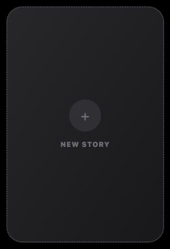</div><figcaption>The creation tile is a peer of story cards and remains present in an empty collection.</figcaption></figure>

| Specification | Current rule |
| --- | --- |
| Shell | Full width, 2:3 ratio, 32px corners, 2px dashed zinc-600 border, diagonal zinc-800 → zinc-900 gradient. |
| Arrangement | Centered column with 16px gap. |
| Add mark | Literal 30px plus in a 64px circle, zinc-700/50 surface and zinc-500 type. |
| Label | 14px black weight, uppercase/widest, zinc-500. |
| Hover | Blue-500 border and label; circle blue-900/30 with blue-500 plus, 300ms transition. |

<section class="reuse-recipe">

##### Use in a New Design

**Construction:** The caller supplies `onCreate`; ScenarioHub always renders the tile after the current cards. Its full shell class is:

```tsx
className="aspect-[2/3] w-full rounded-[2rem] border-2 border-dashed border-zinc-600 bg-gradient-to-br from-zinc-800 to-zinc-900 flex flex-col items-center justify-center gap-4 group hover:border-blue-500 transition-all duration-300"
```

The plus container uses `w-16 h-16 rounded-full bg-zinc-700/50 flex items-center justify-center text-3xl text-zinc-500 group-hover:bg-blue-900/30 group-hover:text-blue-500 transition-colors`. The label uses `text-sm font-black uppercase tracking-widest text-zinc-500 group-hover:text-blue-500`.

**Keep and adapt:** Keep the dashed creation boundary, centered Add emphasis and visual relationship to neighboring items. Match another ratio when the new collection calls for it. The source has no explicit focused, disabled or pending treatment; a new implementation must supply any required state rather than treating hover as keyboard feedback. `onCreate` is the behavior boundary, not evidence of persisted creation.

</section>

<p class="source-line">Source: <code>src/components/chronicle/StoryHub.tsx</code> · lines 271–280.</p>

<details class="implementation"><summary>Supporting source</summary>

```tsx
<button
  onClick={onCreate}
```

This is the current tile's callback boundary; the source class and child treatments needed for construction are stated above.

</details>

</section>

## Fields & Controls

### Fields & Controls

This region primarily browses and selects. Its representative controls are collection segments, image choices and background overlay settings. It has no authoring text-field family of its own in the inspected hub path; use Story Builder's recessed-field recipe if a new My Stories concept actually needs text entry.

For that explicit cross-family borrowing, the complete existing full-width text-field class is:

```tsx
className="w-full px-3 py-2 text-sm bg-[#1c1c1f] border border-black/35 text-white placeholder:text-zinc-600 rounded-lg focus:outline-none focus:ring-2 focus:ring-blue-500/20 focus:border-blue-500"
```

This gives 14px white text, a recessed fill, 8px corners, 12px horizontal / 8px vertical inset and a blue-500 focus border with 2px blue-500/20 ring. Associate a native label with the input: `text-[10px] font-black text-zinc-400 uppercase tracking-widest mb-1`, adding block layout for the 4px label gap. AutoResizeTextarea supplies growing multiline sizing, not appearance, and does not forward ID, disabled or ARIA props; use a wrapping native label for its name, or a native input/textarea when those attributes are needed. The caller owns value/change, validation and disabled behavior. This borrowed field is guidance for a new authoring concept, not an existing My Stories control specimen.

<p class="source-line">Borrowed source: <code>src/features/story-builder/StoryBuilderScreen.tsx</code> · line 526; label owner <code>src/features/story-builder/components/StoryBuilderFieldLabel.tsx</code> · lines 18–21; sizing/interface <code>src/components/chronicle/AutoResizeTextarea.tsx</code> · lines 4–25 and 50–61. Accepted family reference: <code>docs/ui-guide/story-builder.md</code> · Standard Recessed Text Entry and Field Labels.</p>

<section class="manual-entry">

#### Collection Segments

<figure class="source-preview"><div class="capture-background"></div><figcaption>Collection selection uses the slate title/navigation family, with muted inactive labels.</figcaption></figure>

| Part | Construction |
| --- | --- |
| Tray | `flex items-center bg-[#2b2b2e] rounded-full p-1 gap-0.5 border border-[#2b2b2e]`. |
| Button base | `px-4 py-1.5 rounded-full text-xs font-bold transition-colors whitespace-nowrap border-t`. |
| Selected | `relative overflow-hidden bg-gradient-to-b from-[#5a7292] to-[#4a5f7f] border-white/20 text-white shadow-sm`. |
| Inactive | `border-transparent text-[#a1a1aa] hover:text-[#e4e4e7]`. |
| Selected sheen | Absolute inset, rounded-full, gradient from white/7% through transparent, pointer-inert; label above it at z-index 1. |

<section class="reuse-recipe">

##### Use in a New Design

**Construction:** SegmentedControl is private to AppShellTopBar. The header caller supplies options, `activeValue` and `onChange`; the component renders a native button for each option. Copy the complete tray/button/selected-layer relationship when constructing another exclusive collection control. The label must remain above the sheen.

The existing Index meanings are: My Stories excludes owned drafts; Saved Stories maps bookmarked public references and excludes entries already owned; Published uses the owned publication-ID set; Drafts selects owned drafts; All combines owned entries with mapped saved entries. Order follows the supplied arrays and filters. No sort mode or search is established here.

**Keep and adapt:** Preserve slate selection and neutral inactive choices. Supply a named group and selection semantics for new controls, together with visible focus. The current component has no `aria-pressed`, radio selection or explicit focus class. Its `overflow-x-auto … flex-shrink-0` wrapper does not by itself constrain the row: the captured narrow header overflows while the grid fits. Let the new parent constrain, wrap or scroll its control within the available width; that layout decision does not require recoloring the pills.

</section>

<p class="source-line">Source: <code>src/components/app-shell/AppShellTopBar.tsx</code> · lines 197–230 and 386–397; <code>src/pages/Index.tsx</code> · lines 93–99 and 561–595.</p>

<details class="implementation"><summary>Supporting source</summary>

```tsx
<span className="relative z-[1]">{option.label}</span>
```

This is the foreground text layer above the selected sheen. The state styling and caller behavior are stated outside this disclosure.

</details>

</section>

<section class="manual-entry">

#### Overlay Color and Opacity

<figure class="source-preview"><div class="capture-background">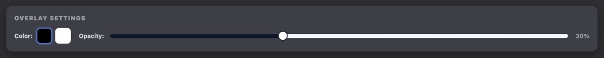</div><figcaption>Existing overlay controls appear for a selected custom background when the caller supplies an overlay-change handler.</figcaption></figure>

| Part | Current construction |
| --- | --- |
| Panel | `mb-5 p-4 rounded-xl border border-black/30 bg-[#3c3e47]`; shadow `0 8px 24px rgba(0,0,0,.35), inset 0 1px 0 rgba(255,255,255,.08), inset 0 -1px 0 rgba(0,0,0,.20)`. |
| Heading | 12px black weight, uppercase/widest, `#a1a1aa`, 12px bottom margin. |
| Color row | 12px bold `#d7d8df` label, 8px gap to choices, 6px between swatches. |
| Swatch | 32px square, 8px corners, 2px border, black or white fill. Selected `#4f7fdc` edge and 2px `#4f7fdc`/35 ring; idle white/15 edge → white/25 on hover. |
| Slider range | 0–80 percent, step 5. Value is an array with one number; changes carry current color and selected background ID. |
| Slider style | 8px rounded secondary track, full-height primary range; 20px background-filled thumb with 2px primary border; theme ring/offset focus and disabled 50% opacity. |
| Opacity arrangement | `min-w-[220px] flex-1 flex items-center gap-3`; numeric value 12px bold zinc-400, 32px wide and right-aligned. |

<section class="reuse-recipe">

##### Use in a New Design

**Construction:** BackgroundPickerModal owns the panel and swatches; its caller supplies current selected-background data and `onOverlayChange(id, color, opacity)`. The shared Slider owns the range/track/thumb styling and interaction. A background without stored overlay settings defaults to black at 10%; these source defaults are separate from the proposed example's explicit 30% Reset value.

**Naming limit:** Passing an ARIA label to the shared Slider labels its Root wrapper, not its Thumb. The current wrapper spreads props onto Root and creates an unnamed Thumb. The source background slider therefore has no accessible slider name. The new appearance example uses the same Radix markup and classes with the name on Thumb, rather than pretending a root label fixes it. The essential complete named-slider fragment is:

```tsx
<SliderPrimitive.Root
  value={[opacity]} onValueChange={([value]) => setOpacity(value)}
  min={0} max={80} step={5}
  className="relative flex w-full flex-1 touch-none select-none items-center"
>
  <SliderPrimitive.Track className="relative h-2 w-full grow overflow-hidden rounded-full bg-secondary">
    <SliderPrimitive.Range className="absolute h-full bg-primary" />
  </SliderPrimitive.Track>
  <SliderPrimitive.Thumb
    aria-label="Background overlay opacity"
    className="block h-5 w-5 rounded-full border-2 border-primary bg-background ring-offset-background transition-colors focus-visible:outline-none focus-visible:ring-2 focus-visible:ring-ring focus-visible:ring-offset-2 disabled:pointer-events-none disabled:opacity-50"
  />
</SliderPrimitive.Root>
```

Import `* as SliderPrimitive` from `@radix-ui/react-slider` for this derived fragment. It preserves the shared slider's appearance; `flex-1` lets it share the opacity row. No invented blue range is added. For swatches in a new composition, put Black overlay / White overlay names and `aria-pressed` on native buttons in a named Overlay color group, retaining the exact selected/idle appearance above.

The example maps `value` over black and white inside that group. This complete swatch fragment uses the previously documented `focus` class and local `color`/`setColor` state:

```tsx
<button
  key={value} type="button"
  aria-label={value === 'black' ? 'Black overlay' : 'White overlay'}
  aria-pressed={color === value} onClick={() => setColor(value)}
  className={`h-8 w-8 rounded-lg border-2 transition-all ${focus} ${color===value?'border-[#4f7fdc] ring-2 ring-[#4f7fdc]/35':'border-white/15 hover:border-white/25'} ${value==='black'?'bg-black':'bg-white'}`}
/>
```

**Keep and adapt:** Keep color and opacity independent: changing one passes the other unchanged. Preserve the selected ring and slider's keyboard focus. The current swatches have no names or selected-state ARIA; the derived example adds them and the blue-300 focus ring described earlier. Row arrangement and panel width may change to keep the preview visible. No invalid state is needed for this constrained numeric choice; asynchronous persistence feedback, if required by a new consumer, remains its responsibility.

</section>

<p class="source-line">Source: <code>src/components/chronicle/BackgroundPickerModal.tsx</code> · lines 55–57 and 126–167; <code>src/components/ui/slider.tsx</code> · lines 8–20. Named-thumb and swatch additions: <code>docs/ui-guide/examples/my-stories-compositions.tsx</code> · BackgroundAppearanceExample.</p>

<details class="implementation"><summary>Supporting source</summary>

```tsx
onValueChange={([val]) => onOverlayChange(selectedBackgroundId, overlayColor, val)}
```

The existing callback keeps the selected background and current color while changing opacity. The new example instead updates local preview state.

</details>

</section>

## Panels & Layout

### Panels & Layout

Choose the layer hierarchy for the amount of information. The media card is one clipped image surface; the detail dialog separates media from information; the background chooser places selection work inside an inset tray. Their corners and shadows are specific variants of the same Chronicle family.

<section class="manual-entry">

#### Story Card and Collection Grid

<figure class="source-preview"><div class="capture-background">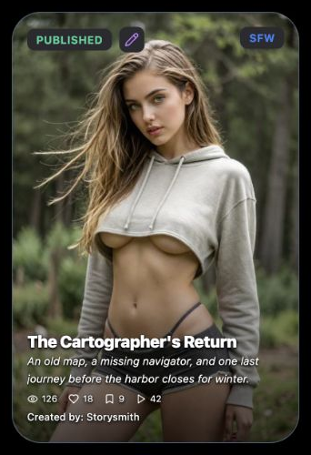</div><figcaption>Production published card: status sits above the cover while summary, counts and author stay over the permanent lower gradient.</figcaption></figure>

| Layer | Complete applicable treatment |
| --- | --- |
| Card frame | 2:3, full width, clipped 32px corners, slate-200 base, 1px `#4a5f7f` edge; important shadow `0 12px 32px -2px rgba(0,0,0,.50)`. |
| Media | Full width/height, object-cover, caller's percentage focal point (default 50%/50%), hover scale 1.1 with 700ms transform transition. |
| Readability layer | Full-frame vertical gradient transparent → transparent → black/70, pointer-inert, z-index 1. |
| Text layer | Bottom full width, 16px inset and 20px bottom, z-index 2; shadow `0 1px 2px rgba(0,0,0,.9), 0 2px 4px rgba(0,0,0,.7), 0 0 1px rgba(0,0,0,.9)`. |
| Status badges | Top/left or top/right 16px; graphite, 8px corners, small backdrop blur, shadow-lg, 10px horizontal / 4px vertical inset, 12px bold uppercase/wide type. |
| Remix badge | Top-left group, 6px padding around 16px purple-400 Pencil, graphite/8px radius/blur/shadow. |
| Grid | One column, then 2 at small, 3 at large, 4 at extra-large, 5 at 2xl; 16px gaps, 32px at large. |

<section class="reuse-recipe">

##### Use in a New Design

**Construction:** The image, gradient, badges, shortcut overlay and text are layers inside a clipped frame. Preserve their relative order and the complete shadow; the source's important base shadow remains in effect on hover. The wrapper did not lift in the source capture. Use this actual treatment rather than copying an ineffective `group-hover` transform or claiming a hover shadow change.

```tsx
className="aspect-[2/3] w-full overflow-hidden rounded-[2rem] bg-slate-200 !shadow-[0_12px_32px_-2px_rgba(0,0,0,0.50)] transition-shadow duration-300 group-hover:shadow-2xl border border-[#4a5f7f] relative"
```

The class above is the exact existing frame; the nonimportant hover shadow does not replace its important shadow. For a new card, preserve the effective base treatment and add only the interaction changes that the concept actually needs.

**Data and states:** Owned drafts show Draft; owned published nondrafts show Published; a bookmarked story does not show those owned badges. Remix status comes from `publishedData.allow_remix`; classification comes from `contentThemes.storyType`. Published data supplies four counters with missing numbers shown as zero. Without that object, the component shows only a Play icon with literal zero, not a loaded local play count. Author is supplied by the parent, falling back to Anonymous at the card; a missing bookmarked-author mapping falls back to ownerUsername in the hub.

**Keep and adapt:** Keep image/text readability, corners, edge, depth and type hierarchy. Grid columns, ratio, metadata and whether a new card has shortcuts can change. Do not make every new media component a portrait or give it invented statistics. Use full text or another accessible description when truncation would hide information needed to identify the item.

</section>

<figure class="source-preview"><div class="capture-background">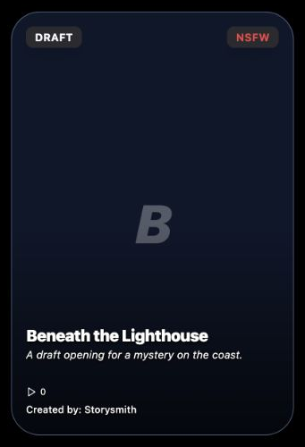</div><figcaption>The existing fallback is a slate-900 surface with 40px inset and a 60px heavy italic initial. Drafts omit Play but retain Edit and Delete shortcuts.</figcaption></figure>

<figure class="source-preview"><div class="capture-background">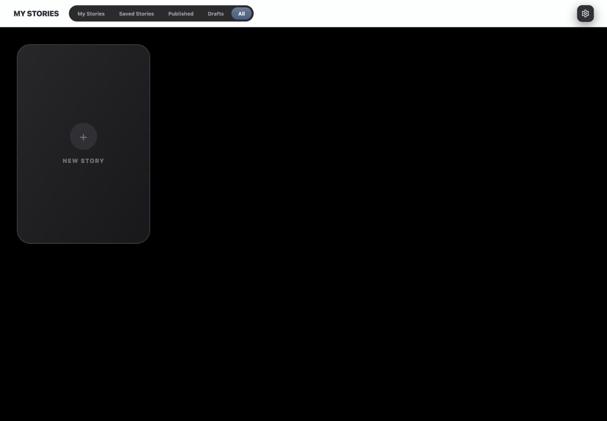</div><figcaption>An empty supplied collection still renders New Story. There is no separate no-results message in this source branch.</figcaption></figure>

When more data is available, ScenarioHub places a sentinel below the grid with 32px vertical padding. It shows a 24px zinc-500 spinning Loader2 only while `isLoadingMore` is true. The caller supplies `hasMore`, `isLoadingMore` and `onLoadMore`; the observer requests another page near the sentinel. This is loading-more feedback, not a general empty or error state.

<p class="source-line">Source: <code>src/components/chronicle/StoryHub.tsx</code> · lines 13–155, 198–210 and 246–290; canvas <code>src/pages/Index.tsx</code> · lines 962–975.</p>

<details class="implementation"><summary>Supporting source</summary>

```tsx
<div className="w-full h-full p-4 lg:p-10 flex flex-col overflow-y-auto">
  <div className="grid grid-cols-1 sm:grid-cols-2 lg:grid-cols-3 xl:grid-cols-4 2xl:grid-cols-5 gap-4 lg:gap-8 w-full">
```

This is the grid's existing parent geometry. ScenarioHub receives the displayed array; it does not choose the current collection filter itself.

</details>

</section>

<section class="manual-entry">

#### Story Detail Surface

<figure class="source-preview"><div class="capture-background">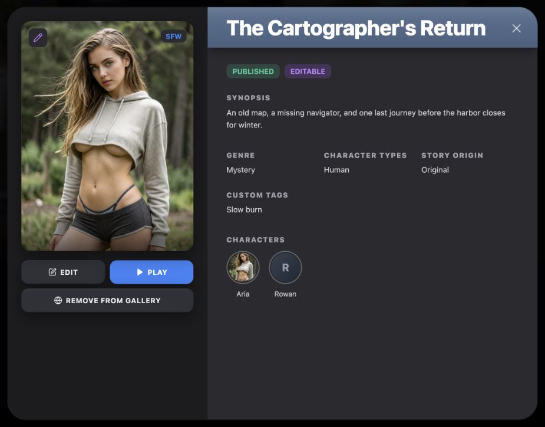</div><figcaption>Existing My Stories detail composition with controlled local story and character data. It is a read-only preview with navigation/action callbacks, not an authoring form.</figcaption></figure>

| Layer | Current construction |
| --- | --- |
| Backdrop | Black/90 and small backdrop blur. |
| Shell | Graphite `#2a2a2f`, 32px corners, clipped overflow, maximum 900px width; height `min(700px, calc(100vh - 2rem))`. Shadow `0 20px 50px rgba(0,0,0,.5), inset 1px 1px 0 rgba(255,255,255,.09), inset -1px -1px 0 rgba(0,0,0,.35)`. |
| Cover column | Fixed 340px, no shrinking, 24px inset, `#1c1c1f`. Cover is 3:4 with 16px corners, diagonal `#2a2a2f` → `#1a1a1f` base and `0 8px 24px rgba(0,0,0,.45)` shadow. |
| Cover fallback | Slate `#5a7292` and 72px heavy white/15 initial; lower 80px gradient black/60 → transparent. |
| Banner | `linear-gradient(180deg, #5a7292 0%, #4a5f7f 100%)`, white/20 top edge, 7% white sheen fading by 30% of its height; shadow `0 10px 15px -3px rgba(0,0,0,.3), 0 4px 6px -4px rgba(0,0,0,.3)`; 32px horizontal / 14px vertical inset. |
| Information column | Flexing min-width-zero column, clipped outer overflow, independent `min-h-0 flex-1 overflow-y-auto … overscroll-contain` content pane. Body inset 24px top / 48px right / 32px bottom / 32px left. |
| Actions | 16px below cover with 8px gap; 40px height, 12px corners. Edit and Remove from Gallery use `#2f3137`/`#eaedf1` and shared button shadow; Play uses blue-500/white with outer shadow only. |
| Close | Top/right 16px, 8px padding, 24px X, white/60 → white. Current control has no accessible name or explicit focus treatment. |

<section class="reuse-recipe">

##### Use in a New Design

**Construction:** The exported ScenarioDetailModal owns this composition but also fetches characters and contains optional public-gallery branches. My Stories supplies title, description, cover/focal point, themes, ownership/draft/publication state and Play/Edit/unpublish callbacks. It does not pass the public review ID or Like/Save callbacks; those public-gallery controls are not present in this consumer.

An owned story shows Edit when supplied and Play unless it is a draft. An unowned detail uses its Play branch; the unconditional Edit shortcut discussed earlier is on the grid card, not this detail's unowned action row. Remove from Gallery appears for an eligible published owned story and callback. It uses a full-width button 8px below the action row, with a 14px Globe changing to a spinning Loader2 and 50% disabled opacity while unpublishing. Its ordinary dark fill is an explicit local treatment; it is not the red scenario-deletion action.

Read-only metadata uses the label/prose styles in Typography & Spacing. The source groups Genre, Character Types and Story Origin in three equal columns with 16px gaps and 32px top margin; warnings and custom tags are later text groups separated by 24px. The character strip uses 56px round portraits with 2px `rgba(248,250,252,.3)` edge, 2px internal padding, 16px between items and 8px between portrait/name. Names are 12px, max 64px and truncated. Empty copy is 13px italic at 30% opacity; loading uses four portrait/name skeleton pairs. It displays at most eight loaded characters. That count and column arrangement are source choices, not new-design rules.

**Source limitations:** This source mounts Dialog, Portal and Overlay but renders plain divs for content. It therefore does not establish a semantic dialog, focus trap or Escape dismissal. The captured source had no `role="dialog"`, and Escape left it open; backdrop click and its X are the explicit dismissal paths. The character strip's pointer cursors have no action handlers, and its inline colors/borders override the nominal hover-color classes. Do not describe those portraits as working profile controls.

**Keep and adapt:** Keep the substantial shell, recessed media, slate banner, type and action hierarchy. Use proper dialog Content with an associated title/description for new dialogs. Choose a responsive cover width and a scrolling arrangement that leaves the information reachable. The Chapter Preview example demonstrates those explicit additions without silently changing the existing product specimen.

</section>

<figure class="source-preview"><div class="capture-background">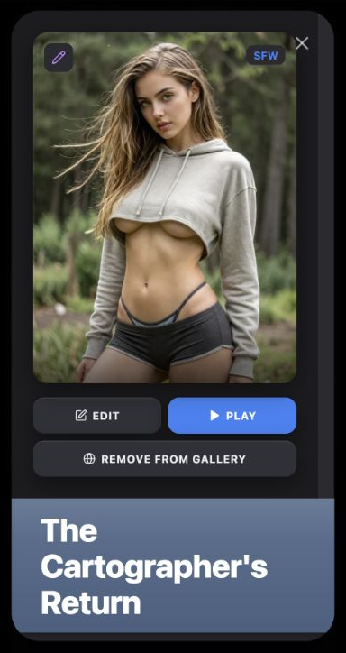</div><figcaption>Existing narrow limitation: the direction changes to a column but the cover remains 340px wide and the shell stays height-capped. In this captured viewport the cover/actions and wrapped title consume the visible space, leaving the synopsis region unavailable. This is not a responsive recipe to inherit.</figcaption></figure>

<p class="source-line">Source: <code>src/components/chronicle/StoryDetailModal.tsx</code> · lines 137–146, 247–474 and 555–675; My Stories consumer <code>src/components/chronicle/StoryHub.tsx</code> · lines 212–244 and 292–318.</p>

<details class="implementation"><summary>Supporting source</summary>

```tsx
className="relative flex h-full w-full max-w-[900px] flex-col overflow-hidden rounded-[32px] bg-[#2a2a2f] md:flex-row"
```

This exact existing class describes the visual shell, not semantic dialog behavior. The fixed cover column and height style are separate source decisions documented above.

</details>

</section>

<section class="manual-entry">

#### Background Chooser Shell and Image Choices

<figure class="source-preview"><div class="capture-background">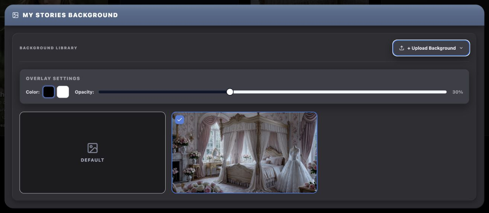</div><figcaption>Existing background chooser with local background records. Default and image choices share selection geometry; upload and deletion remain caller-owned operations.</figcaption></figure>

| Part | Complete applicable treatment |
| --- | --- |
| Dialog foundation | Actual shared DialogContent, width `min(96vw,1280px)`, max-width none, no outer padding/border/background/shadow; default built-in close button hidden. Hidden title and description are supplied. |
| Shell | 24px clipped graphite corners; shadow `0 20px 50px rgba(0,0,0,.55), inset 1px 1px 0 rgba(255,255,255,.09), inset -1px -1px 0 rgba(0,0,0,.35)`. |
| Header | Slate gradient with `0 6px 16px rgba(0,0,0,.35)` shadow and 7% white sheen in its top 30%; 20px horizontal / 16px vertical inset, 18px image icon, 10px icon gap. |
| Tray | 20px outer inset; `#2e2e33`, 16px corners, 20px inner inset; `CHRONICLE_DARK.trayShadow`. |
| Toolbar boundary | Wrapping row, 12px gap, 20px bottom margin, 16px bottom padding and white/10 bottom edge. |
| Choice grid | Two columns, three at medium; 16px gap; 16:9 thumbnails with 12px corners. |
| Selection | Selected 2px blue-500 edge; idle 1px white/12 → white/25; 24px `#4f7fdc` check bed with 8px corners and shadow-lg, inset 8px. |
| Default choice | Recessed `#1c1c1f` plus inset white/7% top-left and black/30 bottom-right shadow; 32px `#7d8498` icon and 12px bold uppercase `#aeb6cc` label. |
| Image choice | Full-cover image; selected check top-left; hover lower black/65 gradient over 64px; delete top-right with 6px padding, 8px corners, rose-500 → rose-600 and white icon. |

<section class="reuse-recipe">

##### Use in a New Design

**Construction:** BackgroundPickerModal supplies the hierarchy and internal source-menu state. Its caller supplies open/close, title, selected ID, image records, selection/upload/delete callbacks, uploading state and optional overlay/library handlers. A null selected ID means Default. The My Stories caller names the surface “My Stories Background”. The default choice's check is top-right; custom images reserve top-right for Delete and put their selected check top-left.

The shared tray shadow is the full combination `inset 1px 1px 0 rgba(255,255,255,.07), inset -1px -1px 0 rgba(0,0,0,.30), 0 4px 12px rgba(0,0,0,.25)`. Keep it with the tray fill and radius rather than treating the border as its only depth cue.

**States:** With no backgrounds, Default remains and a recessed message below reads “No backgrounds uploaded” with upload guidance. Selection is visually explicit but the custom role/button tiles do not expose a selected state through ARIA; delete buttons have no accessible name and are revealed only on hover. New selectable thumbnails need named native selection targets, programmatic selection, visible focus and separately named secondary removal. Keep click and keyboard events from activating both targets.

The chooser uses actual DialogContent, unlike the story-detail source. It therefore keeps the primitive's dialog behavior and title/description wiring, though its built-in X is hidden. The shell does not define a maximum-height scrolling strategy for a long gallery; provide one in a new composition when its content demands it.

**Keep and adapt:** Keep 24px shell → slate header → 16px tray → 12px image choice, selected edge/check and role-specific command styling. Width, thumbnail ratio, column count and the number of choices may follow the new concept. A compact appearance-only popup does not need the whole image library or its heavy shell.

</section>

<p class="source-line">Source: <code>src/components/chronicle/BackgroundPickerModal.tsx</code> · lines 20–36 and 70–237; <code>src/components/ui/dialog.tsx</code> · lines 30–50; <code>src/components/chronicle/chronicle-dark-ui.ts</code> · lines 24–25; My Stories caller <code>src/pages/Index.tsx</code> · lines 1303–1328.</p>

<details class="implementation"><summary>Supporting source</summary>

```tsx
<Dialog open={isOpen} onOpenChange={(open) => !open && onClose()}>
  <DialogContent className="w-[min(96vw,1280px)] max-w-none p-0 border-0 bg-transparent shadow-none [&>button]:hidden">
    <DialogTitle className="sr-only">{title}</DialogTitle>
    <DialogDescription className="sr-only">
      Select and manage background images for this page.
    </DialogDescription>
```

This opening fragment establishes the real dialog foundation. The caller still owns selected data and operation results.

</details>

</section>

## Composition Examples

### Composition Examples

The existing browsing page demonstrates how the pieces fit together. The two new examples contrast a substantial read-only preview with immediate anchored controls. Their locally chosen layouts and state are explicitly separate from the inherited Chronicle styling.

<section class="manual-entry">

#### Existing My Stories Composition

| Requirement | Existing composition | Caller-owned part |
| --- | --- | --- |
| Identify and choose a collection | Shared title plus slate segments. | Active filter and mapping owned/saved records. |
| Browse items | Black/image-backed responsive grid with portrait media cards. | Displayed array, publication/theme/author data and stable IDs. |
| Open a preview | Card primary action opens substantial detail surface. | Hub fetches themes/publication; modal fetches characters. |
| Create, edit or begin | Creation tile and role-specific local actions. | The corresponding callbacks and their operation results. |
| Change the backdrop | Neutral settings command opens background chooser. | Background records, selection, overlay and upload/delete behavior. |

<section class="reuse-recipe">

##### Use in a New Design

**Construction:** Index gives ScenarioHub its filtered registry and callbacks. The hub supplies the grid/card composition; the application header and background wrapper remain outside it. The minimal display/action interface is:

```tsx
<ScenarioHub
  registry={registry}
  onPlay={onPlay}
  onEdit={onEdit}
  onDelete={onDelete}
  onCreate={onCreate}
/>
```

The actual caller also provides publication/theme/author maps and pagination state. This reduced interface is a construction boundary, not a replacement for those data requirements. Opening a card triggers reads; mounting a whole hub is unnecessary when a new concept only needs one media tile or a compact control.

**Keep and adapt:** Preserve surface hierarchy and the meanings of ordinary, destructive, Add and progression actions. Use this page's actual card shadow and slate filters rather than averaging values across the other references. Source loading/error limitations remain separate from style: the hub sets a details-loading flag but does not render it, and failed theme/publication reads resolve to missing data. A new async preview needs explicit feedback if the operation requires it.

</section>

<p class="source-line">Source: <code>src/pages/Index.tsx</code> · lines 962–993 and 1303–1328; <code>src/components/chronicle/StoryHub.tsx</code> · lines 157–244 and 254–318.</p>

<details class="implementation"><summary>Supporting source</summary>

```tsx
const [themes, published] = await Promise.all([
  fetchContentThemes(id).catch(() => null),
  getPublishedScenario(id).catch(() => null)
]);
```

These reads are existing feature dependencies. They are not essential construction instructions for the derived examples.

</details>

</section>

<section class="manual-entry">

#### New Chapter Preview

**Derived teaching example.** “Let me inspect the next chapter's cover, synopsis and a few facts before beginning it.”

<figure class="source-preview"><div class="capture-background">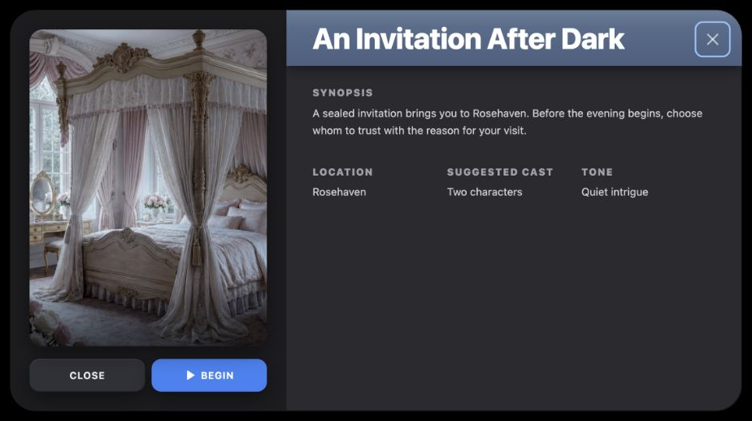</div><figcaption>Proposed Chapter Preview composition. The visual family comes from story details; semantic dialog content and a responsive scrolling arrangement are explicit additions.</figcaption></figure>

| Requirement | Borrowed pattern and inherited styling | Chosen arrangement or behavior |
| --- | --- | --- |
| Inspect a substantial subject separately | 32px graphite shell, heavy/inset shadow and black/90 blurred backdrop. | Named semantic dialog with a viewport-bounded scrolling shell. |
| Establish the chapter visually | Recessed media column, 16px cover corners, outer media shadow, lower gradient. | 3:4 sample cover; full-width column below medium, 340px at medium, cover capped at 292px. |
| Identify and explain it | Slate banner with top edge/sheen, 36px heavy title, 12px uppercase labels and 13px synopsis. | Sample title, synopsis and three facts; facts stack before the small breakpoint. |
| Dismiss or proceed | Detail-local neutral `#2f3137` action and blue-500 progression action, both 40px / 12px corners. | Close dismisses; Begin invokes an optional caller hook and dismisses. |

<section class="reuse-recipe">

##### Use in a New Design

**Construction:** ChapterPreviewExample imports the shared Dialog root, trigger, portal, overlay, title and description, then uses Radix Content directly to preserve the source's black/90 blurred backdrop while adding proper content semantics. DialogTrigger wraps the opener so dismissal can return focus to it. The shared styled DialogContent would create its own default black/80 overlay. This example therefore supplies the full shell styling on primitive Content instead of composing duplicate overlays or relying on the source's plain divs.

The shell uses `w-[min(900px,calc(100vw-32px))] max-h-[calc(100vh-32px)] overflow-y-auto rounded-[32px] bg-[#2a2a2f] md:flex`, centered with fixed positioning and half-width/height transforms, plus the detail shell shadow documented above. This is a single scrolling shell, with responsive cover width and reachable body, rather than the source's fixed narrow cover and clipped inner panes.

New native action buttons use the exact example base `flex h-10 flex-1 items-center justify-center gap-1.5 rounded-xl border-0 text-xs font-bold uppercase tracking-[0.05em] transition-colors` plus the blue-300 focus ring. Close inherits the neutral detail fill/control text and `CHRONICLE_DARK.buttonShadow`; Begin inherits blue-500/white, outer media shadow and 14px filled Play icon. The named X has 8px corners/padding, 24px icon and the same explicit focus ring. These focus/name additions are derived; the colors, depth and action scale come from the detail source.

```tsx
<ChapterPreviewExample image={image} onBegin={beginChapter} />
```

**State and limits:** `initiallyOpen` optionally opens the demonstration. Local open state, close actions and primitive dismissal keep the example separate from the page; Escape closes and returns focus to its trigger. Begin's default hook is a no-op; the consumer must provide a real progression action. The sample does not save a chapter or start a live story. It has no draft form, Apply semantics or validation because the brief is read-only.

**Keep and adapt:** Keep the inherited shell/media/banner/type/action relationships and proper dialog naming/dismissal. The title, facts, ratio, maximum width and responsive breakpoints are teaching choices. A smaller text-only preview can omit the cover column rather than inventing another theme or forcing this entire composition onto it.

</section>

<p class="source-line">Source: <code>docs/ui-guide/examples/my-stories-compositions.tsx</code> · ChapterPreviewExample. Styling owners: <code>src/components/chronicle/StoryDetailModal.tsx</code> · lines 250–350, 449–474 and 583–609. Dialog foundation: <code>src/components/ui/dialog.tsx</code> · lines 7–50.</p>

<details class="implementation"><summary>Supporting source</summary>

```tsx
import {Content as DialogContentPrimitive} from '@radix-ui/react-dialog';
```

The example's Content choice supplies behavior missing from the source detail markup while leaving control of the overlay and inherited visual shell with the composition.

</details>

</section>

<section class="manual-entry">

#### New Background Appearance Popover

**Derived teaching example.** “Keep the background preview visible while I choose a black or white overlay, adjust its strength and reset those choices.”

<figure class="source-preview"><div class="capture-background">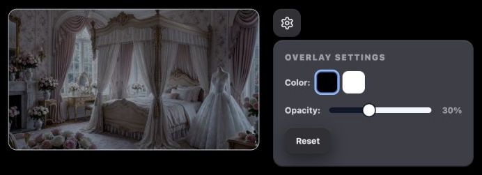</div><figcaption>Proposed immediate-control composition. The preview changes locally as color or opacity changes; closing the popup does not discard those choices.</figcaption></figure>

| Requirement | Borrowed pattern and inherited styling | Chosen arrangement or behavior |
| --- | --- | --- |
| Keep the subject visible | Existing cover-image treatment and 12px image corners. | A 16:9 preview, up to 360px wide, before its settings trigger; layout stacks below medium. |
| Hold a few nearby controls | Dark menu family: 14px corners, elevated `#3c3e47`, black/20 border, control text and shared button shadow. | A nonmodal anchored Popover with 16px inset, 288px width capped to viewport minus 32px. |
| Choose overlay color | Existing 32px black/white swatches and blue selected edge/ring. | Named native buttons with pressed state in an Overlay color group. |
| Adjust intensity | Existing token-based Slider track/range/thumb, 0–80 percent in steps of 5. | An explicitly named Thumb and immediate local image overlay. |
| Return to a known appearance | ChronicleSurfaceButton's ordinary neutral treatment. | Reset sets black and 30% together; this is the example's default, not the source background default. |

<section class="reuse-recipe">

##### Use in a New Design

**Construction:** The shared Popover supplies anchored behavior and its content portal; its default styled content is not Chronicle's dark menu surface. The example caller therefore supplies the complete dark variant below. ChronicleSurfaceButton supplies the 40px square settings trigger and neutral Reset; caller classes `w-10 px-0` or `px-4` supply their geometry.

```tsx
<PopoverContent
  aria-label="Background appearance" align="start"
  className="w-72 max-w-[calc(100vw-32px)] rounded-[14px] border border-black/20 bg-[#3c3e47] p-4 text-[#eaedf1]"
  style={{boxShadow: CHRONICLE_DARK.buttonShadow}}
>
```

Inside, use the complete swatch state classes and named Thumb fragment in Fields & Controls. The heading is 12px black weight, uppercase/widest and zinc-400 with 12px bottom margin; labels are 12px bold `#d7d8df`. Color choice spacing is 6px; opacity items have 12px gaps. Groups end with 16px separation before the next control or Reset. These small controls do not need a slate banner, image library tray or modal backdrop.

```tsx
<BackgroundAppearanceExample image={image} />
```

**State and limits:** The example owns black/white color and numeric opacity in local React state. Each control updates the preview immediately; Reset changes both, and reopening preserves values while the component remains mounted. Escape/outside dismissal closes the Popover without Apply/Cancel behavior. It has no persistence callback: mounting it does not update the page background or a stored background record. A consumer adding persistence must supply the operation and feedback while preserving the immediate interaction contract.

**Keep and adapt:** Preserve the compact elevated surface, neutral command, swatch selection and exact slider treatment. Keep the preview reachable and visible as the popup opens. Its position, width, sample image ratio and 30% default are freely chosen for this teaching brief. Names, pressed state and a named Thumb are explicit accessibility additions, not claims that the original swatches or shared Slider wrapper already supply them.

</section>

<p class="source-line">Source: <code>docs/ui-guide/examples/my-stories-compositions.tsx</code> · BackgroundAppearanceExample. Styling owners: <code>src/components/chronicle/BackgroundPickerModal.tsx</code> · lines 126–164; <code>src/components/ui/slider.tsx</code> · lines 8–20; <code>src/components/ui/dropdown-menu.tsx</code> · lines 55–68; <code>src/components/ui/popover.tsx</code> · lines 10–25; <code>src/components/chronicle/chronicle-dark-ui.ts</code> · lines 26–31.</p>

<details class="implementation"><summary>Supporting source</summary>

```tsx
const [color,setColor]=useState<'black'|'white'>('black');
const [opacity,setOpacity]=useState(30);
```

These states drive the image overlay and controls together. They are local demonstration values, not saved My Stories preferences.

</details>

</section>
