# Story Builder UI Reference

A practical menu of patterns for designing new UI that belongs in Chronicle.

## Overview

### Designing with Story Builder’s UI Language

Use this reference to turn a new concept into a coherent Chronicle interface. The examples cover contrasting jobs—authoring sections, compact choices, text entry, media, navigation and overlays—so a new design can combine established treatments without inventing its colors, shapes or depth. This is a representative design vocabulary, not a component inventory.

#### Start with the User’s Intent

Translate the request into an interaction and a container. Read that family’s recipe, then the few supporting controls it needs. The user should be able to describe the result in ordinary language.

| If the request is… | Start with… | Then combine… |
| --- | --- | --- |
| “Add a place to configure a new concept.” | Authoring section shell | Recessed fields, labels and the appropriate local actions. |
| “Let me edit this in a modal.” | Editor dialog | New authoring-note example: shell, title, tray, fields and footer. |
| “Show a few options beside this button.” | Choose the overlay | Menu for commands; popover for controls. |
| “Ask me which kind to create.” | Chooser dialog | A slate header and a small set of descriptive option tiles. |
| “Let me pick categories or a mode.” | Wrapping choices or segmented choice | The correct single/multiple selection behavior and a blue selected state. |
| “Let me add several named things.” | Repeatable key/value rows | Add actions, local remove controls and an empty state. |
| “Show images I can edit or choose.” | Media frame | Overlay actions and source choices; choose the image ratio for the content. |
| “Warn me before removing something.” | Confirmation dialog | A clear consequence, a neutral Cancel action and a destructive action. |

#### Compose a New Design

1.  **Choose the interaction.** Decide whether the content belongs inline, in an anchored popup, or in a modal. Use the smallest surface that comfortably supports the task.
2.  **Assign each layer a job.** A major shell contains a subject; its title strip identifies it; an inner tray groups work; recessed fields hold editable values; elevated surfaces carry actions.
3.  **Select controls by meaning.** A command, independent toggle, exclusive choice, ordered scale and editable field have different behavior even when they share colors.
4.  **Adapt the composition.** Choose width, columns, image ratio and content density for the new concept. Preserve the treatment of each layer and its relationship to neighboring layers.
5.  **Finish the states.** Include the empty, selected, focused, disabled, busy or invalid states that the interaction actually needs. Verify the result where it will live, including a narrow width.

A new form does not need a photographed cover because Story Card has one. A compact popup does not need a full section header because a modal has one. Choose the visual family, then compose only the pieces the new task needs.

#### What Stays Consistent, and What Can Change

| Design decision | Carry forward | Adapt to the concept |
| --- | --- | --- |
| Surface and depth | Graphite shell → slate title → inset tray → recessed field; use the corresponding shadow with each surface. | Number of layers. A compact popover may need one elevated surface; a substantial editor may need a shell and tray. |
| Shape | 24px major shells, 16px trays/media, 12px ordinary buttons, 8px fields; compact menus use 14px shells and 9px rows. | Container width, height, columns and image ratio. Do not scale every radius with container size. |
| Color meaning | Slate identifies structure; blue marks selection/add/focus; teal–violet marks AI; red marks destructive or invalid states, plus explicitly documented domain exceptions. | Content and labels. A new category or feature does not automatically need a new hue. |
| Type and density | The application font, compact heavy labels, readable field copy, small bold actions and stronger section titles. | Text length and wrapping. Compact overlays can use smaller headings than major sections. |
| Spacing | 4px label gap, 8px ordinary icon gap, 12px compact row gap and 20px major body inset are useful existing relationships. | The arrangement. Start from the closest family; change spacing when actual content or touch targets require it. |
| Interaction | Named controls, visible keyboard focus, clear selection and feedback attached to the action or field. | Feature-specific state and callbacks. Existing limitations in a specimen are not instructions to reproduce them. |

The palette and measurements in the other tabs are construction references. Use shared constants or components where they own the treatment; when a style is local to a caller, carry the full class/style combination rather than selecting only its background color.

#### Using This Reference as a Coding Agent

Resolve the requested interaction first, then combine the appropriate container and controls. Use the shared foundation rules together with the applicable pattern’s construction and state treatments. State which styling is inherited and which layout decisions follow from the new content. An exact existing component is not required for a new concept.

The specifications and short construction fragments carry the design instructions. Supporting source explains existing implementation and dependencies; it is not a requirement to reconstruct unrelated feature logic. When an imported component owns an entire treatment, use that component. When the caller owns styling, supply the complete documented class/style combination.

**Existing examples** show production styling with sample data. **Derived examples** demonstrate proposed combinations of those treatments. Their widths, field arrangements and local interaction choices are examples, not newly established Chronicle standards. Neither category proves live saving, upload or AI behavior.

Use a pattern’s explicit variant when it differs from a broad palette description: for example, a neutral action and an Add action have different fills and text. Do not average the values or introduce a new accent to distinguish a new feature. If a styling decision is genuinely unspecified or contradictory, identify that precise gap. Freely chosen width, columns, wording and content arrangement are not gaps.

During eventual implementation, check the named owner for the current interface and any source drift. This Story Builder reference uses seven sections to organize its content. Pattern relationships, exact styling and source ownership are stated in the text.

#### Check the New Composition

Compare it beside the closest specimen at the same effective width. Check the surface hierarchy, radii, shadow strength, title/label/body scale, control height, gaps, icon size and accent meaning. Then inspect long content, narrow width, keyboard focus and the relevant changed states. Correct the implementation before handing visual comparison back to the user.

#### Story Builder in Context

The following source-rendered view locates the patterns within their original page. It is a context example; use the recipes above when the new concept needs a different arrangement.

<figure class="source-preview"><div class="capture-background"><picture><source media="(max-width:600px)" srcset="../../src/assets/ui-guide/story-builder/overview-narrow.png">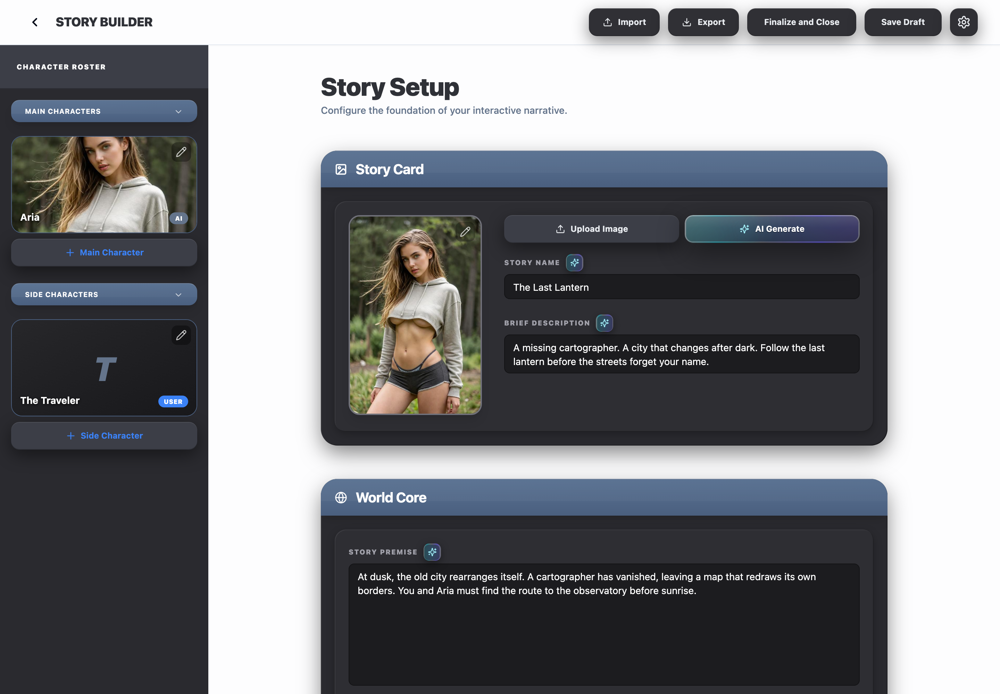</picture></div><figcaption>Captured from the current AppShellTopBar and StoryBuilderScreen with fixed local sample data. Product markup, styles, icons, and layout are imported directly from Chronicle.</figcaption></figure>

#### Page Anatomy

##### Shared application header

The white header spans the workspace above both columns. Its leading area holds Back and the uppercase Story Builder title. Its trailing area holds Import, Export, Finalize and Close, Save Draft, and the administrator-only settings menu.

<p class="source-line"><strong>Source owners:</strong> <code>AppShellHeader.tsx</code> and <code>AppShellTopBar.tsx</code></p>

##### Character Roster

The roster is page-local navigation for story-owned characters. It separates Main and Side Characters, exposes character creation and editing, and owns the roster’s collapsed, expanded, error, and narrow-width presentation.

<p class="source-line"><strong>Source owners:</strong> <code>StoryRosterSidebar.tsx</code>, <code>StoryRosterGroup.tsx</code>, and <code>StoryRosterCharacterTile.tsx</code></p>

##### Authoring canvas

The canvas introduces the page with Story Setup and a short description, then constrains editable content to a centered maximum width. Each authoring subject is a separate dark section so the user can scan the long workspace without losing the current subject.

<p class="source-line"><strong>Source owner:</strong> <code>StoryBuilderScreen.tsx</code></p>

##### Repeated authoring sections

The Story Card establishes the most common composition: a dark outer shell, slate-blue title strip, inset tray, labels, recessed fields, and elevated actions. Later sections reuse that vocabulary while introducing only the controls their subject requires.

#### Visual Hierarchy

The white application chrome carries navigation and persistence. The dark Story Builder surfaces organize authoring work. Slate-blue gradients mark section names and selected navigation. Within a section, distinct layered fills distinguish the shell, tray, and editable field. Depth comes from explicit shadow stacks and inset highlight lines, not from adding unrelated borders or arbitrary background colors.

#### Responsive Structure

Below the large breakpoint, the roster and authoring canvas stack vertically. The roster becomes full width and is capped at 52 percent of the viewport height. At the large breakpoint, the screen becomes a split pane and the roster uses `clamp(250px, 28vw, 300px)`. The authoring canvas uses 16px padding below the breakpoint and 40px at the breakpoint and above.

The Story Card stacks its cover and fields below 768px. At 768px and wider, the cover becomes 192px wide and sits beside the form with a 32px gap.

<p class="verification-note">The source-rendered assets include desktop and narrow captures. They show sample presentation; they do not establish human acceptance of an authenticated story workflow.</p>

## Color Palette

### Color Palette

Color names in this reference describe their visible job in Story Builder. The shared `CHRONICLE_DARK` constants are listed where they exist; inline Tailwind values are identified as component-local instead of being presented as global tokens.

#### Use the Value for the Chosen Pattern

| Apparent overlap | Applicable value | Decision |
| --- | --- | --- |
| Ordinary action versus elevated control | Shared neutral action #303035 → #343439; elevated Upload/Add/menu family #3c3e47 → #44464f where that hover is specified. | CHRONICLE\_DARK.elevated is not the default fill of ChronicleSurfaceButton. Use the action-role table in Buttons & Menus. |
| Dim token versus field placeholder | CHRONICLE\_DARK.dim is #525260. Standard field placeholder:text-zinc-600 is #52525b. | Use #52525b for the documented recessed field placeholder; the shared dim token does not replace caller-owned styling. |
| Invalid field versus deletion action | Field error red-500 is #ef4444. Confirmation Delete is #d94b45 → #e2554e. Quiet row removal uses zinc-500 → rose-400. | Different roles have deliberate treatments. Do not paint the whole form red because one value is invalid. |
| Selected choices versus category meaning | Ordinary selected controls use blue-500. Red NSFW chips are an existing domain exception. | A newly named category does not need a distinct hue. |

#### Application Chrome and Canvas

| Visible role | Sample and value | Used for | Current owner |
| --- | --- | --- | --- |
| Outer application canvas | `#ffffff` | Page background around Chronicle workspaces. | `--background: 0 0% 100%` |
| Authoring canvas wash | `hsl(210 33% 98% / 0.30)` | Scrollable Story Builder canvas behind authoring sections. | `--ghost-white` |
| Header title ink | `hsl(228 7% 20%)` | Uppercase Story Builder title and dark application headings. | `--ui-surface-2` |
| Header divider | `#e2e8f0` | Bottom edge of the shared white header. | Tailwind `slate-200` |

The header and authoring canvas colors include alpha. Their final visible color depends on the layer behind them, so they must not be rewritten as an opaque approximation.

#### Dark Surface Layers

| Visible role | Sample and value | Used for | Source token |
| --- | --- | --- | --- |
| Application dark background | `#0d0e12` | Deepest Chronicle dark background. | `CHRONICLE_DARK.background` |
| Application sidebar | `#1b1b20` | Persistent application rail. | `CHRONICLE_DARK.sidebar` |
| Major section shell | `#2a2a2f` | Story Card, World Core, Goals, Opening Dialog, and roster pane. | `CHRONICLE_DARK.shell` |
| Inset section tray | `#2e2e33` | Inner content region inside authoring section shells. | `CHRONICLE_DARK.tray` |
| Elevated control surface | `#3c3e47` | Upload, Add, roster title bar, selector trays, and menus. | `CHRONICLE_DARK.elevated` |
| Elevated hover surface | `#44464f` | Hover and active treatment for elevated actions. | `CHRONICLE_DARK.elevatedHover` |
| Recessed editable surface | `#1c1c1f` | Text fields, empty cover, chip trays, and inset content. | `CHRONICLE_DARK.recessed` |

#### Slate Navigation and Section Accent

| Visible role | Sample and value | Construction | Used for |
| --- | --- | --- | --- |
| Slate highlight | `#5a7292` | Gradient start. | Section headers and roster group headers. |
| Slate depth | `#4a5f7f` | Gradient end. | Section headers, selected navigation, and tile borders. |
| Slate header gradient | `linear-gradient(180deg, #5a7292, #4a5f7f)` | 1px white/20 top edge plus a translucent diagonal highlight. | Authoring section titles and roster group controls. |

#### Text and Interaction Colors

| Visible role | Sample and value | Used for | Current source |
| --- | --- | --- | --- |
| Primary dark-surface text | `#e4e1e8` | General content on dark Chronicle surfaces. | `CHRONICLE_DARK.text` |
| Control text | `#eaedf1` | Buttons, menus, and action labels. | `CHRONICLE_DARK.controlText` |
| Muted labels | `#a1a1aa` | Field labels, helper copy, inactive navigation. | `CHRONICLE_DARK.muted` / zinc-400 |
| Shared dim copy | `#525260` | Low-priority copy where the shared dim token is used; recessed field placeholders use the local value below. | `CHRONICLE_DARK.dim` |
| Primary blue action | `#3b82f6` | Add actions, selected controls, focus borders, and active chips. | Tailwind `blue-500` |
| Validation and destructive | `#ef4444` | Required-field borders, error copy, and destructive emphasis. | Tailwind `red-500` |
| Destructive hover | `#fb7185` | Remove action hover where the default is muted. | Tailwind `rose-400` |

#### AI Accent

| Layer | Value | Purpose |
| --- | --- | --- |
| Iridescent edge | `white/34 → rgb(34 184 200)/62 → white/22 → rgb(109 94 247)/64 → white/28` | Signals that the action invokes model assistance rather than ordinary editing. |
| Interior | `linear-gradient(90deg, rgb(34 184 200 / .22), rgb(109 94 247 / .22)), #2B2D33` | Keeps the button inside Chronicle’s dark surface family. |
| AI icon | `#a5f3fc` | Cyan icon treatment with a teal glow. |
| Focus | `violet-400 / 45%` | Two-pixel focus-visible ring on the large AI action. |

<details class="implementation">
<summary>Supporting source</summary>

Supporting Production Source

Exact existing implementation is preserved as supporting evidence. Use the construction guidance above for the new design. Imported components retain their interfaces; source-specific data, service calls and feature state are not automatically part of a new composition.

##### chronicle-dark-ui.ts

<p class="source-line">src/components/chronicle/chronicle-dark-ui.ts · lines 6–28</p>

```tsx
export const CHRONICLE_DARK = {
  background: "#0d0e12",
  sidebar: "#1b1b20",
  shell: "#2a2a2f",
  tray: "#2e2e33",
  elevated: "#3c3e47",
  elevatedHover: "#44464f",
  recessed: "#1c1c1f",
  text: "#e4e1e8",
  controlText: "#eaedf1",
  muted: "#a1a1aa",
  dim: "#525260",
  slateTop: "#5a7292",
  slateBottom: "#4a5f7f",
  divider: "rgba(255,255,255,0.06)",
  controlBorder: "rgba(255,255,255,0.10)",
  shellShadow:
    "0 12px 32px -2px rgba(0,0,0,0.50), inset 1px 1px 0 rgba(255,255,255,0.09), inset -1px -1px 0 rgba(0,0,0,0.35)",
  trayShadow:
    "inset 1px 1px 0 rgba(255,255,255,0.07), inset -1px -1px 0 rgba(0,0,0,0.30), 0 4px 12px rgba(0,0,0,0.25)",
  buttonShadow:
    "0 8px 24px rgba(0,0,0,0.45), inset 0 1px 0 rgba(255,255,255,0.09), inset 0 -1px 0 rgba(0,0,0,0.20)",
} as const;
```

</details>

## Typography & Spacing

### Typography & Spacing

Story Builder uses the application’s configured sans-serif stack. Hierarchy comes primarily from weight, size, case, and spacing. Do not introduce a separate display typeface for Story Builder components.

#### Typography Hierarchy

| Text role | Production rule | Visible use |
| --- | --- | --- |
| Shared page title | `18px / 900 / uppercase / tracking-tight` | STORY BUILDER in the white application header. |
| Workspace title | `24px below lg; 36px at lg / 900 / tracking-tight` | Story Setup. |
| Workspace description | `14px / 500 / slate-500` | “Configure the foundation of your interactive narrative.” |
| Section title | `20px / 700 / -0.015em / white` | Story Card, World Core, Opening Dialog, and other slate headers. |
| Field label | `10px / 900 / uppercase / tracking-widest / zinc-400` | Story Name, Brief Description, and most editable labels. |
| Compact key field | `12px / 700 / uppercase / tracking-widest / zinc-400` | Location names and structured world keys. |
| Standard field text | `14px / 400 / white` | Text input and auto-resizing textarea values. |
| Surface action | `12px / 700 / #eaedf1` | Header buttons and Upload Image. |
| Selector label | `10px / 900` | Guidance Strength and selector headings. |
| Error copy | `14px / 500 / red-500` | Field-local validation message. |

#### Spacing Rhythm

| Relationship | Current value | Rule |
| --- | --- | --- |
| Canvas edge | `16px` below lg; `40px` at lg | Creates a compact stacked layout on narrower screens and a broad workbench on desktop. |
| Authoring section separation | `48px` | Story Builder’s canvas uses `space-y-12`. |
| Section header | `20px × 12px` | Horizontal then vertical padding for repeated slate headers. |
| Shell to tray | `20px` | Outer section body padding. |
| Inner tray | `20px` top/sides; `24px` bottom | Allows controls to sit within the bevel without crowding the bottom edge. |
| Story Card columns | `32px` | Cover-to-fields gap at 768px and wider. |
| Field label to input | `4px` | Implemented by `mb-1`. |
| Button icon to label | `8px` | Header and media actions use `gap-2`. |
| Paired field columns | `12px` | Structured location rows use `gap-3`. |

#### Radii and Borders

| Element | Radius | Border rule |
| --- | --- | --- |
| Major section shell | `24px` | No flat outline; depth comes from the shell shadow stack. |
| Inner tray | `16px` | No flat outline; inset highlight and ambient shadow. |
| Surface button | `12px` | No border; inset shadow provides the edge. |
| Dropdown shell | `14px` | `1px black / 20%`. |
| Dropdown row | `9px` | No normal border. |
| Text field | `8px` | `1px black / 35%`; blue focus or red validation replaces emphasis. |
| Cover frame | `16px` | No-cover has no outline; populated cover uses `2px zinc-500`; error uses `2px red-500`. |
| Roster character tile | `16px` | `1px #4a5f7f`; error changes to red-500. |

#### Shadow and Layer Stacks

| Layered element | Exact shadow | Meaning |
| --- | --- | --- |
| Major section shell | `0 12px 32px -2px rgb(0 0 0 / .50), inset 1px 1px 0 rgb(255 255 255 / .09), inset -1px -1px 0 rgb(0 0 0 / .35)` | Raised structural container. |
| Inner tray | `inset 1px 1px 0 rgb(255 255 255 / .07), inset -1px -1px 0 rgb(0 0 0 / .30), 0 4px 12px rgb(0 0 0 / .25)` | Inset working surface with restrained ambient lift. |
| Surface button | `0 8px 24px rgb(0 0 0 / .45), inset 0 1px 0 rgb(255 255 255 / .09), inset 0 -1px 0 rgb(0 0 0 / .20)` | Action surface distinct from recessed input fields. |

#### Icon Treatment

Story Builder uses Lucide icons. Header action icons are 14px. Settings is 20px. Section-heading icons are 18px with a 2–2.5px stroke depending on the current component. Compact AI Enhance uses a 13px Sparkles icon. Icons inherit the action’s foreground unless the component defines a semantic accent.

<details class="implementation">
<summary>Supporting source</summary>

Implementation Details

The shared surface class and constants are the same source used in the palette and action recipes.

##### chronicle-dark-ui.ts

<p class="source-line">src/components/chronicle/chronicle-dark-ui.ts · lines 1–31</p>

```tsx
/**
 * Chronicle's established dark-surface language, extracted from the live App
 * Shell, Chat Interface, Story Builder, and Finance surfaces so prototypes do
 * not recreate those values independently.
 */
export const CHRONICLE_DARK = {
  background: "#0d0e12",
  sidebar: "#1b1b20",
  shell: "#2a2a2f",
  tray: "#2e2e33",
  elevated: "#3c3e47",
  elevatedHover: "#44464f",
  recessed: "#1c1c1f",
  text: "#e4e1e8",
  controlText: "#eaedf1",
  muted: "#a1a1aa",
  dim: "#525260",
  slateTop: "#5a7292",
  slateBottom: "#4a5f7f",
  divider: "rgba(255,255,255,0.06)",
  controlBorder: "rgba(255,255,255,0.10)",
  shellShadow:
    "0 12px 32px -2px rgba(0,0,0,0.50), inset 1px 1px 0 rgba(255,255,255,0.09), inset -1px -1px 0 rgba(0,0,0,0.35)",
  trayShadow:
    "inset 1px 1px 0 rgba(255,255,255,0.07), inset -1px -1px 0 rgba(0,0,0,0.30), 0 4px 12px rgba(0,0,0,0.25)",
  buttonShadow:
    "0 8px 24px rgba(0,0,0,0.45), inset 0 1px 0 rgba(255,255,255,0.09), inset 0 -1px 0 rgba(0,0,0,0.20)",
} as const;

export const CHRONICLE_SURFACE_BUTTON_CLASS =
  "inline-flex h-10 items-center justify-center rounded-xl border-0 bg-[#303035] text-xs font-bold leading-none text-[#eaedf1] shadow-[0_8px_24px_rgba(0,0,0,0.45),inset_0_1px_0_rgba(255,255,255,0.09),inset_0_-1px_0_rgba(0,0,0,0.20)] transition-all hover:bg-[#343439] active:scale-95 active:bg-[#343439] focus-visible:outline-none focus-visible:ring-2 focus-visible:ring-[hsl(var(--accent-teal))]/40 disabled:pointer-events-none disabled:opacity-50";
```

</details>

#### Focus Belongs to the Control Family

Preserve the imported component’s focus behavior. Ordinary ChronicleSurfaceButton uses a 2px `hsl(var(--accent-teal)) / 40%` ring (accent-teal is 186 71% 46%). Recessed fields use the blue-500 border and blue-500/20 ring. Large AI actions use violet-400/45. The confirmation footer uses #6e89ad/70. Checkbox retains its theme ring and 2px ring offset from the shared primitive.

**Derived fallback for new local controls:** when the selected source pattern has no explicit focus treatment, apply `focus-visible:outline-none focus-visible:ring-2 focus-visible:ring-blue-300`, as used by the new examples’ close controls. This supplies a visible keyboard state without changing their normal fill. Use native disabled behavior with 50% opacity when needed. These are explicit recommendations for new compositions, not a claim that every existing local control already implements them.

## Buttons & Menus

### Buttons & Menus

Choose an action pattern by consequence and placement. Ordinary application actions use the shared dark surface button. AI actions use the teal-violet treatment. Add actions use blue text on an elevated dark surface. Overlay actions remain visually quiet until the image or tile becomes the current target.

<section class="manual-entry">

#### Header Action Buttons

Import, Export, Finalize and Close, and Save Draft use the same shared construction. Their labels and disabled conditions differ because each action has a different consequence.

<figure class="source-preview"><div class="capture-background">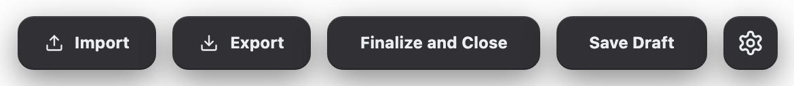</div><figcaption>Actual header actions on their white application background.</figcaption></figure>

**Where used:** The trailing side of the shared Story Builder header.

**Use this pattern when:** The action belongs to application navigation, transfer, or persistence. Do not use the AI accent or blue Add treatment for these actions.

| Specification | Current rule |
| --- | --- |
| Height and radius | `40px` high; `12px` radius. |
| Horizontal padding | `20px` for Import/Export; `24px` for Finalize and Save Draft. |
| Icon and gap | `14px` icon; `8px` icon-to-label gap. |
| Typography | `12px / 700 / leading-none / #eaedf1`. |
| Surface | `#303035`; hover and active `#343439`. |
| Shadow | `CHRONICLE_DARK.buttonShadow`. |
| Focus | Two-pixel `accent-teal / 40%` ring. |
| Active | `scale(.95)`. |
| Disabled | Pointer events removed and opacity reduced to 50%. |

##### Action-specific behavior

| Label | Purpose | Disabled or busy rule |
| --- | --- | --- |
| Import | Opens the story-file import workflow. | Disabled when the story cannot interact or Finalize and Close is saving. |
| Export | Opens the story export-format workflow. | Disabled when the story cannot interact or Finalize and Close is saving. |
| Finalize and Close | Runs readiness checks, saves a non-draft, and returns to My Stories. | Label becomes “Saving…” while its operation is active. |
| Save Draft | Saves the current story as a draft without leaving. | Label becomes “Saving…” while saving; disabled during either save path. |

<section class="reuse-recipe">

##### Use in a New Design

Use for a page-level operation such as importing, saving, or closing. For a local form action, carry the same surface-button language into the form footer.

**Construction:** Import ChronicleSurfaceButton from src/components/chronicle/ChronicleDarkUi.tsx. The shared component supplies the surface, height, radius, shadow and interaction classes; the caller supplies spacing, icon, label, handler and busy/disabled state.

**Keep and adapt:** Keep the 40px height, 12px radius, compact bold text and subdued surface. Adapt label, width and icon to the operation. A new ordinary action does not need a new accent color.

##### Choose the Action Treatment

| Action role | Fixed treatment | Ownership and states |
| --- | --- | --- |
| Ordinary Apply, Cancel, Reset or local operation | ChronicleSurfaceButton: #303035; hover/pressed #343439; #eaedf1 text; 40px height, 12px radius, 12px bold text and CHRONICLE\_DARK.buttonShadow. | Imports from src/components/chronicle/ChronicleDarkUi.tsx. Supplies native button props, forwarded ref and default type="button". Add padding/width, icon, label and handler; explicitly set type="submit" for submission. Focus uses a 2px accent-teal/40 ring; pressed scales to 95%; disabled is non-interactive at 50% opacity. |
| Elevated media/source action | #3c3e47; hover/pressed #44464f; #eaedf1 text; the same 40px/12px geometry and button shadow. | CoverImageActionButtons owns this Upload treatment. It is not the default fill of ChronicleSurfaceButton. The caller disables the action while busy and supplies the changing label. |
| Add an item to a collection | #3c3e47, blue-500 text; hover blue-300 plus brightness-110; 40px height, 12px radius and button shadow. | The Add pattern below includes its exact local class. Use this emphasis for extending a collection, not every primary operation. |
| AI generation or assistance | The layered teal–violet treatment and dark interior; large action uses a violet-400/45 focus ring. | Use the large or compact AI construction according to placement. A blue selection or ordinary save action is not an AI operation. |
| Consequential deletion | DeleteConfirmDialog: #d94b45, hover #e2554e, white text, 40px height, 12px radius and button shadow. | Its Cancel is elevated #3c3e47 → #44464f. Both footer actions use a 2px #6e89ad/70 focus ring. This is an explicit confirmation-family variant, not the field-validation red. |

For a new ordinary footer or reset command, use the neutral shared button above. Keep the elevated Cancel treatment when using the existing destructive confirmation. This distinction follows the chosen family; it does not justify choosing a fresh color.

Busy is caller-owned: expose the busy state, use accurate action text, and disable duplicate submission where necessary. Disabled styling does not itself perform validation or prevent a handler elsewhere from running.

</section>

<details class="implementation">
<summary>Supporting source</summary>

Supporting Production Source

Exact existing implementation is preserved as supporting evidence. Use the construction guidance above for the new design. Imported components retain their interfaces; source-specific data, service calls and feature state are not automatically part of a new composition.

##### AppShellTopBar.tsx

<p class="source-line">src/components/app-shell/AppShellTopBar.tsx · lines 458–520</p>

```tsx
if (tab === "world" && storyBuilder) {
    rightContent = (
      <>
        <SurfaceButton
          onClick={storyBuilder.onOpenImport}
          disabled={!storyBuilder.canInteract || storyBuilder.isSavingAndClosing}
          className="px-5 gap-2"
        >
          <Upload size={14} />
          Import
        </SurfaceButton>
        <SurfaceButton
          onClick={storyBuilder.onOpenExport}
          disabled={!storyBuilder.canInteract || storyBuilder.isSavingAndClosing}
          className="px-5 gap-2"
        >
          <Download size={14} />
          Export
        </SurfaceButton>
        <SurfaceButton
          onClick={storyBuilder.onFinalizeAndClose}
          disabled={storyBuilder.isSavingAndClosing}
          className="px-6"
        >
          {storyBuilder.isSavingAndClosing ? "Saving..." : "Finalize and Close"}
        </SurfaceButton>
        <SurfaceButton
          onClick={storyBuilder.onSaveDraft}
          disabled={storyBuilder.isSaving || storyBuilder.isSavingAndClosing}
          className="px-6"
        >
          {storyBuilder.isSaving ? "Saving..." : "Save Draft"}
        </SurfaceButton>
        {storyBuilder.isAdminState && (
          <DropdownMenu>
            <DropdownMenuTrigger asChild>
              <SurfaceButton className="w-10 px-0" aria-label="Story Builder settings" title="Story Builder settings">
                <Settings className="w-5 h-5" />
              </SurfaceButton>
            </DropdownMenuTrigger>
            <DropdownMenuContent align="end" className="w-72 p-2">
              <div className="flex items-center justify-between gap-3 rounded-[9px] px-2 py-1">
                <div className="min-w-0">
                  <div className="text-[13px] font-semibold text-[#eaedf1]">Track API Usage</div>
                  <div className="text-[11px] text-[#a1a1aa] mt-0.5 truncate">{storyBuilder.apiUsageTrackingStatusText}</div>
                </div>
                <LabeledToggle
                  checked={storyBuilder.isApiUsageTrackingCurrentStory}
                  disabled={storyBuilder.isApiUsageToggleBusy}
                  onCheckedChange={storyBuilder.onToggleApiUsageTracking}
                  offLabel="Off"
                  onLabel="On"
                />
              </div>
            </DropdownMenuContent>
          </DropdownMenu>
        )}
        {storyBuilder.storyTransferNotice && (
          <StoryTransferNotice notice={storyBuilder.storyTransferNotice} />
        )}
      </>
    );
  }
```

##### chronicle-dark-ui.ts

<p class="source-line">src/components/chronicle/chronicle-dark-ui.ts · lines 30–31</p>

```tsx
export const CHRONICLE_SURFACE_BUTTON_CLASS =
  "inline-flex h-10 items-center justify-center rounded-xl border-0 bg-[#303035] text-xs font-bold leading-none text-[#eaedf1] shadow-[0_8px_24px_rgba(0,0,0,0.45),inset_0_1px_0_rgba(255,255,255,0.09),inset_0_-1px_0_rgba(0,0,0,0.20)] transition-all hover:bg-[#343439] active:scale-95 active:bg-[#343439] focus-visible:outline-none focus-visible:ring-2 focus-visible:ring-[hsl(var(--accent-teal))]/40 disabled:pointer-events-none disabled:opacity-50";
```

##### ChronicleDarkUi.tsx

<p class="source-line">src/components/chronicle/ChronicleDarkUi.tsx · lines 6–18</p>

```tsx
export const ChronicleSurfaceButton = React.forwardRef<
  HTMLButtonElement,
  React.ButtonHTMLAttributes<HTMLButtonElement>
>(({ children, className, type = "button", ...props }, ref) => (
  <button
    ref={ref}
    type={type}
    className={cn(CHRONICLE_SURFACE_BUTTON_CLASS, className)}
    {...props}
  >
    {children}
  </button>
));
```

</details>

</section>

<section class="manual-entry">

#### Back Control

The Back control occupies the leading header slot before the Story Builder title. It returns to the owning collection or prior application context.

<figure class="source-preview"><div class="capture-background">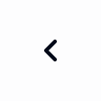</div><figcaption>Actual Back control: the original inline SVG chevron, captured at its native size.</figcaption></figure>

| Specification | Current rule |
| --- | --- |
| Semantic element | Native `button` with `aria-label="Back"`. |
| Geometry | `8px` padding; fully rounded; no normal fill or border. |
| Icon | `20px` chevron; `2.5px` stroke. |
| Hover | `slate-100` background. |
| Placement | Always before the uppercase page title in the leading header group. |

<section class="reuse-recipe">

##### Use in a New Design

Use a quiet leading navigation control when returning to a parent workspace.

**Construction:** BackButton is local to AppShellTopBar, not an exported general component. For a new page, use the existing header integration; for a local close action, use the dialog or popup close pattern instead.

**Keep and adapt:** Keep the compact hit area, simple chevron and accessible name. The destination belongs to the new workflow.

</section>

<details class="implementation">
<summary>Supporting source</summary>

Supporting Production Source

Exact existing implementation is preserved as supporting evidence. Use the construction guidance above for the new design. Imported components retain their interfaces; source-specific data, service calls and feature state are not automatically part of a new composition.

##### AppShellTopBar.tsx

<p class="source-line">src/components/app-shell/AppShellTopBar.tsx · lines 151–157</p>

```tsx
function BackChevronIcon() {
  return (
    <svg xmlns="http://www.w3.org/2000/svg" width="20" height="20" viewBox="0 0 24 24" fill="none" stroke="currentColor" strokeWidth="2.5" strokeLinecap="round" strokeLinejoin="round">
      <path d="m15 18-6-6 6-6" />
    </svg>
  );
}
```

##### AppShellTopBar.tsx

<p class="source-line">src/components/app-shell/AppShellTopBar.tsx · lines 159–165</p>

```tsx
function BackButton({ onClick }: { onClick: () => void }) {
  return (
    <button type="button" onClick={onClick} aria-label="Back" className="p-2 hover:bg-slate-100 rounded-full transition-colors">
      <BackChevronIcon />
    </button>
  );
}
```

</details>

</section>

<section class="manual-entry">

#### Settings Icon Button

The icon-only settings action is the compact variant of the shared surface button. In Story Builder it appears only for administrator state and opens the API-usage settings menu.

<figure class="source-preview"><div class="capture-background">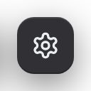</div><figcaption>Actual administrator-only Settings button with the original 20px Lucide icon.</figcaption></figure>

<figure class="source-preview" data-added-state="true"><div class="capture-background">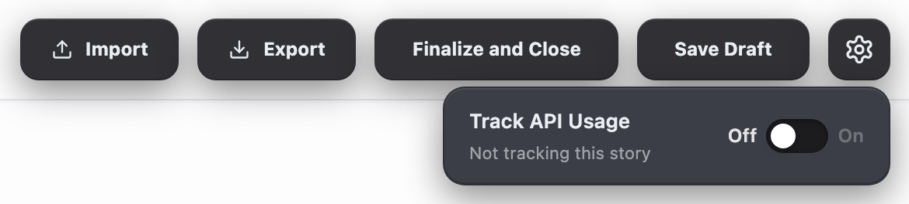</div><figcaption>Actual administrator settings menu, including the API tracking control.</figcaption></figure>

| Specification | Current rule |
| --- | --- |
| Geometry | `40 × 40px`; `12px` radius. |
| Icon | `20px` Settings icon. |
| Accessible name | `aria-label` and `title` both read “Story Builder settings.” |
| Surface and states | Uses the shared surface-button colors, shadow, focus, active, and disabled rules. |

<section class="reuse-recipe">

##### Use in a New Design

Use an icon-only trigger for compact, secondary settings when its purpose is unambiguous.

**Construction:** ChronicleSurfaceButton supplies the visual base. Add w-10, a centered icon, and an accessible name. The administrator-only condition belongs to this Story Builder usage, not to every new settings button.

**Keep and adapt:** Keep the square geometry and ordinary action treatment. Adapt the icon and visibility condition to the feature; show settings content using a menu, popover or dialog according to its complexity.

</section>

<details class="implementation">
<summary>Supporting source</summary>

Supporting Production Source

Exact existing implementation is preserved as supporting evidence. Use the construction guidance above for the new design. Imported components retain their interfaces; source-specific data, service calls and feature state are not automatically part of a new composition.

Source: `src/components/app-shell/AppShellTopBar.tsx` · lines 458–520.

Source: `src/components/chronicle/chronicle-dark-ui.ts` · lines 30–31.

Source: `src/components/chronicle/ChronicleDarkUi.tsx` · lines 6–18.

Source: `src/components/ui/dropdown-menu.tsx` · lines 1–180.

##### labeled-toggle.tsx

<p class="source-line">src/components/ui/labeled-toggle.tsx · complete file</p>

```tsx
import * as React from "react";
import { Lock } from "lucide-react";
import { cn } from "@/lib/utils";

interface LabeledToggleProps {
  checked: boolean;
  onCheckedChange: (checked: boolean) => void;
  disabled?: boolean;
  locked?: boolean;
  className?: string;
  offLabel?: string;  // Custom label for off state (default: "Off")
  onLabel?: string;   // Custom label for on state (default: "On")
  labelTone?: "default" | "dark";
}

const LabeledToggle = React.forwardRef<HTMLButtonElement, LabeledToggleProps>(
  ({ checked, onCheckedChange, disabled = false, locked = false, className, offLabel = "Off", onLabel = "On", labelTone = "default" }, ref) => {
    const isDisabled = disabled || locked;
    const offInactiveClass = "text-zinc-500";
    const onInactiveClass = "text-zinc-500";
    const offActiveClass = labelTone === "dark" ? "text-zinc-900" : "text-zinc-200";
    const onActiveClass = labelTone === "dark" ? "text-[#4a5f7f]" : "text-blue-500";

    return (
      <button
        ref={ref}
        type="button"
        role="switch"
        aria-checked={checked}
        disabled={isDisabled}
        onClick={() => !isDisabled && onCheckedChange(!checked)}
        className={cn(
          "inline-flex items-center gap-1.5 select-none flex-shrink-0",
          isDisabled && "cursor-not-allowed opacity-70",
          className
        )}
      >
        {/* Off label */}
        <span className={cn(
          "text-xs font-semibold transition-colors",
          checked ? offInactiveClass : offActiveClass
        )}>
          {offLabel}
        </span>

        {/* Toggle track */}
        <div className={cn(
          "relative h-[22px] w-10 rounded-full transition-colors",
          locked ? "bg-zinc-500" : (checked ? "bg-blue-500 shadow-[inset_0_1px_3px_rgba(0,0,0,0.3)]" : "bg-[#1c1c1f] shadow-[inset_0_1px_3px_rgba(0,0,0,0.4)]")
        )}>
          {/* Toggle thumb */}
          <div className={cn(
            "absolute top-[3px] h-4 w-4 rounded-full bg-white shadow-md transition-transform",
            checked ? "translate-x-[21px]" : "translate-x-[3px]"
          )} />
        </div>

        {/* On label */}
        <span className={cn(
          "text-xs font-semibold transition-colors",
          checked ? onActiveClass : onInactiveClass
        )}>
          {onLabel}
        </span>

        {/* Lock icon for locked toggles */}
        {locked && (
          <Lock className="w-3 h-3 text-zinc-500" />
        )}
      </button>
    );
  }
);
LabeledToggle.displayName = "LabeledToggle";

export { LabeledToggle };

```

</details>

</section>

<section class="manual-entry">

#### Upload Image and Source Menu

Upload Image is an elevated media action and a menu trigger. It reveals the two current source choices: From Device and From Library.

<figure class="source-preview"><div class="capture-background">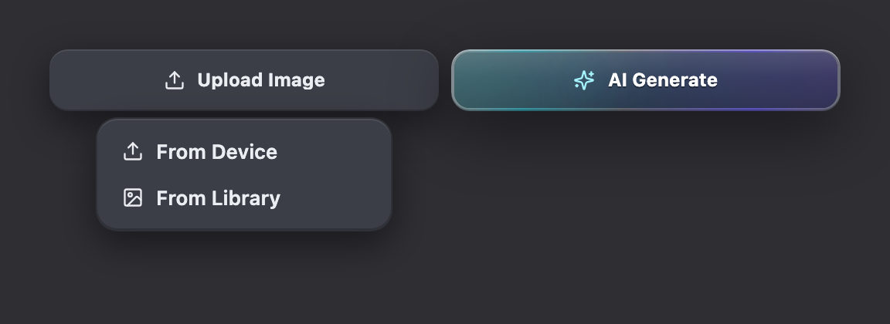</div><figcaption>Actual CoverImageActionButtons with the source menu open. The pair is rendered on the Story Card tray color; no fields sit behind this isolated capture.</figcaption></figure>

**Use this pattern when:** One action has a small, explicit set of source choices. Do not add a light outer menu layer; Chronicle’s dropdown system is dark-only.

| Part | Current rule |
| --- | --- |
| Trigger | `40px` high, full available width, `16px` horizontal padding, `12px` radius, `#3c3e47` surface. |
| Trigger text | `12px / 700 / #eaedf1`; Upload icon `14px`. |
| Trigger hover | `#44464f`; focus uses two-pixel accent-teal/40 ring. |
| Busy | Label becomes “Uploading…” and opacity becomes 50%. |
| Menu shell | Minimum width `160px`; shown use `192px`; `6px` padding; `14px` radius; black/20 border; `#3c3e47`. |
| Menu row | `10px × 8px` padding; `9px` radius; `13px / 600 / #eaedf1`. |
| Menu focus | `white / 8%` row surface and white foreground. |

<section class="reuse-recipe">

##### Use in a New Design

Use a menu when the user chooses one command or source, such as device versus library. Use a popover when the content includes editable controls.

**Construction:** CoverImageActionButtons bundles two media-specific actions and an image-library picker. Reuse it for that workflow. For a new command menu, compose DropdownMenu, DropdownMenuTrigger asChild, DropdownMenuContent and DropdownMenuItem from src/components/ui/dropdown-menu.tsx with the appropriate trigger.

**Keep and adapt:** Keep the dark 14px menu shell, 9px rows, 4px default trigger offset, restrained row highlight and shared icons. Adapt item labels, groups and width to content; retain keyboard navigation and trigger focus return.

</section>

<details class="implementation">
<summary>Supporting source</summary>

Supporting Production Source

Exact existing implementation is preserved as supporting evidence. Use the construction guidance above for the new design. Imported components retain their interfaces; source-specific data, service calls and feature state are not automatically part of a new composition.

##### CoverImageActionButtons.tsx

<p class="source-line">src/components/chronicle/CoverImageActionButtons.tsx · complete file</p>

```tsx
import React, { useState } from "react";
import { Sparkles, Upload, Image as ImageIcon } from "lucide-react";
import {
  DropdownMenu,
  DropdownMenuContent,
  DropdownMenuItem,
  DropdownMenuTrigger,
} from "@/components/ui/dropdown-menu";
import { ImageLibraryPickerModal } from "./ImageLibraryPickerModal";

interface CoverImageActionButtonsProps {
  onUploadFromDevice: () => void;
  onSelectFromLibrary: (imageUrl: string) => void;
  onGenerateClick: () => void;
  disabled?: boolean;
  isGenerating?: boolean;
  isUploading?: boolean;
}

export function CoverImageActionButtons({
  onUploadFromDevice,
  onSelectFromLibrary,
  onGenerateClick,
  disabled = false,
  isGenerating = false,
  isUploading = false,
}: CoverImageActionButtonsProps) {
  const [isPickerOpen, setIsPickerOpen] = useState(false);

  const isDisabled = disabled || isUploading;

  return (
    <>
      <div className="flex gap-2 w-full">
        <DropdownMenu>
          <DropdownMenuTrigger asChild>
            <button
              type="button"
              disabled={isDisabled}
              className="flex h-10 w-full min-w-0 items-center justify-center gap-2 px-4
                rounded-xl border-0
                bg-[#3c3e47] shadow-[0_8px_24px_rgba(0,0,0,0.45),inset_0_1px_0_rgba(255,255,255,0.09),inset_0_-1px_0_rgba(0,0,0,0.20)]
                text-[#eaedf1] text-xs font-bold leading-none
                hover:bg-[#44464f] active:bg-[#44464f] disabled:opacity-50
                focus-visible:outline-none focus-visible:ring-2 focus-visible:ring-[hsl(var(--accent-teal))]/40
                transition-colors"
            >
              <Upload className="w-3.5 h-3.5 shrink-0" />
              <span className="min-w-0 truncate">{isUploading ? "Uploading..." : "Upload Image"}</span>
            </button>
          </DropdownMenuTrigger>
          <DropdownMenuContent
            align="center"
            className="w-48"
          >
            <DropdownMenuItem
              onClick={onUploadFromDevice}
              className="cursor-pointer"
            >
              <Upload className="w-3.5 h-3.5 mr-2" />
              From Device
            </DropdownMenuItem>
            <DropdownMenuItem
              onClick={() => setIsPickerOpen(true)}
              className="cursor-pointer"
            >
              <ImageIcon className="w-3.5 h-3.5 mr-2" />
              From Library
            </DropdownMenuItem>
          </DropdownMenuContent>
        </DropdownMenu>

        <button
          type="button"
          onClick={onGenerateClick}
          disabled={isDisabled || isGenerating}
           className="group relative flex w-full min-w-0 h-10 px-4 rounded-xl overflow-hidden
            text-white text-xs font-bold leading-none
            shadow-[0_12px_40px_rgba(0,0,0,0.45)]
            hover:brightness-125 transition-all
            focus-visible:outline-none focus-visible:ring-2 focus-visible:ring-violet-400/45
            disabled:opacity-50"
        >
          <span
            aria-hidden
            className="absolute inset-0 rounded-xl"
            style={{
              background:
                "linear-gradient(90deg, rgba(255,255,255,0.34) 0%, rgba(34,184,200,0.62) 18%, rgba(255,255,255,0.22) 44%, rgba(109,94,247,0.64) 78%, rgba(255,255,255,0.28) 100%)",
              filter:
                "drop-shadow(0 0 10px rgba(255,255,255,0.10)) drop-shadow(0 0 18px rgba(109,94,247,0.10)) drop-shadow(0 0 18px rgba(34,184,200,0.10))",
            }}
          />

          <span
            aria-hidden
            className="absolute inset-[2px] rounded-[10px]"
            style={{ background: "#2B2D33" }}
          />

          <span
            aria-hidden
            className="absolute inset-[2px] rounded-[10px]"
            style={{
              background:
                "linear-gradient(90deg, rgba(34,184,200,0.22), rgba(109,94,247,0.22)), #2B2D33",
            }}
          />

          <span
            aria-hidden
            className="absolute inset-[2px] rounded-[10px]"
            style={{
              background:
                "linear-gradient(180deg, rgba(255,255,255,0.11), rgba(255,255,255,0.00) 46%, rgba(0,0,0,0.16))",
            }}
          />

          <span
            aria-hidden
            className="absolute inset-0 rounded-xl pointer-events-none"
            style={{
              boxShadow:
                "inset 0 1px 0 rgba(255,255,255,0.26), inset 0 -1px 0 rgba(0,0,0,0.22)",
              background:
                "linear-gradient(135deg, rgba(255,255,255,0.14), rgba(255,255,255,0.00) 55%)",
              mixBlendMode: "screen",
            }}
          />

          <span
            aria-hidden
            className="absolute -left-8 -top-8 h-32 w-32 rounded-full blur-2xl pointer-events-none"
            style={{
              background:
                "radial-gradient(circle, rgba(34,184,200,0.28), transparent 62%)",
            }}
          />

          <span
            aria-hidden
            className="absolute -right-10 -bottom-10 h-40 w-40 rounded-full blur-3xl pointer-events-none"
            style={{
              background:
                "radial-gradient(circle, rgba(109,94,247,0.26), transparent 65%)",
            }}
          />

          <span
            aria-hidden
            className="absolute inset-0 rounded-xl pointer-events-none"
            style={{
              boxShadow:
                "inset 0 1px 0 rgba(255,255,255,0.16), inset 0 -1px 0 rgba(0,0,0,0.26), 0 0 0 1px rgba(255,255,255,0.06)",
            }}
          />

          <span className="relative z-10 flex items-center justify-center gap-2 w-full">
            <Sparkles
              className="w-3.5 h-3.5 shrink-0 text-cyan-200"
              style={{ filter: "drop-shadow(0 0 10px rgba(34,184,200,0.35))" }}
            />
            <span className="min-w-0 truncate drop-shadow-[0_1px_0_rgba(0,0,0,0.35)]">
              {isGenerating ? "Generating..." : "AI Generate"}
            </span>
          </span>
        </button>
      </div>

      <ImageLibraryPickerModal
        isOpen={isPickerOpen}
        onClose={() => setIsPickerOpen(false)}
        destBucket="story_covers_private"
        onSelect={(imageUrl) => {
          onSelectFromLibrary(imageUrl);
          setIsPickerOpen(false);
        }}
      />
    </>
  );
}

```

##### dropdown-menu.tsx

<p class="source-line">src/components/ui/dropdown-menu.tsx · complete file</p>

```tsx
import * as React from "react";
import * as DropdownMenuPrimitive from "@radix-ui/react-dropdown-menu";
import { Check, ChevronRight, Circle } from "lucide-react";

import { cn } from "@/lib/utils";

const DropdownMenu = DropdownMenuPrimitive.Root;

const DropdownMenuTrigger = DropdownMenuPrimitive.Trigger;

const DropdownMenuGroup = DropdownMenuPrimitive.Group;

const DropdownMenuPortal = DropdownMenuPrimitive.Portal;

const DropdownMenuSub = DropdownMenuPrimitive.Sub;

const DropdownMenuRadioGroup = DropdownMenuPrimitive.RadioGroup;

const DropdownMenuSubTrigger = React.forwardRef<
  React.ElementRef<typeof DropdownMenuPrimitive.SubTrigger>,
  React.ComponentPropsWithoutRef<typeof DropdownMenuPrimitive.SubTrigger> & {
    inset?: boolean;
  }
>(({ className, inset, children, ...props }, ref) => (
  <DropdownMenuPrimitive.SubTrigger
    ref={ref}
    className={cn(
      "flex cursor-pointer select-none items-center rounded-[9px] px-2.5 py-2 text-[13px] font-semibold leading-none text-[#eaedf1] outline-none transition-colors data-[state=open]:bg-white/[0.08] data-[state=open]:text-white focus:bg-white/[0.08] focus:text-white",
      inset && "pl-8",
      className,
    )}
    {...props}
  >
    {children}
    <ChevronRight className="ml-auto h-4 w-4" />
  </DropdownMenuPrimitive.SubTrigger>
));
DropdownMenuSubTrigger.displayName = DropdownMenuPrimitive.SubTrigger.displayName;

const DropdownMenuSubContent = React.forwardRef<
  React.ElementRef<typeof DropdownMenuPrimitive.SubContent>,
  React.ComponentPropsWithoutRef<typeof DropdownMenuPrimitive.SubContent>
>(({ className, ...props }, ref) => (
  <DropdownMenuPrimitive.SubContent
    ref={ref}
    className={cn(
      "z-50 min-w-[10rem] overflow-hidden rounded-[14px] border border-black/20 bg-[#3c3e47] p-1.5 text-[#eaedf1] shadow-[0_8px_24px_rgba(0,0,0,0.45),inset_0_1px_0_rgba(255,255,255,0.09),inset_0_-1px_0_rgba(0,0,0,0.20)] data-[state=open]:animate-in data-[state=closed]:animate-out data-[state=closed]:fade-out-0 data-[state=open]:fade-in-0 data-[state=closed]:zoom-out-95 data-[state=open]:zoom-in-95 data-[side=bottom]:slide-in-from-top-2 data-[side=left]:slide-in-from-right-2 data-[side=right]:slide-in-from-left-2 data-[side=top]:slide-in-from-bottom-2",
      className,
    )}
    {...props}
  />
));
DropdownMenuSubContent.displayName = DropdownMenuPrimitive.SubContent.displayName;

const DropdownMenuContent = React.forwardRef<
  React.ElementRef<typeof DropdownMenuPrimitive.Content>,
  React.ComponentPropsWithoutRef<typeof DropdownMenuPrimitive.Content>
>(({ className, sideOffset = 4, ...props }, ref) => (
  <DropdownMenuPrimitive.Portal>
    <DropdownMenuPrimitive.Content
      ref={ref}
      sideOffset={sideOffset}
      className={cn(
        "z-50 min-w-[10rem] overflow-hidden rounded-[14px] border border-black/20 bg-[#3c3e47] p-1.5 text-[#eaedf1] shadow-[0_8px_24px_rgba(0,0,0,0.45),inset_0_1px_0_rgba(255,255,255,0.09),inset_0_-1px_0_rgba(0,0,0,0.20)] data-[state=open]:animate-in data-[state=closed]:animate-out data-[state=closed]:fade-out-0 data-[state=open]:fade-in-0 data-[state=closed]:zoom-out-95 data-[state=open]:zoom-in-95 data-[side=bottom]:slide-in-from-top-2 data-[side=left]:slide-in-from-right-2 data-[side=right]:slide-in-from-left-2 data-[side=top]:slide-in-from-bottom-2",
        className,
      )}
      {...props}
    />
  </DropdownMenuPrimitive.Portal>
));
DropdownMenuContent.displayName = DropdownMenuPrimitive.Content.displayName;

const DropdownMenuItem = React.forwardRef<
  React.ElementRef<typeof DropdownMenuPrimitive.Item>,
  React.ComponentPropsWithoutRef<typeof DropdownMenuPrimitive.Item> & {
    inset?: boolean;
  }
>(({ className, inset, ...props }, ref) => (
  <DropdownMenuPrimitive.Item
    ref={ref}
    className={cn(
      "relative flex cursor-pointer select-none items-center rounded-[9px] px-2.5 py-2 text-[13px] font-semibold leading-none text-[#eaedf1] outline-none transition-colors data-[disabled]:pointer-events-none data-[disabled]:opacity-40 focus:bg-white/[0.08] focus:text-white",
      inset && "pl-8",
      className,
    )}
    {...props}
  />
));
DropdownMenuItem.displayName = DropdownMenuPrimitive.Item.displayName;

const DropdownMenuCheckboxItem = React.forwardRef<
  React.ElementRef<typeof DropdownMenuPrimitive.CheckboxItem>,
  React.ComponentPropsWithoutRef<typeof DropdownMenuPrimitive.CheckboxItem>
>(({ className, children, checked, ...props }, ref) => (
  <DropdownMenuPrimitive.CheckboxItem
    ref={ref}
    className={cn(
      "relative flex cursor-pointer select-none items-center rounded-[9px] py-2 pl-8 pr-2.5 text-[13px] font-semibold leading-none text-[#eaedf1] outline-none transition-colors data-[disabled]:pointer-events-none data-[disabled]:opacity-40 focus:bg-white/[0.08] focus:text-white",
      className,
    )}
    checked={checked}
    {...props}
  >
    <span className="absolute left-2 flex h-3.5 w-3.5 items-center justify-center">
      <DropdownMenuPrimitive.ItemIndicator>
        <Check className="h-4 w-4" />
      </DropdownMenuPrimitive.ItemIndicator>
    </span>
    {children}
  </DropdownMenuPrimitive.CheckboxItem>
));
DropdownMenuCheckboxItem.displayName = DropdownMenuPrimitive.CheckboxItem.displayName;

const DropdownMenuRadioItem = React.forwardRef<
  React.ElementRef<typeof DropdownMenuPrimitive.RadioItem>,
  React.ComponentPropsWithoutRef<typeof DropdownMenuPrimitive.RadioItem>
>(({ className, children, ...props }, ref) => (
  <DropdownMenuPrimitive.RadioItem
    ref={ref}
    className={cn(
      "relative flex cursor-pointer select-none items-center rounded-[9px] py-2 pl-8 pr-2.5 text-[13px] font-semibold leading-none text-[#eaedf1] outline-none transition-colors data-[disabled]:pointer-events-none data-[disabled]:opacity-40 focus:bg-white/[0.08] focus:text-white",
      className,
    )}
    {...props}
  >
    <span className="absolute left-2 flex h-3.5 w-3.5 items-center justify-center">
      <DropdownMenuPrimitive.ItemIndicator>
        <Circle className="h-2 w-2 fill-current" />
      </DropdownMenuPrimitive.ItemIndicator>
    </span>
    {children}
  </DropdownMenuPrimitive.RadioItem>
));
DropdownMenuRadioItem.displayName = DropdownMenuPrimitive.RadioItem.displayName;

const DropdownMenuLabel = React.forwardRef<
  React.ElementRef<typeof DropdownMenuPrimitive.Label>,
  React.ComponentPropsWithoutRef<typeof DropdownMenuPrimitive.Label> & {
    inset?: boolean;
  }
>(({ className, inset, ...props }, ref) => (
  <DropdownMenuPrimitive.Label
    ref={ref}
    className={cn("px-2.5 py-1.5 text-[10px] font-bold uppercase tracking-[0.14em] text-[#a1a1aa]", inset && "pl-8", className)}
    {...props}
  />
));
DropdownMenuLabel.displayName = DropdownMenuPrimitive.Label.displayName;

const DropdownMenuSeparator = React.forwardRef<
  React.ElementRef<typeof DropdownMenuPrimitive.Separator>,
  React.ComponentPropsWithoutRef<typeof DropdownMenuPrimitive.Separator>
>(({ className, ...props }, ref) => (
  <DropdownMenuPrimitive.Separator ref={ref} className={cn("-mx-1 my-1 h-px bg-white/10", className)} {...props} />
));
DropdownMenuSeparator.displayName = DropdownMenuPrimitive.Separator.displayName;

const DropdownMenuShortcut = ({ className, ...props }: React.HTMLAttributes<HTMLSpanElement>) => {
  return <span className={cn("ml-auto text-[10px] tracking-[0.12em] opacity-70", className)} {...props} />;
};
DropdownMenuShortcut.displayName = "DropdownMenuShortcut";

export {
  DropdownMenu,
  DropdownMenuTrigger,
  DropdownMenuContent,
  DropdownMenuItem,
  DropdownMenuCheckboxItem,
  DropdownMenuRadioItem,
  DropdownMenuLabel,
  DropdownMenuSeparator,
  DropdownMenuShortcut,
  DropdownMenuGroup,
  DropdownMenuPortal,
  DropdownMenuSub,
  DropdownMenuSubContent,
  DropdownMenuSubTrigger,
  DropdownMenuRadioGroup,
};

```

</details>

</section>

<section class="manual-entry">

#### AI Generate

The large AI action is reserved for generating new media. Its luminous edge distinguishes model work from uploads, persistence, and ordinary editing.

<figure class="source-preview"><div class="capture-background">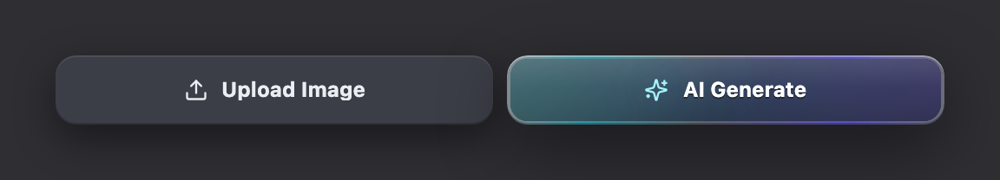</div><figcaption>Actual Upload and AI Generate pair. The AI button retains every production gradient, inset, sheen, and icon layer.</figcaption></figure>

| Specification | Current rule |
| --- | --- |
| Geometry | Full available width; `40px` high; `16px` horizontal padding; `12px` radius. |
| Typography | `12px / 700 / white / leading-none`. |
| Icon | `14px` Sparkles in cyan-200 with teal drop shadow. |
| Edge | Two-pixel multi-stop white/teal/violet gradient. |
| Interior | `#2B2D33` plus teal/violet and vertical highlight layers. |
| Shadow | `0 12px 40px rgb(0 0 0 / .45)` plus source-defined inset highlights and subtle glows. |
| Hover | `brightness(1.25)`. |
| Focus | Two-pixel violet-400/45 ring. |
| Busy | Label becomes “Generating…”; opacity becomes 50% when disabled. |

<section class="reuse-recipe">

##### Use in a New Design

Use the luminous large action when the operation actually generates media with AI.

**Construction:** The complete treatment lives in CoverImageActionButtons; it includes multiple layers, not just a colored border. For a novel AI action, carry those layers and the busy/disabled rules into the appropriate action owner.

**Keep and adapt:** Keep the teal–violet edge and dark interior together. Adapt wording and width. Reserve this treatment for AI assistance; ordinary confirm and save actions remain neutral.

**Construction order:** the 40px-high, 12px-radius clipped button holds the iridescent edge, a dark base inset 2px with 10px radius, the tinted interior, a vertical gloss, an inset highlight layer, two clipped teal/violet blooms, a final edge shadow, then the icon and label above those layers. Keep the complete stack when adapting the large AI treatment. Compact AI Enhance has its own smaller stack; shrinking this button is not its construction.

The exact visual block below omits the library picker and media handlers. It still refers to caller-owned disabled/generating flags and the action; replace those with the new operation’s state. The decorative spans are aria-hidden. Its 125% hover brightness, 50% disabled opacity, violet focus ring and changing busy label belong together.

##### CoverImageActionButtons.tsx

<p class="source-line">src/components/chronicle/CoverImageActionButtons.tsx · lines 73–167</p>

```tsx
        <button
          type="button"
          onClick={onGenerateClick}
          disabled={isDisabled || isGenerating}
           className="group relative flex w-full min-w-0 h-10 px-4 rounded-xl overflow-hidden
            text-white text-xs font-bold leading-none
            shadow-[0_12px_40px_rgba(0,0,0,0.45)]
            hover:brightness-125 transition-all
            focus-visible:outline-none focus-visible:ring-2 focus-visible:ring-violet-400/45
            disabled:opacity-50"
        >
          <span
            aria-hidden
            className="absolute inset-0 rounded-xl"
            style={{
              background:
                "linear-gradient(90deg, rgba(255,255,255,0.34) 0%, rgba(34,184,200,0.62) 18%, rgba(255,255,255,0.22) 44%, rgba(109,94,247,0.64) 78%, rgba(255,255,255,0.28) 100%)",
              filter:
                "drop-shadow(0 0 10px rgba(255,255,255,0.10)) drop-shadow(0 0 18px rgba(109,94,247,0.10)) drop-shadow(0 0 18px rgba(34,184,200,0.10))",
            }}
          />

          <span
            aria-hidden
            className="absolute inset-[2px] rounded-[10px]"
            style={{ background: "#2B2D33" }}
          />

          <span
            aria-hidden
            className="absolute inset-[2px] rounded-[10px]"
            style={{
              background:
                "linear-gradient(90deg, rgba(34,184,200,0.22), rgba(109,94,247,0.22)), #2B2D33",
            }}
          />

          <span
            aria-hidden
            className="absolute inset-[2px] rounded-[10px]"
            style={{
              background:
                "linear-gradient(180deg, rgba(255,255,255,0.11), rgba(255,255,255,0.00) 46%, rgba(0,0,0,0.16))",
            }}
          />

          <span
            aria-hidden
            className="absolute inset-0 rounded-xl pointer-events-none"
            style={{
              boxShadow:
                "inset 0 1px 0 rgba(255,255,255,0.26), inset 0 -1px 0 rgba(0,0,0,0.22)",
              background:
                "linear-gradient(135deg, rgba(255,255,255,0.14), rgba(255,255,255,0.00) 55%)",
              mixBlendMode: "screen",
            }}
          />

          <span
            aria-hidden
            className="absolute -left-8 -top-8 h-32 w-32 rounded-full blur-2xl pointer-events-none"
            style={{
              background:
                "radial-gradient(circle, rgba(34,184,200,0.28), transparent 62%)",
            }}
          />

          <span
            aria-hidden
            className="absolute -right-10 -bottom-10 h-40 w-40 rounded-full blur-3xl pointer-events-none"
            style={{
              background:
                "radial-gradient(circle, rgba(109,94,247,0.26), transparent 65%)",
            }}
          />

          <span
            aria-hidden
            className="absolute inset-0 rounded-xl pointer-events-none"
            style={{
              boxShadow:
                "inset 0 1px 0 rgba(255,255,255,0.16), inset 0 -1px 0 rgba(0,0,0,0.26), 0 0 0 1px rgba(255,255,255,0.06)",
            }}
          />

          <span className="relative z-10 flex items-center justify-center gap-2 w-full">
            <Sparkles
              className="w-3.5 h-3.5 shrink-0 text-cyan-200"
              style={{ filter: "drop-shadow(0 0 10px rgba(34,184,200,0.35))" }}
            />
            <span className="min-w-0 truncate drop-shadow-[0_1px_0_rgba(0,0,0,0.35)]">
              {isGenerating ? "Generating..." : "AI Generate"}
            </span>
          </span>
        </button>
```

</section>

<details class="implementation">
<summary>Supporting source</summary>

Supporting Production Source

Exact existing implementation is preserved as supporting evidence. Use the construction guidance above for the new design. Imported components retain their interfaces; source-specific data, service calls and feature state are not automatically part of a new composition.

Source: `src/components/chronicle/CoverImageActionButtons.tsx` · lines 1–182.

</details>

</section>

<section class="manual-entry">

#### Compact AI Enhance

This compact action sits beside a field label and opens the Enhancement Style choice for that field. It must not replace the larger AI Generate action used for media.

<figure class="source-preview"><div class="capture-background"></div><figcaption>Actual StoryBuilderFieldLabel and its compact enhancement action.</figcaption></figure>

| Specification | Current rule |
| --- | --- |
| Geometry | `6px` padding; `8px` outer radius; `6px` masked interior radius. |
| Icon | `13px` Sparkles, cyan-200, teal glow. |
| Shadow | `0 4px 12px rgb(0 0 0 / .40)`. |
| Hover | `brightness(1.25)`. |
| Loading | Pulse animation and wait cursor. |
| Disabled | Not-allowed cursor and 50% opacity. |
| Keyboard | Current source sets `tabIndex=-1`; the action remains clickable but is not in sequential Tab order. |

<p class="verification-note"><strong>Verification note:</strong> The current <code>tabIndex=-1</code> behavior is documented as source truth, not endorsed here as an accessibility recommendation.</p>

<section class="reuse-recipe">

##### Use in a New Design

Use compact assistance beside a field label when AI modifies that field.

**Construction:** StoryBuilderFieldLabel owns this action. Supply onEnhance, isLoading and isDisabled with the label. Preserve the placement and small visual footprint when building an equivalent field.

**Keep and adapt:** Keep the small Sparkles treatment and its relationship to the label. The existing tabIndex=-1 is a recorded limitation; a new control should remain keyboard reachable.

</section>

<details class="implementation">
<summary>Supporting source</summary>

Supporting Production Source

Exact existing implementation is preserved as supporting evidence. Use the construction guidance above for the new design. Imported components retain their interfaces; source-specific data, service calls and feature state are not automatically part of a new composition.

Source: `src/features/story-builder/components/StoryBuilderFieldLabel.tsx` · lines 1–65.

</details>

</section>

<section class="manual-entry">

#### Full-Width Add Actions

Main Character, Side Character, Add Location, and the builder’s other Add actions extend the current structure. They use blue action text on an elevated dark surface, with component-specific icon sizes and gaps. Reuse the corresponding owner rather than treating every Add action as one interchangeable button.

<figure class="source-preview"><div class="capture-background">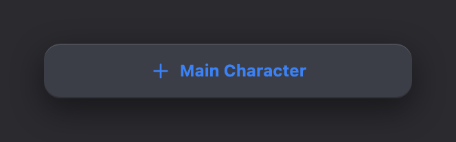</div><figcaption>Actual full-width Main Character action from the roster.</figcaption></figure>

| Specification | Current rule |
| --- | --- |
| Geometry | Full container width; `40px` high; `12px` radius. |
| Typography | `12px / 700 / blue-500`. |
| Icon and gap | `16px` Plus; `6px` gap. |
| Surface and shadow | `#3c3e47` with the Chronicle button shadow stack. |
| Hover | Text changes to blue-300 and the control brightens to 110%. |
| Error variant | Roster Add action gains a red-500 border and two-pixel red-500 ring when required cast roles are missing. |

<section class="reuse-recipe">

##### Use in a New Design

Use when extending a collection: another row, location, character, or authored item.

**Construction:** Use the corresponding feature component when its behavior fits. AddCharacterPlaceholderCard is the roster-specific example; the paired-field excerpt shows a different Add action. For a new collection, retain the elevated base and blue action text while implementing that collection’s handler.

**Keep and adapt:** Keep the 40px height and 12px radius. Full width belongs to collection-ending actions; compact placement may need a content-width variant with the same treatment. Error styling belongs to an actual collection validation state.

Exact Add-action construction, used by AddCharacterPlaceholderCard and the structured location Add action. A 16px Plus precedes the label. Change full-width layout only when its new placement requires it.

<p class="source-line">Exact construction fragment · src/features/story-builder/sidebar/AddCharacterPlaceholderCard.tsx</p>

```tsx
w-full h-10 text-xs font-bold text-blue-500 hover:text-blue-300 bg-[#3c3e47] rounded-xl shadow-[0_8px_24px_rgba(0,0,0,0.45),inset_0_1px_0_rgba(255,255,255,0.09),inset_0_-1px_0_rgba(0,0,0,0.20)] hover:brightness-110 transition-all flex items-center justify-center gap-1.5
```

AddCharacterPlaceholderCard takes label, onClick and optional hasError; it does not expose general disabled or ARIA button props. For another collection, use an appropriately named native button with this treatment and the required state/keyboard behavior. Its optional error class is border-red-500 plus a 2px red ring.

</section>

<details class="implementation">
<summary>Supporting source</summary>

Supporting Production Source

Exact existing implementation is preserved as supporting evidence. Use the construction guidance above for the new design. Imported components retain their interfaces; source-specific data, service calls and feature state are not automatically part of a new composition.

##### AddCharacterPlaceholderCard.tsx

<p class="source-line">src/features/story-builder/sidebar/AddCharacterPlaceholderCard.tsx · complete file</p>

```tsx
import React from 'react';
import { Plus } from 'lucide-react';
import { cn } from '@/lib/utils';

interface AddCharacterPlaceholderCardProps {
  label: string;
  hasError?: boolean;
  onClick: () => void;
}

export const AddCharacterPlaceholderCard: React.FC<AddCharacterPlaceholderCardProps> = ({
  label,
  hasError,
  onClick,
}) => (
  <button
    type="button"
    onClick={onClick}
    className={cn(
      'w-full h-10 text-xs font-bold text-blue-500 hover:text-blue-300 bg-[#3c3e47] rounded-xl shadow-[0_8px_24px_rgba(0,0,0,0.45),inset_0_1px_0_rgba(255,255,255,0.09),inset_0_-1px_0_rgba(0,0,0,0.20)] hover:brightness-110 transition-all flex items-center justify-center gap-1.5',
      hasError && 'border border-red-500 ring-2 ring-red-500'
    )}
  >
    <Plus size={16} />
    <span>{label}</span>
  </button>
);

```

##### StoryBuilderScreen.tsx

<p class="source-line">src/features/story-builder/StoryBuilderScreen.tsx · lines 274–330</p>

```tsx
<div data-publish-error={!!publishErrors.location || undefined}>
                      <label className={`text-[10px] font-black uppercase tracking-widest mb-1 block ${publishErrors.location ? 'text-red-500' : 'text-zinc-400'}`}>Primary Locations</label>
                      {publishErrors.location && <p className="text-sm text-red-500 font-medium mb-2">{publishErrors.location}</p>}
                      <div className="space-y-3">
                        {(world.core.structuredLocations && world.core.structuredLocations.length > 0
                          ? world.core.structuredLocations
                          : [{ id: 'loc_default_1', label: '', description: '' }, { id: 'loc_default_2', label: '', description: '' }]
                        ).map((loc, idx) => (
                          <div key={loc.id} className="flex items-start gap-3">
                            <AutoResizeTextarea
                              value={loc.label}
                              onChange={(v) => {
                                const locs = [...(world.core.structuredLocations || [{ id: 'loc_default_1', label: '', description: '' }, { id: 'loc_default_2', label: '', description: '' }])];
                                locs[idx] = { ...locs[idx], label: v };
                                updateCore({ structuredLocations: locs });
                              }}
                              placeholder={idx === 0 ? "e.g. The Lakehouse" : "Location name..."}
className="w-2/5 px-3 py-2 text-xs font-bold bg-[#1c1c1f] border border-black/35 text-zinc-400 uppercase tracking-widest placeholder:text-zinc-600 rounded-lg focus:outline-none focus:ring-2 focus:ring-blue-500/20 focus:border-blue-500"
                            />
                            <AutoResizeTextarea
                              value={loc.description}
                              onChange={(v) => {
                                const locs = [...(world.core.structuredLocations || [{ id: 'loc_default_1', label: '', description: '' }, { id: 'loc_default_2', label: '', description: '' }])];
                                locs[idx] = { ...locs[idx], description: v };
                                updateCore({ structuredLocations: locs });
                              }}
                              rows={1}
                              placeholder={idx === 0 ? "A secluded cabin by the lake..." : "Describe this location..."}
                              className="flex-1 px-3 py-2 text-sm bg-[#1c1c1f] border border-black/35 text-white placeholder:text-zinc-600 rounded-lg focus:outline-none focus:ring-2 focus:ring-blue-500/20 focus:border-blue-500"
                            />
                            <button
                              type="button"
                              onClick={() => {
                                const locs = [...(world.core.structuredLocations || [])];
                                locs.splice(idx, 1);
                                updateCore({ structuredLocations: locs.length > 0 ? locs : undefined });
                              }}
                              className="mt-2 text-zinc-500 hover:text-rose-400 transition-colors p-1"
                            >
                              <Trash2 size={16} />
                            </button>
                          </div>
                        ))}
                        <button
                          type="button"
                          onClick={() => {
                            const locs = [...(world.core.structuredLocations || [{ id: 'loc_default_1', label: '', description: '' }, { id: 'loc_default_2', label: '', description: '' }])];
                            locs.push({ id: uid('loc'), label: '', description: '' });
                            updateCore({ structuredLocations: locs });
                          }}
                          className="w-full h-10 text-xs font-bold text-blue-500 hover:text-blue-300 bg-[#3c3e47] rounded-xl shadow-[0_8px_24px_rgba(0,0,0,0.45),inset_0_1px_0_rgba(255,255,255,0.09),inset_0_-1px_0_rgba(0,0,0,0.20)] hover:brightness-110 transition-all flex items-center justify-center gap-1.5"
                        >
                          <Plus size={16} />
                          <span>Add Location</span>
                        </button>
                      </div>
                    </div>
```

</details>

</section>

<section class="manual-entry">

#### Image Overlay and Destructive Actions

Edit and image-option controls sit directly on the media or character tile. Destructive actions remain muted in the normal state and introduce red or rose emphasis only when the user reaches the destructive choice.

<figure class="source-preview"><div class="capture-background">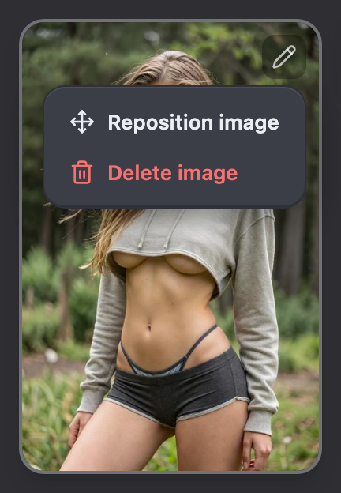</div><figcaption>Actual cover-image menu with Reposition image and Delete image. The portrait is local sample data.</figcaption></figure>

| Control | Current rule | Use |
| --- | --- | --- |
| Cover options | `6px` padding, `8px` radius, black/30 surface, white/70 icon; hover black/50 and white. | Opens Reposition image and Delete image. |
| Character edit | `6px` padding, `8px` radius, black/35 surface, white/75 icon; hover black/55 and white. | Opens the story-owned character in Character Builder. |
| Inline remove | Default zinc-500; hover rose-400; `4px` padding. | Removes a repeatable world row after its own handler runs. |
| Dropdown delete | Red-400 foreground in the menu row. | Opens the explicit destructive path for cover deletion. |

<section class="reuse-recipe">

##### Use in a New Design

Use quiet controls over an image or tile to edit, reposition, or open image commands.

**Construction:** The cover menu and roster edit button have different owners. Use the cover’s dropdown primitive for an action list; use a named button for a single edit action. Provide an accessible name and a discoverable focus state even when the pointer is absent.

**Keep and adapt:** Keep translucent black, a small white icon and 8px radius. The overlay should sit within the media corner without obscuring important content. Destructive emphasis belongs to the destructive item or confirmation.

</section>

<details class="implementation">
<summary>Supporting source</summary>

Supporting Production Source

Exact existing implementation is preserved as supporting evidence. Use the construction guidance above for the new design. Imported components retain their interfaces; source-specific data, service calls and feature state are not automatically part of a new composition.

Source: `src/features/story-builder/components/StoryCardSection.tsx` · lines 1–211.

Source: `src/components/ui/dropdown-menu.tsx` · lines 1–180.

</details>

</section>

## Fields & Controls

### Fields & Controls

Story Builder’s fields use recessed dark surfaces so editable data reads as an interior layer inside the elevated section shell. Selection controls preserve the same dark palette while using blue to indicate the current choice.

<section class="manual-entry">

#### Field Labels

The standard label is a small, heavy, uppercase identifier immediately above its field. An AI-capable label places Compact AI Enhance beside the text. Validation changes the label to red only when the owning section supplies that variant.

<figure class="source-preview"><div class="capture-background">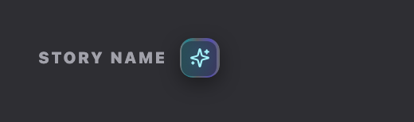</div><figcaption>Actual Story Name label and enhancement action inside the Story Card.</figcaption></figure>

| Part | Current rule |
| --- | --- |
| Label row | Flex row, vertically centered, `8px` gap, `4px` bottom margin. |
| Label text | `10px / 900 / uppercase / tracking-widest / zinc-400`. |
| Plain variant | Label only; use when the field has no AI enhancement handler. |
| AI variant | Adds Compact AI Enhance immediately after the label. |
| Validation variant | Changes the label to red-500 when the owning section explicitly applies error styling. |

<section class="reuse-recipe">

##### Use in a New Design

Use the standard uppercase label above an editable value. Include AI assistance only when that field supports it.

**Construction:** StoryBuilderFieldLabel supplies visible label styling and optional enhancement. It does not link a label to a particular input ID. A new field must also provide a native label association or equivalent accessible name.

**Keep and adapt:** Keep 10px heavy uppercase type, muted color and 4px label-to-field spacing. Adapt the label text and optional assistance; helper text uses readable sentence case.

Label styling fragment. Use it on a native label associated with the input, adding block or flex layout for the content. The default field-label role is distinct from the smaller editable key-field variant.

<p class="source-line">Exact construction fragment · src/features/story-builder/StoryBuilderScreen.tsx</p>

```tsx
text-[10px] font-black text-zinc-400 uppercase tracking-widest mb-1
```

</section>

<details class="implementation">
<summary>Supporting source</summary>

Supporting Production Source

Exact existing implementation is preserved as supporting evidence. Use the construction guidance above for the new design. Imported components retain their interfaces; source-specific data, service calls and feature state are not automatically part of a new composition.

##### StoryBuilderFieldLabel.tsx

<p class="source-line">src/features/story-builder/components/StoryBuilderFieldLabel.tsx · complete file</p>

```tsx
import { Sparkles } from 'lucide-react';
import { cn } from '@/lib/utils';

type StoryBuilderFieldLabelProps = {
  label: string;
  isLoading?: boolean;
  isDisabled?: boolean;
  onEnhance?: () => void;
};

export function StoryBuilderFieldLabel({
  label,
  isLoading = false,
  isDisabled = false,
  onEnhance,
}: StoryBuilderFieldLabelProps) {
  return (
    <div className="mb-1 flex items-center gap-2">
      <label className="text-[10px] font-black uppercase tracking-widest text-zinc-400">
        {label}
      </label>
      {onEnhance ? (
        <button
          type="button"
          tabIndex={-1}
          onClick={onEnhance}
          disabled={isLoading || isDisabled}
          title="Enhance with AI"
          className={cn(
            'relative flex flex-shrink-0 items-center justify-center overflow-hidden rounded-lg p-[6px] text-cyan-200 transition-all',
            isLoading
              ? 'animate-pulse cursor-wait'
              : isDisabled
                ? 'cursor-not-allowed opacity-50'
                : 'hover:brightness-125'
          )}
          style={{ boxShadow: '0 4px 12px rgba(0,0,0,0.40)' }}
        >
          <span
            aria-hidden
            className="pointer-events-none absolute inset-0 rounded-lg"
            style={{
              background:
                'linear-gradient(90deg, rgba(255,255,255,0.34) 0%, rgba(34,184,200,0.62) 18%, rgba(255,255,255,0.22) 44%, rgba(109,94,247,0.64) 78%, rgba(255,255,255,0.28) 100%)',
            }}
          />
          <span
            aria-hidden
            className="pointer-events-none absolute rounded-[6px]"
            style={{
              inset: '1.5px',
              background: 'linear-gradient(90deg, rgba(34,184,200,0.22), rgba(109,94,247,0.22)), #2B2D33',
            }}
          />
          <Sparkles
            size={13}
            className="relative z-10"
            style={{ filter: 'drop-shadow(0 0 6px rgba(34,184,200,0.50))' }}
          />
        </button>
      ) : null}
    </div>
  );
}

```

</details>

</section>

<section class="manual-entry">

#### Standard Recessed Text Entry

Story Name, Brief Description, Story Premise, opening dialog, and other long-form values use the same recessed text treatment. `AutoResizeTextarea` grows with its content rather than introducing a nested scrollbar.

<figure class="source-preview"><div class="capture-background">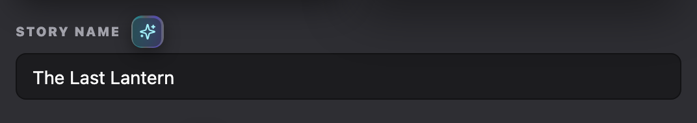</div><figcaption>Actual AutoResizeTextarea with the Story Card label and current input classes. Text is sample data.</figcaption></figure>

| Specification | Current rule |
| --- | --- |
| Surface | `#1c1c1f` with a `1px black / 35%` border. |
| Geometry | `12px × 8px` padding; `8px` radius. |
| Value text | `14px / white`. |
| Placeholder | Tailwind zinc-600, resolved to `#52525b`. |
| Focus | Blue-500 border and two-pixel blue-500/20 ring; no browser outline. |
| Sizing behavior | Width 100%; height resets to auto and then adopts `scrollHeight`; vertical overflow hidden. |

<section class="reuse-recipe">

##### Use in a New Design

Use recessed text entry for new names, descriptions, instructions, or longer authored prose.

**Construction:** Import AutoResizeTextarea for growing multiline content and supply the field treatment below through className. The component supplies sizing and resizing, not appearance. For a single-line value, apply the same treatment to a native input.

**Keep and adapt:** Keep the recessed fill, 8px radius, 12px × 8px padding, 14px text and blue focus treatment. Adapt minimum rows, placeholder and width. A new field also needs a label, meaningful value/change wiring, and any applicable validation.

The normal description-field class is reproduced below. `flex-1` is its row layout; use `w-full min-w-0` when the new field fills a standalone row. The remaining classes supply the recessed field treatment.

<p class="source-line">Exact construction fragment · src/features/story-builder/StoryBuilderScreen.tsx</p>

```tsx
flex-1 px-3 py-2 text-sm bg-[#1c1c1f] border border-black/35 text-white placeholder:text-zinc-600 rounded-lg focus:outline-none focus:ring-2 focus:ring-blue-500/20 focus:border-blue-500
```

**Interface:** AutoResizeTextarea takes `value: string`, `onChange(value: string)`, optional `rows` (default 1), `placeholder`, `className` and `style`. It supplies full width, min-width 0, growing height and wrapping. Unlike a native textarea, this wrapper does not currently forward `id`, `disabled` or ARIA props. A wrapping native label gives it a name. When a new field needs those unsupported attributes, use a native input/textarea with this appearance and the required attributes, or deliberately extend the wrapper in the eventual feature.

**Long content:** let prose wrap and grow inside a bounded scrolling editor body. A label remains above its field. Use readable sentence-case helper text, 14px zinc-300 with relaxed line height as in the derived editor; do not turn paragraph instructions into a 10px uppercase label.

</section>

<details class="implementation">
<summary>Supporting source</summary>

Supporting Production Source

Exact existing implementation is preserved as supporting evidence. Use the construction guidance above for the new design. Imported components retain their interfaces; source-specific data, service calls and feature state are not automatically part of a new composition.

##### AutoResizeTextarea.tsx

<p class="source-line">src/components/chronicle/AutoResizeTextarea.tsx · complete file</p>

```tsx
import React from 'react';
import { cn } from '@/lib/utils';

interface AutoResizeTextareaProps {
  value: string;
  onChange: (value: string) => void;
  placeholder?: string;
  className?: string;
  rows?: number;
  style?: React.CSSProperties;
}

export const AutoResizeTextarea: React.FC<AutoResizeTextareaProps> = ({
  value,
  onChange,
  placeholder,
  className = '',
  rows = 1,
  style,
}) => {
  const ref = React.useRef<HTMLTextAreaElement>(null);
  const resize = React.useCallback(() => {
    if (!ref.current) return;
    ref.current.style.height = 'auto';
    ref.current.style.height = `${ref.current.scrollHeight}px`;
  }, []);

  React.useLayoutEffect(() => {
    resize();
  }, [value, resize]);

  React.useEffect(() => {
    if (!ref.current) return;
    const textarea = ref.current;
    const parent = textarea.parentElement;
    const observerTarget = parent ?? textarea;
    const resizeObserver = new ResizeObserver(() => resize());
    resizeObserver.observe(observerTarget);
    window.addEventListener('resize', resize);

    const raf = window.requestAnimationFrame(() => resize());

    return () => {
      resizeObserver.disconnect();
      window.removeEventListener('resize', resize);
      window.cancelAnimationFrame(raf);
    };
  }, [resize]);

  return (
    <textarea
      ref={ref}
      value={value}
      onChange={(e) => onChange(e.target.value)}
      onInput={resize}
      placeholder={placeholder}
      rows={rows}
      spellCheck={true}
      style={style}
      className={cn("w-full min-w-0 resize-none overflow-hidden whitespace-pre-wrap break-words", className)}
    />
  );
};

```

Source: `src/features/story-builder/components/StoryCardSection.tsx` · lines 1–211.

</details>

</section>

<section class="manual-entry">

#### Validation Presentation

Validation stays attached to the field that must be corrected. The red border, ring, and message appear together; the guide does not introduce a separate floating alert for a field-local error.

<figure class="source-preview"><div class="capture-background">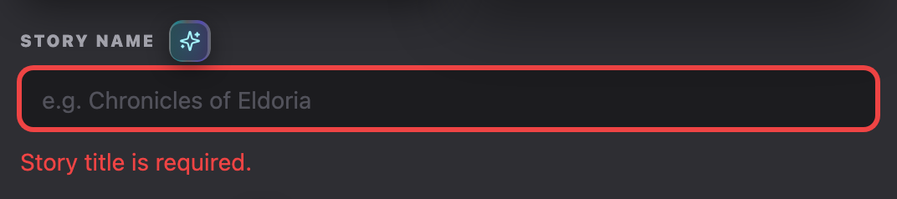</div><figcaption>Actual Story Card validation branch rendered with an explicit sample title error.</figcaption></figure>

| Part | Current rule |
| --- | --- |
| Field border | `1px red-500`. |
| Field ring | `2px red-500`. |
| Error text | `14px / 500 / red-500`, `4px` above. |
| Section targeting | The owning wrapper sets `data-publish-error` so publication validation can locate and scroll to the problem. |

<section class="reuse-recipe">

##### Use in a New Design

Use field-local feedback when the user can correct one value.

**Construction:** Attach the error border, ring and message to the owning field. For new forms, associate the message with the input using aria-describedby and mark the invalid input. data-publish-error belongs to Story Builder publication targeting; only use it when the new field participates in that path.

**Keep and adapt:** Keep red emphasis tied to the problem, with a nearby readable message. Do not rely on color alone. Clear or update the error as the owning validation rules require.

**Invalid treatment:** use `border border-red-500 ring-2 ring-red-500` instead of the normal black/35 border, with nearby `mt-1 text-sm text-red-500` feedback (font-medium where used by the owning field). Connect the feedback using `aria-describedby` and mark invalid state on a native field. **Focused invalid field:** StoryCardSection retains the normal `focus:ring-blue-500/20 focus:border-blue-500` classes in its invalid branch. The blue border and ring take precedence while focused; the red error message remains. On blur, the invalid red border and ring return. A new disabled native field can use `disabled:opacity-50 disabled:cursor-not-allowed`, consistent with the shared control family; this is derived guidance, not behavior supplied by AutoResizeTextarea. Preserve the value and label while disabled. Validation is conditional on the new feature’s rules, not mandatory for every field.

</section>

<details class="implementation">
<summary>Supporting source</summary>

Supporting Production Source

Exact existing implementation is preserved as supporting evidence. Use the construction guidance above for the new design. Imported components retain their interfaces; source-specific data, service calls and feature state are not automatically part of a new composition.

Source: `src/features/story-builder/components/StoryCardSection.tsx` · lines 1–211.

</details>

</section>

<section class="manual-entry">

#### Paired Key and Description Fields

Structured locations pair a compact uppercase key with a standard description. The key is not a label outside the field; it is editable story data.

<figure class="source-preview"><div class="capture-background">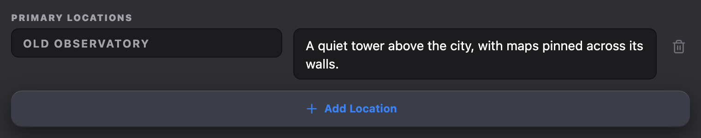</div><figcaption>Actual Primary Locations key/value row, delete action, and Add Location button from StoryBuilderScreen.</figcaption></figure>

| Part | Current rule |
| --- | --- |
| Row | Flex, aligned to the start, `12px` gap. |
| Key field | `40%` width; `12px / 700 / uppercase / tracking-widest / zinc-400`. |
| Description field | Consumes remaining width; standard `14px` field text. |
| Shared field surface | `#1c1c1f`, black/35 border, `8px` radius, blue focus treatment. |
| Remove control | Appears after the description; zinc-500 by default and rose-400 on hover. |

<section class="reuse-recipe">

##### Use in a New Design

Use for repeated key-and-description entries, such as named places, rules, or attributes.

**Construction:** The existing location row is composed inside StoryBuilderScreen. Adapt its row structure and recessed field classes; use the new collection’s data and callbacks. Keep the add/remove controls with their owning row or group.

**Keep and adapt:** The current 40% key width is a location-specific layout choice. For a new concept, choose columns by content and stack them when labels or values become cramped; preserve the 12px gap and shared field treatment.

**Adapting the row:** the existing key/description example uses a 12px gap both between rows and between columns. Its key uses 12px bold uppercase zinc-400 text; its description uses the standard 14px white field text. A new list of ordinary prose needs only the standard field per row, not an invented key column. Keep the repeated group inside the existing tray; another titled outer shell per row would add unnecessary depth.

**Local removal:** StoryBuilderScreen uses a 16px Trash2 icon with `mt-2 text-zinc-500 hover:text-rose-400 transition-colors p-1`. Give a new remove button a meaningful name and visible keyboard focus. For custom controls lacking an existing focus treatment, use the derived focus rule in Typography & Spacing. This quiet row action is distinct from the red final confirmation button.

**Empty and edited states:** keep the group label and Add control available when empty, with short 14px muted helper copy if useful; do not add a decorative card or require sample rows. The feature decides whether deleting the last row leaves an empty group or a required blank field. If it requires a value, use field-local validation. In a deferred editor, Add, edit and remove change the draft until Apply; Cancel discards those changes.

</section>

<details class="implementation">
<summary>Supporting source</summary>

Supporting Production Source

Exact existing implementation is preserved as supporting evidence. Use the construction guidance above for the new design. Imported components retain their interfaces; source-specific data, service calls and feature state are not automatically part of a new composition.

Source: `src/features/story-builder/StoryBuilderScreen.tsx` · lines 274–330.

Source: `src/components/chronicle/AutoResizeTextarea.tsx` · lines 1–64.

</details>

</section>

<section class="manual-entry">

#### Segmented Choice

Manual and Automatic time progression use a compact two-option selector. The enclosing dark tray belongs to the control; the selected option uses blue while the unselected option stays neutral.

<figure class="source-preview"><div class="capture-background">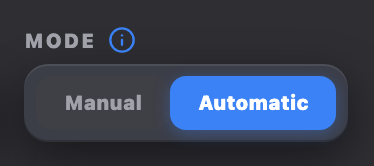</div><figcaption>Actual time-progression choice with Automatic selected.</figcaption></figure>

| Part | Current rule |
| --- | --- |
| Enclosing tray | `6px` padding, `12px` radius, `#3c3e47`, Chronicle button shadow. |
| Option | `14px × 6px` padding; `10px / 900`; `8px` radius. |
| Selected | `#3b82f6`, white text, `0 2px 8px rgb(59 130 246 / .35)`. |
| Unselected | `#3f3f46`, `#a1a1aa`; hover moves toward zinc-300. |
| Semantics | Each option is a button representing one mutually exclusive state. |

<section class="reuse-recipe">

##### Use in a New Design

Use for a small, mutually exclusive choice whose labels fit side by side.

**Construction:** The existing Manual/Automatic control is local markup. A new choice can use native radios in a styled group or buttons with an explicit selected state. Preserve one selected value and accessible group naming.

**Keep and adapt:** Keep an elevated 12px tray, compact 8px options and blue selection. Adapt the number and wording of options; switch to a select or larger chooser when choices cannot remain legible.

**Complete visual construction:** use a flex group with 6px padding, #3c3e47 fill, 12px radius and the shared button shadow. Each option has 14px horizontal/6px vertical padding, 10px heavy text and 8px radius. Selected uses #3b82f6, white text and `0 2px 8px rgba(59,130,246,0.35)` shadow. Unselected uses #3f3f46 and #a1a1aa, with zinc-300 text on hover. These values come from the Manual/Automatic group in StoryBuilderScreen; the option labels and number of choices can change.

**Behavior for a new group:** retain one selected value and an accessible group name. Use native radios with their keyboard behavior, or selected buttons with `aria-pressed` and normal keyboard activation. Add the documented derived focus treatment when implementing new local markup; the existing source has no dedicated focus-visible class. Disable unavailable options semantically and use 50% opacity. If the group no longer fits, stack or wrap its options while preserving the same selection treatment; do not squeeze labels to illegibility. Its compact option height is intentional and does not inherit the 40px ordinary-button rule.

</section>

<details class="implementation">
<summary>Supporting source</summary>

Supporting Production Source

Exact existing implementation is preserved as supporting evidence. Use the construction guidance above for the new design. Imported components retain their interfaces; source-specific data, service calls and feature state are not automatically part of a new composition.

##### StoryBuilderScreen.tsx

<p class="source-line">src/features/story-builder/StoryBuilderScreen.tsx · lines 632–768</p>

```tsx
<div className="flex items-end gap-4 flex-wrap">
                      {/* Starting Day & Time group */}
                      <div>
                        <div className="flex items-center gap-1.5 mb-1">
                          <label className="text-[10px] font-black text-zinc-400 uppercase tracking-widest">Starting Day & Time</label>
                          <Tooltip>
                            <TooltipTrigger asChild>
                              <Info className="w-3.5 h-3.5 text-blue-500 cursor-help" />
                            </TooltipTrigger>
                            <TooltipContent side="top" className="max-w-[300px] text-xs font-semibold leading-relaxed normal-case tracking-normal">
                              Set when your story begins. The AI will use this context for time-appropriate responses.
                            </TooltipContent>
                          </Tooltip>
                        </div>
                        <div className="flex items-center gap-3">
                          {/* Day Counter */}
                          <div className="flex items-center gap-1.5 bg-[#3c3e47] rounded-xl px-3 py-1.5 shadow-[0_8px_24px_rgba(0,0,0,0.45),inset_0_1px_0_rgba(255,255,255,0.09),inset_0_-1px_0_rgba(0,0,0,0.20)]">
                            <span className="text-[10px] font-bold text-zinc-400">Day</span>
                            <button
                              type="button"
                              onClick={() => {
                                const current = openingDialog.startingDay || 1;
                                if (current > 1) onUpdateOpening({ startingDay: current - 1 });
                              }}
                              className="p-0.5 rounded-md hover:bg-zinc-700 text-zinc-400 transition-colors disabled:opacity-30"
                              disabled={(openingDialog.startingDay || 1) <= 1}
                            >
                              <ChevronDown size={14} />
                            </button>
                            <span className="text-base font-bold text-white min-w-[2ch] text-center">
                              {openingDialog.startingDay || 1}
                            </span>
                            <button
                              type="button"
                              onClick={() => {
                                const current = openingDialog.startingDay || 1;
                                onUpdateOpening({ startingDay: current + 1 });
                              }}
                              className="p-0.5 rounded-md hover:bg-zinc-700 text-zinc-400 transition-colors"
                            >
                              <ChevronUp size={14} />
                            </button>
                          </div>

                          {/* Time of Day Icons */}
                          <div className="flex items-center gap-1 bg-[#3c3e47] rounded-xl p-1 shadow-[0_8px_24px_rgba(0,0,0,0.45),inset_0_1px_0_rgba(255,255,255,0.09),inset_0_-1px_0_rgba(0,0,0,0.20)]">
                            {([
                              { key: 'sunrise' as TimeOfDay, icon: Sunrise, label: 'Sunrise' },
                              { key: 'day' as TimeOfDay, icon: Sun, label: 'Day' },
                              { key: 'sunset' as TimeOfDay, icon: Sunset, label: 'Sunset' },
                              { key: 'night' as TimeOfDay, icon: Moon, label: 'Night' },
                            ] as const).map(({ key, icon: Icon, label }) => {
                              const isActive = (openingDialog.startingTimeOfDay || 'day') === key;
                              return (
                                <button
                                  key={key}
                                  type="button"
                                  onClick={() => onUpdateOpening({ startingTimeOfDay: key })}
                                  title={label}
                                  className={`p-1.5 rounded-lg transition-all ${
                                    isActive
                                      ? 'bg-blue-500 text-white shadow-md'
                                      : 'text-zinc-400 hover:bg-zinc-700 hover:text-zinc-200'
                                  }`}
                                >
                                  <Icon size={16} />
                                </button>
                              );
                            })}
                          </div>
                        </div>
                      </div>

                      {/* Mode group */}
                      <div>
                        <div className="flex items-center gap-1.5 mb-1">
                          <label className="text-[10px] font-black text-zinc-400 uppercase tracking-widest">Mode</label>
                          <Tooltip>
                            <TooltipTrigger asChild>
                              <Info className="w-3.5 h-3.5 text-blue-500 cursor-help" />
                            </TooltipTrigger>
                            <TooltipContent side="top" className="max-w-[300px] text-xs font-semibold leading-relaxed normal-case tracking-normal">
                              <ul className="list-disc list-outside pl-4 space-y-1">
                                <li><strong>Manual:</strong> User will update the day and time counters manually when they want the day/time to advance.</li>
                                <li><strong>Automatic:</strong> Time/day will progress by set intervals.</li>
                                <li>Users can adjust these settings during their playthrough in the chat settings tab.</li>
                              </ul>
                            </TooltipContent>
                          </Tooltip>
                        </div>
                        <div className="flex p-1.5 bg-[#3c3e47] rounded-xl shadow-[0_8px_24px_rgba(0,0,0,0.45),inset_0_1px_0_rgba(255,255,255,0.09),inset_0_-1px_0_rgba(0,0,0,0.20)]">
                          <button
                            type="button"
                            onClick={() => onUpdateOpening({ timeProgressionMode: 'manual' })}
                            className={cn(
                              "px-3.5 py-1.5 text-[10px] font-black rounded-lg border-none cursor-pointer transition-all",
                              (openingDialog.timeProgressionMode || 'manual') === 'manual'
                                ? "bg-[#3b82f6] text-white shadow-[0_2px_8px_rgba(59,130,246,0.35)]"
                                : "bg-[#3f3f46] text-[#a1a1aa] hover:text-zinc-300"
                            )}
                          >
                            Manual
                          </button>
                          <button
                            type="button"
                            onClick={() => onUpdateOpening({ timeProgressionMode: 'automatic' })}
                            className={cn(
                              "px-3.5 py-1.5 text-[10px] font-black rounded-lg border-none cursor-pointer transition-all",
                              openingDialog.timeProgressionMode === 'automatic'
                                ? "bg-[#3b82f6] text-white shadow-[0_2px_8px_rgba(59,130,246,0.35)]"
                                : "bg-[#3f3f46] text-[#a1a1aa] hover:text-zinc-300"
                            )}
                          >
                            Automatic
                          </button>
                        </div>
                      </div>

                      {/* Time Interval group */}
                      <div className={cn(
                        "transition-opacity",
                        (openingDialog.timeProgressionMode || 'manual') === 'manual' && "opacity-40 pointer-events-none"
                      )}>
                        <label className="text-[10px] font-black text-zinc-400 uppercase tracking-widest mb-1 block">Time Interval</label>
                        <select
                          value={openingDialog.timeProgressionInterval || 15}
                          onChange={(e) => onUpdateOpening({ timeProgressionInterval: Number(e.target.value) })}
                          className="bg-[#1c1c1f] border border-black/35 rounded-xl text-xs text-white px-2.5 py-2 focus:outline-none focus:ring-1 focus:ring-blue-500"
                        >
                          <option value={5}>5 minutes</option>
                          <option value={10}>10 minutes</option>
                          <option value={15}>15 minutes</option>
                          <option value={30}>30 minutes</option>
                          <option value={60}>60 minutes</option>
                        </select>
                      </div>
                    </div>
```

</details>

</section>

<section class="manual-entry">

#### Guidance Strength Slider

The Story Goals control maps three authored values—Rigid, Normal, and Flexible—to fixed points on a custom track. The explanation beneath it changes with the selected value.

<figure class="source-preview"><div class="capture-background">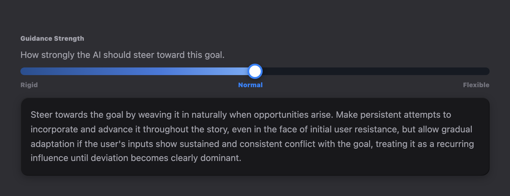</div><figcaption>Actual GuidanceStrengthSlider set to Normal, including its full explanation.</figcaption></figure>

| Part | Current rule |
| --- | --- |
| Track | `12px` high, fully rounded, `rgb(21 25 34 / .95)`. |
| Fill | `#2b4e8d → #4b79d8 60% → #7dadf5`; width is 0%, 50%, or 100%. |
| Thumb | `24 × 24px`, white, `3px blue-500` border, `0 2px 8px rgb(0 0 0 / .3)`. |
| Labels | `10px / 900`; active blue-500, inactive zinc-500. |
| Interaction | Clicking the track selects by thirds; clicking a label selects its exact level. |

<section class="reuse-recipe">

##### Use in a New Design

Use a stepped control when the values form an ordered scale and their meaning can be explained.

**Construction:** GuidanceStrengthSlider is a three-value goal-flexibility control. Reuse it only for that contract. A new scale needs its own values, keyboard-operable slider or radio semantics, and matching explanations.

**Keep and adapt:** Carry the dark track, blue fill and white thumb into an equivalent ordered control. The three labels, thirds-based click mapping and widths are specific to this example.

</section>

<details class="implementation">
<summary>Supporting source</summary>

Supporting Production Source

Exact existing implementation is preserved as supporting evidence. Use the construction guidance above for the new design. Imported components retain their interfaces; source-specific data, service calls and feature state are not automatically part of a new composition.

##### GuidanceStrengthSlider.tsx

<p class="source-line">src/components/chronicle/GuidanceStrengthSlider.tsx · complete file</p>

```tsx
import React from 'react';
import { GoalFlexibility } from '@/types';
import { cn } from '@/lib/utils';

interface GuidanceStrengthSliderProps {
  value: GoalFlexibility;
  onChange: (value: GoalFlexibility) => void;
}

const LEVELS: { value: GoalFlexibility; label: string }[] = [
  { value: 'rigid', label: 'Rigid' },
  { value: 'normal', label: 'Normal' },
  { value: 'flexible', label: 'Flexible' },
];

const DESCRIPTIONS: Record<GoalFlexibility, string> = {
  rigid: "Treat the goal as the primary focus. Allow organic deviations, subplots, and temporary shifts based on user inputs, but always keep the goal in mind and steer the narrative back naturally over time through character actions, events, or motivations. Do not abandon or diminish the goal's importance, integrating it seamlessly as the story progresses toward resolution.",
  normal: "Steer towards the goal by weaving it in naturally when opportunities arise. Make persistent attempts to incorporate and advance it throughout the story, even in the face of initial user resistance, but allow gradual adaptation if the user's inputs show sustained and consistent conflict with the goal, treating it as a recurring influence until deviation becomes clearly dominant.",
  flexible: "Steer towards the goal with light guidance. Make a few subtle attempts (e.g., 2-3 opportunities) to incorporate it, but prioritize flexibility and adapt fully to story deviations if the user's inputs continue to conflict, letting the narrative evolve based on player choices.",
};

const VALUE_PERCENT: Record<GoalFlexibility, number> = {
  rigid: 0,
  normal: 50,
  flexible: 100,
};

export const GuidanceStrengthSlider: React.FC<GuidanceStrengthSliderProps> = ({ value, onChange }) => {
  const fillPercent = VALUE_PERCENT[value];

  return (
    <div>
      <div className="mt-3.5 mb-1.5">
        <span className="text-[10px] font-black text-zinc-400">
          Guidance Strength
        </span>
      </div>

      <p className="text-sm text-zinc-400 mb-2.5">
        How strongly the AI should steer toward this goal.
      </p>

      <div
        className="relative w-full cursor-pointer"
        style={{ height: '12px', borderRadius: '999px', background: 'rgba(21,25,34,0.95)' }}
        onClick={(e) => {
          const rect = e.currentTarget.getBoundingClientRect();
          const pct = ((e.clientX - rect.left) / rect.width) * 100;
          if (pct < 33) onChange('rigid');
          else if (pct < 67) onChange('normal');
          else onChange('flexible');
        }}
      >
        <div
          className="absolute top-0 left-0 h-full rounded-full transition-[width] duration-200 ease-out"
          style={{
            width: `${fillPercent}%`,
            background: 'linear-gradient(90deg, #2b4e8d, #4b79d8 60%, #7dadf5)',
          }}
        />
        <div
          className="absolute top-1/2 -translate-y-1/2 w-6 h-6 rounded-full bg-white border-[3px] border-blue-500 shadow-[0_2px_8px_rgba(0,0,0,0.3)] transition-[left] duration-200 ease-out"
          style={{ left: `${fillPercent}%`, transform: `translate(-50%, -50%)` }}
        />
      </div>

      <div className="flex justify-between mt-2">
        {LEVELS.map((level) => (
          <span
            key={level.value}
            onClick={() => onChange(level.value)}
            className={cn(
              "cursor-pointer text-[10px] font-black transition-colors",
              value === level.value ? "text-blue-500" : "text-zinc-500"
            )}
          >
            {level.label}
          </span>
        ))}
      </div>

      <div className="mt-3 bg-zinc-900 rounded-xl p-4 shadow-[inset_1px_1px_0_rgba(255,255,255,0.07),inset_-1px_-1px_0_rgba(0,0,0,0.30),0_4px_12px_rgba(0,0,0,0.25)]">
        <p className="text-sm text-zinc-400 leading-relaxed m-0">
          {DESCRIPTIONS[value]}
        </p>
      </div>
    </div>
  );
};
```

</details>

</section>

<section class="manual-entry">

#### Content Theme Chips

Content Themes use wrap-capable choice chips inside a recessed tray. Blue indicates a selected option. Story Type uses the same geometry but reserves red for selected NSFW.

<figure class="source-preview"><div class="capture-background">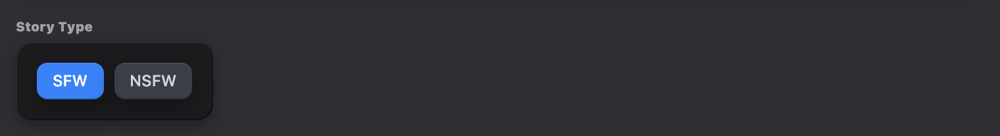</div><figcaption>Actual Story Type controls with SFW selected and NSFW unselected.</figcaption></figure>

| Part | Current rule |
| --- | --- |
| Tray | `#1c1c1f`, `16px` padding, `12px` radius, inner-tray shadow stack. |
| Chip | `12px × 6px` padding, `8px` radius, `12px / 500`. |
| Unselected | `#3c3e47`, zinc-300, 110% brightness on hover. |
| Selected | Blue-500 with white text. |
| Custom selected | Blue-500/20 background, blue-300 text, blue-500/30 border, inline remove action. |
| Story Type | SFW selected is blue-500; NSFW selected is red-500. |

<section class="reuse-recipe">

##### Use in a New Design

Use wrapping choices for categories or tags. State clearly whether one or several can be selected.

**Construction:** ContentThemesSection owns its domain logic. For a new selector, adapt the chip geometry with native radios, checkboxes, or explicit pressed/checked states. Provide the new option set and any custom-entry behavior.

**Keep and adapt:** Keep neutral unselected chips and blue selection. Red NSFW is an existing semantic exception, not the default color for a second option. Custom removable choices retain a visible remove control.

</section>

<details class="implementation">
<summary>Supporting source</summary>

Supporting Production Source

Exact existing implementation is preserved as supporting evidence. Use the construction guidance above for the new design. Imported components retain their interfaces; source-specific data, service calls and feature state are not automatically part of a new composition.

##### ContentThemesSection.tsx

<p class="source-line">src/components/chronicle/ContentThemesSection.tsx · complete file</p>

```tsx
import React, { useState } from 'react';
import { Tags, Plus, X } from 'lucide-react';
import { cn } from '@/lib/utils';
import { ContentThemes } from '@/types';
import {
  CHARACTER_TYPES,
  STORY_TYPES,
  GENRES,
  ORIGINS,
  TRIGGER_WARNINGS
} from '@/constants/content-themes';

interface ContentThemesSectionProps {
  themes: ContentThemes;
  onUpdate: (themes: ContentThemes) => void;
  tagsError?: string;
  storyTypeError?: string;
}

interface CategorySelectorProps {
  title: string;
  prebuiltOptions: readonly string[];
  selected: string[];
  onChange: (selected: string[]) => void;
  allowCustom?: boolean;
  singleSelect?: boolean;
}

const CategorySelector: React.FC<CategorySelectorProps> = ({
  title,
  prebuiltOptions,
  selected,
  onChange,
  allowCustom = true,
  singleSelect = false
}) => {
  const [customInput, setCustomInput] = useState('');
  const [showInput, setShowInput] = useState(false);

  const toggleOption = (option: string) => {
    if (singleSelect) {
      onChange(selected.includes(option) ? [] : [option]);
    } else {
      if (selected.includes(option)) {
        onChange(selected.filter(s => s !== option));
      } else {
        onChange([...selected, option]);
      }
    }
  };

  const addCustom = () => {
    const trimmed = customInput.trim();
    if (trimmed && !selected.includes(trimmed)) {
      onChange([...selected, trimmed]);
      setCustomInput('');
      setShowInput(false);
    }
  };

  const handleKeyDown = (e: React.KeyboardEvent) => {
    if (e.key === 'Enter') {
      e.preventDefault();
      addCustom();
    } else if (e.key === 'Escape') {
      setShowInput(false);
      setCustomInput('');
    }
  };

  // Custom options are those not in prebuilt list
  const customOptions = selected.filter(s => !prebuiltOptions.includes(s as any));

  return (
    <div className="space-y-1">
      <h4 className="text-[10px] font-black text-zinc-400">
        {title}
      </h4>

       <div className="bg-[#1c1c1f] rounded-xl p-4 shadow-[inset_1px_1px_0_rgba(255,255,255,0.07),inset_-1px_-1px_0_rgba(0,0,0,0.30),0_4px_12px_rgba(0,0,0,0.25)]">
        <div className="flex flex-wrap gap-2">
          {/* Prebuilt options */}
          {prebuiltOptions.map(option => {
            const isSelected = selected.includes(option);
            return (
              <button
                key={option}
                type="button"
                onClick={() => toggleOption(option)}
                className={cn(
                  "px-3 py-1.5 rounded-lg text-xs font-medium border-0 transition-all shadow-[0_6px_16px_rgba(0,0,0,0.35),inset_0_1px_0_rgba(255,255,255,0.07),inset_0_-1px_0_rgba(0,0,0,0.20)]",
                  isSelected
                    ? "bg-blue-500 text-white"
                    : "bg-[#3c3e47] text-zinc-300 hover:brightness-110"
                )}
              >
                {option}
              </button>
            );
          })}

          {/* Custom options (with remove button) */}
          {customOptions.map(option => (
            <div
              key={option}
              className="flex items-center gap-1 px-3 py-1.5 rounded-lg text-xs font-medium bg-blue-500/20 text-blue-300 border border-blue-500/30"
            >
              <span>{option}</span>
              <button
                type="button"
                onClick={() => onChange(selected.filter(s => s !== option))}
                className="ml-1 hover:text-white transition-colors"
              >
                <X className="w-3 h-3" />
              </button>
            </div>
          ))}

          {/* Add custom button/input */}
          {allowCustom && (
            showInput ? (
              <div className="flex items-center gap-1">
                <input
                  type="text"
                  value={customInput}
                  onChange={e => setCustomInput(e.target.value)}
                  onKeyDown={handleKeyDown}
                  onBlur={() => {
                    if (!customInput.trim()) {
                      setShowInput(false);
                    }
                  }}
                  placeholder="Custom..."
                  autoFocus
                className="px-3 py-1.5 rounded-lg text-xs font-medium bg-[#1c1c1f] text-white border border-black/35 focus:border-blue-500 focus:outline-none w-28"
                />
                <button
                  type="button"
                  onClick={addCustom}
                  className="p-1.5 rounded-lg bg-blue-500 text-white hover:bg-blue-600 transition-colors"
                >
                  <Plus className="w-3 h-3" />
                </button>
              </div>
            ) : (
              <button
                type="button"
                onClick={() => setShowInput(true)}
                className="h-8 px-3 rounded-lg text-xs font-bold text-blue-500 hover:text-blue-300 bg-[#3c3e47] shadow-[0_8px_24px_rgba(0,0,0,0.45),inset_0_1px_0_rgba(255,255,255,0.09),inset_0_-1px_0_rgba(0,0,0,0.20)] hover:brightness-110 transition-all flex items-center gap-1"
              >
                <Plus className="w-3 h-3" />
                Custom
              </button>
            )
          )}
        </div>
      </div>
    </div>
  );
};

// Story Type selector (single select, mutually exclusive)
const StoryTypeSelector: React.FC<{
  selected: 'SFW' | 'NSFW' | null;
  onChange: (value: 'SFW' | 'NSFW' | null) => void;
}> = ({ selected, onChange }) => {
  return (
    <div className="space-y-1">
      <h4 className="text-[10px] font-black text-zinc-400">
        Story Type
      </h4>

      <div className="bg-[#1c1c1f] rounded-xl p-4 shadow-[inset_1px_1px_0_rgba(255,255,255,0.07),inset_-1px_-1px_0_rgba(0,0,0,0.30),0_4px_12px_rgba(0,0,0,0.25)] w-fit">
        <div className="flex gap-2">
          {STORY_TYPES.map(type => {
            const isSelected = selected === type;
            return (
              <button
                key={type}
                type="button"
                onClick={() => onChange(isSelected ? null : type)}
                className={cn(
                  "px-3 py-1.5 rounded-lg text-xs font-medium border-0 transition-all shadow-[0_6px_16px_rgba(0,0,0,0.35),inset_0_1px_0_rgba(255,255,255,0.07),inset_0_-1px_0_rgba(0,0,0,0.20)]",
                  isSelected
                    ? type === 'NSFW'
                      ? "bg-red-500 text-white"
                      : "bg-blue-500 text-white"
                    : "bg-[#3c3e47] text-zinc-300 hover:brightness-110"
                )}
              >
                {type}
              </button>
            );
          })}
        </div>
      </div>
    </div>
  );
};

// Custom Tags section (free-form input)
const CustomTagsSection: React.FC<{
  tags: string[];
  onChange: (tags: string[]) => void;
}> = ({ tags, onChange }) => {
  const [input, setInput] = useState('');
  const [showInput, setShowInput] = useState(false);

  const addTag = () => {
    const trimmed = input.trim().replace(/^#/, '');
    if (trimmed && !tags.includes(trimmed)) {
      onChange([...tags, trimmed]);
      setInput('');
      setShowInput(false);
    }
  };

  const handleKeyDown = (e: React.KeyboardEvent) => {
    if (e.key === 'Enter') {
      e.preventDefault();
      addTag();
    } else if (e.key === 'Escape') {
      setShowInput(false);
      setInput('');
    }
  };

  return (
    <div className="space-y-1">
      <h4 className="text-[10px] font-black text-zinc-400">
        Custom Tags
      </h4>

      <div className="bg-[#1c1c1f] rounded-xl p-4 shadow-[inset_1px_1px_0_rgba(255,255,255,0.07),inset_-1px_-1px_0_rgba(0,0,0,0.30),0_4px_12px_rgba(0,0,0,0.25)]">
        <div className="flex flex-wrap gap-2">
          {tags.map(tag => (
            <div
              key={tag}
              className="flex items-center gap-1 px-3 py-1.5 rounded-lg text-xs font-medium bg-blue-500/20 text-blue-300 border border-blue-500/30"
            >
              <span>{tag}</span>
              <button
                type="button"
                onClick={() => onChange(tags.filter(t => t !== tag))}
                className="ml-1 hover:text-white transition-colors"
              >
                <X className="w-3 h-3" />
              </button>
            </div>
          ))}

          {showInput ? (
            <div className="flex items-center gap-1">
              <input
                type="text"
                value={input}
                onChange={e => setInput(e.target.value)}
                onKeyDown={handleKeyDown}
                onBlur={() => {
                  if (!input.trim()) {
                    setShowInput(false);
                  }
                }}
                placeholder="Custom..."
                autoFocus
                className="px-3 py-1.5 rounded-lg text-xs font-medium bg-[#1c1c1f] text-white border border-black/35 focus:border-blue-500 focus:outline-none w-28"
              />
              <button
                type="button"
                onClick={addTag}
                className="p-1.5 rounded-lg bg-blue-500 text-white hover:bg-blue-600 transition-colors"
              >
                <Plus className="w-3 h-3" />
              </button>
            </div>
          ) : (
            <button
              type="button"
              onClick={() => setShowInput(true)}
              className="h-8 px-3 rounded-lg text-xs font-bold text-blue-500 hover:text-blue-300 bg-[#3c3e47] shadow-[0_8px_24px_rgba(0,0,0,0.45),inset_0_1px_0_rgba(255,255,255,0.09),inset_0_-1px_0_rgba(0,0,0,0.20)] hover:brightness-110 transition-all flex items-center gap-1"
            >
              <Plus className="w-3 h-3" />
               Custom
            </button>
          )}
        </div>
      </div>
    </div>
  );
};

export const ContentThemesSection: React.FC<ContentThemesSectionProps> = ({
  themes,
  onUpdate,
  tagsError,
  storyTypeError
}) => {
  const updateField = <K extends keyof ContentThemes>(
    field: K,
    value: ContentThemes[K]
  ) => {
    onUpdate({ ...themes, [field]: value });
  };

  return (
    <section>
      <div className="w-full bg-[#2a2a2f] rounded-[24px] overflow-hidden shadow-[0_12px_32px_-2px_rgba(0,0,0,0.50),inset_1px_1px_0_rgba(255,255,255,0.09),inset_-1px_-1px_0_rgba(0,0,0,0.35)]">
        {/* Section Header - Steel Blue */}
        <div className="relative overflow-hidden bg-gradient-to-b from-[#5a7292] to-[#4a5f7f] border-t border-white/20 px-5 py-3 flex items-center gap-3 shadow-lg">
          <div className="absolute inset-0 z-0 bg-gradient-to-tr from-white/10 to-transparent opacity-40" style={{ height: '60%' }} />
          <Tags className="w-[18px] h-[18px] text-white relative z-[1]" />
          <h2 className="text-white text-xl font-bold tracking-[-0.015em] relative z-[1]">Content Themes</h2>
        </div>

        {/* Content */}
        <div className="p-5">
          <div className="p-5 pb-6 bg-[#2e2e33] rounded-2xl shadow-[inset_1px_1px_0_rgba(255,255,255,0.07),inset_-1px_-1px_0_rgba(0,0,0,0.30),0_4px_12px_rgba(0,0,0,0.25)]">
            <div className="space-y-6">
              {/* Tags error */}
              {tagsError && <p className="text-sm text-red-500 font-medium">{tagsError}</p>}

              {/* Character Types */}
              <CategorySelector
                title="Character Types"
                prebuiltOptions={CHARACTER_TYPES}
                selected={themes.characterTypes}
                onChange={v => updateField('characterTypes', v)}
              />

              {/* Story Type */}
              {storyTypeError && <p className="text-sm text-red-500 font-medium">{storyTypeError}</p>}
              <StoryTypeSelector
                selected={themes.storyType}
                onChange={v => updateField('storyType', v)}
              />

              {/* Genre */}
              <CategorySelector
                title="Genre"
                prebuiltOptions={GENRES}
                selected={themes.genres}
                onChange={v => updateField('genres', v)}
              />

              {/* Origin */}
              <CategorySelector
                title="Origin"
                prebuiltOptions={ORIGINS}
                selected={themes.origin}
                onChange={v => updateField('origin', v)}
              />

              {/* Trigger Warnings */}
              <CategorySelector
                title="Trigger Warnings"
                prebuiltOptions={TRIGGER_WARNINGS}
                selected={themes.triggerWarnings}
                onChange={v => updateField('triggerWarnings', v)}
              />

              {/* Custom Tags */}
              <CustomTagsSection
                tags={themes.customTags}
                onChange={v => updateField('customTags', v)}
              />
            </div>
          </div>
        </div>
      </div>
    </section>
  );
};

```

</details>

</section>

<section class="manual-entry">

#### Starting Day, Time of Day, and Interval

These controls set the initial story clock in Opening Dialog. They are not general navigation tabs. Day arrows change the numeric day; four icon buttons select a time of day. Automatic mode enables the interval selector.

<figure class="source-preview"><div class="capture-background">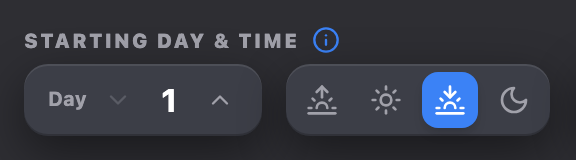</div><figcaption>Actual starting day and time controls with Sunset selected.</figcaption></figure>

##### Construction and States

The day tray uses `#3c3e47`, `12px` radius, `12px × 6px` padding, and a 16px bold white day value. Time-of-day icons are 16px inside 6px-padded buttons. Selected time uses blue-500 and white; unselected icons use zinc-400 with zinc-700 hover. The interval select uses a recessed background, black/35 border, 12px text, 10px horizontal and 8px vertical padding, and a blue-500 focus ring.

**Keyboard and verification note:** The source uses native buttons and a native select. Time buttons have title text but no selected-state ARIA attribute. In Manual mode the interval wrapper has opacity-40 and pointer-events-none; it does not set the select’s disabled attribute. These are current source limitations, not recommended accessibility rules.

<section class="reuse-recipe">

##### Use in a New Design

Use icon choices for a small recognizable set; use a numeric stepper or select when values are ordered or numerous.

**Construction:** The starting-clock values and rules belong to Opening Dialog. For a different concept, reuse the control arrangement and styling while defining its own value contract. Expose selected state and actually disable unavailable controls.

**Keep and adapt:** Keep the elevated grouping, recessed select and blue active choice. Provide text or accessible names for icons. opacity and pointer-events alone do not disable keyboard interaction.

</section>

<details class="implementation">
<summary>Supporting source</summary>

Supporting Production Source

Exact existing implementation is preserved as supporting evidence. Use the construction guidance above for the new design. Imported components retain their interfaces; source-specific data, service calls and feature state are not automatically part of a new composition.

Source: `src/features/story-builder/StoryBuilderScreen.tsx` · lines 632–768.

</details>

</section>

<section class="manual-entry">

#### Goal-Step Checkbox

Story Goals places a checkbox beside each step. This records completion, unlike a theme chip or a navigation choice. Its state contributes to the goal’s progress indicator.

<figure class="source-preview"><div class="capture-background">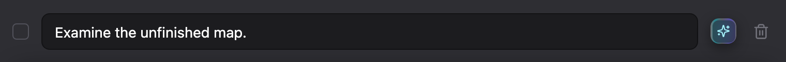</div><figcaption>Actual goal-step row with the shared checkbox and text input.</figcaption></figure>

##### Construction and Keyboard

The shared Radix Checkbox provides a 16px square and 4px radius. Story Goals overrides its border to zinc-600 and uses blue-500 for the checked fill and border. The unchecked background is transparent. The indicator contains a 16px Check icon. The row uses a 12px gap; its adjacent recessed textarea uses 12px horizontal and 8px vertical padding. Space toggles the focused checkbox; the source usage does not provide a separate accessible label for the step checkbox.

<section class="reuse-recipe">

##### Use in a New Design

Use a checkbox for an independent on/off setting or completion state.

**Construction:** Import Checkbox from src/components/ui/checkbox.tsx and add the Story Goals blue checked treatment. Wrap it in a label or connect it to visible label text. The component supplies keyboard behavior; the feature owns the checked value.

**Keep and adapt:** Keep the 16px square, 4px radius and blue selected fill. Adapt the row label and spacing to its context; a checkbox is not a navigation tab.

Pass this exact Story Goals override to Checkbox. The shared primitive supplies the 16px square, 4px radius, check indicator, theme foreground/focus, checked semantics and disabled behavior.

<p class="source-line">Exact construction fragment · src/components/chronicle/StoryGoalsSection.tsx</p>

```tsx
border-zinc-600 data-[state=checked]:bg-blue-500 data-[state=checked]:border-blue-500
```

The caller supplies checked, onCheckedChange and any disabled state, plus an associated label. Keep independent values independent. The derived Preview Options example uses border-zinc-500 on its lighter popover surface; that unselected border is an explicitly local contrast choice. The checked fill and border remain blue-500. The primitive’s disabled state uses cursor-not-allowed and 50% opacity; selection is not indicated by opacity alone.

</section>

<details class="implementation">
<summary>Supporting source</summary>

Supporting Production Source

Exact existing implementation is preserved as supporting evidence. Use the construction guidance above for the new design. Imported components retain their interfaces; source-specific data, service calls and feature state are not automatically part of a new composition.

##### checkbox.tsx

<p class="source-line">src/components/ui/checkbox.tsx · complete file</p>

```tsx
import * as React from "react";
import * as CheckboxPrimitive from "@radix-ui/react-checkbox";
import { Check } from "lucide-react";

import { cn } from "@/lib/utils";

const Checkbox = React.forwardRef<
  React.ElementRef<typeof CheckboxPrimitive.Root>,
  React.ComponentPropsWithoutRef<typeof CheckboxPrimitive.Root>
>(({ className, ...props }, ref) => (
  <CheckboxPrimitive.Root
    ref={ref}
    className={cn(
      "peer h-4 w-4 shrink-0 rounded-sm border border-primary ring-offset-background data-[state=checked]:bg-primary data-[state=checked]:text-primary-foreground focus-visible:outline-none focus-visible:ring-2 focus-visible:ring-ring focus-visible:ring-offset-2 disabled:cursor-not-allowed disabled:opacity-50",
      className,
    )}
    {...props}
  >
    <CheckboxPrimitive.Indicator className={cn("flex items-center justify-center text-current")}>
      <Check className="h-4 w-4" />
    </CheckboxPrimitive.Indicator>
  </CheckboxPrimitive.Root>
));
Checkbox.displayName = CheckboxPrimitive.Root.displayName;

export { Checkbox };

```

##### StoryGoalsSection.tsx

<p class="source-line">src/components/chronicle/StoryGoalsSection.tsx · lines 301–336</p>

```tsx
<div key={step.id} className="flex items-center gap-3">
                            <Checkbox
                              checked={step.completed}
                              onCheckedChange={() => isEditMode ? toggleStep(goal.id, step.id) : undefined}
                              disabled={!isEditMode}
                              className="border-zinc-600 data-[state=checked]:bg-blue-500 data-[state=checked]:border-blue-500"
                            />
                            {isEditMode ? (
                              <>
                                <AutoResizeTextarea
                                  value={step.description}
                                  onChange={(v) => updateStep(goal.id, step.id, { description: v })}
                                  placeholder={`Step ${stepIdx + 1}: Describe this step...`}
                                  className={cn("flex-1 px-3 py-2 bg-[#1c1c1f] border border-black/35 text-white placeholder:text-zinc-600 text-sm rounded-lg focus:outline-none focus:ring-2 focus:ring-blue-500/20 focus:border-blue-500", step.completed && "line-through text-zinc-500")}
                                />
                                <SparkleButton
                                  fieldKey={`story_step_${step.id}`}
                                  onClick={() => onEnhanceField?.(
                                    `story_step_${step.id}`,
                                    () => step.description,
                                    (v) => updateStep(goal.id, step.id, { description: v }),
                                    `Step for story goal "${goal.title || 'Untitled'}"`
                                  )}
                                />
                              </>
                            ) : (
                              <span className={cn("text-sm text-zinc-200 pt-2", step.completed && "line-through text-zinc-500")}>
                                {step.description || 'No description'}
                              </span>
                            )}
                            {isEditMode && (
                              <button tabIndex={-1} onClick={() => deleteStep(goal.id, step.id)} className="text-zinc-500 hover:text-rose-400 transition-colors p-1">
                                <Trash2 size={16} />
                              </button>
                            )}
                          </div>
```

</details>

</section>

## Panels & Layout

### Panels & Layout

Story Builder is composed as a sequence of owned layers. The application header sits outside the builder screen. Inside Story Builder, the roster and authoring canvas own separate scrolling responsibilities. Each authoring section then owns its own shell, title strip, and inset tray.

<section class="manual-entry">

#### Choose a Dialog, Menu, or Popover

“Popup” describes several different jobs. Choose the interaction first; its size and visual weight follow from that job.

| Job | Container | Chronicle treatment |
| --- | --- | --- |
| One command from a short list | Dropdown menu | Compact elevated dark shell, 14px radius, 9px rows; no large title strip. |
| A few settings beside a trigger | Popover | An anchored elevated surface, compact heading and ordinary controls; no page-wide dimming. |
| One choice between descriptive alternatives | Chooser dialog | A dimmed backdrop, 24px graphite shell, slate title and option tiles. |
| A short task with several fields | Editor dialog | A dimmed backdrop, slate-titled shell, inset tray, readable fields and explicit actions. |
| A consequential destructive confirmation | Alert dialog | Clear title and consequence, neutral Cancel and a red destructive action. |

Content with buttons or fields needs an interactive container. A large editing workflow belongs in a full authoring region rather than an oversized popup. This selection guide covers the documented interaction families; it does not imply that every kind of overlay has been specified.

</section>

<section class="manual-entry">

#### White Application Header

<figure class="source-preview"><div class="capture-background">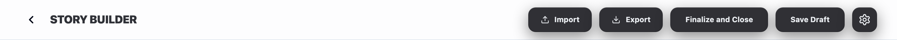</div><figcaption>Actual AppShellTopBar and AppShellHeader with Story Builder props.</figcaption></figure>

**Where used:** Above both Story Builder columns as part of the persistent application shell.

| Specification | Current rule |
| --- | --- |
| Layout | Flex, wrapping, vertically centered, space-between, `12px` gap. |
| Padding | `16px × 12px`; horizontal padding becomes `32px` at lg. |
| Surface | `rgba(248,250,252,.30)`. |
| Divider and shadow | `1px slate-200` bottom border and a small shadow. |
| Wrapping | Left and right content groups wrap instead of forcing page-level horizontal overflow. |

<section class="reuse-recipe">

##### Use in a New Design

Use the shared white header for page-level navigation and actions.

**Construction:** AppShellHeader owns the white wrapping layout; AppShellTopBar chooses the active feature’s content. A new modal or popup stays inside the dark content language and does not repeat the application header.

**Keep and adapt:** Keep the existing application integration, divider and wrapping. Adapt title and relevant actions through their owner.

</section>

<details class="implementation">
<summary>Supporting source</summary>

Supporting Production Source

Exact existing implementation is preserved as supporting evidence. Use the construction guidance above for the new design. Imported components retain their interfaces; source-specific data, service calls and feature state are not automatically part of a new composition.

##### AppShellHeader.tsx

<p class="source-line">src/components/app-shell/AppShellHeader.tsx · complete file</p>

```tsx
import React from "react";

interface AppShellHeaderProps {
  visible: boolean;
  leftContent: React.ReactNode;
  rightContent?: React.ReactNode;
}

export function AppShellHeader({ visible, leftContent, rightContent }: AppShellHeaderProps) {
  if (!visible) return null;

  return (
    <header className="flex flex-shrink-0 flex-wrap items-center justify-between gap-3 border-b border-slate-200 bg-[rgba(248,250,252,0.3)] px-4 py-3 shadow-sm lg:px-8">
      <div className="flex min-w-0 flex-wrap items-center gap-4">
        {leftContent}
      </div>
      <div className="ml-auto flex flex-wrap items-center justify-end gap-3">
        {rightContent}
      </div>
    </header>
  );
}

```

##### AppShellTopBar.tsx

<p class="source-line">src/components/app-shell/AppShellTopBar.tsx · lines 167–173</p>

```tsx
function SectionTitle({ children }: { children: React.ReactNode }) {
  return (
    <h1 className="text-lg font-black text-[hsl(var(--ui-surface-2))] uppercase tracking-tight">
      {children}
    </h1>
  );
}
```

Source: `src/components/app-shell/AppShellTopBar.tsx` · lines 458–520.

</details>

</section>

<section class="manual-entry">

#### Split-Pane Workspace

<figure class="source-preview"><div class="capture-background"></div><figcaption>Actual StoryBuilderScreen and header, rendered with local sample data at 1440px.</figcaption></figure>

| Viewport | Current composition |
| --- | --- |
| Below 1024px | Vertical stack. Roster is full width and capped at `52vh`. Canvas padding is `16px`. |
| 1024px and wider | Horizontal split pane. Roster uses `clamp(250px, 28vw, 300px)`, fills available height, and does not shrink. Canvas padding becomes `40px`. |
| Height ownership | Root uses `h-full min-h-0`; both panes use bounded internal scrolling instead of expanding the browser document. |
| Canvas reading width | Authoring content is centered at `max-w-4xl`. |

<section class="reuse-recipe">

##### Use in a New Design

Use a split workspace when a persistent local list must remain available beside a longer editor.

**Construction:** The source excerpt shows the bounded parent, roster and canvas relationship. Parent height and min-h-0 are part of this composition; adding overflow-y-auto alone does not establish a usable scrolling region.

**Keep and adapt:** Keep the separation of navigation and authoring content. Pane width, breakpoint and canvas maximum width can change for a new workspace if the content requires it; test the transition, scroll ownership and reachability of actions.

</section>

<details class="implementation">
<summary>Supporting source</summary>

Supporting Production Source

Exact existing implementation is preserved as supporting evidence. Use the construction guidance above for the new design. Imported components retain their interfaces; source-specific data, service calls and feature state are not automatically part of a new composition.

##### StoryBuilderScreen.tsx

<p class="source-line">src/features/story-builder/StoryBuilderScreen.tsx · lines 208–249 · focused layout excerpt</p>

```tsx
  // Layout guardrail:
  // Keep lg:flex-row so Story Builder stays split-pane on common laptop widths.
  // h-full + min-h-0 are required for sidebar height + internal scrolling.
  return (
    <div className="flex h-full min-h-0 min-w-0 flex-col lg:flex-row overflow-hidden">
      <StoryRosterSidebar
        characters={characters}
        onSelectCharacter={onSelectCharacter}
        characterErrorsById={publishErrors.characters}
        expandedRosterTileId={expandedRosterTileId}
        onToggleExpand={(charId) => setExpandedRosterTileId((prev) => (prev === charId ? null : charId))}
        onAddCharacter={() => setIsCharacterCreationOpen(true)}
        mainCharsCollapsed={mainCharsCollapsed}
        sideCharsCollapsed={sideCharsCollapsed}
        onToggleMainChars={() => setMainCharsCollapsed((prev) => !prev)}
        onToggleSideChars={() => setSideCharsCollapsed((prev) => !prev)}
        noAICharacterError={noAICharacterError}
        noUserCharacterError={noUserCharacterError}
      />

      <TabFieldNavigator className="flex-1 min-h-0 min-w-0 overflow-y-auto scrollbar-thin bg-ghost-white">
        <div className="p-4 lg:p-10 max-w-4xl mx-auto space-y-12 pb-20">
          <div className="mb-2">
            <h1 className="text-2xl lg:text-4xl font-black text-[hsl(var(--ui-surface-2))] tracking-tight">Story Setup</h1>
            <p className="text-sm font-medium text-slate-500 mt-1">Configure the foundation of your interactive narrative.</p>
          </div>

          <StoryCardSection
            scenarioName={world.core.scenarioName}
            briefDescription={world.core.briefDescription || ''}
            enhancingField={enhancingField}
            storyNameError={storyNameError}
            storyTitleError={publishErrors.storyTitle}
            briefDescriptionError={publishErrors.briefDescription}
            coverImage={coverImage}
            coverImagePosition={coverImagePosition}
            media={media}
            onScenarioNameChange={(value) => updateCore({ scenarioName: value })}
            onBriefDescriptionChange={(value) => updateCore({ briefDescription: value })}
            onEnhanceScenarioName={() => setEnhanceModeTarget('scenarioName')}
            onEnhanceBriefDescription={() => setEnhanceModeTarget('briefDescription')}
          />
```

##### TabFieldNavigator.tsx

<p class="source-line">src/components/chronicle/TabFieldNavigator.tsx · complete file</p>

```tsx
import React, { useRef, useCallback } from 'react';

interface TabFieldNavigatorProps {
  children: React.ReactNode;
  className?: string;
}

export const TabFieldNavigator: React.FC<TabFieldNavigatorProps> = ({ children, className }) => {
  const containerRef = useRef<HTMLDivElement>(null);

  const handleKeyDown = useCallback((e: React.KeyboardEvent) => {
    if (e.key !== 'Tab') return;

    const container = containerRef.current;
    if (!container) return;

    const fields = Array.from(
      container.querySelectorAll<HTMLElement>(
        'textarea, input:not([type=hidden]):not([type=file]):not([type=checkbox]):not([type=radio])'
      )
    ).filter(el => !el.closest('[aria-hidden="true"]') && el.offsetParent !== null);

    const currentIndex = fields.indexOf(document.activeElement as HTMLElement);
    if (currentIndex === -1) return;

    const nextIndex = e.shiftKey ? currentIndex - 1 : currentIndex + 1;
    if (nextIndex < 0 || nextIndex >= fields.length) return;

    e.preventDefault();
    fields[nextIndex].focus();
  }, []);

  return (
    <div ref={containerRef} onKeyDown={handleKeyDown} className={className}>
      {children}
    </div>
  );
};

```

</details>

</section>

<section class="manual-entry">

#### Character Roster Pane

<figure class="source-preview"><div class="capture-background">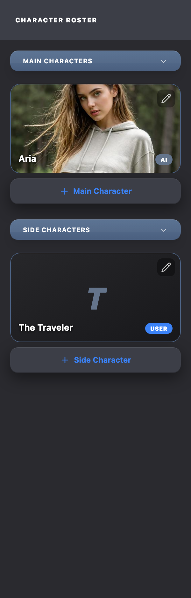</div><figcaption>Actual 300px Character Roster inside the desktop workspace.</figcaption></figure>

The roster is a structural pane, not a floating component. Its header and scroll body share the major-section shell color while the header uses the elevated surface to establish the local navigation title.

| Part | Current rule |
| --- | --- |
| Pane | `#2a2a2f`; full width below lg; `clamp(250px, 28vw, 300px)` at lg. |
| Right edge | Inset `1px white / 6%` line. |
| Header | `24px` padding, `#3c3e47`, inset bottom dark line. |
| Header text | `10px / 900 / white / uppercase / tracking-widest`. |
| Scroll body | Flexes to remaining height, vertical scrolling, `16px` padding, `24px` group spacing, `80px` bottom padding. |

<section class="reuse-recipe">

##### Use in a New Design

Use a structural side pane for persistent local navigation; use a card for a self-contained item.

**Construction:** StoryRosterSidebar is a story-character consumer. A new side pane can reuse its surface and header/body structure, but should own the new list’s state and actions.

**Keep and adapt:** Keep the elevated local header, dark shell and a bounded scroll body. The 300px desktop maximum and 52vh narrow cap belong to this roster composition.

</section>

<details class="implementation">
<summary>Supporting source</summary>

Supporting Production Source

Exact existing implementation is preserved as supporting evidence. Use the construction guidance above for the new design. Imported components retain their interfaces; source-specific data, service calls and feature state are not automatically part of a new composition.

Source: `src/features/story-builder/sidebar/StoryRosterSidebar.tsx` · lines 1–77.

</details>

</section>

<section class="manual-entry">

#### Roster Group Header and Character Tile

<figure class="source-preview"><div class="capture-background">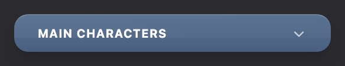</div><figcaption>Actual expanded Main Characters group heading and chevron.</figcaption></figure>

Main Characters and Side Characters use the slate section-header language at a smaller scale. Character tiles then use image-first presentation with a light ownership label and an overlay edit control.

| Part | Current rule |
| --- | --- |
| Group header | Full width, `20px × 8px` padding, `12px` radius, slate gradient, white/20 top edge, `10px / 700` uppercase title. |
| Collapsed state | Chevron rotates 180 degrees; content transitions to zero maximum height and zero opacity. |
| Character tile | `140px` collapsed height, `16px` radius, black background, `1px #4a5f7f` border. |
| Image | Cover fit at collapsed height; expanded state becomes natural-height contain. |
| Edit action | Top-right black/35 overlay, `6px` padding, `16px` Pencil icon. |
| Ownership label | `9px / 900 / uppercase`; User uses blue-500, AI uses slate-500. |
| Error | Tile border changes to red-500 and error text appears below. |

<section class="reuse-recipe">

##### Use in a New Design

Use a collapsible group for a collection that benefits from scanning; use an image tile when the image identifies the item.

**Construction:** StoryRosterGroup owns the collapse presentation and StoryRosterCharacterTile owns image fit and edit treatment. Supply the corresponding state through the parent. A new group needs accessible expanded/collapsed state and a usable empty condition.

**Keep and adapt:** Keep the slate group heading, nested tile geometry and quiet edit control. Character role labels, portrait ratio and expanded image behavior are domain-specific.

</section>

<details class="implementation">
<summary>Supporting source</summary>

Supporting Production Source

Exact existing implementation is preserved as supporting evidence. Use the construction guidance above for the new design. Imported components retain their interfaces; source-specific data, service calls and feature state are not automatically part of a new composition.

Source: `src/features/story-builder/sidebar/StoryRosterGroup.tsx` · lines 1–74.

Source: `src/features/story-builder/sidebar/StoryRosterCharacterTile.tsx` · lines 1–163.

Source: `src/features/story-builder/sidebar/AddCharacterPlaceholderCard.tsx` · lines 1–28.

</details>

</section>

<section class="manual-entry">

#### Authoring Section Shell

<figure class="source-preview"><div class="capture-background">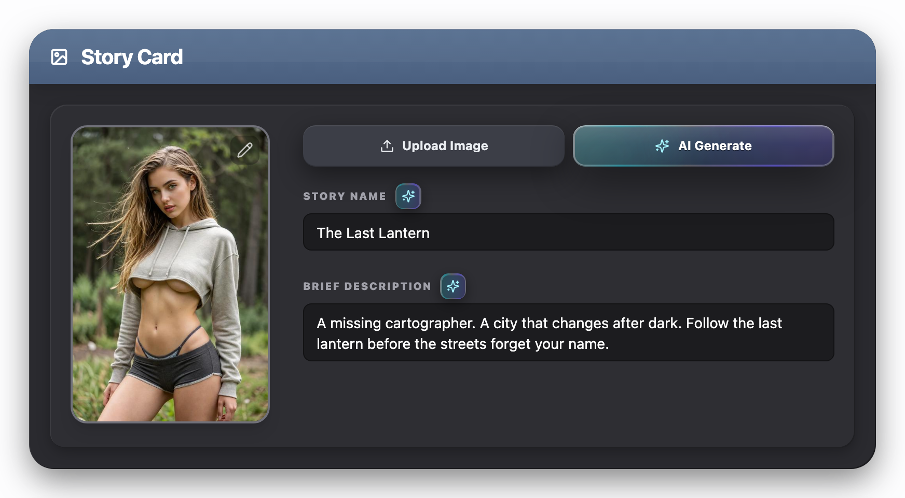</div><figcaption>Actual Story Card in the authoring canvas, showing the shell, slate header, and tray.</figcaption></figure>

**Use this pattern when:** A major Story Builder subject needs a titled, self-contained authoring region. Do not place a flat field group directly on the light canvas when the subject is one of the page’s primary sections.

| Layer | Current construction |
| --- | --- |
| Outer shell | `#2a2a2f`, `24px` radius, overflow hidden, full shell shadow stack. |
| Slate header | `#5a7292 → #4a5f7f`, white/20 top edge, `20px × 12px` padding, `12px` content gap, drop shadow. |
| Header highlight | White/10 to transparent diagonal overlay at 40% opacity and 60% height. |
| Header title | `20px / 700 / white / -0.015em`; leading icon is typically `18px`. |
| Body inset | `20px` padding between shell and tray. |
| Inner tray | `#2e2e33`, `16px` radius, `20px` padding and `24px` bottom padding, tray shadow stack. |

<section class="reuse-recipe">

##### Use in a New Design

Use a major shell for one named authoring subject. Reuse the same language for a substantial editor dialog.

**Construction:** ChronicleDarkShell supplies the shared shell fill, 24px radius and shadow, but not the slate header or inner tray. The Story Card shows the full shell → header → body inset → tray construction. Add only the layers that have a real grouping purpose.

**Keep and adapt:** Keep the shell/header/tray family and its matching radii and shadows. Adapt the title, icon, width, contents and column layout. Avoid repeatedly nesting titled shells inside each other for ordinary field groups.

</section>

<details class="implementation">
<summary>Supporting source</summary>

Supporting Production Source

Exact existing implementation is preserved as supporting evidence. Use the construction guidance above for the new design. Imported components retain their interfaces; source-specific data, service calls and feature state are not automatically part of a new composition.

Source: `src/features/story-builder/components/StoryCardSection.tsx` · lines 1–211.

</details>

</section>

<section class="manual-entry">

#### Cover and Media Frame

<figure class="source-preview"><div class="capture-background">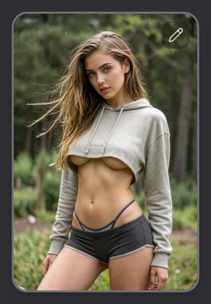</div><figcaption>Actual populated cover frame with its production border, image crop, and edit control.</figcaption></figure>

The Story Card cover is a portrait, image-owned region. Its visual states are structural: empty, populated, repositioning, and validation error.

| State | Current rule |
| --- | --- |
| Geometry | `2:3` aspect ratio; full width below md; `192px` width at md; `16px` radius. |
| Empty | `#1c1c1f`, tray shadow, centered 40px Image icon and 10px uppercase “No Cover.” |
| Populated | Cover image fills the frame with object-fit cover; `2px zinc-500` border and large shadow. |
| Repositioning | Move cursor, `4px blue-500` ring, blue shadow, touch action disabled. |
| Validation error | `2px red-500` border and `2px red-500` ring. |
| Options | Top-right Pencil menu appears only when a cover exists. |

<section class="reuse-recipe">

##### Use in a New Design

Use a media frame when the image is authored content, with controls attached to that image.

**Construction:** StoryCardSection combines the frame and media controller. A new media concept can reuse the frame and overlay treatment without inheriting cover-specific upload, deletion or drag behavior.

**Keep and adapt:** Keep the empty/populated/error distinction and clipped rounded frame. The 2:3 ratio and 192px desktop width describe a story cover; choose another ratio for landscapes, scenes or square assets while retaining the same surface family.

</section>

<details class="implementation">
<summary>Supporting source</summary>

Supporting Production Source

Exact existing implementation is preserved as supporting evidence. Use the construction guidance above for the new design. Imported components retain their interfaces; source-specific data, service calls and feature state are not automatically part of a new composition.

Source: `src/features/story-builder/components/StoryCardSection.tsx` · lines 1–211.

</details>

</section>

<section class="manual-entry">

#### Chooser Dialog

**Existing pattern.** Enhancement Style, Character Creation and Custom Content Type share ChooserModal. It is a reusable example of selecting a kind of operation using descriptive tiles.

<figure class="source-preview"><div class="capture-background">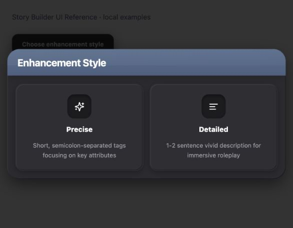</div><figcaption>Production EnhanceModeModal and ChooserModal with their current slate header and two option tiles.</figcaption></figure>

| Part | Construction |
| --- | --- |
| Backdrop and shell | DialogContentBare uses the shared black/80 overlay. The caller adds a 24px shell, #2a2a2f, shell shadow and clipped edges. |
| Title strip | Slate gradient, white/20 top edge, translucent highlight, 20px × 12px padding and 20px bold title. |
| Choice body | 16px outer padding, 12px gap; 16px-radius tray-colored tiles with descriptive copy and a recessed icon bed. |
| Width | Existing two-column mode uses 520px maximum; three-column mode uses 680px. Both use a 95vw cap. |

##### Use in a New Design

Supply open, onClose, title, options and onSelect to ChooserModal when selecting an option completes the interaction. Each option has a stable key, icon, label and description. The current component calls onSelect and then closes; it is not an editing form with a deferred Apply action.

**Adaptation boundary:** keep the shell, title and option treatment; change the choices and supporting copy. Current option columns remain fixed on narrow screens, and the current title is a plain h3 without an explicit DialogTitle association. A new implementation should fit its actual text at narrow widths and provide a named dialog and clear dismissal. Do not reproduce those limitations as style requirements.

<details class="implementation">
<summary>Supporting source</summary>

Supporting Production Source

Exact existing implementation. The limitations above describe this specimen, not the recommended semantics of a new dialog.

##### ChooserModal.tsx

<p class="source-line">src/components/chronicle/ChooserModal.tsx · lines 1–89</p>

```tsx
import React from 'react';
import { Dialog, DialogContentBare } from '@/components/ui/dialog';

/* ═══════════════════════ TYPES ═══════════════════════ */

export interface ChooserOption {
  key: string;
  icon: React.ReactNode;
  label: string;
  description: string;
  /** Tailwind border-color on hover, e.g. "blue-500" */
  hoverColor?: string;
}

export interface ChooserModalProps {
  open: boolean;
  onClose: () => void;
  title: string;
  options: ChooserOption[];
  onSelect: (key: string) => void;
  /** Grid columns — 2 (default) or 3 */
  columns?: 2 | 3;
}

/* ═══════════════════════ HOVER COLOR MAP ═══════════════════════ */

const hoverBorderMap: Record<string, string> = {
  'blue-500': 'hover:border-blue-500',
  'purple-500': 'hover:border-purple-500',
  'rose-500': 'hover:border-rose-500',
  'emerald-500': 'hover:border-emerald-500',
  'indigo-500': 'hover:border-indigo-500',
  'amber-500': 'hover:border-amber-500',
};

/* ═══════════════════════ COMPONENT ═══════════════════════ */

export const ChooserModal: React.FC<ChooserModalProps> = ({
  open,
  onClose,
  title,
  options,
  onSelect,
  columns = 2,
}) => {
  return (
    <Dialog open={open} onOpenChange={(v) => !v && onClose()}>
      <DialogContentBare
        className={`${columns === 3 ? 'sm:max-w-[680px]' : 'sm:max-w-[520px]'} max-w-[95vw] bg-[#2a2a2f] border-0 rounded-[24px] p-0 gap-0 shadow-[0_12px_32px_-2px_rgba(0,0,0,0.50),inset_1px_1px_0_rgba(255,255,255,0.09),inset_-1px_-1px_0_rgba(0,0,0,0.35)] overflow-hidden`}
      >
        {/* ── Slate-blue header (exact builder-container spec) ── */}
        <div className="relative overflow-hidden bg-gradient-to-b from-[#5a7292] to-[#4a5f7f] border-t border-white/20 px-5 py-3 flex items-center gap-3 shadow-lg">
          <div
            className="absolute inset-0 z-0 bg-gradient-to-tr from-white/10 to-transparent opacity-40 pointer-events-none"
            style={{ height: '60%' }}
          />
          <h3 className="text-white text-xl font-bold tracking-[-0.015em] relative z-[1]">
            {title}
          </h3>
        </div>

        {/* ── Option cards ── */}
        <div className={`p-4 grid ${columns === 3 ? 'grid-cols-3' : 'grid-cols-2'} gap-3`}>
          {options.map((opt) => {
            const hoverCls = hoverBorderMap[opt.hoverColor ?? 'blue-500'] ?? 'hover:border-blue-500';
            return (
              <button
                key={opt.key}
                type="button"
                onClick={() => {
                  onSelect(opt.key);
                  onClose();
                }}
                className={`group flex flex-col items-center text-center rounded-2xl bg-[#2e2e33] border-2 border-transparent py-5 px-4 gap-3 shadow-[inset_1px_1px_0_rgba(255,255,255,0.07),inset_-1px_-1px_0_rgba(0,0,0,0.30),0_4px_12px_rgba(0,0,0,0.25)] ${hoverCls} transition-all cursor-pointer`}
              >
                <div className="w-12 h-12 rounded-[14px] bg-[#1c1c1f] border-t border-black/35 shadow-[inset_0_2px_6px_rgba(0,0,0,0.40)] flex items-center justify-center">
                  {opt.icon}
                </div>
                <div className="text-white text-sm font-extrabold">{opt.label}</div>
                <p className="text-zinc-400 text-xs leading-relaxed">{opt.description}</p>
              </button>
            );
          })}
        </div>
      </DialogContentBare>
    </Dialog>
  );
};

```

##### EnhanceModeModal.tsx

<p class="source-line">src/components/chronicle/EnhanceModeModal.tsx · lines 1–45</p>

```tsx
import React from 'react';
import { Sparkles, AlignLeft } from 'lucide-react';
import { ChooserModal, type ChooserOption } from '@/components/chronicle/ChooserModal';

export type EnhanceMode = 'precise' | 'detailed';

interface EnhanceModeModalProps {
  open: boolean;
  onClose: () => void;
  onSelect: (mode: EnhanceMode) => void;
}

const OPTIONS: ChooserOption[] = [
  {
    key: 'precise',
    icon: <Sparkles className="w-5 h-5 text-white" />,
    label: 'Precise',
    description: 'Short, semicolon-separated tags focusing on key attributes',
    hoverColor: 'blue-500',
  },
  {
    key: 'detailed',
    icon: <AlignLeft className="w-5 h-5 text-white" />,
    label: 'Detailed',
    description: '1-2 sentence vivid description for immersive roleplay',
    hoverColor: 'blue-500',
  },
];

export const EnhanceModeModal: React.FC<EnhanceModeModalProps> = ({
  open,
  onClose,
  onSelect,
}) => {
  return (
    <ChooserModal
      open={open}
      onClose={onClose}
      title="Enhancement Style"
      options={OPTIONS}
      onSelect={(key) => onSelect(key as EnhanceMode)}
    />
  );
};

```

</details>

</section>

<section class="manual-entry">

#### Editor Dialog

**Derived recipe.** When a new concept needs several fields and an explicit confirm/cancel step, compose the existing dialog behavior with the Story Builder section language.

1.  Use Dialog and DialogContentBare for the modal layer. Add DialogTitle, a description when useful, and a visible named close control.
2.  Use a 24px graphite shell and slate title strip. Fit width to the form and cap it to the viewport; the worked example uses min(94vw, 620px).
3.  Use a 20px body inset and 16px tray when the fields form a substantial group. Put ordinary recessed fields inside it.
4.  Group ordinary surface actions at the end. Use an AI or destructive accent only if that action actually has that meaning.
5.  Bound the modal height and let its body scroll. Keep dismissal reachable, associate labels/errors with fields, and return focus to the trigger.

DialogContentBare supplies behavior and positioning, not the graphite shell. The default DialogContent has its own padding, background and close control. Choose deliberately so an inherited default does not introduce another visual treatment.

The Authoring Note teaching example combines these layers with recessed fields, local validation and ordinary footer actions. Its proposed width and responsive arrangement belong to that example; the surface language comes from existing patterns.

<details class="implementation">
<summary>Supporting source</summary>

Supporting Production Source

##### dialog.tsx

<p class="source-line">src/components/ui/dialog.tsx · lines 1–117</p>

```tsx
import * as React from "react";
import * as DialogPrimitive from "@radix-ui/react-dialog";
import { X } from "lucide-react";

import { cn } from "@/lib/utils";

const Dialog = DialogPrimitive.Root;

const DialogTrigger = DialogPrimitive.Trigger;

const DialogPortal = DialogPrimitive.Portal;

const DialogClose = DialogPrimitive.Close;

const DialogOverlay = React.forwardRef<
  React.ElementRef<typeof DialogPrimitive.Overlay>,
  React.ComponentPropsWithoutRef<typeof DialogPrimitive.Overlay>
>(({ className, ...props }, ref) => (
  <DialogPrimitive.Overlay
    ref={ref}
    className={cn(
      "fixed inset-0 z-50 bg-black/80 data-[state=open]:animate-in data-[state=closed]:animate-out data-[state=closed]:fade-out-0 data-[state=open]:fade-in-0",
      className,
    )}
    {...props}
  />
));
DialogOverlay.displayName = DialogPrimitive.Overlay.displayName;

const DialogContent = React.forwardRef<
  React.ElementRef<typeof DialogPrimitive.Content>,
  React.ComponentPropsWithoutRef<typeof DialogPrimitive.Content>
>(({ className, children, ...props }, ref) => (
  <DialogPortal>
    <DialogOverlay />
    <DialogPrimitive.Content
      ref={ref}
      className={cn(
        "fixed left-[50%] top-[50%] z-50 grid w-full max-w-lg translate-x-[-50%] translate-y-[-50%] gap-4 border bg-background p-6 shadow-lg duration-200 data-[state=open]:animate-in data-[state=closed]:animate-out data-[state=closed]:fade-out-0 data-[state=open]:fade-in-0 data-[state=closed]:zoom-out-95 data-[state=open]:zoom-in-95 data-[state=closed]:slide-out-to-left-1/2 data-[state=closed]:slide-out-to-top-[48%] data-[state=open]:slide-in-from-left-1/2 data-[state=open]:slide-in-from-top-[48%] sm:rounded-lg",
        className,
      )}
      {...props}
    >
      {children}
      <DialogPrimitive.Close className="absolute right-4 top-4 rounded-sm opacity-70 ring-offset-background transition-opacity data-[state=open]:bg-accent data-[state=open]:text-muted-foreground hover:opacity-100 focus:outline-none focus:ring-2 focus:ring-ring focus:ring-offset-2 disabled:pointer-events-none">
        <X className="h-4 w-4" />
        <span className="sr-only">Close</span>
      </DialogPrimitive.Close>
    </DialogPrimitive.Content>
  </DialogPortal>
));
DialogContent.displayName = DialogPrimitive.Content.displayName;

const DialogContentBare = React.forwardRef<
  React.ElementRef<typeof DialogPrimitive.Content>,
  React.ComponentPropsWithoutRef<typeof DialogPrimitive.Content>
>(({ className, children, ...props }, ref) => (
  <DialogPortal>
    <DialogOverlay />
    <DialogPrimitive.Content
      ref={ref}
      className={cn(
        "fixed left-[50%] top-[50%] z-50 w-full translate-x-[-50%] translate-y-[-50%] duration-200 data-[state=open]:animate-in data-[state=closed]:animate-out data-[state=closed]:fade-out-0 data-[state=open]:fade-in-0 data-[state=closed]:zoom-out-95 data-[state=open]:zoom-in-95 data-[state=closed]:slide-out-to-left-1/2 data-[state=closed]:slide-out-to-top-[48%] data-[state=open]:slide-in-from-left-1/2 data-[state=open]:slide-in-from-top-[48%]",
        className,
      )}
      {...props}
    >
      {children}
    </DialogPrimitive.Content>
  </DialogPortal>
));
DialogContentBare.displayName = "DialogContentBare";

const DialogHeader = ({ className, ...props }: React.HTMLAttributes<HTMLDivElement>) => (
  <div className={cn("flex flex-col space-y-1.5 text-center sm:text-left", className)} {...props} />
);
DialogHeader.displayName = "DialogHeader";

const DialogFooter = ({ className, ...props }: React.HTMLAttributes<HTMLDivElement>) => (
  <div className={cn("flex flex-col-reverse sm:flex-row sm:justify-end sm:space-x-2", className)} {...props} />
);
DialogFooter.displayName = "DialogFooter";

const DialogTitle = React.forwardRef<
  React.ElementRef<typeof DialogPrimitive.Title>,
  React.ComponentPropsWithoutRef<typeof DialogPrimitive.Title>
>(({ className, ...props }, ref) => (
  <DialogPrimitive.Title
    ref={ref}
    className={cn("text-lg font-semibold leading-none tracking-tight", className)}
    {...props}
  />
));
DialogTitle.displayName = DialogPrimitive.Title.displayName;

const DialogDescription = React.forwardRef<
  React.ElementRef<typeof DialogPrimitive.Description>,
  React.ComponentPropsWithoutRef<typeof DialogPrimitive.Description>
>(({ className, ...props }, ref) => (
  <DialogPrimitive.Description ref={ref} className={cn("text-sm text-muted-foreground", className)} {...props} />
));
DialogDescription.displayName = DialogPrimitive.Description.displayName;

export {
  Dialog,
  DialogPortal,
  DialogOverlay,
  DialogClose,
  DialogTrigger,
  DialogContent,
  DialogContentBare,
  DialogHeader,
  DialogFooter,
  DialogTitle,
  DialogDescription,
};

```

</details>

##### What the New Editor Must Supply

Compose Dialog → trigger → DialogContentBare → slate title/close → bounded body → tray → labeled fields and actions. DialogContentBare supplies the portal, black/80 backdrop, centered placement, modal focus handling and Escape dismissal. The caller supplies open state, the graphite shell/shadow, header and tray styling, title/description, named close button, and all values and handlers. Use the Authoring Section Shell’s exact layer specifications; the dialog does not add them automatically.

For a deferred edit, initialize a draft from the current values on opening. Fields and repeated-item actions update the draft; Apply validates and commits it. Cancel, close and Escape discard it. If outside dismissal is allowed, give it the same cancellation meaning. This is a composition rule for that requested interaction, not a claim about every current Chronicle form. Immediate settings instead use the popover contract.

The teaching modal’s header/close remains outside its scrolling body, and its body groups footer actions after the fields with an 8px gap. Width and maximum height follow the new content and viewport; ordinary fields do not acquire additional titled shells. The visible close uses a 16px X, 6px padding, 8px radius, white/75 text, white/10 hover background and the derived blue-300 focus ring.

</section>

<section class="manual-entry">

#### Destructive Confirmation

**Existing pattern.** A consequential removal uses an alert dialog with its consequence stated before the final action.

<figure class="source-preview"><div class="capture-background">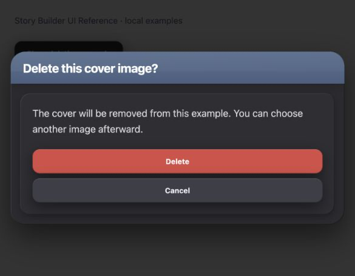</div><figcaption>Production DeleteConfirmDialog with sample cover-deletion wording. The fixture performs no deletion.</figcaption></figure>

DeleteConfirmDialog uses a 24px shell, slate title strip, inset tray, readable description and a two-action footer. The shell shadow is stronger than an ordinary section. Cancel remains an elevated neutral action; Delete uses #d94b45 and #e2554e on hover.

##### Use in a New Design

Supply open, onOpenChange, onConfirm, title and message for an actual deletion with the same interaction contract. Its action label is fixed to “Delete”; use the same alert-dialog construction with accurate wording for a different destructive operation. Preserve focus management and the safe dismissal path. State the real consequence rather than copying the example’s message.

<details class="implementation">
<summary>Supporting source</summary>

Supporting Production Source

##### DeleteConfirmDialog.tsx

<p class="source-line">src/components/chronicle/DeleteConfirmDialog.tsx · lines 1–68</p>

```tsx
import React from 'react';
import {
  AlertDialog,
  AlertDialogContent,
  AlertDialogHeader,
  AlertDialogTitle,
  AlertDialogDescription,
  AlertDialogFooter,
  AlertDialogCancel,
  AlertDialogAction,
} from '@/components/ui/alert-dialog';

interface DeleteConfirmDialogProps {
  open: boolean;
  onOpenChange: (open: boolean) => void;
  onConfirm: () => void;
  message?: string;
  title?: string;
}

export const DeleteConfirmDialog: React.FC<DeleteConfirmDialogProps> = ({
  open,
  onOpenChange,
  onConfirm,
  message,
  title,
}) => {
  return (
    <AlertDialog open={open} onOpenChange={onOpenChange}>
      <AlertDialogContent className="w-[min(94vw,640px)] max-w-none border-0 bg-transparent p-0 shadow-none gap-0">
        <div className="overflow-hidden rounded-[24px] bg-[#2a2a2f] shadow-[0_20px_50px_rgba(0,0,0,0.55),inset_1px_1px_0_rgba(255,255,255,0.09),inset_-1px_-1px_0_rgba(0,0,0,0.35)]">
          <div className="relative overflow-hidden border-t border-white/20 bg-gradient-to-b from-[#5a7292] to-[#4a5f7f] px-5 py-3 shadow-lg">
            <div
              className="pointer-events-none absolute inset-0 z-0 bg-gradient-to-tr from-white/10 to-transparent opacity-40"
              style={{ height: '60%' }}
            />
            <AlertDialogTitle className="relative z-[1] text-xl font-bold tracking-[-0.015em] text-white">
              {title || <>Are you sure you want to <span className="text-[#ffd2cf]">delete</span> this?</>}
            </AlertDialogTitle>
          </div>

          <div className="p-4 sm:p-5">
            <div className="rounded-2xl bg-[#2e2e33] p-5 shadow-[inset_1px_1px_0_rgba(255,255,255,0.07),inset_-1px_-1px_0_rgba(0,0,0,0.30),0_4px_12px_rgba(0,0,0,0.25)]">
              <AlertDialogHeader className="space-y-0 text-left">
                <AlertDialogDescription className="text-base leading-relaxed text-zinc-300">
                  {message || 'This cannot be undone.'}
                </AlertDialogDescription>
              </AlertDialogHeader>

              <AlertDialogFooter className="mt-5 gap-2 sm:gap-2">
                <AlertDialogCancel className="mt-0 inline-flex h-10 items-center justify-center rounded-xl border-0 bg-[#3c3e47] px-5 text-xs font-bold leading-none text-[#eaedf1] shadow-[0_8px_24px_rgba(0,0,0,0.45),inset_0_1px_0_rgba(255,255,255,0.09),inset_0_-1px_0_rgba(0,0,0,0.20)] transition-colors hover:bg-[#44464f] focus-visible:outline-none focus-visible:ring-2 focus-visible:ring-[#6e89ad]/70 focus-visible:ring-offset-0">
                  Cancel
                </AlertDialogCancel>
                <AlertDialogAction
                  onClick={onConfirm}
                  className="inline-flex h-10 items-center justify-center rounded-xl border-0 bg-[#d94b45] px-5 text-xs font-bold leading-none text-white shadow-[0_8px_24px_rgba(0,0,0,0.45),inset_0_1px_0_rgba(255,255,255,0.09),inset_0_-1px_0_rgba(0,0,0,0.20)] transition-colors hover:bg-[#e2554e] focus-visible:outline-none focus-visible:ring-2 focus-visible:ring-[#6e89ad]/70 focus-visible:ring-offset-0"
                >
                  Delete
                </AlertDialogAction>
              </AlertDialogFooter>
            </div>
          </div>
        </div>
      </AlertDialogContent>
    </AlertDialog>
  );
};

```

</details>

</section>

## Composition Examples

### Composition Examples

The first two examples show existing production compositions. The next two demonstrate new concepts assembled from the same visual language. All figures are React renders using Chronicle’s application styles; derived examples are explicitly identified and have their own reference-only source.

<section class="manual-entry">

#### Story Card

This composition demonstrates how the section shell, slate header, inner tray, cover frame, media actions, AI treatment, field labels, and recessed text entry work together.

<figure class="source-preview"><div class="capture-background"><picture><source media="(max-width:600px)" srcset="../../src/assets/ui-guide/story-builder/story-card-narrow.png">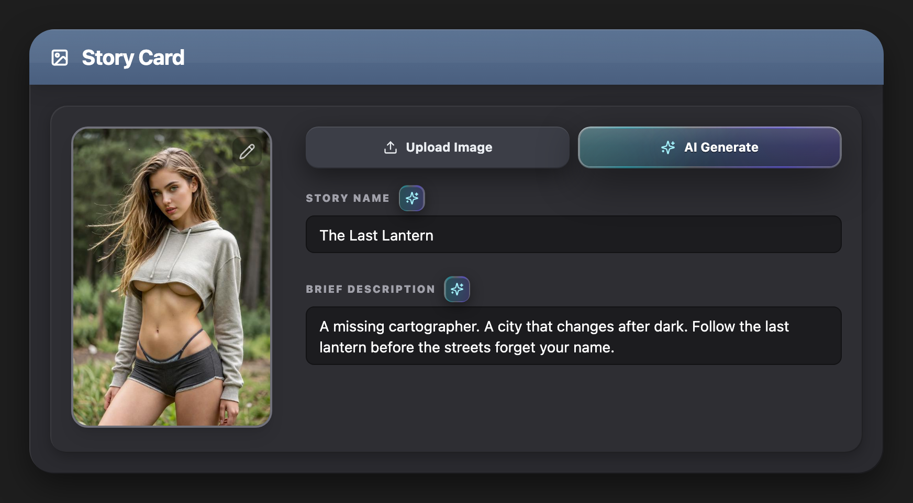</picture></div><figcaption>Actual StoryCardSection rendered from Chronicle source at an 816px component width. Story text and portrait are sample data.</figcaption></figure>

##### Composition Order

1.  Major section shell.
2.  Slate title header with leading Image icon.
3.  Twenty-pixel shell body inset.
4.  Inset tray.
5.  Responsive cover-and-fields row.
6.  Upload source menu and AI Generate action.
7.  AI-capable field labels and auto-resizing text entry.

##### Responsive Behavior

Below 768px the cover and field column stack, and the cover can use the available width while retaining its 2:3 ratio. At 768px and wider the cover becomes 192px wide, the fields consume the remaining width, and the gap is 32px.

The Story Card combines a shell, slate title, inset tray, media controls and recessed fields. Upload is an elevated source action; AI Generate uses its layered teal–violet treatment.

At narrower widths this figure uses a separately captured narrow render, not a squeezed desktop reconstruction. Production keeps the media buttons side by side and truncates their labels when space is limited.

<section class="reuse-recipe">

##### Use in a New Design

Use this as a worked example of a substantial section containing media and fields.

**Construction:** Read the composition order, then select only the relevant pieces for the new concept. StoryCardSection itself requires story values, callbacks and a media controller; a text-only subject should not inherit those dependencies.

**Keep and adapt:** The shell, slate header, inset tray and field/action treatments carry forward. The cover, specific field names, two-column arrangement and media workflow belong to the Story Card.

</section>

<details class="implementation">
<summary>Supporting source</summary>

Supporting Production Source

**Composition:** StoryCardSection → shell → slate header → body inset → inner tray → cover and fields → CoverImageActionButtons → StoryBuilderFieldLabel → AutoResizeTextarea.

**State dependency:** `useStoryBuilderMedia` supplies cover refs and image actions. The component itself owns the displayed image frame and menu markup; external services are outside this visual capture.

Exact existing implementation is preserved as supporting evidence. Use the construction guidance above for the new design. Imported components retain their interfaces; source-specific data, service calls and feature state are not automatically part of a new composition.

##### StoryCardSection.tsx

<p class="source-line">src/features/story-builder/components/StoryCardSection.tsx · complete file</p>

```tsx
import type { RefObject } from 'react';
import { Move, Pencil, Trash2 } from 'lucide-react';
import { cn } from '@/lib/utils';
import { AutoResizeTextarea } from '@/components/chronicle/AutoResizeTextarea';
import { CoverImageActionButtons } from '@/components/chronicle/CoverImageActionButtons';
import {
  DropdownMenu,
  DropdownMenuContent,
  DropdownMenuItem,
  DropdownMenuTrigger,
} from '@/components/ui/dropdown-menu';
import type { StoryBuilderMediaController } from '@/features/story-builder/hooks/use-story-builder-media';
import { StoryBuilderFieldLabel } from './StoryBuilderFieldLabel';

type StoryCardSectionProps = {
  scenarioName: string;
  briefDescription: string;
  enhancingField: string | null;
  storyNameError?: boolean;
  storyTitleError?: string;
  briefDescriptionError?: string;
  coverImage: string;
  coverImagePosition: { x: number; y: number };
  media: StoryBuilderMediaController;
  onScenarioNameChange: (value: string) => void;
  onBriefDescriptionChange: (value: string) => void;
  onEnhanceScenarioName: () => void;
  onEnhanceBriefDescription: () => void;
};

export function StoryCardSection({
  scenarioName,
  briefDescription,
  enhancingField,
  storyNameError,
  storyTitleError,
  briefDescriptionError,
  coverImage,
  coverImagePosition,
  media,
  onScenarioNameChange,
  onBriefDescriptionChange,
  onEnhanceScenarioName,
  onEnhanceBriefDescription,
}: StoryCardSectionProps) {
  const hasStoryTitleError = Boolean((storyNameError && !scenarioName.trim()) || storyTitleError);

  return (
    <section>
      <div className="w-full overflow-hidden rounded-[24px] bg-[#2a2a2f] shadow-[0_12px_32px_-2px_rgba(0,0,0,0.50),inset_1px_1px_0_rgba(255,255,255,0.09),inset_-1px_-1px_0_rgba(0,0,0,0.35)]">
        <div className="relative flex items-center gap-3 overflow-hidden border-t border-white/20 bg-gradient-to-b from-[#5a7292] to-[#4a5f7f] px-5 py-3 shadow-lg">
          <div className="absolute inset-0 z-0 bg-gradient-to-tr from-white/10 to-transparent opacity-40" style={{ height: '60%' }} />
          <svg xmlns="http://www.w3.org/2000/svg" width="18" height="18" viewBox="0 0 24 24" fill="none" stroke="currentColor" strokeWidth="2.5" strokeLinecap="round" strokeLinejoin="round" className="relative z-[1] text-white"><rect width="18" height="18" x="3" y="3" rx="2" ry="2"/><circle cx="9" cy="9" r="2"/><path d="m21 15-3.086-3.086a2 2 0 0 0-2.828 0L6 21"/></svg>
          <h2 className="relative z-[1] text-xl font-bold tracking-[-0.015em] text-white">Story Card</h2>
        </div>

        <div className="p-5">
          <div className="rounded-2xl bg-[#2e2e33] p-5 pb-6 shadow-[inset_1px_1px_0_rgba(255,255,255,0.07),inset_-1px_-1px_0_rgba(0,0,0,0.30),0_4px_12px_rgba(0,0,0,0.25)]">
            <div className="flex flex-col gap-8 md:flex-row">
              <div data-publish-error={storyTitleError ? true : undefined}>
                <div
                  ref={media.coverContainerRef as RefObject<HTMLDivElement>}
                  onMouseDown={media.handleCoverMouseDown}
                  onMouseMove={media.handleCoverMouseMove}
                  onMouseUp={media.handleCoverMouseUp}
                  onMouseLeave={media.handleCoverMouseUp}
                  onTouchStart={media.handleCoverTouchStart}
                  onTouchMove={media.handleCoverTouchMove}
                  onTouchEnd={media.handleCoverTouchEnd}
                  style={media.isRepositioningCover ? { touchAction: 'none' } : undefined}
                  className={cn(
                    'relative aspect-[2/3] w-full overflow-hidden rounded-2xl transition-all duration-200 md:w-48',
                    media.isRepositioningCover
                      ? 'cursor-move ring-4 ring-blue-500 shadow-xl shadow-blue-500/20'
                      : storyTitleError
                        ? 'border-2 border-red-500 ring-2 ring-red-500'
                        : coverImage
                          ? 'border-2 border-zinc-500 shadow-lg'
                          : 'shadow-lg'
                  )}
                >
                  {coverImage ? (
                    <>
                      
                      {media.isRepositioningCover ? (
                        <div className="pointer-events-auto absolute inset-0 z-[18] cursor-move touch-none">
                          <button
                            type="button"
                            className="pointer-events-auto absolute left-2 top-2 z-20 rounded-md border border-white/20 bg-black/55 px-2 py-1 text-[9px] font-bold text-white hover:bg-black/70"
                            onMouseDown={(event) => event.stopPropagation()}
                            onTouchStart={(event) => event.stopPropagation()}
                            onClick={(event) => {
                              event.stopPropagation();
                              media.finishCoverRepositioning();
                            }}
                          >
                            Done
                          </button>
                        </div>
                      ) : null}
                    </>
                  ) : (
                    <div className="flex h-full w-full flex-col items-center justify-center gap-3 rounded-2xl bg-[#1c1c1f] shadow-[inset_1px_1px_0_rgba(255,255,255,0.07),inset_-1px_-1px_0_rgba(0,0,0,0.30),0_4px_12px_rgba(0,0,0,0.25)]">
                      <svg xmlns="http://www.w3.org/2000/svg" width="40" height="40" viewBox="0 0 24 24" fill="none" stroke="currentColor" strokeWidth="1.5" strokeLinecap="round" strokeLinejoin="round" className="text-zinc-500"><rect width="18" height="18" x="3" y="3" rx="2" ry="2"/><circle cx="9" cy="9" r="2"/><path d="m21 15-3.086-3.086a2 2 0 0 0-2.828 0L6 21"/></svg>
                      <span className="text-[10px] font-black uppercase tracking-widest text-zinc-500">No Cover</span>
                    </div>
                  )}

                  {coverImage ? (
                    <div className="absolute right-2 top-2 z-30">
                      <DropdownMenu>
                        <DropdownMenuTrigger asChild>
                          <button
                            type="button"
                            className="rounded-lg bg-black/30 p-1.5 text-white/70 transition-colors hover:bg-black/50 hover:text-white"
                            aria-label="Cover image options"
                            title="Cover image options"
                          >
                            <Pencil className="h-4 w-4" />
                          </button>
                        </DropdownMenuTrigger>
                        <DropdownMenuContent align="end">
                          <DropdownMenuItem onClick={media.beginCoverRepositioning}>
                            <Move className="mr-2 h-4 w-4" />
                            Reposition image
                          </DropdownMenuItem>
                          <DropdownMenuItem onClick={media.requestDeleteCover} className="text-red-400 focus:text-red-400">
                            <Trash2 className="mr-2 h-4 w-4" />
                            Delete image
                          </DropdownMenuItem>
                        </DropdownMenuContent>
                      </DropdownMenu>
                    </div>
                  ) : null}
                </div>
                {storyTitleError ? (
                  <p className="mt-2 text-sm font-medium text-red-500">{storyTitleError}</p>
                ) : null}
              </div>

              <div className="flex flex-1 flex-col gap-4">
                <CoverImageActionButtons
                  onUploadFromDevice={() => media.coverFileInputRef.current?.click()}
                  onSelectFromLibrary={media.handleCoverSelectedFromLibrary}
                  onGenerateClick={media.openCoverGenerator}
                  disabled={media.isUploadingCover}
                  isUploading={media.isUploadingCover}
                  isGenerating={false}
                />

                <div data-publish-error={hasStoryTitleError || undefined}>
                  <StoryBuilderFieldLabel
                    label="Story Name"
                    onEnhance={onEnhanceScenarioName}
                    isLoading={enhancingField === 'scenarioName'}
                    isDisabled={enhancingField !== null && enhancingField !== 'scenarioName'}
                  />
                  <AutoResizeTextarea
                    value={scenarioName}
                    onChange={onScenarioNameChange}
                    placeholder="e.g. Chronicles of Eldoria"
                    className={`px-3 py-2 text-sm bg-[#1c1c1f] text-white placeholder:text-zinc-600 rounded-lg focus:outline-none focus:ring-2 focus:ring-blue-500/20 focus:border-blue-500 ${hasStoryTitleError ? 'border border-red-500 ring-2 ring-red-500' : 'border border-black/35'}`}
                  />
                  {hasStoryTitleError ? (
                    <p className="mt-1 text-sm text-red-500">{storyTitleError || 'Story name is required'}</p>
                  ) : null}
                </div>

                <div data-publish-error={briefDescriptionError ? true : undefined}>
                  <StoryBuilderFieldLabel
                    label="Brief Description"
                    onEnhance={onEnhanceBriefDescription}
                    isLoading={enhancingField === 'briefDescription'}
                    isDisabled={enhancingField !== null && enhancingField !== 'briefDescription'}
                  />
                  <AutoResizeTextarea
                    value={briefDescription}
                    onChange={onBriefDescriptionChange}
                    rows={2}
                    placeholder="A short summary that appears on your story card (1-2 sentences)..."
                    className={`px-3 py-2 text-sm bg-[#1c1c1f] text-white placeholder:text-zinc-600 rounded-lg focus:outline-none focus:ring-2 focus:ring-blue-500/20 focus:border-blue-500 ${briefDescriptionError ? 'border border-red-500 ring-2 ring-red-500' : 'border border-black/35'}`}
                  />
                  {briefDescriptionError ? (
                    <p className="mt-1 text-sm font-medium text-red-500">{briefDescriptionError}</p>
                  ) : null}
                </div>

                <input
                  type="file"
                  ref={media.coverFileInputRef as RefObject<HTMLInputElement>}
                  className="hidden"
                  accept="image/*"
                  onChange={(event) => {
                    void media.handleCoverUpload(event);
                  }}
                />
              </div>
            </div>
          </div>
        </div>
      </div>
    </section>
  );
}

```

Source: `src/components/chronicle/CoverImageActionButtons.tsx` · lines 1–182.

Source: `src/features/story-builder/components/StoryBuilderFieldLabel.tsx` · lines 1–65.

Source: `src/components/chronicle/AutoResizeTextarea.tsx` · lines 1–64.

Source: `src/components/ui/dropdown-menu.tsx` · lines 1–180.

</details>

</section>

<section class="manual-entry">

#### Character Roster

This composition demonstrates the roster pane, local title, expanded and collapsed character groups, image-first tile, edit overlay, ownership label, and full-width Add action.

<figure class="source-preview"><div class="capture-background">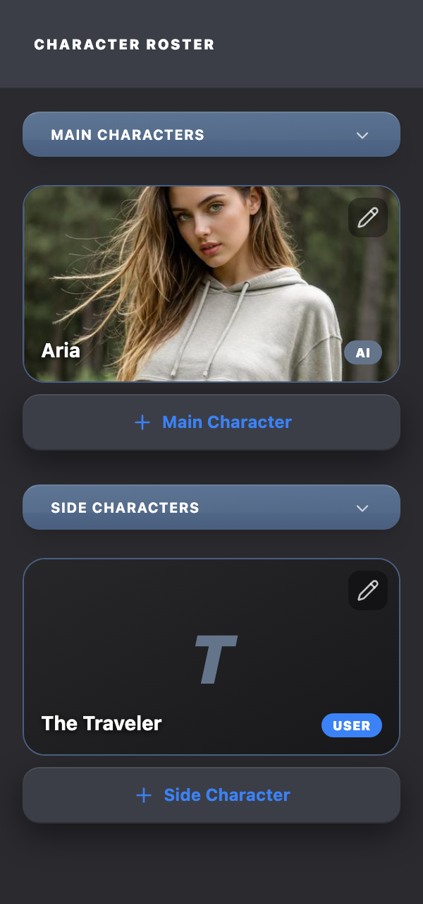</div><figcaption>Actual StoryRosterSidebar at its desktop 300px width. Both groups are expanded; the missing portrait demonstrates the real initial-letter fallback.</figcaption></figure>

##### Composition Order

1.  Non-shrinking roster pane.
2.  Elevated local header.
3.  Internally scrolling group body.
4.  Slate group controls for Main and Side Characters.
5.  Character tiles followed by a full-width Add action.
6.  Field-local errors below the owning tile or Add action.

##### Responsive Behavior

Below 1024px the roster becomes full width, uses automatic height, and is capped at 52vh. At 1024px and wider it becomes `clamp(250px, 28vw, 300px)`, fills the available workspace height, and maintains its own vertical scroll.

The roster combines collapsible slate group headings, image tiles, quiet overlay actions and blue-text Add actions inside a bounded side pane.

##### Collapsed Group and Validation State

<figure class="source-preview" data-added-state="true"><div class="capture-background">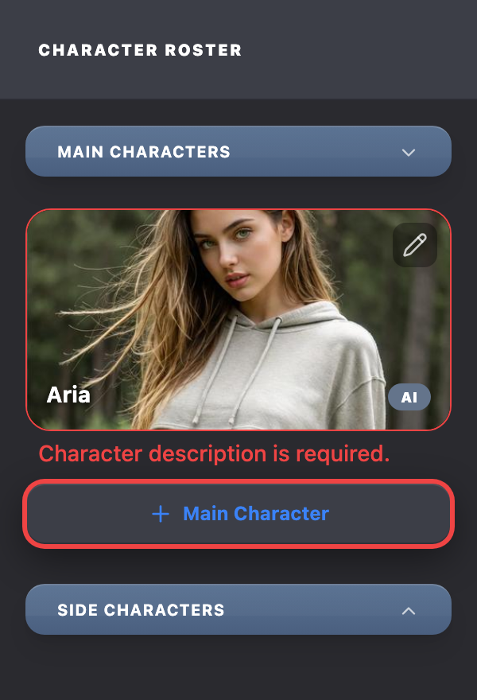</div><figcaption>Same production roster with Side Characters collapsed and explicit sample validation props. Red error treatment is supplied by the component, not drawn onto the image.</figcaption></figure>

<section class="reuse-recipe">

##### Use in a New Design

Use this as a worked example of compact navigation, grouping and image-led items.

**Construction:** Read the pane and group relationships before adapting the tile. For a new collection, implement that collection’s state and item actions; use the source as the construction reference.

**Keep and adapt:** The layered pane and grouping language carry forward. Cast roles, ownership labels and character-edit behavior belong to this example.

</section>

<details class="implementation">
<summary>Supporting source</summary>

Supporting Production Source

**Composition:** StoryRosterSidebar → fixed heading and scroll body → StoryRosterGroup → StoryRosterCharacterTile and AddCharacterPlaceholderCard. Collapsed and expanded state is passed from StoryBuilderScreen.

Exact existing implementation is preserved as supporting evidence. Use the construction guidance above for the new design. Imported components retain their interfaces; source-specific data, service calls and feature state are not automatically part of a new composition.

##### StoryRosterSidebar.tsx

<p class="source-line">src/features/story-builder/sidebar/StoryRosterSidebar.tsx · complete file</p>

```tsx
import React from 'react';
import { Character } from '@/types';
import { StoryRosterGroup } from '@/features/story-builder/sidebar/StoryRosterGroup';

interface StoryRosterSidebarProps {
  characters: Character[];
  onSelectCharacter: (id: string) => void;
  characterErrorsById?: Record<string, string[]>;
  expandedRosterTileId: string | null;
  onToggleExpand: (id: string) => void;
  onAddCharacter: () => void;
  mainCharsCollapsed: boolean;
  sideCharsCollapsed: boolean;
  onToggleMainChars: () => void;
  onToggleSideChars: () => void;
  noAICharacterError?: string;
  noUserCharacterError?: string;
}

export const StoryRosterSidebar: React.FC<StoryRosterSidebarProps> = ({
  characters,
  onSelectCharacter,
  characterErrorsById,
  expandedRosterTileId,
  onToggleExpand,
  onAddCharacter,
  mainCharsCollapsed,
  sideCharsCollapsed,
  onToggleMainChars,
  onToggleSideChars,
  noAICharacterError,
  noUserCharacterError,
}) => {
  const mainCharacters = characters.filter((character) => character.characterRole === 'Main');
  const sideCharacters = characters.filter((character) => character.characterRole === 'Side');

  return (
    // Layout guardrail: keep lg:h-full + lg:max-h-none so roster fills pane height
    // when split-pane mode is active; mobile/tablet still uses capped stacked mode.
    <aside className="w-full lg:w-[clamp(250px,28vw,300px)] flex-shrink-0 bg-[#2a2a2f] shadow-[inset_-1px_0_0_rgba(255,255,255,0.06)] flex flex-col h-auto lg:h-full max-h-[52vh] lg:max-h-none">
      <div className="p-6 bg-[#3c3e47] shadow-[inset_0_-1px_0_rgba(0,0,0,0.25)]">
        <div className="text-[10px] font-black text-white uppercase tracking-widest">Character Roster</div>
      </div>

      <div className="flex-1 overflow-y-auto p-4 space-y-6 scrollbar-none pb-20 bg-[#2a2a2f]">
        <StoryRosterGroup
          title="Main Characters"
          collapsed={mainCharsCollapsed}
          onToggle={onToggleMainChars}
          characters={mainCharacters}
          onSelectCharacter={onSelectCharacter}
          characterErrorsById={characterErrorsById}
          expandedRosterTileId={expandedRosterTileId}
          onToggleExpand={onToggleExpand}
          onAddCharacter={onAddCharacter}
          addLabel="Main Character"
          addHasError={Boolean(noAICharacterError || noUserCharacterError)}
          additionalErrors={[noAICharacterError, noUserCharacterError].filter(Boolean) as string[]}
        />

        <StoryRosterGroup
          title="Side Characters"
          collapsed={sideCharsCollapsed}
          onToggle={onToggleSideChars}
          characters={sideCharacters}
          onSelectCharacter={onSelectCharacter}
          characterErrorsById={characterErrorsById}
          expandedRosterTileId={expandedRosterTileId}
          onToggleExpand={onToggleExpand}
          onAddCharacter={onAddCharacter}
          addLabel="Side Character"
        />
      </div>
    </aside>
  );
};

```

##### StoryRosterGroup.tsx

<p class="source-line">src/features/story-builder/sidebar/StoryRosterGroup.tsx · complete file</p>

```tsx
import React from 'react';
import { ChevronDown } from 'lucide-react';
import { Character } from '@/types';
import { StoryRosterCharacterTile } from '@/features/story-builder/sidebar/StoryRosterCharacterTile';
import { AddCharacterPlaceholderCard } from '@/features/story-builder/sidebar/AddCharacterPlaceholderCard';

interface StoryRosterGroupProps {
  title: string;
  collapsed: boolean;
  onToggle: () => void;
  characters: Character[];
  onSelectCharacter: (id: string) => void;
  characterErrorsById?: Record<string, string[]>;
  expandedRosterTileId: string | null;
  onToggleExpand: (id: string) => void;
  onAddCharacter: () => void;
  addLabel: string;
  addHasError?: boolean;
  additionalErrors?: string[];
}

export const StoryRosterGroup: React.FC<StoryRosterGroupProps> = ({
  title,
  collapsed,
  onToggle,
  characters,
  onSelectCharacter,
  characterErrorsById,
  expandedRosterTileId,
  onToggleExpand,
  onAddCharacter,
  addLabel,
  addHasError,
  additionalErrors,
}) => (
  <section className="space-y-2">
    <button
      type="button"
      aria-expanded={!collapsed}
      className="relative w-full overflow-hidden bg-gradient-to-b from-[#5a7292] to-[#4a5f7f] border-t border-white/20 px-5 py-2 rounded-xl mb-3 shadow-lg cursor-pointer select-none text-left"
      onClick={onToggle}
    >
      <div className="absolute inset-0 z-0 bg-gradient-to-tr from-white/10 to-transparent opacity-40" style={{ height: '60%' }} />
      <div className="flex items-center justify-between relative z-[1]">
        <span className="text-[10px] font-bold text-white uppercase tracking-wider">{title}</span>
        <ChevronDown className={`w-3.5 h-3.5 text-white/70 transition-transform duration-200 ${collapsed ? 'rotate-180' : ''}`} />
      </div>
    </button>

    <div
      className={`transition-all duration-300 ease-in-out ${collapsed ? 'max-h-0 opacity-0 overflow-hidden' : 'max-h-[2000px] opacity-100 overflow-visible'}`}
    >
      <div className="space-y-2">
        {characters.map((char) => (
          <StoryRosterCharacterTile
            key={char.id}
            char={char}
            onSelect={onSelectCharacter}
            errors={characterErrorsById?.[char.id]}
            isExpanded={expandedRosterTileId === char.id}
            onToggleExpand={onToggleExpand}
          />
        ))}
        <AddCharacterPlaceholderCard label={addLabel} hasError={addHasError} onClick={onAddCharacter} />
        {additionalErrors?.map((error, index) => (
          <p key={`${error}-${index}`} className="text-sm text-red-500 font-medium pl-2">
            {error}
          </p>
        ))}
      </div>
    </div>
  </section>
);

```

##### StoryRosterCharacterTile.tsx

<p class="source-line">src/features/story-builder/sidebar/StoryRosterCharacterTile.tsx · complete file</p>

```tsx
import React, { useEffect, useMemo, useState } from 'react';
import { Pencil } from 'lucide-react';
import { Character } from '@/types';
import { cn } from '@/lib/utils';
import { clampPercent, mapPreviewToTilePosition, Size2D } from '@/features/shared-builder/utils/image-position';

const CHARACTER_AVATAR_PREVIEW_SIZE = 192;
const STORY_ROSTER_TILE_HEIGHT = 140;
const STORY_ROSTER_TILE_WIDTH = 268;
const avatarNaturalSizeCache = new Map<string, Size2D>();

interface StoryRosterCharacterTileProps {
  char: Character;
  onSelect: (id: string) => void;
  errors?: string[];
  isExpanded: boolean;
  onToggleExpand: (id: string) => void;
}

export const StoryRosterCharacterTile: React.FC<StoryRosterCharacterTileProps> = ({
  char,
  onSelect,
  errors,
  isExpanded,
  onToggleExpand,
}) => {
  const hasAvatar = Boolean(char.avatarDataUrl);
  const [naturalImageSize, setNaturalImageSize] = useState<Size2D | null>(
    () => (char.avatarDataUrl ? avatarNaturalSizeCache.get(char.avatarDataUrl) ?? null : null)
  );

  useEffect(() => {
    if (!hasAvatar) {
      setNaturalImageSize(null);
      return;
    }

    const cachedSize = avatarNaturalSizeCache.get(char.avatarDataUrl!);
    if (cachedSize) {
      setNaturalImageSize(cachedSize);
      return;
    }

    let cancelled = false;
    const image = new Image();
    const commitSize = () => {
      const nextSize = {
        width: image.naturalWidth || 1,
        height: image.naturalHeight || 1,
      };
      avatarNaturalSizeCache.set(char.avatarDataUrl!, nextSize);
      if (!cancelled) setNaturalImageSize(nextSize);
    };

    image.onload = () => {
      commitSize();
    };
    image.onerror = () => {
      if (!cancelled) setNaturalImageSize(null);
    };
    image.src = char.avatarDataUrl!;
    if (image.complete && image.naturalWidth > 0) {
      commitSize();
    }

    return () => {
      cancelled = true;
    };
  }, [char.avatarDataUrl, hasAvatar]);

  const tileObjectPosition = useMemo(() => {
    const stored = {
      x: clampPercent(char.avatarPosition?.x ?? 50),
      y: clampPercent(char.avatarPosition?.y ?? 50),
    };

    if (!naturalImageSize) return stored;

    return mapPreviewToTilePosition(
      stored,
      naturalImageSize,
      { width: CHARACTER_AVATAR_PREVIEW_SIZE, height: CHARACTER_AVATAR_PREVIEW_SIZE },
      { width: STORY_ROSTER_TILE_WIDTH, height: STORY_ROSTER_TILE_HEIGHT }
    );
  }, [char.avatarPosition?.x, char.avatarPosition?.y, naturalImageSize]);

  return (
    <div className="space-y-1">
      <div
        className={cn(
          'group relative overflow-hidden rounded-2xl bg-black transition-all duration-300',
          isExpanded ? '' : 'h-[140px]',
          errors && errors.length > 0 ? 'border border-red-500' : 'border border-[#4a5f7f]'
        )}
      >
        {hasAvatar ? (
          
        ) : (
          <div className="flex h-full min-h-[140px] items-center justify-center bg-gradient-to-br from-zinc-800 to-zinc-900 font-black text-5xl italic uppercase text-slate-500">
            {char.name.charAt(0)}
          </div>
        )}

        <div className="absolute inset-0 bg-black/0 group-hover:bg-black/25 transition-colors duration-200 z-[5] pointer-events-none" />

        {hasAvatar && (
          <button
            type="button"
            onClick={() => onToggleExpand(char.id)}
            className="absolute inset-0 z-20"
            aria-label={isExpanded ? `Collapse ${char.name} avatar` : `Expand ${char.name} avatar`}
          />
        )}

        <button
          type="button"
          onClick={(event) => {
            event.stopPropagation();
            onSelect(char.id);
          }}
          className="absolute right-2 top-2 z-30 rounded-lg bg-black/35 p-1.5 text-white/75 transition-colors hover:bg-black/55 hover:text-white"
          aria-label={`Edit ${char.name}`}
        >
          <Pencil className="w-4 h-4" />
        </button>

        <div className="absolute inset-x-0 bottom-0 z-30 p-3">
          <div className="flex items-end justify-between gap-2">
            <div className="min-w-0 flex-1">
              <div className="truncate text-sm font-bold text-white drop-shadow-[0_1px_2px_rgba(0,0,0,0.85)]">
                {char.name}
              </div>
            </div>
            <span
              className={cn(
                'text-[9px] font-black uppercase tracking-wide shrink-0 rounded-full px-2 py-0.5',
                char.controlledBy === 'User' ? 'bg-blue-500 text-white' : 'bg-slate-500 text-white'
              )}
            >
              {char.controlledBy}
            </span>
          </div>
        </div>
      </div>

      {errors && errors.length > 0 && (
        <div className="pl-2 space-y-0.5">
          {errors.map((error, index) => (
            <p key={index} className="text-sm text-red-500 font-medium">
              {error}
            </p>
          ))}
        </div>
      )}
    </div>
  );
};

```

Source: `src/features/story-builder/sidebar/AddCharacterPlaceholderCard.tsx` · lines 1–28.

##### image-position.ts

<p class="source-line">src/features/shared-builder/utils/image-position.ts · complete file</p>

```tsx
export type Size2D = { width: number; height: number };

export const clampPercent = (value: number): number => Math.max(0, Math.min(100, value));

const mapAxis = (
  percent: number,
  imageLength: number,
  fromLength: number,
  toLength: number,
  fromScale: number,
  toScale: number
): number => {
  const fromRendered = imageLength * fromScale;
  const fromOverflow = Math.max(0, fromRendered - fromLength);
  const sourceOffset =
    fromOverflow === 0
      ? 0
      : ((fromOverflow * clampPercent(percent)) / 100) / fromScale;

  const toRendered = imageLength * toScale;
  const toOverflow = Math.max(0, toRendered - toLength);
  if (toOverflow === 0) return 50;

  const toOffset = sourceOffset * toScale;
  return clampPercent((toOffset / toOverflow) * 100);
};

export const mapPositionBetweenFrames = (
  stored: { x: number; y: number },
  imageSize: Size2D,
  fromSize: Size2D,
  toSize: Size2D
): { x: number; y: number } => {
  const fromScale = Math.max(
    fromSize.width / imageSize.width,
    fromSize.height / imageSize.height
  );
  const toScale = Math.max(
    toSize.width / imageSize.width,
    toSize.height / imageSize.height
  );

  return {
    x: mapAxis(stored.x, imageSize.width, fromSize.width, toSize.width, fromScale, toScale),
    y: mapAxis(stored.y, imageSize.height, fromSize.height, toSize.height, fromScale, toScale),
  };
};

export const mapPreviewToTilePosition = (
  storedPreviewPercent: { x: number; y: number },
  imageSize: Size2D,
  previewSize: Size2D,
  tileSize: Size2D
): { x: number; y: number } =>
  mapPositionBetweenFrames(storedPreviewPercent, imageSize, previewSize, tileSize);

export const mapTileToPreviewPosition = (
  tilePercent: { x: number; y: number },
  imageSize: Size2D,
  tileSize: Size2D,
  previewSize: Size2D
): { x: number; y: number } =>
  mapPositionBetweenFrames(tilePercent, imageSize, tileSize, previewSize);

```

</details>

</section>

<p class="verification-note"><strong>Verification note:</strong> These are local source-rendered captures, not screenshots of an authenticated saved story. Upload, AI, persistence, and account services were not exercised. The displayed controls are images; only this manual’s navigation and disclosures are interactive.</p>

<section class="manual-entry">

#### New Composition: Authoring Note Modal

**Design brief:** “Let me write a named atmosphere cue in a modal.” This reference-only example demonstrates how to create a new form while retaining Chronicle’s visual language.

<figure class="source-preview"><div class="capture-background"><picture><source media="(max-width:600px)" srcset="../../src/assets/ui-guide/story-builder/new-authoring-note-narrow.png" width="317" height="686">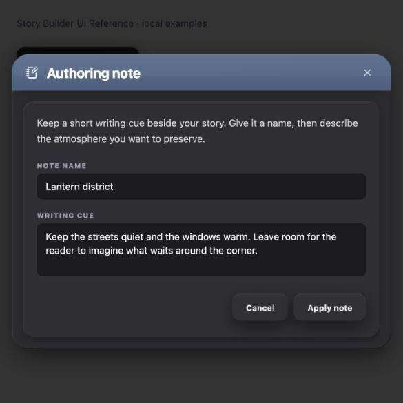</picture></div><figcaption>Derived Authoring Note modal: a new reference example, not an implemented Story Builder feature.</figcaption></figure>

| New design decision | Borrowed pattern | Why it fits |
| --- | --- | --- |
| A centered form with explicit Apply and Cancel | Editor dialog | The interaction is a small focused task, separate from the page. |
| A titled container with grouped fields | Shell, slate header and tray | It carries the same depth and hierarchy as a major authoring section. |
| Name and longer writing cue | Recessed text entry | Input and textarea share styling while using different sizing behavior. |
| Neutral footer actions | Shared surface button | Applying authored text is an ordinary operation; it does not need an AI or destructive accent. |

**What is new:** the field content, 620px width, close control, bounded scrolling and local form wiring. **What is inherited:** surfaces, shadows, radii, slate header, text hierarchy, fields, focus treatment and ordinary actions.

The example includes a properly named dialog, associated labels, an inline empty-name error, Cancel/close behavior and a local Apply result. It stores nothing outside the preview. This demonstrates construction; the eventual feature would supply its own data and saving behavior.

##### Transfer the Decisions

The modal is chosen because this is a separate editing task with an explicit completion point. The title strip identifies the subject; the tray groups the related fields; both single-line and longer prose use the same recessed family. Adding more fields should reuse that vocabulary and choose the appropriate control by meaning, not add a new color or copy the Story Card’s media column.

**Example limit:** the local fixture reports Apply and closes, but does not maintain separate committed and draft values; typed values remain when it reopens. Its screenshot teaches styling. A real deferred editor must supply the draft/commit/cancel behavior described in Editor Dialog. The example’s 620px width and 90dvh height cap are layout choices, not global requirements.

<details class="implementation">
<summary>Supporting source</summary>

Supporting Reference Source

This is complete reference-only React source, adapted from the named patterns. It includes both new examples and their preview harness. The constants at the top carry the field styling that AutoResizeTextarea does not supply by itself.

##### composition-examples.tsx

<p class="source-line">docs/ui-guide/examples/composition-examples.tsx · reference-only examples</p>

```tsx
import React, { useState } from 'react';
import { NotebookPen, SlidersHorizontal, X } from 'lucide-react';
import { Dialog, DialogTrigger, DialogContentBare, DialogTitle, DialogDescription, DialogClose } from '@/components/ui/dialog';
import { Popover, PopoverTrigger, PopoverContent } from '@/components/ui/popover';
import { Checkbox } from '@/components/ui/checkbox';
import { ChronicleSurfaceButton } from '@/components/chronicle/ChronicleDarkUi';
import { CHRONICLE_DARK } from '@/components/chronicle/chronicle-dark-ui';
import { AutoResizeTextarea } from '@/components/chronicle/AutoResizeTextarea';
import { EnhanceModeModal } from '@/components/chronicle/EnhanceModeModal';
import { DeleteConfirmDialog } from '@/components/chronicle/DeleteConfirmDialog';

// Reference-only compositions. These are new examples, not Chronicle features.
// Shared behavior and tokens are imported; consumer styling is adapted from
// StoryCardSection, ChooserModal, and the shared dropdown menu.
export const referenceFieldClass = 'w-full px-3 py-2 text-sm font-normal bg-[#1c1c1f] text-white placeholder:text-zinc-600 rounded-lg border border-black/35 focus:outline-none focus:ring-2 focus:ring-blue-500/20 focus:border-blue-500';
const labelClass = 'mb-1 block text-[10px] font-black uppercase tracking-widest text-zinc-400';
const closeClass = 'shrink-0 rounded-lg p-1.5 text-white/75 hover:bg-white/10 hover:text-white focus-visible:outline-none focus-visible:ring-2 focus-visible:ring-blue-300';

export function AuthoringNoteExample() {
  const [open, setOpen] = useState(false);
  const [name, setName] = useState('Lantern district');
  const [note, setNote] = useState('Keep the streets quiet and the windows warm. Leave room for the reader to imagine what waits around the corner.');
  const [error, setError] = useState(false);
  const [saved, setSaved] = useState(false);
  return <Dialog open={open} onOpenChange={setOpen}>
    <DialogTrigger asChild><ChronicleSurfaceButton className="gap-2 px-5"><NotebookPen className="h-3.5 w-3.5" />Add authoring note</ChronicleSurfaceButton></DialogTrigger>
    <p role="status" className="mt-4 text-sm text-slate-600">{saved ? 'Example note applied in this preview.' : 'A new form composed from the reference patterns.'}</p>
    <DialogContentBare className="flex max-h-[90dvh] w-[min(94vw,620px)] flex-col overflow-hidden rounded-[24px] border-0 bg-[#2a2a2f] p-0 text-white" style={{ boxShadow: CHRONICLE_DARK.shellShadow }}>
      <div className="relative flex shrink-0 items-center gap-3 overflow-hidden border-t border-white/20 bg-gradient-to-b from-[#5a7292] to-[#4a5f7f] px-5 py-3 shadow-lg">
        <div className="pointer-events-none absolute inset-0 h-[60%] bg-gradient-to-tr from-white/10 to-transparent opacity-40" />
        <NotebookPen className="relative h-[18px] w-[18px] shrink-0" />
        <DialogTitle className="relative flex-1 text-xl font-bold tracking-[-0.015em]">Authoring note</DialogTitle>
        <DialogClose className={`relative ${closeClass}`} aria-label="Close authoring note"><X className="h-4 w-4" /></DialogClose>
      </div>
      <form className="min-h-0 overflow-y-auto p-4 sm:p-5" onSubmit={event => { event.preventDefault(); if (!name.trim()) { setError(true); return; } setError(false); setSaved(true); setOpen(false); }}>
        <div className="rounded-2xl bg-[#2e2e33] p-5 pb-6" style={{ boxShadow: CHRONICLE_DARK.trayShadow }}>
          <DialogDescription className="mb-5 text-sm leading-relaxed text-zinc-300">Keep a short writing cue beside your story. Give it a name, then describe the atmosphere you want to preserve.</DialogDescription>
          <div className="space-y-4">
            <div>
              <label htmlFor="reference-note-name" className={labelClass}>Note name</label>
              <input id="reference-note-name" value={name} onChange={event => { setName(event.target.value); setError(false); }} aria-invalid={error || undefined} aria-describedby={error ? 'reference-note-error' : undefined} className={`${referenceFieldClass} ${error ? 'border-red-500 ring-2 ring-red-500' : ''}`} />
              {error && <p id="reference-note-error" role="alert" className="mt-1 text-sm font-medium text-red-500">Enter a note name.</p>}
            </div>
            <label className="block"><span className={labelClass}>Writing cue</span><AutoResizeTextarea value={note} onChange={setNote} rows={3} className={referenceFieldClass} /></label>
          </div>
          <div className="mt-5 flex flex-wrap justify-end gap-2">
            <DialogClose asChild><ChronicleSurfaceButton className="px-5">Cancel</ChronicleSurfaceButton></DialogClose>
            <ChronicleSurfaceButton type="submit" className="px-5">Apply note</ChronicleSurfaceButton>
          </div>
        </div>
      </form>
    </DialogContentBare>
  </Dialog>;
}

export function PreviewOptionsExample() {
  const [open, setOpen] = useState(false);
  const [captions, setCaptions] = useState(true);
  const [names, setNames] = useState(false);
  return <Popover open={open} onOpenChange={setOpen}>
    <PopoverTrigger asChild><ChronicleSurfaceButton className="gap-2 px-5"><SlidersHorizontal className="h-3.5 w-3.5" />Preview options</ChronicleSurfaceButton></PopoverTrigger>
    <PopoverContent align="start" sideOffset={8} collisionPadding={16} aria-labelledby="reference-options-title" className="w-[min(320px,calc(100vw-32px))] rounded-[14px] border border-black/20 bg-[#3c3e47] p-4 text-[#eaedf1]" style={{ boxShadow: CHRONICLE_DARK.buttonShadow }}>
      <div className="mb-2 flex items-center gap-3"><h2 id="reference-options-title" className="flex-1 text-sm font-bold">Preview options</h2><button type="button" className={closeClass} aria-label="Close preview options" onClick={() => setOpen(false)}><X className="h-4 w-4" /></button></div>
      <p className="mb-4 text-xs leading-relaxed text-zinc-300">Adjust the information shown with an image.</p>
      <div className="space-y-3">
        <label className="flex cursor-pointer items-center gap-3 text-sm"><Checkbox checked={captions} onCheckedChange={value => setCaptions(value === true)} className="border-zinc-500 data-[state=checked]:border-blue-500 data-[state=checked]:bg-blue-500" />Show captions</label>
        <label className="flex cursor-pointer items-center gap-3 text-sm"><Checkbox checked={names} onCheckedChange={value => setNames(value === true)} className="border-zinc-500 data-[state=checked]:border-blue-500 data-[state=checked]:bg-blue-500" />Show character names</label>
      </div>
    </PopoverContent>
  </Popover>;
}

export function ReferenceCompositionPage({ view }: { view: string }) {
  const [chooserOpen, setChooserOpen] = useState(false);
  const [deleteOpen, setDeleteOpen] = useState(false);
  return <main className="min-h-screen bg-white p-6 sm:p-10">
    <p className="mb-6 text-sm text-slate-500">Story Builder UI Reference · local examples</p>
    {view === 'compose-modal' && <AuthoringNoteExample />}
    {view === 'compose-popover' && <PreviewOptionsExample />}
    {view === 'chooser' && <><ChronicleSurfaceButton className="px-5" onClick={() => setChooserOpen(true)}>Choose enhancement style</ChronicleSurfaceButton><EnhanceModeModal open={chooserOpen} onClose={() => setChooserOpen(false)} onSelect={() => {}} /></>}
    {view === 'confirmation' && <><ChronicleSurfaceButton className="px-5" onClick={() => setDeleteOpen(true)}>Show deletion example</ChronicleSurfaceButton><DeleteConfirmDialog open={deleteOpen} onOpenChange={setDeleteOpen} title="Delete this cover image?" message="The cover will be removed from this example. You can choose another image afterward." onConfirm={() => {}} /></>}
  </main>;
}

```

</details>

</section>

<section class="manual-entry">

#### New Composition: Preview Options Popover

**Design brief:** “Put a few display settings beside the preview button.” This reference-only example uses an anchored popover with independent checkboxes.

<figure class="source-preview"><div class="capture-background">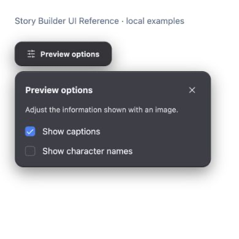</div><figcaption>Derived Preview Options popover: a compact anchored surface with independent selection, without a modal backdrop.</figcaption></figure>

##### Construction

Use Popover, PopoverTrigger asChild and PopoverContent from src/components/ui/popover.tsx. The primitive supplies anchoring, collision handling and dismissal. Override its generic visual defaults with the dark menu family: #3c3e47, 14px radius, black/20 border, control text and the shared button shadow. Use 16px padding for a small form, rather than the menu’s denser row padding.

Keep the heading compact and place the controls directly on this surface. A slate title bar, outer major shell and inner tray would add unnecessary structural weight here. Blue checked states communicate selection; ordinary text and close controls remain neutral.

**What can change:** settings, labels and width. The example uses up to 320px, 16px viewport clearance and an 8px trigger gap. These are derived layout choices, not new global tokens. Longer editing tasks should use the editor-dialog family.

**Behavior:** independent checkboxes update local preview state immediately. There is no Apply footer. Escape and the named close control dismiss the popover and return focus to its trigger. An outside click also dismisses it, while allowing focus to follow that outside interaction. In a product feature, the owner must define whether these are transient or saved preferences.

The surface inherits the dark dropdown family’s fill, border, radius and shadow. Checkbox behavior is supplied by the shared Checkbox; the caller adds the documented blue checked treatment. Both teaching examples are defined in `docs/ui-guide/examples/composition-examples.tsx`.

##### Transfer the Decisions

The anchored surface preserves the surrounding preview because these controls make small immediate changes. Independent settings use checkboxes; a single choice among alternatives uses the existing segmented-choice treatment inside the same surface. A local Reset command uses an ordinary neutral surface button and resets the feature-defined defaults. These roles do not turn the popup into a command menu or require a slate title strip.

In this example the heading is 14px bold, explanatory copy is 12px zinc-300 with relaxed line height, option labels are 14px, and checkbox rows have a 12px gap. Close uses the same 16px X, 6px padding, 8px radius and focus treatment as the teaching modal. Keep these compact type/control relationships while adapting width and arrangement to the actual content. Dismissal ends the popup interaction; it does not undo immediate changes. These composition choices extend existing patterns and are identified as derived guidance.

<details class="implementation">
<summary>Supporting source</summary>

Supporting Production Source

The shared primitive below supplies positioning and interaction. The reference example supplies the dark surface and content.

##### popover.tsx

<p class="source-line">src/components/ui/popover.tsx · lines 1–30</p>

```tsx
import * as React from "react";
import * as PopoverPrimitive from "@radix-ui/react-popover";

import { cn } from "@/lib/utils";

const Popover = PopoverPrimitive.Root;

const PopoverTrigger = PopoverPrimitive.Trigger;

const PopoverContent = React.forwardRef<
  React.ElementRef<typeof PopoverPrimitive.Content>,
  React.ComponentPropsWithoutRef<typeof PopoverPrimitive.Content>
>(({ className, align = "center", sideOffset = 4, ...props }, ref) => (
  <PopoverPrimitive.Portal>
    <PopoverPrimitive.Content
      ref={ref}
      align={align}
      sideOffset={sideOffset}
      className={cn(
        "z-50 w-72 rounded-md border bg-popover p-4 text-popover-foreground shadow-md outline-none data-[state=open]:animate-in data-[state=closed]:animate-out data-[state=closed]:fade-out-0 data-[state=open]:fade-in-0 data-[state=closed]:zoom-out-95 data-[state=open]:zoom-in-95 data-[side=bottom]:slide-in-from-top-2 data-[side=left]:slide-in-from-right-2 data-[side=right]:slide-in-from-left-2 data-[side=top]:slide-in-from-bottom-2",
        className,
      )}
      {...props}
    />
  </PopoverPrimitive.Portal>
));
PopoverContent.displayName = PopoverPrimitive.Content.displayName;

export { Popover, PopoverTrigger, PopoverContent };

```

</details>

</section>
